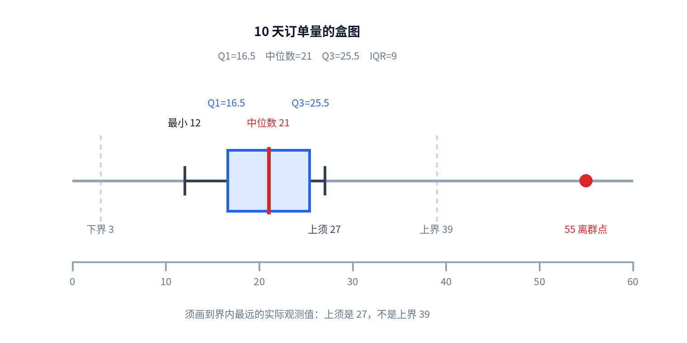

# 0 复习总览

按章排列的核心考点，每条配一道按考试形式出的例题。例题都能手算，答案分步写。

题型：判断、填空、简答、计算。计算题会给出全部数据，考步骤和公式。

## 第 1 章 概述

### 考点 1 · KDD 的七个步骤

**考什么**：简答、填空。

**必记**

- 顺序：数据清理 → 数据集成 → 数据选择 → 数据变换 → 数据挖掘 → 模式评估 → 知识表示。
- 前四步合称预处理。
- 真正的"挖掘"只有第五步，占整个流程的一小块。

**例题**（填空）

知识发现过程中：

1. 把多个数据源合并成一致数据存储的步骤叫（　）。
2. 用智能方法从数据中提取模式的步骤叫（　）。
3. 把结果呈现给用户、支持决策的步骤叫（　）。

**答**

1. 数据集成。
2. 数据挖掘。
3. 知识表示。

### 考点 2 · 四大任务与监督方式

**考什么**：判断、选择。

**必记**

- 有监督：分类（输出类别）、回归（输出数值），训练数据有类标号。
- 无监督：聚类、关联分析，训练数据没有类标号。
- 分类与回归的分界是输出类型，不是数据长得像不像数。

**例题**（判断，说明理由）

1. 预测一套房子的成交价属于分类任务。
2. 把用户按消费行为分成若干群，属于聚类。
3. 从购物小票里发现"买啤酒的人常买尿布"，属于有监督学习。
4. 判断一封邮件是否为垃圾邮件，属于分类。

**答**

1. 错。输出是连续数值，属于回归。
2. 对。没有预先给定的类，按相似性自动分组。
3. 错。关联分析不需要类标号，是无监督的。
4. 对。

## 第 2 章 认识数据

### 考点 3 · 属性四种类型

**考什么**：填空、判断，也是计算题的第一步。

**必记**

- 判据不是"看起来像不像数"，而是**允许哪种运算**。

| 类型 | 判等 | 排序 | 相减 | 相除 |
| --- | --- | --- | --- | --- |
| 标称 | ✓ | ✗ | ✗ | ✗ |
| 序数 | ✓ | ✓ | ✗ | ✗ |
| 区间 | ✓ | ✓ | ✓ | ✗ |
| 比率 | ✓ | ✓ | ✓ | ✓ |

- 标称：学号、邮编、血型。
- 序数：满意度、名次、等级。
- 区间：摄氏温度、年份。
- 比率：年龄、收入、消费额。

**例题**（填空并说明理由）

判断类型：

1. 学号 2023001。
2. 满意度（差/中/好）。
3. 摄氏温度 25℃。
4. 月消费额 0 元。

**答**

1. 标称。差值没有意义，只是编号。
2. 序数。能排序，但"好 − 中"没有确定含义。
3. 区间。差值有意义，但 0℃ 不是"没有温度"，不能说"两倍"。
4. 比率。0 元就是没有消费，是真零，可以算倍数。

### 考点 4 · 非对称二元与相异性矩阵

**考什么**：计算题必考，通常是第一道。

**必记**

- 逐位比对，数四个量：$q$ 两边都是 1，$r$ 左 1 右 0，$s$ 左 0 右 1，$t$ 两边都是 0。

$$
d=\frac{r+s}{q+r+s}
$$

- 分母**不含 $t$**：两人都没买过某商品，不说明两人相似。
- 矩阵对称，对角线为 0。

**例题**（计算）

5 种商品（面包、牛奶、尿布、啤酒、鸡蛋），3 位用户：

| 用户 | 面包 | 牛奶 | 尿布 | 啤酒 | 鸡蛋 |
| --- | --- | --- | --- | --- | --- |
| U1 | 1 | 1 | 0 | 0 | 1 |
| U2 | 1 | 0 | 1 | 0 | 0 |
| U3 | 0 | 1 | 0 | 1 | 1 |

求 $d(U1,U2)$、$d(U1,U3)$、$d(U2,U3)$，写出 3×3 相异性矩阵。

**答**

1. $U1$ 与 $U2$：$q=1$（面包），$r=2$（牛奶、鸡蛋），$s=1$（尿布），$t=1$（啤酒）：

$$
d=\frac{2+1}{1+2+1}=0.75
$$

2. $U1$ 与 $U3$：$q=2$（牛奶、鸡蛋），$r=1$（面包），$s=1$（啤酒），$t=1$（尿布）：

$$
d=\frac{1+1}{2+1+1}=0.5
$$

3. $U2$ 与 $U3$：$q=0$，$r=2$（面包、尿布），$s=3$（牛奶、啤酒、鸡蛋）：

$$
d=\frac{2+3}{0+2+3}=1
$$

4. 矩阵：

$$
D=\begin{pmatrix}
0 & 0.75 & 0.5\\
0.75 & 0 & 1\\
0.5 & 1 & 0
\end{pmatrix}
$$

### 考点 5 · 混合属性的相异性

**考什么**：计算。作业第 2 题就是这个形状。

**必记**

- 三种属性各算各的，最后**按属性个数取平均**。
- 标称：相同 0，不同 1。
- 序数：先换成 $r=\dfrac{rank-1}{M-1}$，再取差的绝对值。
- 数值：先按极差归一化成 $\dfrac{\lvert x_i-x_j\rvert}{\max-\min}$。
- 这里的"数值"**包含区间和比率两种尺度**，两者算距离的方法没有区别。
- 四种尺度是更细的分法；混在矩阵里时，只有标称、序数、数值这三类算法不同。
- 单位换算不影响结果：℃ 换成 K，差值和极差同时平移，比值不变。

$$
d(i,j)=\frac{\sum_{f=1}^{p}\delta_{ij}^{(f)}\,d_{ij}^{(f)}}{\sum_{f=1}^{p}\delta_{ij}^{(f)}}
$$

- 数值项**必须先归一化**，否则一个数额属性就吃掉另外两项。

**例题**（计算）

4 个对象、3 个属性：

| 对象 | Test1（标称） | Test2（序数） | Test3（数值） |
| --- | --- | --- | --- |
| X1 | A | Fair | 45 |
| X2 | B | Good | 22 |
| X3 | A | Excellent | 64 |
| X4 | C | Good | 28 |

序数等级 Fair < Good < Excellent。求 $d(X1,X2)$、$d(X2,X4)$，写 4×4 矩阵。

**答**

1. 序数换算，$M=3$：Fair→0，Good→0.5，Excellent→1。
2. 数值极差 $64-22=42$，归一化后：X1=0.548，X2=0，X3=1，X4=0.143。
3. $d(X1,X2)$：标称 1，序数 $|0-0.5|=0.5$，数值 $|0.548-0|=0.548$：

$$
d=\frac{1+0.5+0.548}{3}=0.683
$$

4. $d(X2,X4)$：标称 1，序数 $|0.5-0.5|=0$，数值 $|0-0.143|=0.143$：

$$
d=\frac{1+0+0.143}{3}=0.381
$$

5. 矩阵：

$$
D=\begin{pmatrix}
0 & 0.683 & 0.484 & 0.635\\
0.683 & 0 & 0.833 & 0.381\\
0.484 & 0.833 & 0 & 0.786\\
0.635 & 0.381 & 0.786 & 0
\end{pmatrix}
$$

6. 最相似 X2 与 X4（0.381），最不相似 X2 与 X3（0.833）。

### 考点 6 · 三种距离

**考什么**：计算，常和曼哈顿距离绑在一起考。

**必记**

- 曼哈顿：各维差取绝对值再累加。
- 欧氏：差的平方和开根号。
- 切比雪夫：只看最大的一维差。

$$
L_1=\sum_i|x_i-y_i|,\qquad
L_2=\sqrt{\sum_i(x_i-y_i)^2},\qquad
L_\infty=\max_i|x_i-y_i|
$$

- 曼哈顿是"街区"走法，欧氏是直线，切比雪夫只看最突出的那一维。

**例题**（计算）

三位顾客的记录（消费额百元、到店次数、停留时间）：

| 顾客 | 消费额 | 次数 | 停留 |
| --- | --- | --- | --- |
| P1 | 2 | 5 | 8 |
| P2 | 5 | 3 | 6 |
| P4 | 1 | 8 | 2 |

求 $d(P1,P2)$ 的三种距离，以及 $d(P1,P4)$ 的曼哈顿距离。

**答**

1. $P1$ 与 $P2$ 的三维差为 $3,2,2$。
2. 曼哈顿：$3+2+2=7$。
3. 欧氏：$\sqrt{9+4+4}=\sqrt{17}\approx4.12$。
4. 切比雪夫：$\max(3,2,2)=3$。
5. $P1$ 与 $P4$ 的差为 $1,3,6$，曼哈顿 $=1+3+6=10$。

### 考点 7 · 中位数、四分位数与盒图

**考什么**：计算，必考。

**必记**

- 位置法：第 $k$ 百分位的位置是 $(n+1)\cdot k/100$。
- 位置非整数时，在相邻两值之间线性插值。
- 四分位极差 $\text{IQR}=Q_3-Q_1$。
- 上界 $=Q_3+1.5\,\text{IQR}$，下界 $=Q_1-1.5\,\text{IQR}$。
- 超出界的观测值是离群点。
- 须画到**界内最远的实际观测值**，不是画到界上。

> 提醒：课件写的是"位置小数部分不为 0 就取相邻两值的平均"，考题说明写的是线性插值，两者只在小数部分恰为 0.5 时相同。下面按考题的线性插值算；按课件则 $Q_1=16$、$Q_3=26$。

**例题**（计算）

10 天订单量，已排序：12, 15, 17, 18, 20, 22, 24, 25, 27, 55。

1. 求 $Q_1$、中位数、$Q_3$。
2. 求 IQR 与上下界，判断离群点。
3. 写五数概括，判断偏斜方向。

**答**

1. $Q_1$ 位置 $=11\times0.25=2.75$：

$$
Q_1=15+0.75\times(17-15)=16.5
$$

2. 中位数位置 $=5.5$：

$$
M=20+0.5\times(22-20)=21
$$

3. $Q_3$ 位置 $=8.25$：

$$
Q_3=25+0.25\times(27-25)=25.5
$$

4. $\text{IQR}=25.5-16.5=9$。
5. 上界 $=25.5+13.5=39$，下界 $=16.5-13.5=3$。
6. 55 超过 39，是离群点。
7. 五数概括：12、16.5、21、25.5、55。
8. 均值 23.5 大于中位数 21，右边的尾巴把均值拉高，是**右偏**。

### 考点 8 · 直方图

**考什么**：计算，一般接在盒图后面。

**必记**

- 等宽分箱，区间左闭右开 $[a,b)$，最后一箱右端闭合。
- 频率 = 频数 ÷ 总数。
- 单独落在一箱里的值，一眼能看出是离群点。

**例题**（计算）

沿用上题 10 个数，以 10 为起点、组距 10 分箱，写频数与频率。

**答**

| 区间 | 频数 | 频率 |
| --- | --- | --- |
| [10,20) | 4 | 0.4 |
| [20,30) | 5 | 0.5 |
| [30,40) | 0 | 0 |
| [40,50) | 0 | 0 |
| [50,60] | 1 | 0.1 |

55 单独落在最后一箱。

### 考点 9 · 余弦相似性

**考什么**：计算、判断。

**必记**

- 只看向，不看长度。

$$
\text{sim}=\frac{\mathbf v_1\cdot\mathbf v_2}{\lVert\mathbf v_1\rVert\,\lVert\mathbf v_2\rVert},\qquad d=1-\text{sim}
$$

- 文本向量非负，相似度落在 $[0,1]$。
- 长度不同但方向相同，相似度仍为 1。

**例题**（计算）

词表（数据、挖掘、算法），$\mathbf v_1=(1,1,0)$，$\mathbf v_2=(1,0,1)$。求相似度与距离。

**答**

1. 点积 $=1$。
2. 两个模都是 $\sqrt2$。
3. 相似度 $=1/2=0.5$。
4. 距离 $=1-0.5=0.5$。

## 第 3 章 数据预处理

### 考点 10 · 缺失值与噪声

**考什么**：简答、计算。

**必记**

- 缺失值：丢弃、填补（均值、中位数、众数、同类均值、回归插值）、忽略。
- 噪声：排序 → 等频切箱 → 箱均值 / 箱中位数 / 箱边界平滑。
- 箱边界平滑：每个值换成**更近的那个边界**。
- 边界平滑不改变极端值，所以比均值平滑更抗破坏。

**例题**（计算）

数据 4, 8, 15, 21, 21, 24, 25, 28, 34，等频分 3 箱，写箱均值平滑与箱边界平滑的结果。

**答**

1. 三箱：{4, 8, 15}、{21, 21, 24}、{25, 28, 34}。
2. 箱均值：9、22、29，结果为 9,9,9, 22,22,22, 29,29,29。
3. 箱 1 边界 4 与 15：4→4，8→4，15→15。
4. 箱 2 边界 21 与 24：三点落在边界上，不变。
5. 箱 3 边界 25 与 34：25→25，28→25，34→34。
6. 边界平滑结果：4,4,15, 21,21,24, 25,25,34。

### 考点 11 · 三种规范化

**考什么**：计算，常给一列数让你三种都算。

**必记**

- 最小-最大：把值线性压到指定区间。
- z-score：减均值除标准差。
- 小数定标：除以 $10^j$，$j$ 取使 $\max|v'|<1$ 的最小整数。

$$
v'=\frac{v-\min}{\max-\min},\qquad
v'=\frac{v-\bar v}{\sigma},\qquad
v'=\frac{v}{10^{j}}
$$

**例题**（计算）

数据 20, 40, 60, 80, 100。

1. 最小-最大到 $[0,1]$。
2. z-score（总体标准差）。
3. 小数定标，写出 $j$。

**答**

1. 最小-最大：分母 80，结果 0, 0.25, 0.5, 0.75, 1。
2. 均值 60，标准差 $\sqrt{800}\approx28.28$。
3. z-score：$-1.414,\ -0.707,\ 0,\ 0.707,\ 1.414$。
4. 小数定标：$j=2$，结果 0.2, 0.4, 0.6, 0.8, 1.0。

### 考点 12 · 数据归约

**考什么**：判断、简答。

**必记**

- 三条路：维归约（属性子集、PCA）、数量归约（抽样、直方图、聚类、回归）、数据压缩（小波）。
- 抽样三种：简单随机、分层、簇。
- PCA 属于维归约，减少的是列。
- 回归归约属参数化：只存参数，参数个数固定。

**例题**（判断）

1. 有放回地随机抽样本属于分层抽样。
2. 先按性别分层再在层内随机抽，能保证每层都有代表。
3. PCA 属于数量归约。
4. 用回归模型只保留参数，属于参数化归约。

**答**

1. 错，是简单随机抽样。
2. 对。
3. 错，PCA 减少的是列，属维归约。
4. 对。

## 第 4 章 关联规则

### 考点 13 · 支持度、置信度、提升度

**考什么**：计算、简答，常作 Apriori 大题的第一问。

**必记**

- 支持度：这条规则覆盖多少数据。
- 置信度：前件成立时后件有多可靠。
- 提升度：把"后件本身就很常见"的影响扣掉。

$$
\text{supp}(X)=\frac{\#(X)}{N},\qquad
\text{conf}(X\to Y)=\frac{\text{supp}(X\cup Y)}{\text{supp}(X)},\qquad
\text{lift}=\frac{\text{conf}}{\text{supp}(Y)}
$$

- lift > 1 正相关，= 1 独立，< 1 负相关。

**例题**（计算）

4 笔交易：T1 面包牛奶；T2 面包尿布啤酒；T3 牛奶尿布啤酒；T4 面包牛奶尿布。

求"面包 → 牛奶"的三个指标。

**答**

1. $\text{supp}(\text{面包}\cup\text{牛奶})=2/4=0.5$。
2. $\text{supp}(\text{面包})=3/4=0.75$。
3. $\text{supp}(\text{牛奶})=3/4=0.75$。
4. 置信度 $=0.5/0.75=0.667$。
5. 提升度 $=0.667/0.75=0.889$。
6. lift < 1，买面包的人反而不太买牛奶，弱负相关。

### 考点 14 · Apriori 逐层搜索与剪枝

**考什么**：计算，重点大题。

**必记**

- 三步循环：连接 → 剪枝 → 计数。
- 连接：前 $k-2$ 项相同的两个 $k-1$ 项集，拼成 $k$ 项候选。
- 剪枝：候选的**所有** $k-1$ 子集都必须在 $L_{k-1}$ 里，否则不进候选。
- 计数：支持度不够的删掉。
- 某一层为空就停。

**例题**（计算）

沿用考点 13 的 4 笔交易，最小支持度计数 2，写 L1、L2、L3，说明终止。

**答**

1. L1：面包 3、牛奶 3、尿布 3、啤酒 2。
2. L2 候选 6 个，计数后保留：面包牛奶 2、面包尿布 2、牛奶尿布 2、尿布啤酒 2。
3. 淘汰：面包啤酒 1、牛奶啤酒 1。
4. L3 候选 {面包, 牛奶, 尿布}：三个 2-子集都在 L2，计数 2，保留。
5. {牛奶, 尿布, 啤酒} 缺 {牛奶, 啤酒}，剪掉。
6. {面包, 尿布, 啤酒} 缺 {面包, 啤酒}，剪掉。
7. 所以 $L_3$ 只有一个：{面包, 牛奶, 尿布}:2。
8. L4 无法生成，$L_4$ 为空，终止。

### 考点 15 · 由频繁项集生成强规则

**考什么**：计算，Apriori 大题的后半段。

**必记**

- 对每个频繁项集，枚举非空真子集 $X$，剩下部分作 $Y$。
- 分子永远是项集的支持度，变的是分母（前件的支持度）。
- 前件越常见，分母越大，置信度越低。

**例题**（计算）

接上题，最小置信度 0.7。对 {面包, 牛奶, 尿布}（支持度 2）列出强规则。

**答**

1. 六条规则的分子都是 2。
2. 前件是两个商品（支持度 2）：面包∧牛奶→尿布、面包∧尿布→牛奶、牛奶∧尿布→面包，置信度都是 $2/2=1.000$，全是强规则。
3. 前件是一个商品（支持度 3）：面包→牛奶∧尿布、牛奶→面包∧尿布、尿布→面包∧牛奶，置信度都是 $2/3=0.667$，低于 0.7，不选。
4. 结论：三条两商品前件的规则是强规则。

## 第 5 章 分类

### 考点 16 · 分类流程与过拟合

**考什么**：简答、判断。

**必记**

- 五步：获取数据 → 预处理 → 划分训练集与测试集 → 训练 → 测试。
- 训练集与测试集不能混用。
- 训练准确率远高于测试准确率 = 过拟合。
- 两者都低 = 欠拟合。
- 成因：模型太复杂、样本太少或噪声太多。
- 对策：剪枝、加样本、正则化、用验证集调参。

**例题**（简答）

某模型训练集准确率 99.2%，测试集 61%。判断问题，说两点原因、两点对策。

**答**

1. 问题：过拟合。
2. 原因：模型太复杂，把训练集噪声也学了；训练样本太少。
3. 对策：剪枝或降低模型复杂度；增加样本或加正则化。
4. 补充：调参要另切验证集，不能拿测试集反复试，那叫数据泄漏。

### 考点 17 · K-近邻

**考什么**：计算、简答。

**必记**

- 找最近的 $k$ 个训练样本，按**多数类**投票。
- 没有训练阶段，训练集就是模型。
- $k$ 小对噪声敏感，$k$ 大边界模糊。
- 量纲不同时先归一化。

**例题**（计算）

训练点：P1(0,0) 类 A，P2(1,1) 类 A，P3(2,1) 类 B，P4(1,3) 类 B，P5(3,3) 类 B。新样本 Q(1,1.5)。

问 $k=1$ 与 $k=3$ 时分别判成哪类。

**答**

1. 距离：P1 1.80，P2 0.50，P3 1.12，P4 1.50，P5 2.50。
2. $k=1$：最近 P2，判 A。
3. $k=3$：P2(A)、P3(B)、P4(B)。
4. B 得两票，判 B。
5. $k$ 变了结论就变，说明 $k$ 的选择直接影响结果。

### 考点 18 · 决策树

**考什么**：计算（走树）、简答（写规则）。

**必记**

- 内部结点是属性，边是属性取值，叶子是类别。
- 判断新样本：从根开始按属性值走分支。
- 规则写法：把每条根到叶的路径写成合取，再用"或"连起来。
- 属性顺序的三种选法：信息增益、增益率、Gini 指标。

**例题**（计算）

打球决策树：

- Outlook=Sunny：看 Humidity，High 判否，Normal 判是。
- Outlook=Overcast：直接判是。
- Outlook=Rain：看 Wind，Strong 判否，Weak 判是。

判断 D15(Sunny, High, Strong)、D16(Rain, Normal, Weak)。

**答**

1. D15：Sunny → Humidity=High → 否。
2. D16：Rain → Wind=Weak → 是。
3. D16 的陷阱是 Humidity=Normal，但在 Rain 分支下它不参与判断。
4. 规则：(Sunny ∧ Normal) ∨ (Overcast) ∨ (Rain ∧ Weak) → 是。

### 考点 19 · 朴素贝叶斯

**考什么**：计算、简答。

**必记**

- 假设各属性条件独立。
- 分母相同，比较时可以不除。
- 取后验最大的类。

$$
P(c\mid x)\propto P(c)\prod_i P(x_i\mid c)
$$

**例题**（计算）

6 条记录：晴且打球 2 条，晴不打 1 条，雨打球 1 条，雨不打 2 条。预测"晴"时打不打球。

**答**

1. $P(打)=3/6=0.5$，$P(不打)=0.5$。
2. $P(晴|打)=2/3$，$P(晴|不打)=1/3$。
3. 打：$0.5\times2/3=0.333$。
4. 不打：$0.5\times1/3=0.167$。
5. 前者大，判"打球"。

### 考点 20 · SVM 与核函数

**考什么**：简答，去年原题。

**必记**

- 数据是 $d$ 维向量，目标是找 $d-1$ 维超平面把两类分开。
- 可行超平面有无穷多条，选**边距最大**的那条。
- 决策边界叫最大边距超平面。
- 离边界最近的点叫支持向量，解只由它们决定。
- 线性不可分时用核方法：隐式映射到高维，在高维里线性分开。
- 核函数只算内积，不显式算出高维坐标。

**例题**（简答）

SVM 的核心思想？核函数的作用？

**答**

1. 核心思想：在特征空间里找超平面分开两类，并让两类到超平面的最小距离最大。
2. 为什么选最大边距：对噪声更稳健，泛化更好。
3. 支持向量的作用：最终模型只由它们决定，其他点删掉不影响结果。
4. 核函数的作用：原始空间线性不可分时，用核函数把样本隐式映射到高维，使之线性可分。
5. 好处：只算内积，避免显式的高维计算。

### 考点 21 · 集成学习

**考什么**：判断、简答。

**必记**

- Bagging：有放回抽样，各轮独立，可并行，等权投票。
- Boosting：训练集不变，调样本权重，串行，好模型权重大。
- 随机森林是 Bagging 的变体。
- AdaBoost、GBDT、XGBoost 属于 Boosting。

**例题**（判断）

1. 随机森林的各棵树可以并行训练。
2. Boosting 每轮重新抽样得到新训练集。
3. AdaBoost 会提高被错分样本的权重。
4. Bagging 对每个基学习器的投票权重不同。

**答**

1. 对。
2. 错，训练集不变，变的是权重。
3. 对。
4. 错，等权。

## 第 6 章 聚类

### 考点 22 · K-means

**考什么**：简答，去年原题。

**必记**

- 五步：选 $k$ 个初始中心 → 样本归最近中心 → 每簇算均值当新中心 → 重新分配 → 重复后两步直到不变。
- 目标是最小化误差平方和。

$$
\text{SSE}=\sum_{i=1}^{k}\sum_{x\in C_i}\lVert x-\mu_i\rVert^2
$$

- 优点：球状簇紧凑，对大数据集高效。
- 缺点：$k$ 要预先给、对初值敏感、对噪声敏感。

**例题**（简答）

简述 k-means 步骤与优缺点。

**答**

1. 随机选 $k$ 个点作初始中心。
2. 每个样本归到最近的中心，形成 $k$ 簇。
3. 每簇重算均值，作为新中心。
4. 重复分配与更新，直到簇不再变化。
5. 优点：簇内紧凑，复杂度随样本数线性增长。
6. 缺点一：$k$ 必须事先指定。
7. 缺点二：初值不好会停在局部最优。
8. 缺点三：均值受离群点影响，一个点就能拉偏中心。
9. 改进：多跑几次取最优；用 k-medoids 把中心换成实际点。

### 考点 23 · 聚类有效性

**考什么**：简答，去年原题。

**必记**

- 外在方法：有基准可比，如 purity、NMI、RI、ARI。
- 内在方法：没有基准，看簇内紧、簇间开，如 WSS、BSS。
- WSS 越小越好，BSS 越大越好。

$$
\text{WSS}=\sum_i\sum_{x\in C_i}(x-m_i)^2,\qquad
\text{BSS}=\sum_i|C_i|(m-m_i)^2
$$

$$
\text{purity}=\frac{\sum_i\text{第 }i\text{ 簇中多数类的个数}}{N}
$$

**例题**（计算）

两簇 $C_1=\{1,2,3\}$，$C_2=\{8,9,10\}$，求 WSS 与 BSS。

**答**

1. $m=5.5$，$m_1=2$，$m_2=9$。
2. WSS：$1+0+1+1+0+1=4$。
3. BSS：$3\times(5.5-2)^2+3\times(5.5-9)^2$。
4. $=36.75+36.75=73.5$。
5. 结论：WSS 小、BSS 大，这个划分好。

### 考点 24 · DBSCAN

**考什么**：计算（判点）、简答（优缺点）。

**必记**

- 两个参数：ε 与 MinPts。
- 核心点：ε-邻域内点数 ≥ MinPts。
- 边界点：自己不是核心点，但落在某核心点邻域内。
- 噪声：两者都不是。
- 簇：密度相连点的最大集合。
- 优点：任意形状、抗噪。
- 缺点：两个参数全局唯一，密度不均时失效。

**例题**（计算）

1. 一维点 0、0.5、1、1.5、3，ε=0.6，MinPts=3（含自己）。判断身份，写出簇。
2. 二维点 $A(0,0)$、$B(0.5,0)$、$C(0,0.5)$、$D(3,3)$、$E(3.2,3.1)$、$F(6,6)$，ε=1，MinPts=3。哪些是核心点，哪些是噪声？

**答**

1. 0.5 的邻域含 0、0.5、1，共 3 个，核心点。
2. 1 的邻域含 0.5、1、1.5，共 3 个，核心点。
3. 0 的邻域只有 2 个，但在 0.5 的邻域内，边界点。
4. 1.5 同理，边界点。
5. 3 孤立，噪声。
6. 簇：{0, 0.5, 1, 1.5}。
7. 第二问：A、B、C 两两距离都小于 1，各有 3 个邻居，都是核心点，连成一个簇。
8. D 与 E 相距 0.22，但各只有 2 个邻居，不是核心点，也不在任何核心点邻域内，都是噪声。
9. F 孤立，噪声。

### 考点 25 · 层次聚类

**考什么**：计算。

**必记**

- 凝聚式：每点一簇，反复合并最近的两簇。
- 单链：簇间距离取最近点对。
- 全链：取最远点对。
- 平均链：取所有跨簇点对的均值。
- 结果画成树状图，横切一刀就是聚类结果。

**例题**（计算）

一维点 1、3、7、9。用单链写合并顺序与高度；用全链求最后一步高度。

**答**

1. 距离：$d(1,3)=2$，$d(7,9)=2$，$d(3,7)=4$。
2. 单链第一步：{1,3} 与 {7,9}，高度都是 2。
3. 两簇最近点对是 3 与 7，距离 4，最后在高度 4 合并。
4. 全链：最远点对是 1 与 9，距离 8，最后一步高度 8。
5. 分成两簇切在 2 与 4 之间，得 {1,3} 与 {7,9}。

## 第 7 章 回归

### 考点 26 · 一元线性回归

**考什么**：简答，去年原题。

**必记**

- 模型 $\hat y=\beta_0+\beta_1x$。
- 损失是残差平方和。

$$
\text{RSS}=\sum(y_i-\hat y_i)^2
$$

- 最小二乘解：

$$
\beta_1=\frac{S_{xy}}{S_{xx}},\qquad \beta_0=\bar y-\beta_1\bar x
$$

- $S_{xy}=\sum(x_i-\bar x)(y_i-\bar y)$，$S_{xx}=\sum(x_i-\bar x)^2$。

**例题**（计算）

数据 $(1,2),(2,3),(3,5),(4,6)$。求回归方程与 $R^2$。

**答**

1. $\bar x=2.5$，$\bar y=4$。
2. $S_{xy}=3+0.5+0.5+3=7$。
3. $S_{xx}=2.25+0.25+0.25+2.25=5$。
4. $\beta_1=7/5=1.4$。
5. $\beta_0=4-1.4\times2.5=0.5$。
6. 方程：$\hat y=1.4x+0.5$。
7. 预测值 1.9、3.3、4.7、6.1，残差平方和 $0.01+0.09+0.09+0.01=0.2$。
8. $SST=4+1+1+4=10$。
9. $R^2=1-0.2/10=0.98$。

### 考点 27 · 多元回归与 R²

**考什么**：简答、填空。

**必记**

- 正规方程：$\hat{\boldsymbol\beta}=(\mathbf X^T\mathbf X)^{-1}\mathbf X^T\mathbf Y$。
- $\mathbf X^T\mathbf X$ 不可逆的三个原因：属性线性相关、样本数少于属性数、某属性全为常数。
- $R^2$ 随属性增加只升不降，比较模型要用调整 $R^2$。

$$
R^2=1-\frac{\text{SSE}}{\text{SST}},\qquad
R^2_{\text{adj}}=1-(1-R^2)\frac{n-1}{n-p-1}
$$

**例题**（计算）

$n=10$、$p=2$、$R^2=0.90$，求调整 $R^2$。

**答**

1. 代入公式：$1-(1-0.9)\times\dfrac{9}{7}$。
2. $=1-0.1\times1.286=1-0.129$。
3. 结果 0.871。

### 考点 28 · 逻辑回归与正则化

**考什么**：填空、判断。

**必记**

- sigmoid 把线性打分压成概率。

$$
\pi=\frac{1}{1+e^{-\boldsymbol w^T\boldsymbol x}}
$$

- $\pi>0.5$ 判正类，等价于 $\boldsymbol w^T\boldsymbol x>0$。
- 损失是交叉熵。

$$
L=-\sum\left[y\log\pi+(1-y)\log(1-\pi)\right]
$$

- L1（Lasso）把部分系数压到恰好 0，产生稀疏解。
- L2（Ridge）只把系数压小，不为 0。

**例题**（判断）

1. 逻辑回归输出 0 到 1 之间的概率。
2. 逻辑回归的决策边界是 $\boldsymbol w^T\boldsymbol x=0$。
3. L2 正则化能让部分系数恰好等于 0。
4. 真实类别为 1、模型给出 0.1 时，交叉熵损失很大。

**答**

1. 对。
2. 对。
3. 错，那是 L1。
4. 对，$-\log 0.1=2.303$。

## 易错清单

来自一轮完整模拟（13 题）的失分点。考前只看这一节。

### 交卷前四条自查

- 盒图：须画到界内最远的观测值，不是画到界上。
- Apriori：数完必须回到阈值比一次，小于阈值就删。
- 回归：$\text{SST}$ 用 $y$ 算，$\sum(x_i-\bar x)^2$ 是分母，两者不能混。
- 矩阵：写完检查对称、对角为 0、每行 $q+r+s+t$ 等于属性数。

### 计算题的收尾

- 盒图的上须：上界是算出来的（例：31.5），须画到界内最远观测值（例：18）。
- 中位数：$n$ 为奇数取第 $(n+1)/2$ 个，$n$ 为偶数才取中间两值平均。
- Apriori：$\{A,B,C\}$ 计数 1 小于阈值 2 时必须删；$L_3$ 为空就没有强规则。
- 回归：$\sum(x_i-\bar x)^2$ 是 $\beta_1$ 的分母；$\text{SST}=\sum(y_i-\bar y)^2$。
- 相异性矩阵：逐列对齐数 $q,r,s,t$，漏一个共同的 1 就会把 $q$ 少数。

### 公式的分母

- 序数属性：$r=\dfrac{rank-1}{M-1}$。三级之间只有两段间隔，除以 2 不是 3。
- 余弦：分母是两个模长的乘积 $|\boldsymbol v_1|\cdot|\boldsymbol v_2|$，不是模长相加。
- 余弦距离：$d=1-\text{sim}$。相似度越像越接近 1，距离越像越接近 0。
- 置信度：一定落在 $[0,1]$，算出大于 1 说明分子分母用反了。

### 概念题的要点

- KDD 预处理是前四步：清洗、集成、选择、变换。
- 预处理占整个流程的 60%～80%，真正的挖掘只占 10% 左右。
- 数据清洗解决质量问题，数据变换统一取值形态，数据归约缩小数据量。
- k-means 三个缺点：$k$ 要预先给定、对初值敏感、对噪声敏感。
- 聚类内在评估：WSS 越小越好，BSS 越大越好，两者之和等于总平方和。
- SVM：找 $d-1$ 维超平面；最大边距指两类之间的隔离带最宽；支持向量是落在隔离带边界上的点。
- 常见核：线性核、多项式核、高斯核（RBF）。
- 分类五步：收集数据 → 预处理 → 划分 → 训练 → 评估。
- 过拟合三个办法：正则化、剪枝或简化模型、增加数据。

### 判断题

- 随机森林属于 Bagging，可以并行；Boosting（AdaBoost、GBDT、XGBoost）才串行。
- 只写“对”“错”不给分，理由要写出判断依据。
- 数字只当编号用（学号、邮编）就是标称属性，不能做算术。

### DBSCAN

- 邻域包含自己，$\text{MinPts}=3$ 表示算上自己一共 3 个点。
- 邻居够数是核心点；邻居不够但落在核心点邻域里是边界点；都不满足是噪声。
- 密度可达有方向，密度相连靠共同上游、是对称的。
