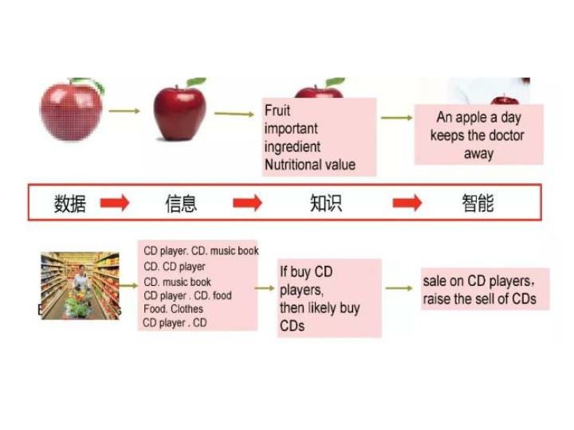
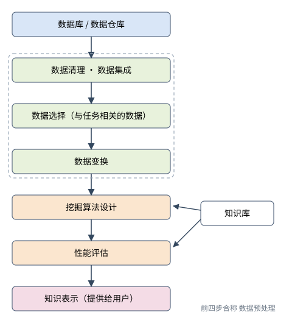
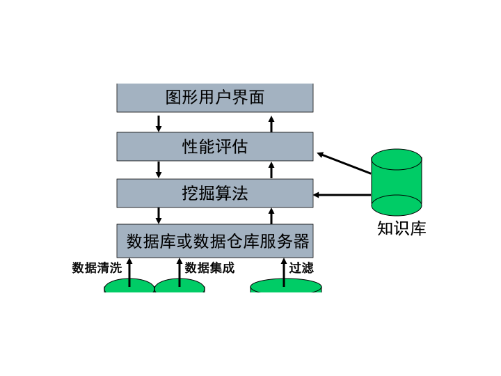
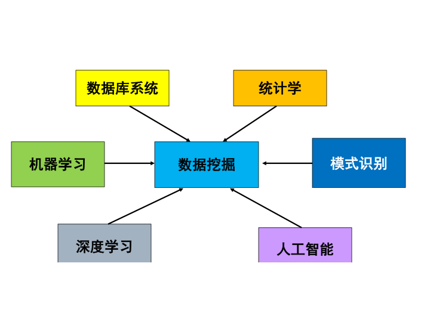

# 1 概述

一句话：数据库能存、能查、能统计，却==发现不了数据里的关系和规则==，也预测不了趋势；数据挖掘就是从大量含噪数据里自动挖出隐含的、事先不知道的、潜在有用的知识，并且走完一条固定的七步流水线。

## 0 读这一章之前

- **前置知识**：无，从零开始；本章只立概念，不涉及计算。
- **一句话概括**：本章回答三个问题——==数据挖掘是什么、能干什么、全过程怎么走==。
- **三个新词**：**KDD**（知识发现的完整流程）、**有监督 / 无监督**、**分类 / 回归 / 聚类 / 关联规则**。
- **课件标的重点**（第 19 页「主要目标」）：==数据挖掘的概念、数据挖掘的任务、挖掘过程==。只看两节的话，看 1.2.2 与 1.4。

## 总览（思维导图）

$$
\text{第 1 章 概述}
\begin{cases}
1.1\ \text{背景}:\ \text{数据爆炸},\ \text{库能查不能掘}\\
1.2\ \text{基本概念}
\begin{cases}
\text{数据}\to\text{信息}\to\text{知识}\to\text{智慧}\\
\text{定义}:\ \text{海量含噪数据}\to\text{隐含未知有用}
\end{cases}\\
1.3\ \text{发展历史}:\ \text{数据访问}\to\text{仓库}\to\text{大数据}\to\text{AI 原生}\\
1.4\ \text{挖掘过程}:\ \text{清}\to\text{集}\to\text{选}\to\text{变}\to\text{挖}\to\text{评}\to\text{表}\\
1.5\ \text{主要任务}:\ \text{预测（分类、回归）},\ \text{描述（聚类、关联）}\\
1.6\ \text{相关学科}:\ \text{数据库}\times\text{机器学习}\times\text{统计学}\\
1.7\ \text{应用}:\ \text{信用评分、逾期、流失、欺诈}\\
1.8\ \text{研究热点}:\ \text{大模型、图、可信、多模态与因果}
\end{cases}
$$

# 1.1 背景

> [!tip] 人话
> 数据自己往硬盘里长，长得比人能读的快得多；数据库只会「查」，不会「想」，于是需要一个==自动从数据里提炼规律==的技术。

- **数据爆炸**：二十世纪末以来全球信息量急剧增长，据估计==每二十个月增加一倍==；规模从 TB 走向 PB。
- **数据从哪来**：
  - 自动数据收集工具、数据库系统、Web、计算机化的社会提供了收集与可获得性；
  - 商业：Web、电子商务、交易数据、股市……
  - 科学：遥感、生物信息学、科学模拟；
  - 社会及每个人：新闻、数码相机、微信、抖音。
- **瓶颈**：数据库系统能高效实现数据的录入、查询、统计，但==无法发现数据中存在的关系和规则==，也无法根据现有数据预测未来趋势。
- **出路**：我们被数据所淹没，但渴望知识，于是数据挖掘技术应运而生——数据挖掘就是==海量数据的自动分析技术==。

# 1.2 基本概念

## 1.2.1 数据、信息、知识、智慧

> [!tip] 人话
> 同样的东西往上叠四层：==原始符号是数据，加工过的是信息，信息之间连起来是知识，拿知识去解决问题才叫智慧==。

### 数据

- **定义**：对客观事件进行记录并可以鉴别的符号，是对客观事物的性质、状态以及相互关系等进行记载的==物理符号或这些物理符号的组合==。
- **存放**：可能存储在数据库、数据仓库和其他信息资料库中。
- **类型**：连续型（数值）；离散型（标称、二元）；符号、字符。
- **主要问题**：不一致、错误、缺失等。

### 信息

- **定义**：具有时效性的、有一定含义的、有逻辑的、经过加工处理的、==对决策有价值的数据流==。
- 关键在「加工过」：同一批数据按含义组织起来，才成为信息。

### 知识

- **定义**：人们实践经验的结晶且为新的实践所证实；是关于事物运动的状态和状态变化的规律；是对信息加工提炼所获得的==抽象化产物==。
- **另一种表述**：把有关信息关联在一起所形成的信息结构；它反映了客观世界中事物之间的关系，不同事物或相同事物间的不同关系形成不同的知识。
- **形式**：可能是模式、关联、变化、异常以及其他有意义的结构。
- **例子**：「雪是白色的」是**事实**；「如果头痛且流涕，则有可能患了感冒」是**规则**。

### 智慧

- **定义**：人类基于已有的知识，针对物质世界运动过程中产生的问题，根据获得的信息进行分析、对比、演绎，==找出解决方案的能力==。
- 这种能力运用的结果，是把信息中有价值的部分挖掘出来，使之成为知识架构的一部分。

四层的关系可以压成一条链：

$$
\text{数据}\xrightarrow{\ \text{加工处理}\ }\text{信息}\xrightarrow{\ \text{建立联系}\ }\text{知识}\xrightarrow{\ \text{串联新关系}\ }\text{智慧}
$$

## 1.2.2 数据挖掘的定义

> [!tip] 人话
> 数据一个比一个大、一个比一个脏，人看不过来——所以让算法替人从里面==翻出点头的、没预料到的规律==。

**技术角度的定义**：数据挖掘（Data Mining）是从==大量的、不完全的、有噪声的、模糊的、随机==的实际应用数据中，提取==隐含在其中的、人们事先不知道的、但又是潜在有用==的信息和知识的过程。

定义里包含三层含义：

1. **数据源**是真实的、海量的、含噪声的。
2. 发现的是==用户感兴趣的知识==；发现的知识要可接受、可理解、可运用。
3. 并不要求发现放之四海皆准的知识，==仅支持特定的发现问题==。

### 与传统数据分析方法的区别

数据挖掘要处理的四类难处（课件列的正是这四条）：

- **海量数据**：算法要有高度的可扩展性，能有效处理 TB 级数据。
- **高维数据**：维数可高达数万个。
- **数据的高度复杂性、非结构化**：文本、图像、视频和 Web 数据；时序数据；图、社会网络、多关系数据；异构数据。
- **噪声数据**：数据里带误差与异常。

### 并非所有和数据相关的任务都是数据挖掘

下列系统==不是数据挖掘系统==：

- 数据库系统
- 信息系统
- 数据统计分析系统

三点区别：

1. 相比上述系统，数据挖掘系统==关注更广的范围，是多学科的融合==。
2. 数据挖掘要发现那些==不能靠直觉发现==、甚至违背直觉的信息或知识。
3. 挖掘出的信息==越是出乎意料，就可能越有价值==。

# 1.3 发展历史

> [!tip] 人话
> 三十年里变化的是「能挖什么」和「谁来挖」：从一张关系表，到一个数据湖，再到==大模型和智能体自己去试==。

## KDD 这个词从哪来

- **1989 年 8 月**，在美国底特律召开的第 11 届国际人工智能联合会议（IJCAI）的专题讨论会上，首次出现==数据库中的知识发现（Knowledge Discovery in Database，KDD）==这一术语。
- 1991、1993、1994 年都举行了 KDD 专题讨论会，汇集各领域的研究人员与应用开发者，集中讨论数据统计、海量数据分析算法、知识表示、知识运用等问题。
- 最初，数据挖掘只是 KDD 中==利用算法处理数据的一个步骤==；其后逐渐演变成 KDD 的同义词。现在人们往往不加区别地使用「数据挖掘」和「KDD」。

## 五个演进阶段

| 进化阶段 | 商业问题 | 支持技术 | 产品特点 |
| --- | --- | --- | --- |
| 数据访问（20 世纪 80 年代） | 在天津去年三月的销售额是多少？ | 关系数据库（RDBMS）、结构化查询语言（SQL）、ODBC | 在记录级提供历史性的、动态数据信息 |
| 数据仓库（20 世纪 90 年代） | 在天津去年三月的销售额是多少？据此可得出什么结论？ | 联机分析处理（OLAP）、多维数据库、数据仓库 | 在各种层次上提供回溯的、动态的数据信息 |
| 大数据分布式处理（21 世纪 00 年代） | 如何处理社交媒体、移动设备产生的海量异构数据，挖掘用户行为规律？ | Hadoop、NoSQL、分布式存储、MapReduce | 支持 PB 级海量异构数据的分布式批处理，兼容非结构化数据 |
| 深度学习与智能自动化（21 世纪 10 年代） | 如何自动识别海量数据中的复杂模式，实现精准预测与多模态识别？ | 深度学习、GPU 加速、流计算、AutoML | 自动特征工程，支持文本／图像多模态数据，分析精度大幅提升 |
| AI 原生与数据智能（21 世纪 20 年代至今） | 如何用自然语言直接查询数据，让业务人员无需技术知识就能获取洞察？ | 大语言模型、向量数据库、MLOps、湖仓一体 | 自然语言交互，自助式分析，统一数据与 AI 工作流 |

> [!note] 注
> 课件原表另有一列「厂家」（如 Oracle、Sybase、Cognos、Cloudera、Databricks、OpenAI 等），与本课程考点无关，这里省略。

## 当前的技术走向

- **大模型**：用于从大规模数据中提取有用的信息和知识；通过学习更复杂的模式和关系，更准确地进行预测和分类。
- **结构化数据基础模型（LDM，Large Data Model）**：让基础模型直接学习不同结构化数据中的==变量关系、条件关系和生成机制==。例如 TabPFN-3.5（SAP，预训练后直接做分类、回归、时序预测与异常检测，原生支持到百万行级）、LimiX-2（国内团队，400M 参数，学跨变量、跨样本的联合依赖结构）。
- **AutoML**：自动化数据处理、模型选择、超参数优化，简化机器学习流程；主要算法有神经架构搜索（NAS）、贝叶斯优化、遗传算法、强化学习与各类元学习算法。
- **AutoFE（自动化特征工程）**：做特征选择、生成和转换，是 AutoML 工作流中数据预处理的一部分；工具有开源库（Featuretools、AutoFeat、TSFresh）、商用低代码平台（FineDataLink、DataWorks、DataExplorer）与一站式数据平台（FDL、Databricks、Snowflake）。
- **AI 数据科学代理**：从「辅助写代码」走向==自动迭代实验==。框架有 AutoGen（微软，多智能体协作）、LangGraph（循环控制、状态管理、人机交互）、Phidata（把大模型变成产品中的 Agent）；DS-STAR（谷歌）用「数据分析—顺序规划—结果验证—方案修正」的循环处理多表、文本与异构文件。

# 1.4 挖掘过程 KDD

> [!tip] 人话
> 七步流水线：==清 → 集 → 选 → 变 → 挖 → 评 → 表==。前四步都在「把数据弄干净、弄成算法吃得下的样子」，真正调算法只有第五步。

七步按顺序是：

1. **数据清理**：消除噪声或不一致的数据。课件特别注明：==这一步可能要占全过程 60% 的工作量==。
2. **数据集成**：多种数据源组合到一起。
3. **数据选择**：从数据库中提取与分析任务相关的数据。
4. **数据变换**：变换或统一成适合挖掘的形式。
5. **挖掘算法设计**：用适当的算法找到感兴趣的模式或预测结果。
6. **性能评估**：对得到的模式或预测结果做评估。
7. **知识表示**：把知识呈现给用户。

> 前四步在课件里被括号合称==数据预处理==。

## 数据预处理

- **为什么需要**：KDD 的处理对象是大量长期积累的数据，一般存在数据库系统里，往往==不适合直接在上面挖掘==，要先做准备。
- **包含五件事**：
  - 数据的选择——选择相关数据；
  - 净化——消除噪声、冗余数据；
  - 推测——推算缺值数据；
  - 转换——离散型数据与连续型数据之间的转换；
  - 数据缩减——减少数据量。
- **地位**：数据预处理是 KDD 的第一个步骤，也是比较重要的一个步骤；==数据准备得好坏直接影响挖掘的效率和准确度，以及最终模式的有效性==。

## 挖掘算法设计

- 这是==最为关键==的步骤：根据 KDD 的目标选取相应算法与参数，分析数据，得到可能形成知识的模式或模型。
- 目前采用较多的算法：关联规则、决策树、SVM、神经网络、k-means、线性回归等。

## 性能评估与知识表示

- **性能评估**：得到的模式大部分是==用数学手段描述的表达式==，很难被人理解，还需要把它解释成可理解的方式呈现给用户。
- **知识表示**：主要目的是==为了运用==。运用知识有两种方法：
  1. 只需看知识本身所描述的关系或结果，就可以对决策提供支持；
  2. 要求对新的数据运用知识，由此可能产生新的问题，需要对知识做进一步优化。
- **整个过程是循环的**：KDD 可能需要多次的循环反复，==任何一个步骤一旦与预期目标不符，都要回到前面的步骤重新调整、重新执行==。

## 典型数据挖掘系统的体系结构

自下而上（PPT 第 61 页）：

1. **数据库或数据仓库**：原始数据所在。
2. **数据库或数据仓库服务器**：负责数据清洗、数据集成、过滤。
3. **挖掘算法**：从知识库中取用领域知识后运行。
4. **性能评估**：同样以知识库为输入，评估挖出的模式。
5. **图形用户界面**：把结果交给用户。

> [!warning] 易错
> ==知识库不是流水线上的第五步==，而是旁挂的输入：它同时喂给「挖掘算法」和「性能评估」，用户界面在最上层。

#### 例题 1（填空 + 简答）：KDD 的七个步骤

> [!note] 注
> 本章课件没有例题，本题按课件考点自编，用于自测。

**题目**：把下面打乱的步骤排成正确顺序，并说明前四步合称什么、哪一步最关键、哪一步工作量最大。
A. 数据变换　B. 数据清理　C. 知识表示　D. 挖掘算法设计　E. 数据选择　F. 性能评估　G. 数据集成

**解**：按 KDD 的定义顺序逐个归位——

- 先清洗噪声与不一致 → **B 数据清理**
- 再把多数据源合并 → **G 数据集成**
- 再挑出与任务相关的数据 → **E 数据选择**
- 再统一成适合挖掘的形式 → **A 数据变换**
- 然后才是选算法 → **D 挖掘算法设计**
- 对结果做评估 → **F 性能评估**
- 最后把知识交给用户 → **C 知识表示**

**答**：$B\to G\to E\to A\to D\to F\to C$，即**数据清理 → 数据集成 → 数据选择 → 数据变换 → 挖掘算法设计 → 性能评估 → 知识表示**。

- 前四步合称==数据预处理==；其中数据清理可能占全过程约 60% 的工作量。
- 最关键的是第五步==挖掘算法设计==。
- 整个过程需要==多次循环反复==，某一步与预期不符就回到前面重做。

> [!warning] 易错
> 把「数据清理」写成「数据清洗」不算错，但顺序不能挪：清理在集成之前，选择在变换之前。

# 1.5 主要任务

> [!tip] 人话
> 任务只有两大类：==「猜未知」叫预测，「描述现状」叫描述==；四个具体方法各配一个应用话题一起记。

## 宏观上的两大类

- **预测性方法（Prediction Methods）**：利用已知变量的信息，预测未知或未来的其它变量，即==由解释变量推目标变量==。
- **描述性方法（Description Methods）**：找到==人类可理解的模式==来描述数据。

## 从挖掘模式上分的四类（连同配套话题）

- **关联分析** —— 配套话题：推荐系统
- **分类** —— 配套话题：长尾分布
- **聚类分析** —— 配套话题：离群点分析
- **回归** —— 配套话题：时间序列分析

> [!note] 注
> 这四组「方法—话题」是课件第 64 页的固定搭配，考试常按这个配对出题。

### 关联分析：配套话题是推荐系统

- **推荐系统**：利用用户的一些行为，通过一些数学算法，推测出用户可能喜欢的东西。
- **关联分析**：从一个项目集中发现关联规则，该规则显示了给定数据集中==经常一起出现的属性—值条件元组==。规则 $X\Rightarrow Y$ 的含义是：满足 $X$ 的数据库元组很可能满足 $Y$。
- **应用**：交易数据分析、支持定向市场、商品目录设计和其他业务决策。

### 分类：配套话题是长尾分布

- **分类**：通过分析一个==类别已知==的数据集的特征来建立一组模型，该模型可用以预测类别未知的数据项的类别。
- **模型形式**：分类规则（IF-THEN）、决策树、神经网络。
- **长尾分布**（配套话题）：80/20 法则——20% 的人掌握 80% 的社会财富；推广到数据上，==80% 的样本分布在 20% 的头部类别上==，大量尾部类别样本稀少，呈现一种极端不平衡分布。

### 聚类分析：配套话题是离群点分析

- **聚类分析**：又称「==同质分组==」或「==无监督的分类==」，把一组数据分成不同的「簇」，每簇中的数据相似、不同簇间的数据距离较远；相似性可以由用户或专家定义的距离函数加以度量。
- **好的聚类**：不同类间数据的相似性尽可能小，类内数据的相似性尽可能大。
- **离群点**（配套话题）：一些与数据的一般行为或模型==不一致的孤立数据==。
- **为什么不能一律丢弃**：通常孤立点被当作「噪音」或异常丢弃，但在==欺骗检测==中，却可以通过对罕见事件做孤立点分析得到结论。
- **应用**：信用卡欺诈检测、移动电话欺诈检测、客户划分、医疗分析（异常）。

### 回归：配套话题是时间序列分析

- **回归**：与分类类似，只不过它要预测的不是类别，而是==一个连续的数值==。
- **时间序列分析**（配套话题）：通过对大量时间序列数据的分析，找到特定的规则和感兴趣的特性，包括==搜索相似序列或子序列，挖掘序列模式、周期性、趋势和偏差==；预测的目的是对未来的情况作出估计。

### 分类与聚类的区别（最爱考的一对）

| 维度 | 分类 | 聚类 |
| --- | --- | --- |
| 类标号 | 训练数据类别已知 | 事先没有任何标签 |
| 学习方式 | 有监督 | 无监督 |
| 模型产出 | 一组模型，用来判新样本 | 若干个簇，用距离衡量相似 |
| 别称 | — | 同质分组、无监督的分类 |

判断口诀：==类别 → 分类，数值 → 回归，没标签分组 → 聚类，找共同出现 → 关联分析==。

#### 例题 2（归类题）：判断任务类型与监督方式

**题目**：指出下列四个场景各属于哪种挖掘任务、是有监督还是无监督，并说明依据。

- (1) 用历史邮件训练垃圾邮件过滤器
- (2) 根据面积和地段预测房屋成交价
- (3) 按消费行为把客户分成若干群体（事先无标签）
- (4) 从购物篮数据中发现「买 A 也常买 B」

**解**：逐个对照四种任务的判据——

- (1) 邮件已标注「垃圾／正常」→ 类别已知，学怎么分 → **分类**，有监督。
- (2) 要预测的是成交价，是连续数值 → **回归**，有监督。
- (3) 没有任何标签，只按相似性成组 → **聚类**，无监督。
- (4) 找的是频繁同时出现的项集与规则 $X\Rightarrow Y$ → **关联分析**，无监督。

**答**：分类（有监督）／回归（有监督）／聚类（无监督）／关联分析（无监督）。

> [!warning] 易错
> 聚类叫「无监督的**分类**」，但它==不是分类任务==——分类必须有已知类标号；只要事先没有标签，一律往聚类上答。

# 1.6 与其他学科的关系

> [!tip] 人话
> 数据挖掘==没有自己的独门数学==：数据库负责「存得下」、统计学负责「算得准」、机器学习负责「学得会」，拼起来才是它；真正只属于它自己的东西是==关联分析==。

- **核心交叉领域**：数据库系统、统计学、机器学习、可视化、信息检索、高性能计算。
- **关系密切的领域**：深度学习、模式识别、空间数据分析、图像处理、自然语言处理、信号处理、概率论、图论、归纳逻辑等。

## 与数据库的关系

- **数据库关注**：数据建模、查询语言、查询处理与优化方法、数据存储以及索引和存取，处理的是==相对结构化的数据集==，可以为数据挖掘提供数据管理技术。
- **数据挖掘反哺**：数据挖掘任务可以进行分析和预测，==扩充已有数据库系统的能力==，满足高端用户复杂的数据分析需求。

## 与机器学习的关系

- 数据挖掘可以认为是==数据库技术与机器学习的交叉==：它利用数据库技术管理海量数据，机器学习和统计学为它提供数据分析技术。
- 作为一个独立的学科，数据挖掘也有自己独特的东西，即==关联分析==。

## 与统计学的关系

- **关联**：统计学为数据挖掘的一些算法设计提供指导思想；应用统计学对数据挖掘的结果进行评估和验证。
- **共同点**：都是要==发现数据中的结构、隐藏的内在规律==。

| 维度 | 统计学 | 数据挖掘 |
| --- | --- | --- |
| 数据来源 | 抽样样本，从小样本推测总体特征 | 通常直接从海量数据集中挖知识 |
| 结果形式 | 预测中常表现为一个或一组函数关系式 | 重点在预测结果，很多时候并不产生明确的函数式 |

- **不同点补充**：数据挖掘有时甚至不知道到底是哪些变量在起作用、又是如何起作用的。

# 1.7 应用

> [!tip] 人话
> 数据挖掘天生带着业务需求：本质是==把「这个客户接下来会怎样」提前算出来==，所以它成了 CRM 和 BI 的标配技术。

- **需求背景**：在市场分析、业务管理、决策支持等方面有广泛应用，是实现==CRM（客户关系管理）和 BI（商业智能）的重要技术手段之一==。
- **五类典型应用**：客户信用评分、逾期行为预测、客户流失分析、欺诈甄别、客户群体划分。

两个课件案例：

1. **消费者人群画像——智能信用评分**：用中国移动提供的样本数据，包括客户的各类通信支出、欠费情况、出行情况、消费场所、社交、个人兴趣等多维度数据，运用机器学习和深度学习算法，==准确评估用户的消费信用分值==。
2. **用户逾期行为预测**：通过分析信贷用户的其他行为，来判断该用户==是否逾期==。

一句话收尾：==有数据的地方，就可能需要数据挖掘技术==。

# 1.8 研究热点与挑战

> [!tip] 人话
> 老问题是「数据太大挖不动」，新问题是「模型太强却说不清、还可能泄露隐私」——所以热点一半在==让大模型直接参与挖掘==，一半在==让挖出来的东西可信==。

## 大语言模型与数据挖掘的深度融合

- **语义增强的传统挖掘**：把 LLM 集成到关联规则挖掘中，用它的语义理解能力克服传统方法对符号共现模式的「语义脆弱性」，实现==无需本体（Ontology-Free）的语义泛化==。
- **自动化数据探索与分析**：LLM 被用于自动化探索性数据分析（EDA），通过自然语言或 SQL 接口，帮用户从复杂表格和数据湖中发现关系、生成洞察。
- **智能数据发现代理**：多智能体框架结合 LLM 的上下文推理能力，高效发现数据湖中==可连接（Joinable）的列关系==。

## 图基础模型与图神经网络（GNNs）的演进

- **应对真实世界挑战**：针对图数据中普遍存在的不平衡、噪声、隐私和分布外（OOD）问题，设计更鲁棒的 GNN 架构。
- **图与 LLM 的协同**：既用 LLM 增强图挖掘，也把图结构知识注入 LLM，形成==双向增强的循环==。
- **边缘感知图学习**：更精细地建模边缘（关系）的属性与影响，以捕获更复杂的依赖关系。

## 可信与负责任的数据挖掘

- **可解释性（XAI）**：研究重点从简单的「事后解释」转向==内在可解释==的模型设计（如可解释的决策树集成、概念瓶颈模型），并建立标准化基准来量化「准确率—透明度」的权衡。
- **隐私保护**：隐私保护数据挖掘（PPDM）持续演进，重点是==联邦学习（FL）、分割学习（SL）与差分隐私（DP）==的融合，在分布式与边缘环境中平衡数据效用与隐私安全。
- **公平性**：公平性感知的数据挖掘（Fairness-Aware Data Mining）致力于检测和缓解算法偏见，确保结果不加剧社会不平等。

## 新兴交叉与融合方向

- **多模态数据挖掘**：整合文本、图像、音频等多种模态，采用基于注意力机制和 Transformer 的==早期融合==策略成为主流，重点是跨模态对齐与知识融合。
- **数据挖掘与区块链**：利用区块链的安全、透明、不可篡改特性，解决挖掘中的信任、隐私与分布式决策问题。
- **因果推断与数据挖掘的融合**：研究正从「预测」走向==「干预」==；因果机器学习被用于精准医疗、社会学等，在复杂高维观测数据中识别异质性处理效应，并构建可解释的因果模型。
