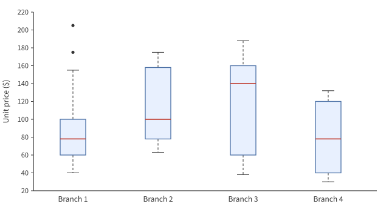
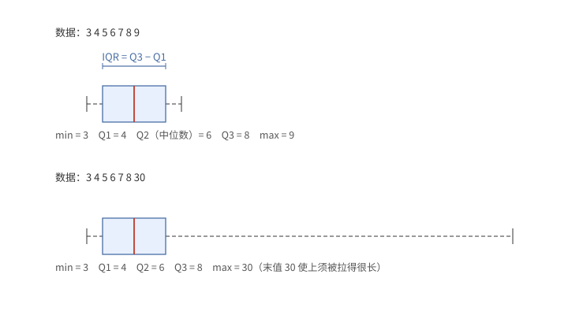
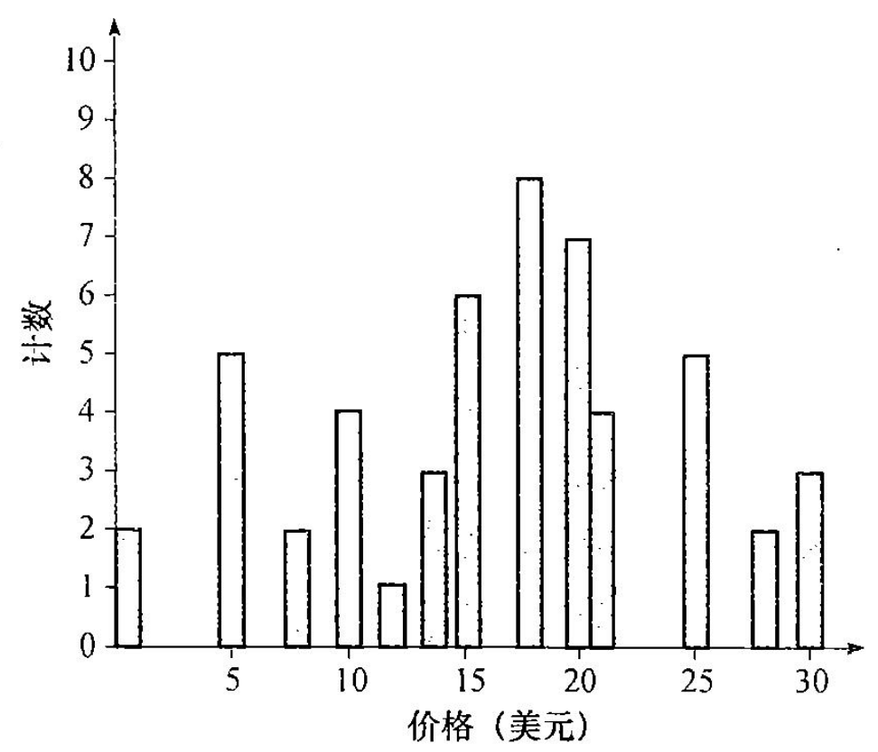
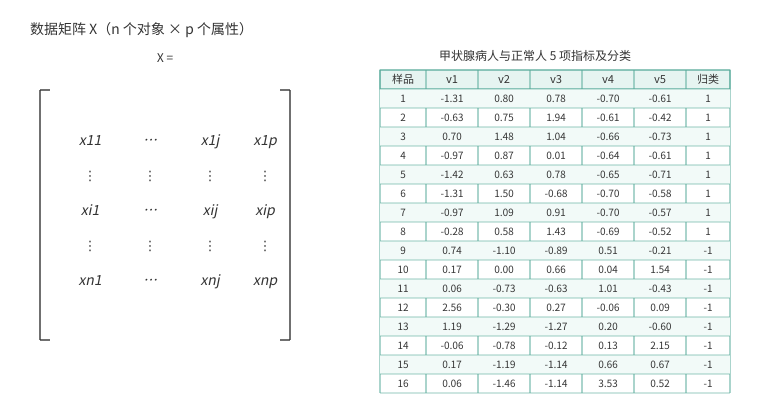

# 2 认识数据

一句话：先看清数据本身，再谈怎么挖——**2.1 数据长什么样（对象 + 属性类型）→ 2.2 怎么统计描述 → 2.3 怎么画出来 → 2.4 怎么度量相似与相异。**

## 0 读这一章之前

- **前置知识**：会算平均数、会看二维坐标图。
- **一句话概括**：本章给后面所有算法打地基——数据长什么样、怎么统计、怎么画、两行数据差多少。
- **三个新词**：==属性==（一列）、==相异性 / 距离==（两行差多少）、==四分位数==（排队后切四刀）。
- **计算题集中在这几处**：四分位数与盒图、非对称二元相异性、序数属性的距离、$L_1/L_2/L_\infty$ 距离矩阵、余弦相似度。

## 总览（思维导图）

$$
\text{第 2 章}
\begin{cases}
2.1\ \text{数据对象与属性类型}
\begin{cases}
\text{行}=\text{对象},\ \text{列}=\text{属性},\ n\times p\\
\text{标称/二元/序数/数值（区间、比率）}\\
\text{离散（定性） vs 连续（定量）}
\end{cases}\\[4pt]
2.2\ \text{基本统计描述}
\begin{cases}
\text{中心}:\ \text{均值},\ \text{中位数},\ \text{中列数},\ \text{众数}\\
\text{散布}:\ \text{极差},\ \text{四分位数},\ IQR,\ \sigma^2
\end{cases}\\[4pt]
2.3\ \text{可视化}:\ \text{盒图、直方图、散点图、平行坐标}\\[4pt]
2.4\ \text{相似性与相异性}
\begin{cases}
\text{标称}:\ \text{简单匹配 / one-hot}\\
\text{二元}:\ \text{对称 / 非对称（Jaccard）}\\
\text{序数}:\ \text{排位}\to[0,1]\to\text{距离}\\
\text{数值}:\ L_1,\ L_2,\ L_h,\ L_\infty\quad \text{方向}:\ \cos
\end{cases}
\end{cases}
$$

# 2.1 数据对象与属性类型

> [!tip] 人话
> 一行记录 = 一个==数据对象==，一列 = 它的一个==属性==；属性属于哪一类，决定了它==能算什么运算==。

## 什么是数据

- **定义**：数据是指对客观事件进行记录并可以鉴别的符号，是对客观事物的性质、状态以及相互关系等进行记载的物理符号或这些物理符号的组合。
- **存储**：可能存放在数据库、数据仓库和其他信息资料库中。
- **类型**：连续型 → 数值；离散型 → 标称、二元、序数。
- **主要问题**：不一致、错误、缺失等。

## 2.1.1 数据对象

- **定义**：数据集由==数据对象==组成，一个数据对象代表一个实体。
- **举例**：销售——顾客、商品、销售记录；医疗——患者、药品；大学——学生、老师、课程。
- **别称**：记录、数据点、实体、样本、实例、对象；如果存放在数据库中，它们就是**数据元组**。
- **行列约定**：数据库中**行对应数据对象，列对应属性**。
- **现实数据集的样子**：美国桥梁数据集的值用逗号分隔成一行（`E13,A,33,CRAFTS,...`），岩土参数数据集直接从电子表格抄来——真实数据往往不规整，还带 `?` 表示缺失。

$$
\text{数据集}=n\ \text{个对象}\times p\ \text{个属性}
$$

## 2.1.2 数据属性

- **属性**：一个==域==，表示一个数据对象的一个特征（如顾客 ID、姓名、地址）。
- **同义词**：属性 = 维度（数据仓库）= 特征（机器学习）= 变量（统计学）；数据挖掘与数据库多用「属性」。
- **观察 / 属性向量**：给定属性的可观察值叫**观察**；刻画一个对象的属性集合叫**属性向量**（特征向量）。

### 四类属性

属性分四类：标称、二元、序数、数值；其中**数值属性**再分成**区间标度**与**比率标度**两种。

| 类型          | 定义                                        | 允许运算             | 例子                                        | 关键点                                       |
| ----------- | ----------------------------------------- | ---------------- | ----------------------------------------- | ----------------------------------------- |
| 标称 Nominal  | 值是事物的标号或名称，表示类别、编码或状态，**没有次序**             | $=,\neq$         | 头发颜色、婚姻状况、职业、邮编、学号                        | 也叫枚举型；**用数字表示 ≠ 数值属性**，编码做算术无意义           |
| 二元 Binary   | 只有两个类别或状态 $0/1$；布尔属性 true/false           | $=,\neq$         | smoker（1 吸烟）、medical test（1 阳性）、性别        | 标称的**特例**；$0$=不出现，$1$=出现                   |
| 序数 Ordinal  | 值之间有**有意义的序或秩评定**，但相继值之间的差未知              | 再加 $<,>$         | Size = {small, medium, large}、Grade、满意度 $0\sim4$ | 常用来记录不能客观度量的主观质量，调查中排序                    |
| 区间 Interval | 用相等单位尺度度量；值有序，可正/0/负，允许定量评估差值            | 再加 $+,-$         | 摄氏/华氏温度、日历日期                              | **没有真正的零值**：10℃ 比 5℃ 高 5℃，但不能说暖 2 倍       |
| 比率 Ratio    | 定量，具有**固定零点**                             | 再加 $\times,\div$ | 开氏温标、字数、货币数量、工作年限                         | 10 K 是 5 K 的两倍，100 元比 1 元富有 100 倍           |

> [!note] 定性 vs 定量
> 标称、二元、序数是==定性==属性：描述对象特征，不给出实际大小或数量，通常是代表类别的词；即使用整数，也只是**类别编码**，不是测量的量。区间、比率是==定量==属性：整数或实数。

### 同一个数据集的多种写法（编码不改变类型）

课件用同一份学生数据演示：原始值 → 编码 → 换一种数值映射，数据「看起来」越来越像数字，但属性类型没变。

| 序号 | 头发颜色 | 籍贯    | A成绩 | B成绩 | 类别 |
| -- | ---- | ----- | --- | --- | -- |
| 1  | 黑色   | 天津    | 90  | C   | 1  |
| 2  | 黄色   | 北京    | 70  | A   | 0  |
| 3  | 紫色   | 北京    | 91  | A   | ？  |
| 1  | 0    | 022   | 90  | 3   | 1  |
| 2  | 1    | 010   | 70  | 5   | 0  |
| 3  | 9    | 010   | 91  | 5   | ？  |

- **编码**：头发颜色 黑→0、黄→1、紫→9；籍贯 天津→022、北京→010；B 成绩 C→3、A→5。
- **再映射**：B 成绩 A→100、C→60；A 成绩与类别还能画成散点图。
- **要点**：$0/1/9$ 只是标号，9 不代表「比 0 大 9 倍」；换一种映射，距离就变了——所以要先认清==属性类型==。

### 二元属性：对称 vs 非对称

> [!tip] 人话
> 两种取值同等重要叫==对称==；只有一种结果有意义（另一种只是「没事」）叫==非对称==。

| 类型 | 定义 | 例子 | 约定 |
| --- | --- | --- | --- |
| 对称二元 | 两种状态具有同等价值并携带相同权重 | 性别 | 两种结果都算证据 |
| 非对称二元 | 两种状态的结果不是同等重要 | 疾病化验 positive / negative | 把**更重要**的结果标为 $1$（如 HIV 阳性） |

### 离散 vs 连续

| 类型 | 定义 | 例子 | 对应的属性类 |
| --- | --- | --- | --- |
| 离散属性 | 具有有限或无限**可数个**值，可以用或不用整数表示 | 发色、是否吸烟、医学检查结果、饮料尺寸、邮政编码、电话号码 | 定性：标称、二元、序数 |
| 连续属性 | 连续值取实数，实数值用有限位数字表示，一般用浮点变量表示 | 温度、高度、宽度 | 定量：数值属性（区间、比率） |

课件把两者直接对应起来：**离散 → 定性**，**连续 → 定量**；判断口诀是「值不是离散的，就是连续的」。

### 属性的特性（决定类型）

$$
\text{Distinctness}\ (=\ \neq)\ \to\ \text{Order}\ (<\!>)\ \to\ \text{Addition}\ (+-)\ \to\ \text{Multiplication}\ (*/)
$$

- **标称属性**：只有 distinctness。
- **序数属性**：distinctness 与 order。
- **区间标度属性**：distinctness、order、addition。
- **比率标度属性**：四条全有。

### 示例：给高尔夫数据判类型

课件示例 1 是一张「是否适合打高尔夫」的数据表：

| Day | Outlook  | Temperature | Humidity | Windy | Play Golf? |
| --- | -------- | ----------- | -------- | ----- | ---------- |
| 1   | Sunny    | 85          | 85       | False | No         |
| 2   | Sunny    | 80          | 90       | True  | No         |
| 3   | Overcast | 83          | 78       | False | Yes        |
| 4   | Rainy    | 70          | 96       | False | Yes        |
| 5   | Rainy    | 68          | 80       | False | Yes        |
| 6   | Rainy    | 65          | 70       | True  | No         |
| 7   | Overcast | 64          | 65       | True  | Yes        |
| 8   | Sunny    | 72          | 95       | False | No         |
| 9   | Sunny    | 69          | 70       | False | Yes        |
| 10  | Rainy    | 75          | 80       | False | Yes        |
| 11  | Sunny    | 75          | 70       | True  | Yes        |
| 12  | Overcast | 72          | 90       | True  | Yes        |
| 13  | Overcast | 81          | 75       | False | Yes        |
| 14  | Rainy    | 71          | 80       | True  | No         |

- **Outlook**：{Sunny, Overcast, Rainy}，无序 → ==标称==。
- **Temperature / Humidity**：数值 → ==连续 / 定量==（可算差值、比值）。
- **Windy**：{True, False}，两状态同等重要 → ==对称二元==。
- **Play Golf?**：{Yes, No} → 二元（也可看作标称）。
- **Day**：只是编号 → 标称。
- 整张表里**没有序数属性**——序数要求「有序且相邻差未知」，这里找不到这样的列。

### 示例 2、3：真实数据集里的属性

- **移动设备用户年龄和性别预测**：`device_id`（唯一标识，无重复）、`gender`（0 男 / 1 女）、`age`、`phone_brand`、`device_model`、`event_id`、`app_id`。同一张表里同时有==标称==（品牌、型号）、==二元==（gender）、==数值==（age）。
- **房价预测**：从链家页面直接抓的表——`title`、`model`（如 2 室 1 厅）、`community`、`region`、`built`（2003 年建）、`price`、单价，还有一列 `traffic` 形如「距离 2 号线南京西路站 649 米」。
- **要点**：真实数据里的数字常藏在文字里（「距离…649 米」「2003 年建」），要先把它拆成属性，才谈得上判断类型。

# 2.2 数据的基本统计描述

统计描述的目标是**更好地理解数据**：2.2.1 中心趋势度量（度量数据分布的中部或中心位置）与 2.2.2 度量数据散布（数据如何分散）。

## 2.2.1 中心趋势度量

> [!tip] 人话
> 均值是「全都算进去的平均」，中位数是「排队站中间那个」，众数是「出现最多的那个」；==极端值只欺负均值==。

| 统计量  | 公式 / 定义                                                    | 特点                                |
| ---- | ---------------------------------------------------------- | --------------------------------- |
| 均值   | $\bar{x}=\frac{1}{N}\sum_{i=1}^{N}x_i$（代数度量）                  | 全部数据参与计算，**每一个数据变化它都变**，易受极端值影响    |
| 加权均值 | $\bar{x}=\frac{\sum w_ix_i}{\sum w_i}$，权重 $w$ 代表重要性、发生频率等   | 各数据权重不同                           |
| 截尾均值 | 丢弃高低极端值后的均值                                                | 专门为降低极端值影响                        |
| 中位数  | 按顺序排列后居于中间位置的数，把数值集合划分为相等的上下两部分；偶数个取中间两个的平均 | **不受最大、最小两个极端数值的影响**，部分数据变动对它无影响 |
| 中列数  | $\text{Midrange}=\dfrac{\max+\min}{2}$                    | 只用最大值和最小值，可用来评估数值型数据的中心趋势        |
| 众数   | 集合中出现最频繁的值                                                 | 可能多个众数：单峰、双峰、三峰；每个值只出现一次则**没有众数**  |

中位数例（课件）：$23,29,20,32,23,21,33,25$ → 排序 $20,21,23,23,25,29,32,33$，故

$$
\text{Median}=\frac{23+25}{2}=24
$$

观测数量很大时中位数计算开销大，对数值属性可用**插值**求近似：

$$
\text{Median}=L_1+\frac{N/2-(\sum freq)_l}{freq_{\text{median}}}\times width
$$

$L_1$ 是中值区间的最低值，$N$ 是数据值的个数，$(\sum freq)_l$ 是所有低于中值区间的区间的频率之和，$freq_{\text{median}}$ 是中值区间的频率，$width$ 是中值区间的宽度（极差）。

课件用一张年龄分组频数表演示这个公式（中值区间被框在 $11\sim20$）：

| 年龄    | $1\sim3$ | $4\sim10$ | $11\sim20$ | $21\sim30$ | $31\sim60$ | $61\sim80$ |
| ----- | -------- | --------- | ---------- | ---------- | ---------- | ---------- |
| 频数    | 100      | 250       | 2000       | 600        | 850        | 66         |

- **$N$**：$100+250+2000+600+850+66=3866$，故 $N/2=1933$。
- **$(\sum freq)_l$**：低于中值区间的两个区间之和 $100+250=350$，$freq_{\text{median}}=2000$。
- 课件没给数值答案；取 $width=20-11=9$ 代入得 $\text{Median}\approx11+\frac{1933-350}{2000}\times9\approx18.1$。

### 均值、中位数、众数的区别

- **均值**：由全部数据计算，会因每一个数据的变化而变化。
- **中位数**：由排序得到，不受最大、最小两个极端数值的影响；个别数据变动较大时，常用它描述集中趋势。
- **众数**：反映一组数据的集中程度，「最佳」「最受欢迎」「最满意」这类说法都与它有关，反映一种最普遍的倾向。

课件对比：$0,1,5,5,6,8,100$ 与 $0,1,5,5,6,8,10$——把极端值 $100$ 换成 $10$，均值大变，中位数与众数不变。

### 哪些统计量能算（高频判断）

课件先问「这些值能算众数/中位数/均值/差值/比率吗」，再给出结论：

| 属性                  | 众数 | 中位数 | 均值 | 标准差 | 差值 | 比率 |
| ------------------- | -- | --- | -- | --- | -- | -- |
| 标称（zip codes、眼睛颜色） | 可  | 不可  | 不可 | 不可  | 不可 | 不可 |
| 序数（mineral hardness、等级） | 可  | 可   | 不可 | 不可  | 不可 | 不可 |
| 区间（日历日期、摄氏温度）       | 可  | 可   | 可  | 可   | 可  | 不可 |
| 比率（开氏温度、货币、年龄）      | 可  | 可   | 可  | 可   | 可  | 可  |

### 偏斜

- **对称单峰**：均值、中位数、众数都是同一个中心值。
- **正倾斜（右偏）**：众数出现在**小于**中位数的值上——长尾在右，把均值拉大，于是 $\text{众数}<\text{中位数}<\text{均值}$。
- **负倾斜（左偏）**：众数出现在**大于**中位数的值上——长尾在左，均值被拉小，于是 $\text{均值}<\text{中位数}<\text{众数}$。

> [!warning] 易错
> 判偏斜先看==众数在哪一侧==（课件口径），再看长尾拉谁：均值总被尾巴拉过去，中位数只跟排序有关。

## 2.2.2 度量数据散布

考察评估数值数据散布或发散的度量：极差、分位数、四分位数、四分位数极差、五数概括、方差、标准差。

- **极差 Range**：最大值与最小值的差。
- **分位数 quantile**：取自数据分布的每隔一定间隔上的点，把数据划分成基本上大小相等的连贯集合。
- **四分位数 quartile**：$Q_1$（第 25 百分位数）、$Q_3$（第 75 百分位数）；$Q_2$ = 中位数。
- **四分位数极差 IQR**：$IQR=Q_3-Q_1$。

### 四分位数怎么算（课件算法）

> [!tip] 人话
> 把数据排队后切四刀，切点就是==四分位数==；$Q_3-Q_1$ 叫==四分位数极差==，箱子有多长就看它。

1. 对所有数据进行排序。
2. 计算 $(n+1)f\%=j+q$，其中 $n$ 是数据个数，$f$ 是分位数，$j$ 是整数。
3. $q=0$ 时 $x_{(j)}$ 就是 $f\%$ 的分位数；$q\neq0$ 时取 $0.5\,x_{(j)}+0.5\,x_{(j+1)}$。

#### 例题 1（计算）：四分位数（课件两道练习）

**题目**：用课件算法分别求两组数据的 $Q_1$、中位数、$Q_3$。

- **练习 1**：$3,5,7,6,4,8,9$。
- **练习 2**：$2,6,5,3,4,7$。

**解**：

练习 1 排序后 $3,4,5,6,7,8,9$，$n=7$ 故 $(n+1)=8$：

- **$Q_1$**：$8\times25\%=2$，$j=2,\ q=0$；取值：$x_{(2)}=4$
- **中位数**：$8\times50\%=4$，$j=4,\ q=0$；取值：$x_{(4)}=6$
- **$Q_3$**：$8\times75\%=6$，$j=6,\ q=0$；取值：$x_{(6)}=8$

练习 2 排序后 $2,3,4,5,6,7$，$n=6$ 故 $(n+1)=7$：

- **$Q_1$**：$7\times25\%=1.75$，$j=1,\ q=0.75$；取值：$0.5x_{(1)}+0.5x_{(2)}=0.5\times2+0.5\times3=2.5$
- **中位数**：$7\times50\%=3.5$，$j=3,\ q=0.5$；取值：$0.5x_{(3)}+0.5x_{(4)}=0.5\times4+0.5\times5=4.5$
- **$Q_3$**：$7\times75\%=5.25$，$j=5,\ q=0.25$；取值：$0.5x_{(5)}+0.5x_{(6)}=0.5\times6+0.5\times7=6.5$

**答**：练习 1 为 $Q_1=4$、中位数 $6$、$Q_3=8$；练习 2 为 $Q_1=2.5$、中位数 $4.5$、$Q_3=6.5$。

> [!warning] 易错
> 只要 $q\neq0$，就取相邻两个数的**中点**，不管 $q$ 是 $0.75$ 还是 $0.25$——这是课件算法，与某些软件的四分位数定义不同。

### 五数概括与离群点

$$
\left.
\begin{array}{ll}
\text{五数概括} & \min,\ Q_1,\ \text{median},\ Q_3,\ \max\\[2pt]
\text{可疑离群点} & x>Q_3+1.5\,IQR\ \ \text{或}\ \ x<Q_1-1.5\,IQR
\end{array}
\right\}
\ \text{盒图的基础}
$$

### 方差与标准差

$$
\sigma^2=\frac{1}{N}\sum_{i=1}^{N}(x_i-\mu)^2,\qquad \sigma=\sqrt{\sigma^2}
$$

- **方差 / 标准差** → 散布程度；**均值** → 中心。
- $\sigma=0$ 表示没有散布；$\sigma>0$ 才有散布。
- **方差越小，数据稳定性越强**。

# 2.3 数据可视化

## 2.3.1 概述

> [!tip] 人话
> 图表的用处是==把数据变成一眼能看出的形状==——发现异常、看出趋势、也让人愿意看。

- **定义**：将大型数据集中的数据以图形图像形式表示，并利用数据分析和开发工具发现其中未知信息的处理过程，并以图展示出来。
- **本质**：把数据的各个属性值以**多维数据**的形式表示，从不同维度观察数据，从而做更深入的观察和分析。

四个作用：

1. **观测、跟踪数据**：实时监控数据状态。
2. **分析数据**：经典例子是**霍乱地图**——分析霍乱患者分布与水井分布的关系，发现某口井供水范围内患者明显偏多，据此找到污染的水泵。
3. **辅助理解数据**：降低理解成本。
4. **增强数据吸引力**：图表新闻；顶刊插图也靠可视化传达结论（如 Nature Machine Intelligence 2026 关于语言模型协作、Nature 2025 人类认知基础模型、Nature 2026 可解释深度学习与自动驾驶的工作）。

## 2.3.2 常用图表

| 图表   | 维度       | 应用场景                        |
| ------ | ---------- | ------------------------------- |
| 柱状图 | 二维       | 指定一个分析轴进行数据大小的比较，只需比较其中一维 |
| 折线图 | 二维       | 按时间序列分析数据的变化趋势，适用于较大的数据集 |
| 饼图   | 二维       | 指定一个分析轴进行所占比例的比较，只适用于反映部分与整体 |
| 散点图 | 二维或三维 | 有两个维度需要比较              |
| 气泡图 | 三维或四维 | 其中只有两维能够精确辨识        |
| 雷达图 | 四维以上   | 数据点不超过 6 个               |

### 2.3.2.1 盒图

> [!tip] 人话
> 一个箱子画出中位数与上下四分位数，箱子长度就是 ==IQR==，跑到须外面的点就是==离群点==。





- **盒的端点**：一般在四分位数上；箱子长度 $=IQR$。
- **中位数**：箱子中间的线。
- **须**：箱子外面的两根须是观察的最小值和最大值，但有规则——
  - 最大值 $<Q_3+1.5\,IQR$：须扩展到最大值；
  - 最小值 $>Q_1-1.5\,IQR$：须扩展到最小值；
  - 最大值 $>Q_3+1.5\,IQR$：须只扩展到 $Q_3+1.5\,IQR$；
  - 最小值 $<Q_1-1.5\,IQR$：须只扩展到 $Q_1-1.5\,IQR$。
- **正常范围**：$[Q_1-1.5\,IQR,\ Q_3+1.5\,IQR]$，范围外的点判为离群点。

#### 例题 2（计算）：四分位数、IQR 与盒图五要素

**题目**：某商品最近 10 天的日销量为 $2,4,5,7,8,10,12,13,15,60$（单位：件）。按课件算法求 $Q_1$、中位数、$Q_3$ 与 $IQR$，写出盒图的五个要素，并判断是否存在离群点。

**解**：排序后 $n=10$，故 $n+1=11$。

- **$Q_1$**：$11\times25\%=2.75$，$j=2,\ q\neq0$；取值：$0.5x_{(2)}+0.5x_{(3)}=0.5\times4+0.5\times5=4.5$
- **中位数**：$11\times50\%=5.5$，$j=5,\ q\neq0$；取值：$0.5x_{(5)}+0.5x_{(6)}=0.5\times8+0.5\times10=9$
- **$Q_3$**：$11\times75\%=8.25$，$j=8,\ q\neq0$；取值：$0.5x_{(8)}+0.5x_{(9)}=0.5\times13+0.5\times15=14$

$$
IQR=Q_3-Q_1=14-4.5=9.5
$$

$$
\text{上界}=Q_3+1.5\,IQR=14+14.25=28.25,\qquad
\text{下界}=Q_1-1.5\,IQR=4.5-14.25=-9.75
$$

**答**：$Q_1=4.5$，中位数 $9$，$Q_3=14$，$IQR=9.5$；五数概括 $(2,\ 4.5,\ 9,\ 14,\ 60)$。上须画到不超过上界的最大观测值 $15$，下须画到最小值 $2$；$60>28.25$，判为**离群点**，单独用一个点标出。

> [!warning] 易错
> $28.25$ 是**判定阈值**，不是须的长度；须只延伸到==真实存在的观测值==（这里是 $15$）。

### 2.3.2.2 直方图

> [!tip] 人话
> 把值域切成等宽的==桶==，数每个桶里有多少个值，柱高就是频次。

- **定义**：直方图（或频率直方图）是单变量数据的图，横轴表示值，纵轴表示频次。
- **标称 $X$**：对 $X$ 的每一个已知值画一个柱或竖直条，条高表示该值出现的频率——更多称作**条形图**。
- **数值 $X$**：更多用直方图。$X$ 的值域被划分为不相交的连续子域，子域称作**桶（bucket）/箱（bin）**，桶的范围称作**宽度**，通常桶是等宽的。

课件示例把一组价格数据画成直方图（每个柱对应一个取值，相当于桶宽为 1）：

```text
1,1,5,5,5,5,5,8,8,10,10,10,10,12,14,14,14,15,15,15,15,15,15,
18,18,18,18,18,18,18,18,20,20,20,20,20,20,20,21,21,21,21,
25,25,25,25,25,28,28,30,30,30
```



### 2.3.2.3 散点图

每个值对视为一个代数坐标对，作为一个点画在平面上；用于观察**双变量数据**、点簇与离群点，以及两个变量之间的关系、趋势。

- **两个属性 X 和 Y，如果一个属性蕴含另一个，则它们是相关的**；相关可能是正、负或零相关。
- **正相关**：从左下到右上倾斜，$X$ 的值随 $Y$ 的值增加而增加。
- **负相关**：从左上到右下倾斜，$X$ 的值随 $Y$ 的值减小而增加。
- **不相关**：两个属性之间不存在相关关系。

$k$ 维数据可画**散点图矩阵**，共 $\frac{k(k-1)}{2}$ 张。

### 2.3.2.4 平行坐标（高维）

高维数据里每个属性一根竖轴，一个对象一条折线；课件示例的属性是节油量、气缸、排气量、动力、重量、速度、年份。

### 2.3.2.5 思维导图

展现概念之间的层次与关系。

### 2.3.2.6 标签云

用字号体现词频。

## 2.3.3 数据可视化工具

课件列出的工具：

- **ECharts**：百度前端数据可视化团队研发，PC 与移动设备上都能流畅运行，兼容 IE8/9/10/11、Chrome、Firefox、Safari，底层依赖 Canvas 类库 ZRender；图表类型覆盖折线、柱状、散点、饼图、K 线，盒形图，地图/热力图/线图，关系图与 treemap，平行坐标，以及 BI 的漏斗图、仪表盘，并支持图与图混搭。
- **D3**（Data-Driven Documents）：JavaScript 函数库，做数据可视化，代表图表有 Voronoi 图、树形图、圆形集群和单词云。
- **Tableau**：桌面系统中最简单的商业智能工具软件，适合企业和部门做日常报表与可视化分析。
- **时间线工具**：Timetoast（在线创作基于时间轴事件记载服务）、Xtimeline（免费绘制时间线的在线工具，社区类型）。
- **Google Chart API**：通过浏览器在线查看统计图表。
- **CiteSpace**：引文空间，科学计量学 + 可视化，呈现科学知识的结构、规律与分布（「科学知识图谱」）。
- **Gephi**：开源免费跨平台（JVM）复杂网络分析软件，用于网络与复杂系统、动态与分层图的交互可视化。
- **t-SNE**：t 分布随机邻近嵌入，降维方法，优势是保持局部结构，可生成漂亮的可视化图。
- **深度模型画图工具**：如 ConvNetDraw；另有 Plotly/Dash、Flourish、Datawrapper、Observable Plot、Apache Superset、PyGWalker、Grafana。

# 2.4 度量数据的相似性和相异性

> [!tip] 人话
> ==相异度 = 两行差多少==，距离是最常用的一种；相似度相反，越像值越大。

很多算法越来越依赖于在输入空间给定的好的度量：K-means、K 近邻方法、SVM、深度学习等，都需要能反映数据间重要关系的度量。

| 概念                 | 含义                        | 取值范围             |
| -------------------- | --------------------------- | -------------------- |
| 相似性 similarity    | 描述两个数据对象的相似程度，越相似值**越高** | 通常落在 $[0,1]$     |
| 相异性 e.g. distance | 描述两个数据对象的差异程度，越相似值**越低** | 最小相异度通常为 $0$ |

两者统称**邻近性**。

## 2.4.1 数据矩阵与相异性矩阵

> [!tip] 人话
> ==数据矩阵==是「对象 × 属性」的原表，==相异性矩阵==是「对象 × 对象」的距离表。



| 矩阵       | 维度        | 类型     | 含义                                               |
| ---------- | ----------- | -------- | -------------------------------------------------- |
| 数据矩阵   | $n\times p$ | 二模矩阵 | 行和列代表不同的实体：行是对象、列是属性           |
| 相异性矩阵 | $n\times n$ | 单模矩阵 | 只包含一类实体；$d_{ii}=0$、$d_{ij}=d_{ji}$，下三角即可存完 |

## 2.4.2 标称属性的邻近性度量

设 $p$ 为刻画对象的属性总数，$m$ 为两个对象取值相同的属性数。

**方法 1：简单匹配**

$$
d(i,j)=\frac{p-m}{p},\qquad sim(i,j)=\frac{m}{p}
$$

课件的例子：$d_1=\{red, China, smoker\}$，$d_2=\{black, China, non\text{-}smoker\}$——只有 country 相同，故 $m=1,\ p=3$：

$$
sim(1,2)=\frac{1}{3},\qquad d(1,2)=\frac{2}{3}
$$

**方法 2：one-hot 编码**

采用 0-1 值代表 $M$ 个状态。课件把三个对象编码为：

| 对象 | 取值                          | one-hot       |
| ---- | ----------------------------- | ------------- |
| $d_1$ | {red, not China, smoker}      | {001, 01, 01} |
| $d_2$ | {black, China, non-smoker}    | {010, 10, 10} |
| $d_3$ | {yellow, China, non-smoker}   | {100, 10, 10} |

编码之后每个状态变成一列 0-1，就能交给**二元属性**的距离公式处理。

## 2.4.3 二元属性的邻近性度量

> [!tip] 人话
> 全是 0/1 的表格里，先把「两者都取 1」「一个 1 一个 0」「都为 0」数清楚，再套公式。

|             | 对象 $j$ = 1 | 对象 $j$ = 0 |
| ----------- | ------------ | ------------ |
| 对象 $i$ = 1 | $q$          | $r$          |
| 对象 $i$ = 0 | $s$          | $t$          |

$q$：两者都取 1 的属性数；$r$：$i$ 取 1、$j$ 取 0；$s$：$i$ 取 0、$j$ 取 1；$t$：两者都取 0。

| 情形             | 公式                                                            |
| ---------------- | --------------------------------------------------------------- |
| 对称二元相异性   | $d(i,j)=\dfrac{r+s}{q+r+s+t}$（不同的个数 / 总个数）             |
| 非对称二元相异性 | $d(i,j)=\dfrac{r+s}{q+r+s}$（**忽略 $t$**）                      |
| 非对称二元相似性 | $sim_{Jaccard}(i,j)=\dfrac{q}{q+r+s}$                           |

> [!warning] 易错
> 只有「两种状态同等重要」才用对称公式。化验结果里「两人都阴性」==不构成相似证据==，所以非对称公式把 $t$ 从分母里去掉。

#### 例题 3（计算）：非对称二元相异性（课件患者表）

**题目**：下表中 Gender 是对称二元属性，Fever、Cough 与 Test-1~Test-4 按非对称二元属性处理（Y、P 取 1，N 取 0）。求 $d(Jack,Mary)$、$d(Jack,Jim)$、$d(Jim,Mary)$。

| Name | Gender | Fever | Cough | Test-1 | Test-2 | Test-3 | Test-4 |
| ---- | ------ | ----- | ----- | ------ | ------ | ------ | ------ |
| Jack | M      | Y     | N     | P      | N      | N      | N      |
| Mary | F      | Y     | N     | P      | N      | P      | N      |
| Jim  | M      | Y     | P     | N      | N      | N      | N      |

**解**：先编码（Gender 不参与）：

- **Jack**：Fever 1、Cough 0、Test-1 1、Test-2 0、Test-3 0、Test-4 0
- **Mary**：Fever 1、Cough 0、Test-1 1、Test-2 0、Test-3 1、Test-4 0
- **Jim**：Fever 1、Cough 1、Test-1 0、Test-2 0、Test-3 0、Test-4 0

逐对计数：

- **Jack, Mary**：$q=2$（Fever、Test-1）；$r=0$；$s=1$（Test-3）；$t=3$；$d=\dfrac{0+1}{2+0+1}=0.33$
- **Jack, Jim**：$q=1$（Fever）；$r=1$（Test-1）；$s=1$（Cough）；$t=3$；$d=\dfrac{1+1}{1+1+1}=0.67$
- **Jim, Mary**：$q=1$（Fever）；$r=1$（Cough）；$s=2$（Test-1、Test-3）；$t=2$；$d=\dfrac{1+2}{1+1+2}=0.75$

**答**：$d(Jack,Mary)=0.33$，$d(Jack,Jim)=0.67$，$d(Jim,Mary)=0.75$。

> [!warning] 易错
> 只把 Test-1~Test-4 当非对称属性会算不出课件答案：这张表里 ==Fever、Cough 也在非对称列==（课件用红框圈的就是这几列），只有 Gender 是对称属性被排除。

#### 例题 4（计算）：三名患者的相异性矩阵

**题目**：三名患者做了 4 项化验，$1$ 表示阳性、$0$ 表示阴性，全部按**非对称二元属性**计算。求两两相异性并写出相异性矩阵。

| 患者   | $T_1$ | $T_2$ | $T_3$ | $T_4$ |
| ------ | ----- | ----- | ----- | ----- |
| $P_1$  | 1     | 1     | 0     | 0     |
| $P_2$  | 0     | 1     | 1     | 0     |
| $P_3$  | 1     | 0     | 0     | 1     |

**解**：

- **$P_1,P_2$**：$q=1$（$T_2$）；$r=1$（$T_1$）；$s=1$（$T_3$）；$t=1$（$T_4$）；$d=\dfrac{2}{3}\approx0.667$
- **$P_1,P_3$**：$q=1$（$T_1$）；$r=1$（$T_2$）；$s=1$（$T_4$）；$t=1$（$T_3$）；$d=\dfrac{2}{3}\approx0.667$
- **$P_2,P_3$**：$q=0$；$r=2$（$T_2,T_3$）；$s=2$（$T_1,T_4$）；$t=0$；$d=\dfrac{4}{4}=1.000$

| $d(i,j)$ | $P_1$   | $P_2$   | $P_3$   |
| -------- | ------- | ------- | ------- |
| $P_1$    | 0       | $0.667$ | $0.667$ |
| $P_2$    | $0.667$ | 0       | $1.000$ |
| $P_3$    | $0.667$ | $1.000$ | 0       |

**答**：相异性矩阵如上（对称、对角为 0，写出下三角即可）。

## 2.4.4 序数属性的距离

> [!tip] 人话
> 序数只知道「谁大谁小」，于是先换成==名次==，再压到 $[0,1]$，最后当普通数值算距离。

序数属性的值之间具有有意义的序或排位，相继值之间的量值未知；而数值属性的值域可以映射到具有 $M_f$ 个状态的序数属性 $f$。

1. 第 $i$ 个对象在属性 $f$ 上的值为 $x_{if}$，用对应的**排位** $r_{if}$ 取代它（属性 $f$ 有 $M_f$ 个有序状态）。
2. 把每个属性的值域映射到 $[0,1]$ 上，使每个属性有相同的权重：

$$
z_{if}=\frac{r_{if}-1}{M_f-1}
$$

3. 采用任意一种**数值属性**的距离度量（如欧氏距离）计算。

#### 例题 5（计算）：序数属性的距离矩阵

**题目**：4 个对象在某序数属性上的取值是 $x_1=$ Excellent、$x_2=$ fair、$x_3=$ good、$x_4=$ Excellent。求映射后的值与两两欧氏距离。

**解**：值的有序状态为 fair $<$ good $<$ Excellent，故 $M_f=3$，三个状态的排位分别是 fair $=1$、good $=2$、Excellent $=3$。

- **排位**：$x_1=3,\ x_2=1,\ x_3=2,\ x_4=3$
- **映射**：$z_{if}=\dfrac{r_{if}-1}{3-1}$，得 $z_1=1,\ z_2=0,\ z_3=0.5,\ z_4=1$

| 对象对        | $z$ 之差（欧氏距离） |
| ------------- | -------------------- |
| $x_1$ 与 $x_2$ | $1$                  |
| $x_1$ 与 $x_3$ | $0.5$                |
| $x_1$ 与 $x_4$ | $0$                  |
| $x_2$ 与 $x_3$ | $0.5$                |
| $x_2$ 与 $x_4$ | $1$                  |
| $x_3$ 与 $x_4$ | $0.5$                |

**答**：映射后 $z=(1,\ 0,\ 0.5,\ 1)$，距离如上；$x_1$ 与 $x_4$ 取值相同故距离为 $0$。

## 2.4.5 数值属性的距离

课件讲三种：欧几里得距离、曼哈顿距离、闵可夫斯基距离。

### 欧几里得距离

两点间的直线距离，也就是生活中默认使用的距离；本质是勾股定理 $a^2+b^2=c^2$。

$$
d_{2D}=\sqrt{(x_1-x_2)^2+(y_1-y_2)^2}
$$

$$
d_{3D}=\sqrt{(x_1-x_2)^2+(y_1-y_2)^2+(z_1-z_2)^2}
$$

$$
d_{nD}=\sqrt{\sum_{k=1}^{n}(x_{1k}-x_{2k})^2}
$$

> [!warning] 易错
> 如果两个点的==范围差别较大==，需要先**标准化**再算距离。

### 曼哈顿距离

也称城市街区距离（City Block distance），标明两个点在标准坐标系上的**绝对轴距总和**：在曼哈顿从一个十字路口开车到另一个十字路口，不能穿楼，实际驾驶距离就是这个距离。

$$
d_{2D}=\lvert x_1-x_2\rvert+\lvert y_1-y_2\rvert
$$

$$
d_{nD}=\sum_{k=1}^{n}\lvert x_{1k}-x_{2k}\rvert
$$

### 什么才叫「距离」（四性质）

$$
\left.
\begin{array}{ll}
\text{非负性} & d(i,j)>0\ \ \text{当}\ \ i\neq j\\[2pt]
\text{同一性} & d(i,i)=0\\[2pt]
\text{对称性} & d(i,j)=d(j,i)\\[2pt]
\text{三角不等式} & d(i,j)\leq d(i,k)+d(k,j)
\end{array}
\right\}
\ \text{满足这些条件的测度称作度量}
$$

### 闵可夫斯基距离

是欧几里得距离和曼哈顿距离的推广。$i=(x_{i1},\dots,x_{ip})$ 与 $j=(x_{j1},\dots,x_{jp})$ 是两个数据对象，$h$ 是实数，也称 $L_h$ 范数（有些书称 $L_p$ 范数）：

$$
d(i,j)=\left(\sum_{k=1}^{p}\lvert x_{ik}-x_{jk}\rvert^{h}\right)^{1/h}
$$

三个特例：

- **$h=1$**：曼哈顿距离（城市块距离、$L_1$ 范数）；向量是二进制时即 **Hamming 距离**（不同位的个数）。
- **$h=2$**：欧几里得距离（$L_2$ 范数）。
- **$h\to\infty$**：上确界距离（$L_{\max}$ 范数、$L_\infty$ 范数），即两个向量在任一属性分量上的最大差。

#### 例题 6（计算）：同一组数据的三种距离矩阵

**题目**：4 个二维数据点如下，求所有点对的 $L_1$、$L_2$、$L_\infty$ 距离。

| 点    | attribute 1 | attribute 2 |
| ----- | ----------- | ----------- |
| $x_1$ | 1           | 2           |
| $x_2$ | 3           | 5           |
| $x_3$ | 2           | 0           |
| $x_4$ | 4           | 5           |

**解**：以 $x_2,x_3$ 为例（差值 $\lvert 3-2\rvert=1$、$\lvert 5-0\rvert=5$）：

$$
d_{L_1}=1+5=6,\qquad d_{L_2}=\sqrt{1^2+5^2}=\sqrt{26}=5.10,\qquad d_{L_\infty}=\max(1,5)=5
$$

其余各对同法：

| 点对        | $L_1$ | $L_2$ | $L_\infty$ |
| ----------- | ----- | ----- | ---------- |
| $x_1,x_2$   | $5$   | $3.61$ | $3$       |
| $x_1,x_3$   | $3$   | $2.24$ | $2$       |
| $x_1,x_4$   | $6$   | $4.24$ | $3$       |
| $x_2,x_3$   | $6$   | $5.10$ | $5$       |
| $x_2,x_4$   | $1$   | $1.00$ | $1$       |
| $x_3,x_4$   | $7$   | $5.39$ | $5$       |

**答**：三种距离下 $x_2$ 与 $x_4$ 都最近（$1$），$x_3$ 与 $x_4$ 的 $L_1$ 最大（$7$）；同一组数据换范数，大小关系会变。

> [!warning] 易错
> 曼哈顿距离==不加平方、不开方==，直接把各维差值的绝对值相加；$L_\infty$ 是取**最大的那一维**差，不是求和。

## 2.4.6 余弦相似性

> [!tip] 人话
> 余弦只看==两个向量指向的方向==，不看它们有多长。

$$
sim(v_1,v_2)=\frac{v_1\cdot v_2}{\lVert v_1\rVert\,\lVert v_2\rVert}
$$

通常用于文本挖掘：向量 $v$ 中第 $j$ 个数值就是相应文档中第 $j$ 个项的量度（词频）。

```text
v1 = {1,1,1,1,1,1,1,1,1,1,1,0,0,0,0,0,0,0,0,0,0,0,0,0,0}
v2 = {0,0,0,0,0,0,0,0,0,0,0,0,1,1,1,1,1,0,0,0,0,0,0,0,0}
v3 = {1,1,1,0,1,0,1,1,1,0,0,1,0,0,0,0,0,0,0,0,0,0,0,0,0}
```

#### 例题 7（计算）：三个文档向量的余弦相似度

**题目**：按上面的 $v_1,v_2,v_3$（各 25 维），求 $sim(v_1,v_2)$、$sim(v_2,v_3)$、$sim(v_1,v_3)$。

**解**：先数各向量有多少个 1：$\lVert v_1\rVert=\sqrt{11}$、$\lVert v_2\rVert=\sqrt{5}$、$\lVert v_3\rVert=\sqrt{8}$。

- **$sim(v_1,v_2)$**：$v_1$ 的 1 在前 11 维、$v_2$ 的 1 在 13~17 维，无交集，点积 $0$ ⇒ $\dfrac{0}{\sqrt{11}\sqrt{5}}=0$
- **$sim(v_2,v_3)$**：同样无交集，点积 $0$ ⇒ $\dfrac{0}{\sqrt{5}\sqrt{8}}=0$
- **$sim(v_1,v_3)$**：两个向量同时为 1 的位置有 7 个（第 1、2、3、5、7、8、9 维），点积 $7$ ⇒

$$
sim(v_1,v_3)=\frac{7}{\sqrt{11}\sqrt{8}}=\frac{7}{9.38}\approx0.75
$$

**答**：$sim(v_1,v_2)=0$，$sim(v_2,v_3)=0$，$sim(v_1,v_3)\approx0.75$。

> [!warning] 易错
> 分母是**长度之积** $\sqrt{11}\sqrt{8}=9.38$，不是 $11\times8=88$。写成 $11\times8$ 却算出 $0.75$，说明用的是范数；考场上把分母写清楚。

它比较的是方向而非绝对长度，所以词频比例相近、长度差一倍的两篇文章仍可能很相似。

## 2.4.7 度量学习

> [!tip] 人话
> 不手工挑公式，而是==让数据自己学一个更合适的距离==。

- **Isomap（等度量映射）**：核心在于发现并利用流形空间的特点，引入**测地线距离**并提出对应的计算方法。流形是在局部区域与欧氏空间同胚的空间，即局部具有欧氏空间的性质、能用欧氏距离计算；做法是「对每个点基于欧氏距离找近邻，建立近邻图」，于是计算两点测地距离的问题就变成计算近邻图上两点之间的**最短路径**问题。
- **LMNN（Large Margin Nearest Neighbor）**：为 K 近邻分类学一个大间隔的距离度量。
- **深度度量学习（Deep Metric Learning）**：用神经网络学嵌入，常见损失有 (1) 对比损失、(2) 三元组损失（Triplet loss）、(3) 四元组损失（Quadruplet loss）、(4) 难样本采样三元组损失（TriHard loss）、(5) 边界挖掘损失（MSML）。

> [!note] 注
> 三元组损失的目标是让锚点与正样本更近、与负样本更远，即 $d(\text{锚点},\text{正})<d(\text{锚点},\text{负})$。

## 2.4.8 多模态对齐中的相似度

目标：让配对的图像与文本在共享空间中更接近，让不配对的样本更远。

$$
z_i^I=\frac{f^I(x_i)}{\lVert f^I(x_i)\rVert_2},\qquad z_j^T=\frac{f^T(t_j)}{\lVert f^T(t_j)\rVert_2}
$$

$$
s_{ij}=\tau\langle z_i^I,z_j^T\rangle+b,\qquad
\mathcal{L}=\frac{1}{B^2}\sum_i\sum_j\log\left[1+\exp(-y_{ij}s_{ij})\right]
$$

$y_{ij}=+1$ 表示匹配、$-1$ 表示不匹配；$\tau$ 是可学习的温度系数。

**SigLIP 2（2025）的改进**：

- **成对二分类**：用 Sigmoid 损失独立判断每个图文对，避免 CLIP 对全批次 Softmax 的依赖。
- **局部语义增强**：加入图像描述、局部定位、自蒸馏与掩码预测，使图像块特征也具有语义。
- **应用**：跨语言图文检索、零样本分类、开放词汇检测与视觉语言模型的视觉编码。

## 2.4.9 大模型嵌入与 RAG 检索

大模型既要在内部计算「注意力相似度」，也要在外部检索中计算「语义距离」；做法从单一余弦相似度走向**混合相关度**：

$$
s_{rank}=w_1s_{dense}+w_2s_{lex}+w_3s_{mul}
$$

- **Dense**：归一化句向量的内积，适合语义近似但措辞不同的文本。
- **Lexical**：根据共同词项及其学习权重计算稀疏匹配，保留关键词精确匹配。
- **Multi-vector**：保留词元级向量并采用晚交互，捕捉查询与长文档的细粒度关系。

代表工作：**NV-Embed**（LLM + 潜在注意力池化 + 两阶段对比指令微调，ICLR 2025 Spotlight）、**M3-Embedding**（统一 dense、sparse 与 multi-vector，支持 100 余种语言、最长 8192 词元）。

## 2.4.10 视觉文档 RAG 的细粒度相关度

**ColPali**：查询按词元表示、文档页按图像块表示（$E_q\in\mathbb{R}^{N_q\times128}$、$E_d\in\mathbb{R}^{N_d\times128}$），再用 MaxSim 完成**晚交互**；图像中的文字、表格、图形和版式都转化为 patch 向量。

- **MaxSim**：每个查询词元选择最相似的页面图像块，再把各词元的最大相似度求和。
- **优点**：比单向量更能保留局部语义，可直接检索含表格、图形和复杂版式的 PDF 页面。
- **RAG 作用**：先找到与问题最相关的页面，再把页面内容交给多模态大模型生成答案。
