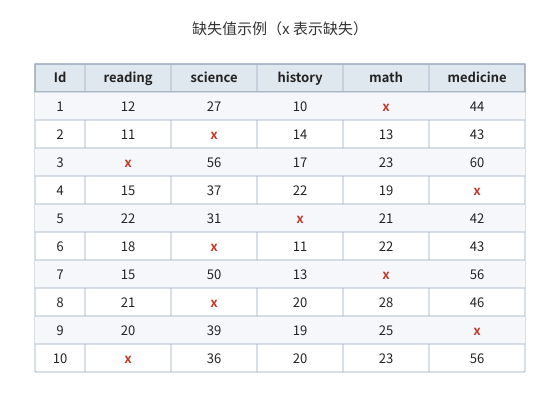
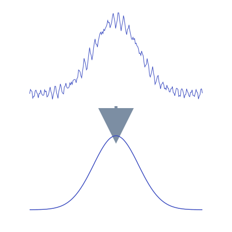
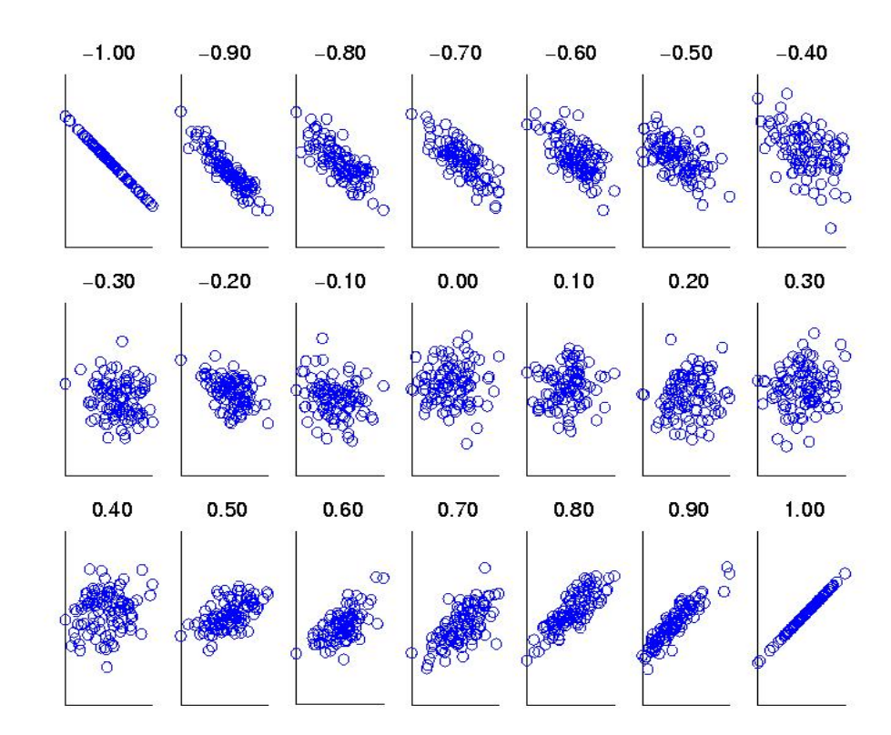
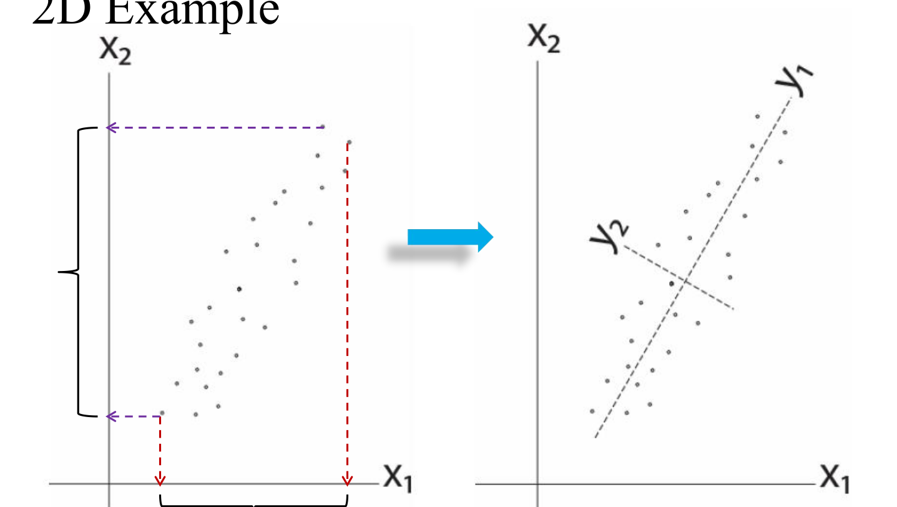
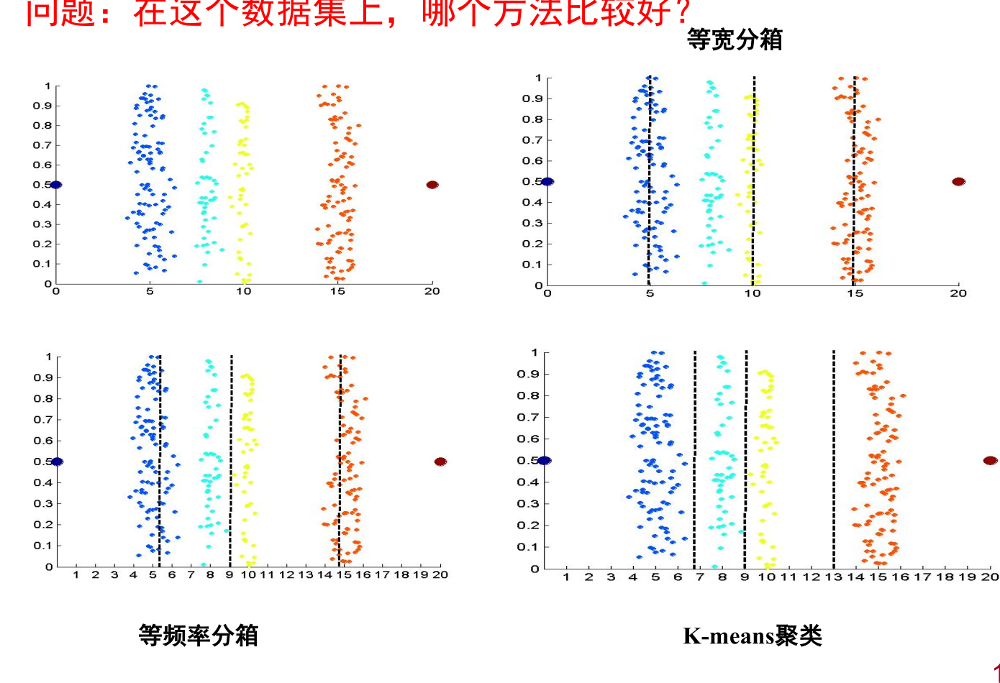

# 3 数据预处理

一句话：现实数据**不完整、有噪声、不一致、维度高、数量大**，本章按 ==清洗 → 集成 → 归约 → 变换== 四步，把它变成**质量可控、统一、低维、规范化**的数据源。

## 0 读这一章之前

- **前置知识**：第 2 章的属性类型（标称 / 二元 / 序数 / 数值）、盒图与 $1.5IQR$ 判据。
- 本章回答一个问题：==脏数据怎么收拾==——缺的补、噪的平、散的并、多的压、量的统一。
- 三个新词：**缺失值**、**噪声**（测量中的随机误差，不是录入错误）、**数据归约**（用更少的数据表达同样的信息）。
- 计算题集中在：分箱光滑、协方差与相关系数、信息增益、三种规范化、等宽 / 等频分箱。

## 总览（思维导图）

$$
\begin{array}{c}
\text{质量差、来源多、维度高、数量大的原始数据}\\[2pt]
\downarrow\\[2pt]
\begin{cases}
3.2\ \text{清洗}:\ \text{缺失值、噪声、离群点}\\
3.3\ \text{集成}:\ \text{实体识别、冗余、重复、值冲突}\\
3.4\ \text{归约}
\begin{cases}
\text{属性归约}
\begin{cases}
3.4.2\ \text{属性选择}:\ \text{过滤式 / 包裹式 / 嵌入式}\\
3.4.3\ \text{属性重构}:\ \text{PCA}\\
3.4.4\ \text{其他}:\ \text{LDA、NMF、t-SNE}
\end{cases}\\
\text{数量归约}:\ 3.4.5\sim3.4.8\ \text{回归、直方图、聚类、抽样}
\end{cases}\\
3.5\ \text{变换}:\ \text{编码、规范化、离散化、脱敏}
\end{cases}\\[2pt]
\downarrow\\[2pt]
\text{高质量、统一、低维、规范化的数据}
\end{array}
$$

# 3.1 数据预处理：概述

## 3.1.1 数据质量：为什么要预处理

> [!tip] 人话
> 一张表能不能直接挖，先看它 ==缺不缺、脏不脏、对不对得上==、可不可信。

课件列的七个维度（后面写着 `…… relevance`，说明还能再补）：

- **完整性**：值有没有缺（not recorded、unavailable）
- **有噪声**：含噪声与离群点，如 $Salary=$ “$-100$”
- **一致性**：字段之间对不上，如 $Age=$ “42” 而 $Birthday=$ “01/09/1985”
- **准确性**：correct or wrong、accurate or not
- **时效性**：timely update?
- **可信性**：how trustable are the data
- **可解释性**：how easily the data can be understood

数据挖掘关注两件事：==数据质量问题的检测与纠正==，以及**能容忍数据质量差的算法**的使用。

## 3.1.2 数据预处理的主要任务

> [!tip] 人话
> 四件事各管一类毛病：清洗管脏、集成管散、归约管多、变换管乱。

- **清洗（Data cleaning）**：空缺、噪声数据处理等
- **集成（Data integration）**：数据合并、汇总、过滤等
- **降维 / 归约（Data reduction）**：将高维数据降低到低维空间中
- **转换（Data transformation）**：重新格式化与转换

整理前的数据特点：**质量较差**（缺失、噪声）、**来源多样**、**属性维度灾难**、**规范程度不一**（依赖数据来源）。

目标：为决策支持应用提供一个高质量的数据源。经过处理后数据具有四个特点——清洗后==质量可控制==、集成后==统一==、归约后**低维表示**、变换后**规范化**。

# 3.2 数据清洗

> [!tip] 人话
> 清洗只干两件事：==把缺的补上==、==把噪的抹平==。

现实世界的数据一般是**脏数据**（许多潜在的不正确数据，如仪器故障、人为或电脑错误、传输错误）：

- **不完整**：缺少属性值，缺少某些感兴趣的属性，如 $Occupation=$ “ ”
- **有噪声**：包含噪声、误差或异常值，如 $Salary=$ “$-10$”
- **不一致**：代码或名称上的差异，如 $Age=$ “40” 而 $Birthday=$ “03/07/2010”；评级从 1/2/3 改成 A/B/C；重复记录之间互相不符

## 3.2.1 缺失值

> [!tip] 人话
> 值缺了只有两条路：==丢掉==（整条记录或整个属性），或者==推断一个合理的值补上==。

数据并不总是完整的：数据库表里很多记录对应字段没有值（如销售表中的顾客收入）。数据丢失可能是由于：

1. **设备异常**
2. **人为的失误**
3. 输入时某些数据==因得不到重视而没有被输入==
4. 不适用 Not Applicable (N/A)

空缺值要经过推断而补上。课件的处理方法分三类：

1. **忽略有缺失值的样本**：假定挖掘任务是分类或描述，有缺失值的样本通常被忽略；==属性缺失值较多时，挖掘算法的效果会非常差==。
2. **人工填写空缺值**：重新采集、利用领域知识等方法；工作量大、枯燥乏味、可行性低。
3. **自动填充**，有四招：
   - 使用一个**全局常量**填充，如 “unknown” 或 $-\infty$
   - 使用**属性的平均值**填充
   - 使用**与给定样本属同一类的所有样本的平均值**填充
   - **建模预测**：Bayesian 公式 / 判定树这类基于推断的方法、回归的方法、矩阵补全等

**插值法**（两种，课件各配一例）：

- **最邻近插值法**：拿同一行（或同一列）里最近的已知值补空缺。课件把 $3\times3$ 表补成 $4\times4$：

$$
\begin{bmatrix}
56&23&15\\
65&32&78\\
12&45&62
\end{bmatrix}
\Longrightarrow
\begin{bmatrix}
56&23&15&15\\
65&32&78&78\\
12&45&62&62\\
12&45&62&62
\end{bmatrix}
$$

- **线性插值**：在已知点之间按等间距补值。课件例 $0,0,255,255$ 缺中间两点，步长 $255/3=85$，补成 $0,85,170,255$。

现代补全方向（知道即可）：监督学习下的缺失处理、GP-VAE、CSDI（扩散模型）、SAITS（自注意力）、DiffPuter、RefiDiff、Meta-GAIN 等。

## 3.2.2 噪声数据

> [!tip] 人话
> 噪声是==测量出来的随机偏差==，不是填错格；办法就是让每个值和它的邻居商量一下，取个代表值。

**噪声**：一个测量变量中的随机错误或偏差。引起不正确属性值的原因：数据收集工具的问题、数据输入错误、数据传输错误、技术限制。

最常用的处理办法是**分箱（Binning）**，三步：

1. 按**递增**顺序对数据排列
2. 分到（**等频**的）箱子中
3. 使用**光滑技术**：用箱均值光滑、用箱中位数光滑、用箱边界光滑等

#### 例题 1（计算）：用箱均值与箱边界光滑

**题目**：数据 $4,8,15,21,21,24,25,28,34$，先排序，再划分到大小为 3 的等频箱（每箱 3 个值），分别用箱均值与箱边界光滑。

**解**：排序后按 3 个一组切分，逐箱算均值：

- bin 1：$4,8,15$，均值 $(4+8+15)/3=9$
- bin 2：$21,21,24$，均值 $(21+21+24)/3=22$
- bin 3：$25,28,34$，均值 $(25+28+34)/3=29$

| 箱    | 内容       | 箱均值光滑 | 箱边界光滑 |
| ----- | ---------- | ---------- | ---------- |
| bin 1 | $4,8,15$   | $9,9,9$    | $4,4,15$   |
| bin 2 | $21,21,24$ | $22,22,22$ | $21,21,24$ |
| bin 3 | $25,28,34$ | $29,29,29$ | $25,25,34$ |

**答**：箱均值光滑为 $9,9,9\,/\,22,22,22\,/\,29,29,29$；箱边界光滑为 $4,4,15\,/\,21,21,24\,/\,25,25,34$。

> [!warning] 易错
> 箱边界光滑**只保留箱内最小值和最大值**，中间值换成离它更近的那个边界（$8$ 离 $4$ 近 ⇒ $4$）。不是“取平均”，也不是“用中位数”。

### 离群点与它的处理

**离群点**：具有与数据集中大多数其他数据对象==很大不同==的特征的数据对象。**但离群点不等于异常点。**身高 $210$ cm 在统计上可能是离群点，却完全可能是真实数据而不是错误。

课件的四种处理办法：

- **聚类**：把联系松散的数据当作离群点，聚类集合之外的点即为离群点，监测并去除
- **回归**：让数据适应回归函数（线性或非线性）来平滑数据
- **盒图**：通过盒图画出离群点
- **计算机 + 人工**：计算机检测可疑数据，再人工判断

#### 例题 2（计算）：箱均值光滑 + 箱线图找离群点

**题目**：年龄数据 $13,15,16,16,19,20,20,21,22,22,25,25,25,25,30,33,33,35,35,35,35,36,40,45,46,52,70$（27 个）。① 用大小为 3 的箱均值光滑；② 用箱线图、四分位范围、$1.5IQR$ 找出离群点。

**解**：

① 27 个值正好切成 9 个大小为 3 的等频箱：

- $13,15,16$ → 均值 $14.67$
- $16,19,20$ → 均值 $18.33$
- $20,21,22$ → 均值 $21$
- $22,25,25$ → 均值 $24$
- $25,25,30$ → 均值 $26.67$
- $33,33,35$ → 均值 $33.67$
- $35,35,35$ → 均值 $35$
- $36,40,45$ → 均值 $40.33$
- $46,52,70$ → 均值 $56$

② 排序后取四分位数：$n=27$，$Q_1$ 在第 $(27+1)/4=7$ 个位置，$Q_1=20$；$Q_3$ 在第 $3\times7=21$ 个位置，$Q_3=35$。

$$
IQR=Q_3-Q_1=35-20=15
$$

$$
\text{上界}=Q_3+1.5IQR=35+22.5=57.5,\qquad \text{下界}=Q_1-1.5IQR=20-22.5=-2.5
$$

**答**：只有 $70>57.5$，是离群点；其余 26 个值都落在 $[-2.5,\,57.5]$ 内。

> [!warning] 易错
> 分箱光滑会**改变数据的方差**：$70$ 被平均成 $56$，离群点被抹掉之后再做箱线图就找不到了。所以要先判离群点，再决定要不要光滑。

#### 例题 3（判断）：预处理与噪声的四条判断

**题目**：判断对错并说明理由。

- **(1) 处理缺失值只能删除含缺失值的记录**：错。还可填补——用全局常量、属性均值、同类均值、建模预测；也可以删除该**属性**而不是记录。
- **(2) 噪声就是录入错误**：错。噪声是测量变量中的**随机错误或偏差**；录入错误、代码不一致属于另一类问题（不一致 / 不准确）。
- **(3) 离群点就是异常点，必须删除**：错。离群点只表示与大多数点差别大，可能是真实极端值（身高 $210$ cm）。
- **(4) 分箱光滑是用箱内代表值替换箱中数据**：对。代表值可以是箱均值、箱中位数或箱边界。

> [!warning] 易错
> 第 (1) 条把“删除”当==唯一手段==，是这类判断题最常见的陷阱；第 (3) 条要能举出反例。

现代去噪方向（知道即可）：图像去噪 DnCNN（残差学习，$x=y-\mathcal{R}(y)$）、显微图像零样本去噪与超分、电压成像自监督去噪、噪声标签学习（修正 vs 过滤、最优梯度裁剪、模糊学习机修正、强化学习修正）等。

# 3.3 数据集成

> [!tip] 人话
> 把几个库并成一张表，麻烦的不是搬运，而是==同一件事在不同库里长得不一样==。

**数据集成**：将多个数据源中的数据合并，存放在一个数据存储中（如数据仓库）。它有助于==减少结果数据集的冗余和不一致==，提高挖掘过程的准确性和速度。

数据集成存在的四个问题：

- **实体识别问题**：从多个数据源识别现实世界的实体，如 Bill Clinton = William Clinton。模式集成与对象匹配需要技巧——怎么让计算机认出 `customer_id` 和另一个库的 `cust_number` 是同一属性？办法是==利用元数据==（属性的名字、含义、数据类型、取值范围、处理空值的规则）。
- **属性冗余和相关性**：两个属性表达相同或高度相关的信息（如出生年份与年龄），引出相关性分析（协方差 / 相关系数，见 3.4.2）。
- **样本重复**：两个数据源里是同一个实体，合并后不能简单留两份。
- **数据值冲突的检测与处理**：同一实体来自不同数据源时属性值可能不同——价格的单位（元 / 千元）、表示与尺度或编码不同（metric vs. British units）、体重在一个系统用公制另一个用英制；学校之间交换信息时，一个学校等级从 A+ 到 F，另一个从 1 到 10，==很难制定精确的转换规则==。

课件给的重复检测流程是**建键 → 排序 → 合并**（Create Keys → Sort → Merge）：先用姓名 + 地址等字段拼出比对键，排序后相邻比较，键相同的就是重复记录。

| First | Last    | Address         | ID                | Key             |
| ----- | ------- | --------------- | ----------------- | --------------- |
| Sal   | Stolfo  | 123 First Street | 45678987          | STLSAL123FRST456 |
| Sal   | Stolfo  | 123 First Street | 45678986 45688987 | STLSAL123FRST456 |
| Sal   | Stolpho | 123 First Street | 45654321          | STLSAL123FRST456 |
| Sal   | Stiles  | 123 Forest Street |                  | STLSAL123FRST456 |

> [!note] 注
> 上表第三行 `Stolpho` 与 `Stolfo` 拼写不同，但比对键相同——这就是为什么==不能拿原始字段直接相等判重==，要先规范化再建键。

# 3.4 数据归约

> [!tip] 人话
> 归约就是==用更少的列、更少的行，表达同样的信息==；判据是“类别分布别变太多”。

**数据归约**：用来获得数据集的归约表示——① 属性个数更小；② 对象数量更小；③ 但仍接近于保持原始数据的完整性。

为什么要归约：==维数灾难==、存储量、计算量、准确率。

课件例（学生膳食结构与缺钙调查表）：原始表有 9 个食物属性（鸡肉、猪肉、牛肉、羊肉、鱼肉、鸡蛋、青菜、番茄、牛奶）加健康情况；做决策树后，只用“**牛奶**”一个属性就能把样本分成“不缺钙 / 缺钙”。这说明==冗余属性可以被删掉==——这就是属性子集选择要干的事。

## 3.4.1 数据归约策略的概述

$$
\text{数据归约}
\begin{cases}
\text{属性归约}
\begin{cases}
3.4.2\ \text{属性选择}:\ \text{过滤式 / 包裹式 / 嵌入式}\\
3.4.3\ \text{属性重构}:\ \text{PCA}\\
3.4.4\ \text{其他}:\ \text{NMF、LDA、ICA、Isomap、LLE、t-SNE}
\end{cases}\\[4pt]
\text{数量归约}
\begin{cases}
\text{参数化}:\ 3.4.5\ \text{回归模型}\\
\text{非参数化}:\ 3.4.6\sim3.4.8\ \text{直方图、聚类、抽样}
\end{cases}
\end{cases}
$$

- **属性归约**：删除不相干的属性（维）
- **数量归约**：通过==删除冗余的对象==减少数据量
- **参数化方法**：需要假设模型（如回归）
- **非参数化方法**：不需要假设模型，主要有直方图、聚类、抽样

## 3.4.2 属性子集选择

> [!tip] 人话
> 从一堆列里挑出==最小的一组==，让类别的分布尽量跟原来一样。

**目标**：找出最小属性集，使得数据类别的分布尽可能接近使用所有属性的原始分布。**好处**：减少属性数目，使模式更易于理解。

课件例：表里既有高数上、高数下、数据挖掘、综合成绩，又有羊肉、牛肉、鸡蛋、青菜、牛奶、健康情况。显然==高数上 / 高数下 / 数据挖掘 与“综合成绩”高度相关（冗余）==，食物属性才是解释“健康情况”的候选。

| 学生 | 高数上 | 高数下 | 数据挖掘 | 综合成绩 | 羊肉 | 牛肉 | 鸡蛋 | 青菜 | 牛奶 | 健康情况 |
| ---- | ------ | ------ | -------- | -------- | ---- | ---- | ---- | ---- | ---- | -------- |
| 1    | 90     | 92     | 80       | 85       | 1    | 1    | 0    | 1    | 1    | 不缺钙   |
| 2    | 60     | 65     | 90       | 75       | 1    | 1    | 1    | 1    | 1    | 不缺钙   |
| 3    | 95     | 91     | 92       | 93       | 1    | 1    | 0    | 1    | 0    | 缺钙     |

三类方法（区别在于==特征选择发生在模型训练的哪个阶段==）：

| 方法            | 思路                                                     | 常用评价 / 例子                                     | 特点                                     |
| --------------- | -------------------------------------------------------- | --------------------------------------------------- | ---------------------------------------- |
| 包裹式 Wrapper  | 直接把**最终将要使用的模型的性能**作为特征子集的评价标准 | LVW 拉斯维加斯包裹法；RFE 递归特征消除法            | 效果更好，但需多次训练模型，计算开销较大 |
| 过滤式 Filter   | 先做特征选择，再训练模型，**与后续模型训练无关**         | 协方差、相关系数、Relief、卡方检验                  | 快，开销小                               |
| 嵌入式 Embedded | 特征选择与学习器训练**融为一体**，同一个优化过程完成     | 决策树：信息增益、互信息；正则化：$L_1$、$L_2$ 范数 | 训练同时完成选择                         |

### 3.4.2.1 包裹式选择：LVW 与 RFE

> [!tip] 人话
> 包裹式不看统计量，直接==拿最终模型考一次试==，考得好的特征组合就留下。

包裹式的目的就是为**给定的模型**选择最有利于其性能的特征子集；从最终模型的性能看，它比过滤式更好，但需要多次训练模型，计算开销较大。两种具体做法：

- **LVW（Las Vegas Wrapper）**：从原始特征中随机选子集 → 学习器训练 → 评价函数观察性能 → 优于之前就保留，否则重复 → 达到停止标准时，当前子集即为所求
- **RFE（Recursive Feature Elimination）**：用全部特征训练一个模型 → 删掉权值系数未达阈值的特征 → 用新特征集继续训练直到停止标准；==特征被删除的次序就是按优先级排序的次序==

### 3.4.2.2 过滤式选择：协方差

> [!tip] 人话
> 两个属性一起涨就叫==正相关==，一个涨一个跌就是负相关；协方差就是量这个“一起动”的数值。

两个数值型属性 $A$、$B$，$n$ 个样本 $\{(a_1,b_1),\dots,(a_n,b_n)\}$，均值（期望）为：

$$
E(A)=\bar A=\frac{\sum_{i=1}^{n}a_i}{n},\qquad E(B)=\bar B=\frac{\sum_{i=1}^{n}b_i}{n}
$$

协方差有两种等价写法：

$$
Cov(A,B)=E\big((A-\bar A)(B-\bar B)\big)=\frac{\sum_{i=1}^{n}(a_i-\bar A)(b_i-\bar B)}{n}
$$

$$
Cov(A,B)=E(A\cdot B)-\bar A\bar B
$$

- $Cov>0$：$A$ 大于均值时 $B$ 也倾向于大于均值——==同向变化==
- $Cov<0$：一个在均值以上时另一个倾向于在均值以下——反向变化
- $Cov=0$：$A$ 与 $B$ 相互独立时协方差为 0；但**反过来不成立**——协方差为 0 不代表独立，只有在额外假设（如数据满足多元正态分布）下，协方差为 0 才意味着独立

#### 例题 4（计算）：两家公司股票价格的协方差

**题目**：5 次观测到的 AllElectronics 与 HighTech 股价如下，判断两家公司的股票是否同时涨落。

| Time point | AllElectronics | HighTech |
| ---------- | -------------- | -------- |
| $t_1$      | 6              | 20       |
| $t_2$      | 5              | 10       |
| $t_3$      | 4              | 14       |
| $t_4$      | 3              | 5        |
| $t_5$      | 2              | 5        |

**解**：先算均值

$$
E(AllElectronics)=\frac{6+5+4+3+2}{5}=\frac{20}{5}=4
$$

$$
E(HighTech)=\frac{20+10+14+5+5}{5}=\frac{54}{5}=10.80
$$

再用 $Cov=E(AB)-\bar A\bar B$：

$$
Cov=\frac{6\times20+5\times10+4\times14+3\times5+2\times5}{5}-4\times10.80=50.2-43.2=7
$$

**答**：$Cov=7>0$，所以可以说==两家公司的股票同时上涨==。

> [!warning] 易错
> 用第二个公式时，$E(AB)$ 要除以 $n$，而 $\bar A\bar B$ 是**两个均值相乘**，不要漏掉减号后面的项；本题答案正好是 7，用错公式会得到 50.2 或 43.2。

### 3.4.2.2 过滤式选择：相关系数

相关系数（又称==皮尔逊积矩系数==）是**标准化后的协方差**，消除了两个变量变化幅度的影响，只反映每单位变化时的相似程度：

$$
r_{A,B}=\frac{Cov(A,B)}{\sigma_A\sigma_B}=\frac{\sum_{i=1}^{n}(a_ib_i)-n\bar A\bar B}{n\sigma_A\sigma_B},\qquad -1\leq r\leq1
$$

其中 $\sum(a_ib_i)$ 是 $AB$ 叉积和。

- $r>0$：正相关，$A$ 随 $B$ 增大而增大；==值越大相关性越强==
- $r=0$：不存在**线性**相关关系
- $r<0$：负相关，一个值随另一个减少而增加

课件用来演示的三个属性（obj1 到 obj6）：

| 属性        | obj1 | obj2 | obj3 | obj4 | obj5 | obj6 |
| ----------- | ---- | ---- | ---- | ---- | ---- | ---- |
| Attribute A | 11   | 7    | 14   | 11   | 43   | 38   |
| Attribute B | 11   | 13   | 17   | 13   | 51   | 46   |
| Attribute C | 9    | 11   | 20   | 9    | 69   | 76   |

散点图可以用来**可视化**属性之间的关联关系：$r_{A,B}=1$ 完全正相关，$r_{A,B}=-1$ 完全负相关，$r_{A,B}=0$ 表示它们之间没有线性关系。

> [!warning] 易错
> $r=0$ 只说明==没有线性关系==。$y=x^2$ 上取对称样本时 $r=0$，但两者显然有关系。

### 3.4.2.3 嵌入式选择：信息增益

> [!tip] 人话
> 熵是“有多乱”，信息增益是==用完这个属性之后，乱的程度降了多少==。

嵌入式特征选择把特征选择过程与学习器训练过程**融为一体**，在同一个优化过程中完成：决策树用信息增益、互信息；正则化用 $L_1$、$L_2$ 范数。

熵描述数据的不确定性：

$$
H(S)=-\sum_{i=1}^{n}p(x_i)\log_2 p(x_i)
$$

引入属性 $X$ 之后不确定程度减少的程度就是信息增益：

$$
Gain(S,X)=H(S)-H(S\mid X)
$$

==IG 越大，说明消除不确定的程度越大==，属性越有用。

#### 例题 5（计算）：一次分裂的信息增益

**题目**：某个二分类节点共 30 个样本，按正负类分成 14 与 16；用属性 $X$ 分裂后，左子节点 17 个样本（13 : 4），右子节点 13 个样本（1 : 12）。求各节点熵与这次分裂的信息增益。

**解**：

父节点熵：

$$
H(S)=-\frac{14}{30}\log_2\frac{14}{30}-\frac{16}{30}\log_2\frac{16}{30}=0.9968
$$

左子节点熵：

$$
H(S\mid X=a)=-\frac{13}{17}\log_2\frac{13}{17}-\frac{4}{17}\log_2\frac{4}{17}=0.7871
$$

右子节点熵：

$$
H(S\mid X=b)=-\frac{1}{13}\log_2\frac{1}{13}-\frac{12}{13}\log_2\frac{12}{13}=0.3912
$$

条件熵（按样本数加权）：

$$
H(S\mid X)=\frac{17}{30}\times0.7871+\frac{13}{30}\times0.3912=0.6156
$$

**答**：$Gain(S,X)=0.9968-0.6156=0.381$。

> [!note] 注
> 课件把这几个数写成 $0.996$、$0.787$、$0.391$、$0.615$（都是四舍五入 / 截断），增益算出来同样是 $0.381$。答题时保留几位小数不影响结论，但==中间值别提前砍成两位==，否则误差会累积。

#### 例题 6（计算）：完美划分时信息增益为 1

**题目**：$S$ 中两类各占一半，$H(S)=1.0$。按属性 $X$（喝牛奶 / 不喝牛奶）划分后，两个子节点都变成纯的（一类占 100%）。求 $H(S\mid X)$ 与 $Gain(S,X)$。

**解**：

$$
H(S)=-0.5\log_2 0.5-0.5\log_2 0.5=1.0
$$

$$
H(S\mid X=a)=-1\log_2 1-0\log_2 0=0,\qquad H(S\mid X=b)=-0\log_2 0-1\log_2 1=0
$$

$$
H(S\mid X)=0.5\times0+0.5\times0=0
$$

**答**：$Gain(S,X)=1.0-0=1.0$，==子节点越纯，条件熵越小，增益越大==。

#### 例题 7（计算）：吸烟与否的信息增益

**题目**：$S$ 中两类各占一半。按 $X$ 划分：$X=a$（不吸烟）占 60%，其中两类按 $0.8:0.2$ 分布；$X=b$（吸烟）占 40%，其中两类按 $0.05:0.95$ 分布。求信息增益。

**解**：

$$
H(S\mid X=a)=-0.8\log_2 0.8-0.2\log_2 0.2=0.7219
$$

$$
H(S\mid X=b)=-0.05\log_2 0.05-0.95\log_2 0.95=0.2864
$$

$$
H(S\mid X)=0.6\times0.7219+0.4\times0.2864=0.5477
$$

**答**：$Gain(S,X)=1.0-0.5477=0.4523$。

> [!warning] 易错
> 条件熵是==按分支样本比例加权==的（$0.6$ 和 $0.4$），不是两个子节点熵直接相加或求算术平均。

## 3.4.3 主成分分析 PCA

> [!tip] 人话
> 换一套坐标轴，让==信息最集中的方向==排到第一根轴上，后面几根就可以丢掉。

课件两组例子：

- 语文、数学、历史、地理、物理、政治 —— 经 PCA 后得到“**理科成绩**、**文科成绩**”
- 身高、袖长、胸围、腰围、肩宽、肩厚 —— 经 PCA 后得到“**长度指标**、**胖瘦指标**、**反映体型的指标**”

基本设定：

- 搜索 $k$ 个最能代表数据的 $d$ 维**正交向量**，$k\leq d$；原数据投影到更小的空间，导致属性归约
- 本质是创建一个替换的、较小的变量集，即“**组合**”属性，==不是删属性==
- 几何直觉：数据服从 Gaussian 分布时，方差决定椭圆的**长轴与短轴**，选择与长轴对应的属性（最大方差方向）就是第一主成分

展开后的协方差矩阵为 $S(X)=\frac{1}{n-1}XX^{\mathsf T}$，变换后为 $S(Y)=\frac{1}{n-1}YY^{\mathsf T}$。

**目标**：变换后 $S(Y)$ **对角线上的项非零、所有非对角线元素为零**，即不同主成分之间协方差为 $0$（去相关）。

$$
S(Y)=
\begin{bmatrix}
\lambda_1&0&0\\
0&\lambda_2&0\\
0&0&\lambda_3
\end{bmatrix}
$$

实现手段是**特征分解**：$S(X)$ 的特征向量给出主成分方向，特征值给出对应方向的方差。==特征值越大 → 该方向方差越大 → 越重要==，取前 $k$ 个特征向量投影即可。

> [!note] 注
> 课件只给到“目标对角化 + 特征分解”这一层，没有矩阵手算例题。落地时的一般步骤是：数据中心化 → 算协方差矩阵 → 特征分解 → 按特征值降序取前 $k$ 个特征向量 → 投影。

## 3.4.4 其他降维方法

### 3.4.4.1 线性判别分析 LDA（判别）

经典的有**监督**数据降维方法。主要思想：把高维数据投影到较低维空间，且保证投影后==各个类别的类内方差小而类间均值差别大==——同一类的高维数据投影后聚在一起，不同类相距较远。

| 对比     | PCA                                                                | 线性判别分析 LDA           |
| -------- | ------------------------------------------------------------------ | -------------------------- |
| 监督性   | 无监督                                                             | 有监督                     |
| 投影方向 | 样本点投影具有**最大方差**的方向                                   | **分类性能最好**的投影方向 |
| 相同点   | 两者均可降维；均使用矩阵**特征分解**的思想；均假设数据符合高斯分布 | 同左                       |

### 3.4.4.2 隐狄利克雷分配 LDA（主题模型）

Blei 等人 2003 年提出的基于概率模型的**主题模型**，一种非监督机器学习技术，用来识别大规模文档集 / 语料库中潜在隐藏的主题信息；它假设==每个词由背后一个潜在隐藏的主题中抽取==。

> [!warning] 易错
> 两个 LDA 同名不同物：**线性判别分析**（Linear Discriminant Analysis，有监督降维）和**隐狄利克雷分配**（Latent Dirichlet Allocation，主题模型）。考试写全称。

### 3.4.4.3 非负矩阵分解 NMF

Lee 和 Seung 1999 年在《Nature》上提出：分解后所有分量均为**非负值**（要求纯加性的描述），同时实现非线性的维数约减。给定 $X\in\mathbb{R}^{M\times N}$ 与非负整数 $k<\min\{M,N\}$：

$$
\min_{W,H}\ f(W,H)=\lVert X-WH\rVert_F^2,\qquad \text{s.t.}\ W\geq0,\ H\geq0
$$

文本向量空间模型中 $v_{ij}\geq0$，所以 NMF 可用于==数据降维、文本聚类==等问题。

### 3.4.4.4 t-SNE

t 分布随机邻近嵌入（t-Distribution Stochastic Neighbour Embedding），一种用于降维的机器学习方法，==主要优势是保持局部结构的能力==，常用于高维数据的可视化。

另外还有独立成分分析 ICA、Isomap、局部线性嵌入 LLE 等，知道用途即可。

## 3.4.5 回归：参数化数据归约

> [!tip] 人话
> 数据长得像一条曲线，就只存这条曲线的参数，点全扔掉。

回归模型可以用来近似给定的数据，步骤是：

1. 假设数据适合某个模型
2. 预测模型参数
3. 只存储参数，并丢弃数据（可能的异常值除外）

例：一百万个点大致满足 $y=2x+1$，则只需保存 $a=2$、$b=1$。这属于**参数化方法**——需要先假设模型。

## 3.4.6 直方图分析

> [!tip] 人话
> 不存每个值，只存==每个区间的个数==。

直方图使用**分箱来近似数据分布**；划分规则是**等宽**——将范围划分为 $N$ 个大小相等的间隔（均匀网格）。

课件数据：$1,1,5,5,5,5,5,8,8,10,10,10,10,12,14,14,14,15,15,15,15,15,15,18,18,18,18,18,18,18,18,20,20,20,20,20,20,20,21,21,21,21,25,25,25,25,25,28,28,30,30,30$。

按等宽划分后只保留每个区间的频数，所以也是数据压缩——属于**非参数化方法**，不需假设模型。

## 3.4.7 聚类

聚类技术把数据元组看作对象，将对象划分为群或簇，使得同一簇中的对象相互“**相似**”，而与其他簇中的对象“**相异**”；通常，相似性基于距离函数。

$100$ 万样本聚成 $100$ 个簇后，只需存簇中心、代表对象等，==大量相似样本被概括==。

## 3.4.8 抽样

> [!tip] 人话
> 从一大堆里抽一小把，只要这小把==和整体长得像==，就够用了。

抽样允许用**小得多的随机样本（子集）**表示大型数据集。关键原则：选择数据的一个**代表性子集**——如果样本与原始数据集具有近似相同的（感兴趣的）属性，则该样本具有代表性。

- **简单随机抽样**：每个样本都有机会被随机抽到
- **簇抽样**：先把数据分成若干簇，再抽取簇
- **分层抽样**：先按类别等分层，再从每层抽

两个待研究的问题：

- **样本大小和数据质量**：$8000$ 点、$2000$ 点、$500$ 点的效果差别很大，需要研究==自适应抽样方法==
- **不均衡数据分布**：少数类在随机抽样中容易被抽没，需要研究不均衡抽样方法

表格数据方向的最新工作（知道即可）：Polynomial-based Self-Attention、SwitchTab、CARTE、TableLoRA、TabFlex 等。

# 3.5 数据变换

> [!tip] 人话
> 数据变换就是==换一种记法==：把不同单位、不同量级的东西摆到同一个尺度上。

数据变换是数据从一种表示形式变为另一种表现形式的过程。课件给的动机：数据的标准、区间范围差别较大，需要进行数据转换。

| 场景     | 变换前                                | 变换后                        |
| -------- | ------------------------------------- | ----------------------------- |
| 身高体重 | $1.65$ m / $55$ kg、$1.75$ m / $70$ kg、$1.72$ m / $75$ kg、$1.60$ m / $52$ kg、$1.83$ m / $89$ kg | $1.65/0.55$、$1.75/0.70$、$1.72/0.75$、$1.60/0.52$、$1.83/0.89$ |
| 成绩     | 平时成绩（十分制）$5,6,9,10$          | 平时成绩（百分制）$50,60,90,100$，与期末的 $70,60,80,95$ 可比 |

## 3.5.1 数据编码

标称数据转成 **one-hot 编码**（四种颜色对应四列 0/1）：

$$
color\in\{A,B,C,D\}\ \Longrightarrow\ (1,0,0,0),\ (0,1,0,0),\ (0,0,1,0),\ (0,0,0,1)
$$

## 3.5.2 数据规范化

### 最小-最大规范化

对原始数据做**线性变换**，使数据落到 $[new\_min_A,\ new\_max_A]$ 区间内：

$$
v'=\frac{v-\min_A}{\max_A-\min_A}(new\_max_A-new\_min_A)+new\_min_A
$$

其中 $\max_A,\min_A$ 是属性 $A$ 的最大与最小值，$new\_max_A,new\_min_A$ 是变换后区间的最大与最小值。一般映射到 $[0,1]$ 时简化为 $v'=\frac{v-\min_A}{\max_A-\min_A}$。

课件例：工资在 $700\sim12000$ 之间，则工资 $7830$ 规范化后为

$$
v'=\frac{7830-700}{12000-700}\times(1-0)+0=0.7430\ (\text{课件原值})
$$

> [!warning] 易错
> 课件这里**算错了**：$\frac{7830-700}{12000-700}=\frac{7130}{11300}\approx0.631$，不是 $0.7430$。==记公式、自己代数字==，不要背 PPT 上这个数。

最小-最大值标准化保留了原有数据值的关系；但 $[\min_A,\max_A]$ 之外的新输入会落在 $[0,1]$ 以外——==输入的取值范围变了，规范化结果就过界==。

#### 例题 8（计算）：三属性分别做最小-最大规范化

**题目**：6 个对象的三个属性（就是上面相关分析那张表）分别做最小-最大规范化到 $[0,1]$。

**解**：逐一算极差 $\max-\min$，再代公式。

- Attribute 1：$\min=7,\ \max=43$，极差 $36$
  - $11\to\frac{11-7}{36}=\frac{4}{36}$，$7\to0$，$14\to\frac{7}{36}$，$11\to\frac{4}{36}$，$43\to1$，$38\to\frac{31}{36}$
- Attribute 2：$\min=11,\ \max=51$，极差 $40$
  - $11\to0$，$13\to\frac{2}{40}$，$17\to\frac{6}{40}$，$13\to\frac{2}{40}$，$51\to1$，$46\to\frac{35}{40}$
- Attribute 3：$\min=9,\ \max=76$，极差 $67$
  - $9\to0$，$11\to\frac{2}{67}$，$20\to\frac{11}{67}$，$9\to0$，$69\to\frac{60}{67}$，$76\to1$

**答**：三行结果分别是 $\frac{4}{36},0,\frac{7}{36},\frac{4}{36},1,\frac{31}{36}$；$0,\frac{2}{40},\frac{6}{40},\frac{2}{40},1,\frac{35}{40}$；$0,\frac{2}{67},\frac{11}{67},0,\frac{60}{67},1$。

### z-score 规范化

基于属性 $A$ 的**平均值和标准差**：

$$
v'=\frac{v-\bar A}{\sigma_A}
$$

其中 $\bar A$ 与 $\sigma_A$ 是属性 $A$ 的均值与标准差。课件特别说明：==当实际的最小值和最大值未知时很有用==，或者当**离群点主导了最小-最大规范化**时也用它。标准差可以用**均值绝对偏差**替换。

### 小数定标规范化

通过移动属性 $A$ 的小数点位置进行规范化：

$$
v'=\frac{v}{10^j}
$$

其中 $j$ 是使得 $\max(\lvert v'\rvert)<1$ 的最小整数。

### 三种规范化对比

| 方法     | 公式                                                                    | 核心               | 注意                     |
| -------- | ----------------------------------------------------------------------- | ------------------ | ------------------------ |
| Min-Max  | $v'=\frac{v-\min_A}{\max_A-\min_A}(new\_max_A-new\_min_A)+new\_min_A$   | 线性映射到固定区间 | 超出原区间会过界         |
| z-score  | $v'=\frac{v-\bar A}{\sigma_A}$                                          | 减均值、除标准差   | 结果无固定上下界         |
| 小数定标 | $v'=\frac{v}{10^j}$                                                     | 移动小数点         | 只换数量级，不改分布形状 |

#### 例题 9（计算）：三种规范化同题对比

**题目**：某属性的年龄取值为 $18\sim60$，均值 $\mu=35$、标准差 $\sigma=10$。求年龄 $x=42$ 的最小-最大规范化（映射到 $[0,1]$）、$z$-score 规范化与小数定标规范化结果；再给出 $x=18$、$x=60$ 的结果。

**解**：

- **最小-最大**：$\frac{x-18}{60-18}$；$x=42$：$\frac{24}{42}\approx0.571$；$x=18$：$0$；$x=60$：$1$
- **$z$-score**：$\frac{x-35}{10}$；$x=42$：$0.7$；$x=18$：$-1.7$；$x=60$：$2.5$
- **小数定标**：$\max=60$，要 $60/10^j<1$ ⇒ $j=2$；$x=42$：$0.42$；$x=18$：$0.18$；$x=60$：$0.60$

**答**：$x=42$ 的三种结果分别是 $0.571$、$0.7$、$0.42$；$x=18$ 是 $0$、$-1.7$、$0.18$；$x=60$ 是 $1$、$2.5$、$0.60$。

> [!warning] 易错
> 小数定标的 $j$ 由==整个属性的最大值==决定（这里 $60$），不是由你手上这一个值决定。

## 3.5.3 数据离散化

> [!tip] 人话
> 把连续的数值切成几段，用段名代替具体数值——树模型只认这种离散属性。

为什么要离散化：

- **易于组织成更高层次的概念**
- **某些模型只能使用离散属性**（例如决策树）

属性的两种形式：**离散**——标称、二元、序数；**连续**——数值。

定义：将连续属性的范围划分为**区间**，用区间标签替换实际的数据值，通过离散化==减少数据取值的个数==。

方法：

- **分箱**：并不使用类信息，是一种**非监督**的离散化技术；对用户指定的箱个数很敏感，也容易受离群点影响
- **聚类**：将数值划分成簇

#### 例题 10（计算）：等频分箱与等宽分箱

**题目**：按价格排序的数据（美元）$4,8,9,15,21,21,24,25,26,28,29,33$。① 分成等频（等深为 4）的箱子；② 分成等宽（等宽为 10）的箱子。

**解**：

① 等频：每箱 4 个样本

- Bin 1：$4,8,9,15$
- Bin 2：$21,21,24,25$
- Bin 3：$26,28,29,33$

② 等宽：$[4,14)$、$[14,24)$、$[24,34)$

- Bin 1：$4,8,9$
- Bin 2：$15,21,21$
- Bin 3：$24,25,26,28,29,33$

**答**：等频箱每箱 4 个；等宽箱的宽度都是 10，但样本数 3 / 3 / 6，==很不均匀==。

| 对比         | 等宽   | 等频       |
| ------------ | ------ | ---------- |
| 每箱宽度     | 相同   | 不一定     |
| 每箱样本数   | 不一定 | 基本相同   |
| 受离群点影响 | 是     | 相对小一些 |

### 分箱 vs 聚类（课件思考题）

课件给出的数据集：**4 组**数据（x 约在 4~6、7~9、10、14~16），另加 **2 个离群点**（x 约 0 和 20），y 轴随机分布。问题：在这个数据集上，哪个方法比较好？

看图可以回答：==等宽分箱被两端的离群点拉宽了区间==，中间的数据切得不均匀；等频分箱按样本数切，条带宽度随密度变化；K-means 聚类把两个离群点各成一簇，4 组数据各成一簇，切得最贴合数据结构。

> [!warning] 易错
> 分箱与聚类都**不用类标签**，都是非监督的；区别在于分箱看**数值区间的宽度或频数**，聚类看**样本之间的距离**。

## 3.5.4 数据脱敏

> [!tip] 人话
> 让数据“看着像真的、实际是假的”，既能开发测试，又不泄露隐私。

定义：某些敏感信息通过**脱敏规则**进行数据的变形，实现敏感隐私数据的可靠保护。涉及客户安全数据或商业性敏感数据时（身份证号、手机号、卡号、客户号等），在不违反系统规则的条件下对真实数据改造后提供测试使用。通过脱敏产品可以==防止企业内部对隐私数据的滥用==、防止未脱敏数据流出企业，既保护隐私又满足监管合规。

- **替换**（最基础的方法：把敏感信息换成虚拟值）
  - **通用化**：替换为通用的占位符；简单易行，但可能导致数据失真
  - **随机化**：替换为随机生成的值；随机值必须在统计上与原始数据相似，以保持数据有效性
- **删除**（直接从数据中删除敏感信息；有效，但可能降低数据有效性）
  - **整行删除**：把含敏感信息的整行删掉；安全，但可能损失大量有用数据
  - **列删除**：只删含敏感信息的列，保留其他列
- **掩盖**（部分掩盖或模糊，保护敏感信息同时保留有效性）
  - **部分隐藏**：一部分字符替换为占位符，如信用卡中间数字用星号代替
  - **模糊化**：如日期只保留年份或月份
- **加密**（把数据转为密文，只有授权用户能解密）
  - **对称加密**：同一密钥加密解密；效率高，但需保证密钥安全
  - **非对称加密**：一对密钥（一加一解）；安全性更高，计算开销更大
- **哈希**（把数据转为固定长度的哈希值；不可逆，相同输入始终得到相同哈希值）
  - **单向哈希**：可保护密码等敏感信息；存在哈希碰撞（多个输入映射到同一哈希值）风险
  - **盐值哈希**：在单向哈希基础上加随机盐值，提高安全性，但增加管理成本

口诀：**替、删、掩、密、哈。**

现代数据变换方向（知道即可）：NormTab、Knowledge-Enriched ML for Tabular Data、TableCanoniser、TableLoRA、语言模型驱动的表格数据准备等。
