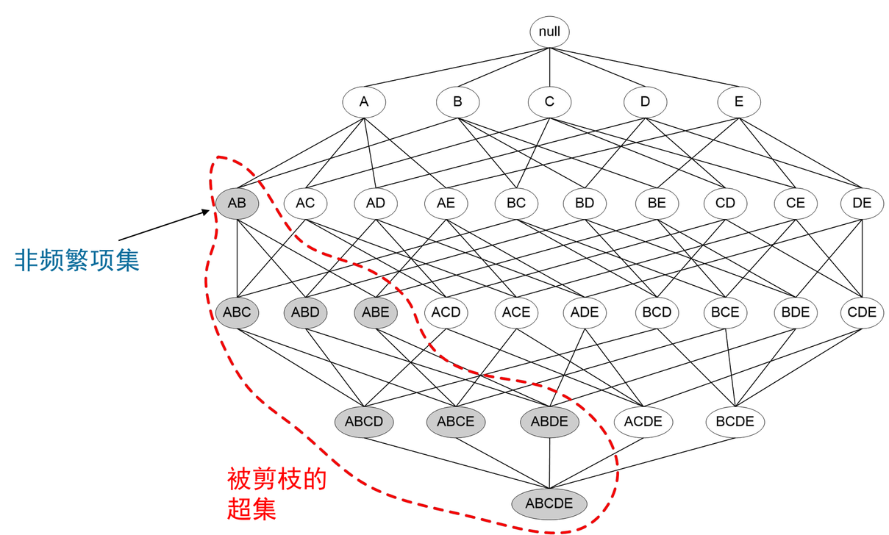
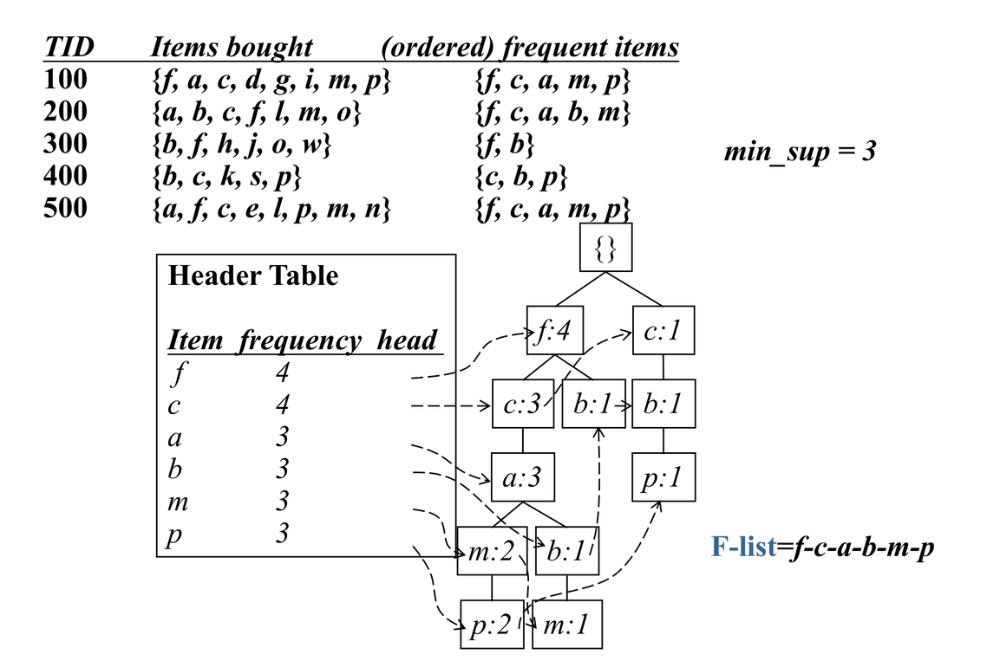

# 4 关联规则

一句话：整章一条主线——先定义**频繁项集**与**强关联规则**（支持度 + 置信度两道门槛），再用两种算法高效地找出来（**Apriori 逐层产生-测试 → FP-growth 建树免候选集**），最后把"频繁共现"的思想推广到**推荐算法**。

## 0 读这一章之前

- **前置知识**：会数数、会算比例（支持度分母是事务总数）。
- **一句话概括**：从购物篮里找出「买了 A 也常买 B」这类规则，核心算法是 Apriori。
- **三个新词**：**支持度**（这个组合出现得多不多）、**置信度**（A 出现时 B 也出现的比例）、**频繁项集**。
- **计算题集中**：给定事务表与最小支持度，手推 Apriori 的 $L_1\to L_2\to L_3$ 与规则置信度；FP-树按事务逐个插入、配方条件模式基也考。

## 总览（思维导图）

$$
\begin{array}{c}
\text{交易数据库}D\ \Rightarrow\ \text{频繁项集}\ \Rightarrow\ \text{强关联规则}\\[4pt]
\begin{cases}
4.1\ \text{概述}:\ \text{购物篮分析}\\[4pt]
4.2\ \text{Apriori}
\begin{cases}
\text{先验原理}:\ \text{非频繁项集的超集必非频繁}\\
\text{level-wise}:\ \text{连接步}+\text{剪枝步},\ \text{每层扫一遍库}
\end{cases}\\[4pt]
4.3\ \text{FP-growth}
\begin{cases}
\text{阶段一}:\ \text{扫 2 遍建 FP-树}\\
\text{阶段二}:\ \text{条件模式基}\to\text{条件 FP-树}
\end{cases}\\[4pt]
4.4\ \text{推荐算法}
\begin{cases}
\text{用频繁集}:\ 4.4.2\ \text{关联规则推荐}\\
\text{用评分}:\ 4.4.3\ \text{协同过滤（用户 / 物品）}\\
\text{其他}:\ \text{流行度、内容、模型、图、大模型}
\end{cases}\\[4pt]
4.5\ \text{小结}:\ \text{Apriori、FP-growth，四类推荐算法}
\end{cases}
\end{array}
$$

# 4.1 关联规则概述

> [!tip] 人话
> 超市小票堆成山，关联规则就是从中挖「同一个篮子里经常一起出现的东西」，好把货架摆在一起、或者做「买了又买」的推荐。

- **地位**：关联规则是数据挖掘中==最活跃==的研究方法之一。
- **目的**：发现**交易数据库**中不同商品之间的**关联关系**。
- **场景**：购物篮分析——**尿布与啤酒**、电子产品、书（电商的"买了又买 / 猜你喜欢"）。
- **起源**：R. Agrawal 等人 1993 年 SIGMOD 提出关联规则；1994 年 VLDB 提出 Apriori 快速算法（两篇经典文献引用数万次）。

# 4.2 Apriori 算法

## 4.2.1 基本概念

> [!tip] 人话
> 先认识几个词：==项、项集、事务==，再给"出现得多不多"和"含 A 时也含 B 的概率"各起一个名字：支持度、置信度。

### 引例：一个超市的 10 笔交易

商品集 $I=\{$bread, beer, cake, cream, milk, tea$\}$（6-项集），$|D|=10$。

| TID | 顾客购买商品 Items          |
| --- | --------------------------- |
| T1  | bread cream milk tea        |
| T2  | bread cream milk            |
| T3  | cake milk                   |
| T4  | milk tea                    |
| T5  | bread cake milk             |
| T6  | bread tea                   |
| T7  | beer milk tea               |
| T8  | bread tea                   |
| T9  | bread cream milk tea        |
| T10 | bread milk tea              |

### 9 个定义

- **定义 4.1 项目与项集**：$I=\{i_1,i_2,\ldots,i_m\}$ 是 $m$ 个不同项目的集合，每个 $i_k$ 是一个**项目**；项目的集合叫**项集**，元素个数为长度，长度 $k$ 的项集叫 $k$-项集。每个商品就是一个项目，$I$ 是 6-项集，$X=\{$milk, tea$\}$ 是 2-项集。
- **定义 4.2 交易**：每笔交易 $T$ 是 $I$ 上的非空子集（$T\subseteq I$，通常 $T\subset I$），有唯一交易号 TID；交易的全体构成**交易数据库** $D$，交易个数记 $|D|$（本例 $|D|=10$）。
- **定义 4.3 项集的支持度**：==绝对支持度（支持度计数）== $\text{count}(X\subseteq T)$ 是 $D$ 中包含 $X$ 的交易数量；==相对支持度==是 $X$ 出现的概率，描述 $X$ 的重要性。

$$
\text{support}(X)=\frac{\text{count}(X\subseteq T)}{|D|}
$$

- **定义 4.4 项集的最小支持度与频繁集**：用户要求项集必须满足的最小支持阈值叫**最小支持度** $\text{min\_sup}$，表示"最低重要性"；只有满足它的项集才能产生规则。支持度 $\ge \text{min\_sup}$ 的项集叫**频繁项集**（反之非频繁集），满足条件的 $k$-项集叫 $k$-频繁集，记 $L_k$。
- **定义 4.5 关联规则**：蕴含式 $R:\ X\Rightarrow Y$，其中 $X\subset I$、$Y\subset I$、$X\cap Y=\phi$；语义是「$X$ 在某一交易中出现，会导致 $Y$ 按某一概率也在同一交易中出现」。
- **定义 4.6 规则的支持度**：同时包含 $X$ 和 $Y$ 的交易数与所有交易数之比，即==联合概率== $p(X,Y)$。

$$
\text{support}(X\Rightarrow Y)=\frac{\text{count}(X\cup Y)}{|D|}
$$

- **定义 4.7 规则的置信度**：包含 $X$ 和 $Y$ 的交易数与包含 $X$ 的交易数之比，即==条件概率== $p(Y\mid X)$，反映"含 $X$ 则同时含 $Y$"的概率。

$$
\text{confidence}(X\Rightarrow Y)=\frac{\text{support}(X\cup Y)}{\text{support}(X)}=\frac{\text{count}(X\cup Y)}{\text{count}(X)}
$$

- **定义 4.8 最小支持度与最小置信度**：$\text{min\_sup}$ 衡量规则需要满足的最低**重要性**；$\text{min\_conf}$ 衡量最低**可靠性**。
- **定义 4.9 强关联规则**：$\text{support}(X\Rightarrow Y)\ge \text{min\_sup}$ **且** $\text{confidence}(X\Rightarrow Y)\ge \text{min\_conf}$ 时称**强关联规则**，否则为弱关联规则；只有强规则才能用于指导商家决策。

### 支持度与置信度的算例

> [!tip] 人话
> 支持度==＝这个组合在所有交易里出现得多不多==；置信度==＝买了 A 的人里有多少也买了 B==。

**支持度**（课件用 bread / milk / tea 演示）：

- $X=\{bread,milk\},\ Y=\{tea\}$：$\text{count}(X\cup Y)=3$，$|D|=10$，支持度 $=0.3$。
- $X=\{tea\},\ Y=\{bread,milk\}$：$\text{count}=3$，支持度 $=0.3$（$\cup$ 对称，支持度与前后件顺序无关）。
- $X=\{bread\},\ Y=\{tea,cream\}$：$\text{count}=2$，支持度 $=0.2$。

**支持度计数**：

- $X_1=\{bread\}$：计数 7，支持度 0.7。
- $X_2=\{bread,milk\}$：计数 5，支持度 0.5。
- $X_3=\{bread,milk,tea\}$：计数 3，支持度 0.3。

**置信度**：

- $\{bread,milk\}\Rightarrow\{tea\}$：$0.3/0.5=0.6$。
- $\{tea\}\Rightarrow\{bread,milk\}$：$0.3/0.7\approx 0.43$。

若 $\text{min\_sup}=0.3$：$\{bread,milk\}$ 支持度 0.5，是 ==2-频繁集==；$\{cake,milk\}$ 支持度 0.2，是**非频繁集**。

### 课件例：网球拍与网球（表 1）

数据库含 **6 个事务**，项集 $I=\{$网球拍, 网球, 运动鞋, 羽毛球$\}$，$\text{min\_sup}=0.5$、$\text{min\_conf}=0.5$。

| TID | 网球拍 | 网球 | 运动鞋 | 羽毛球 |
| --- | -----: | ---: | -----: | -----: |
| 1   |      1 |    1 |      1 |      0 |
| 2   |      1 |    1 |      0 |      0 |
| 3   |      1 |    0 |      0 |      0 |
| 4   |      1 |    0 |      1 |      0 |
| 5   |      0 |    0 |      1 |      1 |
| 6   |      1 |    1 |      0 |      0 |

考虑规则：网球拍 ⇒ 网球

$$
\text{支持度}=\frac{3}{6}=0.5\ge 0.5,\qquad \text{置信度}=\frac{3}{5}=0.6\ge 0.5
$$

两条门槛都过，所以是==强关联规则==（分子 3 = 同时买两样的交易数，分母 5 = 买网球拍的交易数）。

## 4.2.2 挖掘策略

> [!tip] 人话
> 别想着一次算完：先找==频繁项集==，再从里面挑==强规则==——两件事分开做，规模就降下来了。

### 两个子任务

1. **频繁项集产生（Frequent Itemset Generation）**：发现所有满足最小支持度阈值的项集，即**频繁项集**。
2. **规则的产生（Rule Generation）**：从上一步的频繁项集中提取所有高支持度、高置信度的规则，即**强规则**（strong rule）。

目标是找出支持度 $\ge\text{min\_sup}$ 且置信度 $\ge\text{min\_conf}$ 的所有规则。

### 为什么不能蛮干

- **格结构（lattice structure）**：由事务数据集产生的频繁项集数量可能非常大——给定 $d$ 个项目，共有 $2^{d}-1$ 个可能的候选项集（$\varnothing,A,B,\ldots,AB,AC,\ldots$ 层层张开，形如一个格）。
- **Brute-force（暴力）方法**：把格结构中==每个项集都当候选项集==，将每个候选项集与每个事务比较，确定支持度计数。

$$
M=2^{d}-1,\qquad \text{时间复杂度}\sim O(NMW)
$$

其中 $N$ 为事务数、$M$ 为候选项集数、$W$ 为事务最大宽度。这种开销可能非常大，从数据集提取规则的数量达**指数级**。

### 降低计算复杂度的两条路

- **减少候选项集的数量**：先验（apriori）原理（下一节）。
- **减少比较的次数**：不再让每个候选项集与每个事务逐一匹配，改用更高级的数据结构，或存储候选项集 / 压缩数据集。

## 4.2.3 Apriori 算法

> [!tip] 人话
> 一个项集不频繁，它加上任何东西得到的超集一定也==不频繁==——这是==剪枝==的全部依据。

> 课件编号从 4.2.3 直接跳到 4.2.6，中间几节课件没有，不是漏抄。

Apriori 是最有影响的挖掘频繁项集的算法，名字就来自它使用了**频繁项集性质的先验知识**。

### 先验原理与反单调性

- 一个项集是**频繁**的，则它的所有**子集**一定也频繁。
- 反之，一个项集是**非频繁**的，则它的所有**超集**一定也非频繁（==可以直接剪掉整条分支==）。



这种基于支持度度量修剪指数搜索空间的策略称为**基于支持度的剪枝**（support-based pruning）。它依赖支持度度量的关键性质：

$$
\text{项集的支持度}\ \le\ \text{它任一子集的支持度}\qquad(\text{反单调性 anti-monotone})
$$

### 基本思想：level-wise 逐层搜索

> [!tip] 人话
> 先挑出频繁的 1 项集，再把它们两两拼成 2 项集，==一层一层往上==，拼不出新的就停。

$$
L_1\ \to\ C_2\ \to\ L_2\ \to\ C_3\ \to\ \cdots\ \to\ L_k=\varnothing\ \text{时结束}
$$

- 先找频繁 1-项集 $L_1$，用 $L_1$ 找 $L_2$，用 $L_2$ 找 $L_3$，直到没有新的频繁 $k$-项集被发现；**每个 $L_k$ 都要求对数据库作一次完全扫描**。
- 用 $L_{k-1}$ 找 $L_k$ 分两步：
  - **连接步**：将 $L_{k-1}$ 与自身连接，产生候选 $k$-项集的集合 $C_k$；
  - **剪枝步**：剪除不满足最小支持度的候选项集（子集不频繁的候选同样先剪掉）。

### 手工跑一遍（4 个事务，min_sup 计数 = 2）

课件的事务表（$I_1$–$I_5$）：

| TID | Items             |
| --- | ----------------- |
| T1  | I1, I3, I4        |
| T2  | I2, I3, I5        |
| T3  | I1, I2, I3, I5    |
| T4  | I2, I5            |

1. **扫描 D 给 1 项集计数**：$I_1:2$、$I_2:3$、$I_3:3$、$I_4:1$、$I_5:3$；与 min_sup=2 比较，$I_4$ 被剪，得 $L_1=\{I_1,I_2,I_3,I_5\}$。
2. **由 $L_1$ 连接出 2 项集候选**：$\{I_1,I_2\},\{I_1,I_3\},\{I_1,I_5\},\{I_2,I_3\},\{I_2,I_5\},\{I_3,I_5\}$，共 6 个。
3. **扫描 D 计数**：$\{I_1,I_2\}:1$、$\{I_1,I_3\}:2$、$\{I_1,I_5\}:1$、$\{I_2,I_3\}:2$、$\{I_2,I_5\}:3$、$\{I_3,I_5\}:2$；剪掉计数 1 的两个，得 $L_2=\{\{I_1,I_3\},\{I_2,I_3\},\{I_2,I_5\},\{I_3,I_5\}\}$。
4. **由 $L_2$ 连接出 3 项集候选**：只有 $\{I_2,I_3\}$ 与 $\{I_2,I_5\}$ 前 $k-2=1$ 项相同，连接得到==唯一候选== $\{I_2,I_3,I_5\}$（其余组合的子集不在 $L_2$ 中，先被剪掉）。
5. **扫描 D 计数**：$\{I_2,I_3,I_5\}:2\ge 2$，得 $L_3=\{I_2,I_3,I_5\}$。
6. **下一轮**：$L_3$ 无法再连接出候选，**算法终止**。

全部频繁项集共 $4+4+1=9$ 个。

### 伪代码

```text
输入：交易数据库 D，最小支持阈值 min_sup
输出：D 中的频繁项集 L = ∪ Lk

(1)  L1 = find_frequent_1_itemset(D);        // 发现 1-项集
(2)  for (k = 2; L(k-1) ≠ ∅; k++) {
(3)      Ck = apriori_gen(L(k-1), min_sup);  // 根据频繁(k-1)-项集产生候选 k-项集
(4)      for each t ∈ D {                    // 扫描数据库，确定每个候选项集的支持频度
(5)          Ct = subset(Ck, t);             // 获得 t 所包含的候选项集
(6)          for each c ∈ Ct
(7)              c.count++;
(8)      }
(9)      Lk = {c ∈ Ck | c.count > min_sup};
(10) }
(11) return L = ∪ Lk;
```

> [!note] 注
> 课件伪代码第 (9) 行写的是 `c.count > min_sup`；按定义应为 $\ge$（"支持度大于或等于 min_sup 的项集称为频繁项集"）。==手算一律按大于等于判断==。

### 第二个例：Bread / Milk / Beer / Diaper（最小支持度计数 = 3）

| TID | Items                          |
| --- | ------------------------------ |
| 1   | Bread, Milk                    |
| 2   | Bread, Diaper, Beer, Eggs      |
| 3   | Milk, Diaper, Beer, Coke       |
| 4   | Bread, Milk, Diaper, Beer      |
| 5   | Bread, Milk, Diaper, Coke      |

1. **1 项集**：Bread 4、Coke 2、Milk 4、Beer 3、Diaper 4、Eggs 1 → 频繁项 Bread、Milk、Beer、Diaper（Coke、Eggs 被剪）。
2. **2 项集**：$\{$Bread, Milk$\}$ 3、$\{$Bread, Beer$\}$ **2**、$\{$Bread, Diaper$\}$ 3、$\{$Milk, Beer$\}$ **2**、$\{$Milk, Diaper$\}$ 3、$\{$Beer, Diaper$\}$ 3 → 保留 4 个（黑体两个被剪）。
3. **3 项集**：$\{$Bread, Milk, Diaper$\}$ **2** $<3$ → 无频繁 3 项集。

这个例子最能说明==先验原理==的价值：**枚举所有项集要 $C_6^1+C_6^2+C_6^3=41$ 个候选，用先验原理只需 $6+6+1=13$ 个。**

### 两个重要特点

- **逐层算法**：从频繁 1-项集到最长的频繁项集，每次遍历项集格中的一层。
- **产生-测试策略**：每次迭代用上一轮发现的频繁项集产生新候选，再对每个候选计数并与最小支持度阈值比较。

迭代次数是 $k_{\max}$，即==频繁项集的最大长度==。

### 规则产生

忽略前件或后件为空的规则，每个频繁 $k$-项集能够产生多达 $2^{k}-2$ 条关联规则。

提取方式：把项集 $Y$ 划分成两个非空子集 $X$ 和 $Y-X$，使 $X\Rightarrow Y-X$ 满足置信度阈值。

$Y=\{A,B,C,D\}$ 是频繁项集时，候选规则共 $2^4-2=14$ 条：

- **后件 1 项**：ABC⇒D, ABD⇒C, ACD⇒B, BCD⇒A
- **后件 2 项**：AB⇒CD, AC⇒BD, AD⇒BC, BC⇒AD, BD⇒AC, CD⇒AB
- **后件 3 项**：A⇒BCD, B⇒ACD, C⇒ABD, D⇒ABC

这些规则必然已经满足支持度阈值（它们都由频繁项集产生），所以==支持度只算一次，规则产生阶段只需再查置信度==。

#### 例题 1（计算）：Apriori 完整手推

**题目**：8 名学生的选课记录如下，最小支持度计数为 **3**（即 $\text{min\_sup}=3/8=0.375$），最小置信度 $\text{min\_conf}=0.6$。求全部频繁项集，并列出 3-项集产生的强规则。

- **T1**：算法, 编译
- **T2**：算法, 操作系统, 数据库
- **T3**：编译, 操作系统, 数据库, 网络
- **T4**：算法, 编译, 操作系统, 数据库
- **T5**：算法, 编译, 操作系统, 网络
- **T6**：算法, 编译, 网络
- **T7**：算法, 编译, 操作系统
- **T8**：算法, 操作系统, 数据库

**解**：

*第 1 步：扫描一次，计数 1-项集*（阈值 3）

- 数据库：4（T2, T3, T4, T8）
- 算法：7（除 T3 外全部）
- 网络：3（T3, T5, T6）
- 操作系统：6（T2, T3, T4, T5, T7, T8）
- 编译：6（T1, T3, T4, T5, T6, T7）

$L_1$ 共 5 个，全部保留：$\{$数据库, 算法, 网络, 操作系统, 编译$\}$。

*第 2 步：由 $L_1$ 连接出 10 个候选 2-项集，扫描计数*

- $\{$数据库, 算法$\}$：3 → 频繁
- $\{$数据库, 编译$\}$：2 → 剪掉
- $\{$数据库, 网络$\}$：1 → 剪掉
- $\{$数据库, 操作系统$\}$：4 → 频繁
- $\{$算法, 编译$\}$：5 → 频繁
- $\{$算法, 网络$\}$：2 → 剪掉
- $\{$算法, 操作系统$\}$：5 → 频繁
- $\{$网络, 编译$\}$：3 → 频繁
- $\{$网络, 操作系统$\}$：2 → 剪掉
- $\{$操作系统, 编译$\}$：4 → 频繁

$L_2$ 共 6 个：$\{$数据库, 算法$\}$、$\{$数据库, 操作系统$\}$、$\{$算法, 编译$\}$、$\{$算法, 操作系统$\}$、$\{$网络, 编译$\}$、$\{$操作系统, 编译$\}$。

*第 3 步：连接 + 剪枝得候选 3-项集*

- $\{$数据库, 算法$\}$ 与 $\{$数据库, 操作系统$\}$ 前 1 项相同 → $\{$数据库, 算法, 操作系统$\}$；
- $\{$算法, 操作系统$\}$ 与 $\{$算法, 编译$\}$ 前 1 项相同 → $\{$算法, 操作系统, 编译$\}$；
- 其余连接（如 $\{$数据库, 算法, 编译$\}$）的子集 $\{$数据库, 编译$\}$ 不在 $L_2$ 中 → 剪掉。

计数：$\{$数据库, 算法, 操作系统$\}$ 3 个（T2, T4, T8）；$\{$算法, 操作系统, 编译$\}$ 3 个（T4, T5, T7）→ 两个都进 $L_3$。

*第 4 步：$L_3$ 连接得候选 $\{$数据库, 算法, 操作系统, 编译$\}$，计数 1（只有 T4）$<3$ → 无频繁 4-项集，终止。*

*第 5 步：$L_3$ 产生规则*（支持度都是 $3/8=0.375$，置信度 = 项集计数 / 前件计数）

$\{$数据库, 算法, 操作系统$\}$：

- 数据库 ⇒ 算法, 操作系统：前件计数 4，置信度 $3/4=0.75$ ✓
- 算法 ⇒ 数据库, 操作系统：前件计数 7，$3/7\approx0.429$ ✗
- 操作系统 ⇒ 数据库, 算法：前件计数 6，$3/6=0.50$ ✗
- 数据库, 算法 ⇒ 操作系统：前件计数 3，$3/3=1.00$ ✓
- 数据库, 操作系统 ⇒ 算法：前件计数 4，$3/4=0.75$ ✓
- 算法, 操作系统 ⇒ 数据库：前件计数 5，$3/5=0.60$ ✓（等于阈值算满足）

$\{$算法, 操作系统, 编译$\}$：

- 算法 ⇒ 操作系统, 编译：$3/7\approx0.429$ ✗
- 操作系统 ⇒ 算法, 编译：$3/6=0.50$ ✗
- 编译 ⇒ 算法, 操作系统：$3/6=0.50$ ✗
- 算法, 操作系统 ⇒ 编译：$3/5=0.60$ ✓
- 算法, 编译 ⇒ 操作系统：$3/5=0.60$ ✓
- 操作系统, 编译 ⇒ 算法：$3/4=0.75$ ✓

**答**：$L_1$ 5 个、$L_2$ 6 个、$L_3$ 2 个，共 **13 个频繁项集**；候选项集用了 $5+10+2+1=18$ 个（暴力枚举要 $5+10+10+5+1=31$ 个）。$L_3$ 产生 **7 条强规则**（4 条 + 3 条）。

**补充问法**：求规则「数据库 ⇒ 操作系统」的支持度与置信度。项集 $\{$数据库, 操作系统$\}$ 计数 4，所以支持度 $4/8=0.5$，置信度 $4/4=1.0$，是强规则。完整收集时 $L_2$ 还能产生 10 条强规则，与 $L_3$ 的 7 条合计 **17 条**。

> [!warning] 易错
> 1. 支持度是**计数 / 事务总数**，别忘除以 $N$；置信度的分母是**前件的计数**，不是总数。
> 2. 一个 3-项集拆得出 $C_3^1+C_3^2=6$ 条规则，别只写 2 条"单前件"的。
> 3. 置信度恰好等于阈值算满足；计数恰好等于最小支持度计数也算频繁。

## 4.2.6 Apriori 算法复杂度分析

> [!tip] 人话
> Apriori 的成本由三件事决定：==候选有多少、要扫几层库、每层扫得多慢==。

- **支持度阈值 ↓**：更多项集变成频繁的，计算复杂度增加；频繁项集最大长度增加，导致扫描数据集的次数也增多。
- **项数 ↑**：存储项的支持度计数需要更多空间；若频繁项集数目也随之增长，候选更多，计算量与 I/O 开销增加。
- **事务数 ↑**：算法反复扫描数据集，运行时间随之增加。
- **事务的平均宽度 ↑**：频繁项集最大长度随之增加；事务包含更多项，支持度计数时的遍历次数增加。

## 4.2.7 Apriori 算法优缺点

- **优点**：简单、易理解、数据要求低。
- **缺点**：
  - 每一步产生候选项集时循环产生的组合过多，没有排除不应参与组合的元素；
  - 每次计算项集支持度都对数据库 $D$ 的全部记录扫描比较，大型数据库的 I/O 开销随记录数呈几何级数增长。

**瓶颈**：算法模式是"==候选项集 — 生成 — 测试=="。

- **生成候选项集代价高**：数据库含 100 个项目时，候选项集数量 $C_{100}^1+C_{100}^2+\cdots+C_{100}^{100}=2^{100}-1$。
- **多次重复扫描数据库**：每一层都要把数据库全扫一遍。

于是问题变成：**如何提高生成频繁项集的效率？** → 引出 FP-growth。

# 4.3 FP-growth 算法

> [!tip] 人话
> Apriori 慢在「反复扫库 + 生成一堆候选集」；FP-growth 只扫两遍、把数据压成一棵 ==FP-树==，再在树上「自底向上、递归地」长出频繁项集，==不生成候选集==。

## 4.3.1 动机与整体思想

- **针对瓶颈**：Apriori ==需要产生大量候选项集==、==需要重复扫描数据库==。
- **提出**：2000 年 Jiawei Han 等人提出基于 FP-树的 FP-growth，不同于 Apriori 的"产生-测试"范型，属于「==不生成候选项集==」的方法。
- **压缩**：FP-树是输入数据的压缩表示——逐个读入事务，把每个事务映射成树上一条路径。
- **两阶段**：① 建立 FP-树（把事务库构造成树）；② 挖掘 FP-树（在树上挖频繁模式与关联规则）。
- **扫描与速度**：只扫库 ==2 次==、不用候选集；比 Apriori ==约快一个数量级==。

两次扫描：

1. **第 1 次**：得到 1 维频繁项集（频繁项及支持度），按支持度降序排成 ==F-list==。
2. **第 2 次**：用 1 维频繁项过滤非频繁项，同时 ==建立 FP-树==。

## 4.3.2 五个定义（课件 4.10–4.14）

- **定义 4.10 FP-树**：树形结构，包括一个频繁项组成的==头表==、一个标记 `null` 的根节点，根的子节点为一个项前缀子树的集合。
- **定义 4.11 频繁项头表（Head Table）**：每个表项两个域——`item-name`、`node_link`；`node_link` 指向树中具有同名项的**第一个节点**，有时也带该项目的支持度计数。
- **定义 4.12 项前缀子树**：节点三个域——`item-name`（项名）、`count`（所在路径代表的交易中包含此节点项目的交易个数）、`node_link`（指向下一个同名节点，没有则 `null`）。
- **定义 4.13 条件模式基**：一个"子数据库"，由 FP-树中与某==后缀模式==一起出现的**前缀路径集**组成。
- **定义 4.14 条件 FP-树**：由条件模式基构造出的 FP-子树。

## 4.3.3 第一阶段：构造 FP-树

输入：交易记录集 $D$、最小支持度 $\text{sup\_min}$；输出：FP-树。

1. **扫一遍数据库**：得到频繁项集合 $F$ 及各自支持度，把 $F$ 按==支持度递降==排序，记为 $L$。
2. **建根节点**：创建根节点 $T$，标记 `null`。
3. **第二次扫描**：每个事务中的项按 $L$ 的次序排列，为每个事务创建分枝；沿共同前缀上的每个节点计数 +1，前缀之后创建新节点和链接。

#### 例题 2（计算）：构造 FP-树（A–E 五个商品，min_sup = 2）

**题目**：10 个事务如下，$\text{min\_sup}=2$，构造 FP-树。

- **T1**：A, B
- **T2**：B, C, D
- **T3**：A, C, D, E
- **T4**：A, D, E
- **T5**：A, B, C
- **T6**：A, B, C, D
- **T7**：A
- **T8**：A, B, C
- **T9**：A, B, D
- **T10**：B, C, E

**解**：先扫一遍计数：A 8、B 7、C 6、D 5、E 3（全部 $\ge2$），故 ==F-list = A, B, C, D, E==。第二次扫描，事务内按 F-list 排序后逐个插入：

1. **T1 {A,B}**：新建 `null → A:1 → B:1`。
2. **T2 {B,C,D}**：根下无 B，新建 `null → B:1 → C:1 → D:1`。
3. **T3 {A,C,D,E}**：与 T1 共享前缀 A，A 计数 $1\to2$；A 下新建 `C:1 → D:1 → E:1`。
4. **T4 {A,D,E}**：A $2\to3$；A 下新建 `D:1 → E:1`。
5. **T5 {A,B,C}**：A $3\to4$，A 下的 B $1\to2$，B 下新建 `C:1`。
6. **T6 {A,B,C,D}**：A $4\to5$、B $2\to3$、C $1\to2$，C 下新建 `D:1`。
7. **T7 {A}**：A $5\to6$。
8. **T8 {A,B,C}**：A $6\to7$、B $3\to4$、C $2\to3$。
9. **T9 {A,B,D}**：A $7\to8$、B $4\to5$，B 下新建 `D:1`。
10. **T10 {B,C,E}**：根下的 B $1\to2$、C $1\to2$，C 下新建 `E:1`。

**答**：FP-树为

```text
null
├── A:8
│   ├── B:5 ─┬── C:3 ── D:1
│   │        └── D:1
│   ├── C:1 ── D:1 ── E:1
│   └── D:1 ── E:1
└── B:2 ── C:2 ─┬── D:1
                └── E:1
```

> [!warning] 易错
> 1. 事务必须**先按 F-list 排序再插入**，否则同一批事务会长出不同的树。
> 2. 只有**共同前缀**上的节点计数 +1，分叉之后的节点一律新建，别错误地把同名节点合并计数。

#### 例题 3（计算）：构造 FP-树（f, c, a, b, m, p，min_sup = 3）

**题目**：5 个事务如下，$\text{min\_sup}=3$。求 F-list 与 FP-树。

| TID | Items bought              | (ordered) frequent items |
| --- | ------------------------- | ------------------------ |
| 100 | {f, a, c, d, g, i, m, p}  | {f, c, a, m, p}          |
| 200 | {a, b, c, f, l, m, o}     | {f, c, a, b, m}          |
| 300 | {b, f, h, j, o, w}        | {f, b}                   |
| 400 | {b, c, k, s, p}           | {c, b, p}                |
| 500 | {a, f, c, e, l, p, m, n}  | {f, c, a, m, p}          |

**解**：计数 f 4、c 4、a 3、b 3、m 3、p 3（其余项 $<3$ 被过滤），得 ==F-list = f-c-a-b-m-p==。按此顺序逐个插入：

1. **T100**：新建 `null → f:1 → c:1 → a:1 → m:1 → p:1`。
2. **T200**：f $1\to2$、c $1\to2$、a $1\to2$；a 下新建 `b:1 → m:1`。
3. **T300 {f,b}**：f $2\to3$；f 下新建 `b:1`。
4. **T400 {c,b,p}**：根下无 c，新建 `null → c:1 → b:1 → p:1`。
5. **T500**：f $3\to4$、c $2\to3$、a $2\to3$、m $1\to2$、p $1\to2$。

**答**：F-list = f-c-a-b-m-p，FP-树（含头表与结点链接）：

```text
null
├── f:4 ─┬── c:3 ── a:3 ─┬── m:2 ── p:2
│        │               └── b:1 ── m:1
│        └── b:1
└── c:1 ── b:1 ── p:1
```



### FP-树的大小与排序

- **通常比原数据小**：事务常共享共同项；共同项少时压缩不明显。
- **依赖排序**：一般按==支持度计数递减==排，得到较小的树。
- **结点链接**：用指针把同名结点串起来，便于快速访问。

## 4.3.4 第二阶段：挖掘 FP-树

> [!tip] 人话
> 想找"以 P 结尾"的频繁项集，就只看通向 P 的所有前缀路径（==条件模式基==），把这些前缀当成一个小数据库再建小树（==条件 FP-树==），递归下去。

- **输入**：FP-树；**输出**：频繁模式与关联规则。
- 每个事务对应一条路径，所以只要==考察包含某结点的路径==，就能找出以 $i$ 结尾的频繁项集；顺着结点链接可快速取这些路径。

五个步骤：

1. **Step1**：读库，构造频繁 1-项集及 FP-树。
2. **Step2**：遍历头表，对每个频繁项 $i$ 累积其所有前缀路径，形成 $i$ 的==条件模式基==。
3. **Step3**：把条件模式基上每条路径的节点计数更新为 $i$ 的计数，构造==条件 FP-树==。
4. **Step4**：在条件 FP-树中找出所有路径，对路径上节点做所有组合，合并计数。
5. **Step5**：把 Step4 得到的频繁项集与 $i$ 合并，得到包含 $i$ 的频繁项集。

Step2–5 循环，直到遍历完头表。

#### 例题 4（计算）：挖掘 FP-树（两例续）

**题目**：分别对例题 2 的 FP-树（min_sup = 2）与例题 3 的 FP-树（min_sup = 3）做第二步挖掘，求各频繁项的条件模式基与包含它的频繁项集。

**解**：

*（1）例题 2 的树*，自底向上按头表顺序处理：

| 项  | 条件模式基                 | 合并计数                            | 得到的频繁项集                                              |
| --- | -------------------------- | ----------------------------------- | ----------------------------------------------------------- |
| B   | A:5                        | A:5                                 | $\{$B$\}$、$\{$A,B$\}$                                      |
| C   | AB:3, A:1, B:2             | A:4, B:5, AB:3                      | $\{$C$\}$、$\{$A,C$\}$、$\{$B,C$\}$、$\{$A,B,C$\}$          |
| D   | ABC:1, AB:1, AC:1, A:1, BC:1 | A:4, B:3, C:3; AB:2, AC:2, BC:2     | $\{$D$\}$、$\{$A,D$\}$、$\{$B,D$\}$、$\{$C,D$\}$、$\{$A,B,D$\}$、$\{$A,C,D$\}$、$\{$B,C,D$\}$ |
| E   | ACD:1, AD:1, BC:1          | A:2, C:2, D:2; AD:2                 | $\{$E$\}$、$\{$A,E$\}$、$\{$C,E$\}$、$\{$D,E$\}$、$\{$A,D,E$\}$ |

（A 在树中无处可依，条件模式基为空，只有 $\{$A$\}$。）

*（2）例题 3 的树*，各频繁项的条件模式基：

- **c**：f:3
- **a**：fc:3
- **b**：fca:1, f:1, c:1
- **m**：fca:2, fcab:1
- **p**：fcam:2, cb:1

自底向上逐个处理（$\text{min\_sup}=3$）：

- **p**：基 fcam:2、cb:1 → 条件 FP-树里两条路径共享前缀 c，c 累加为 3，f 只有 2 被剪 → 只剩 $\{$c:3$\}$ → 得到 $\{$p$\}$、$\{$c,p$\}$（计数 3）。
- **m**：基 fca:2、fcab:1 → 两条路径共享 f-c-a，累加后 f:3、c:3、a:3（b:1 被剪）→ 得到 $\{$m$\}$ 以及 $\{$f,m$\}$、$\{$c,m$\}$、$\{$a,m$\}$、$\{$f,c,m$\}$、$\{$f,a,m$\}$、$\{$c,a,m$\}$、$\{$f,c,a,m$\}$（都计数 3）。
- **b**：基 fca:1、f:1、c:1 → 累加后最高只有 f:2，全部 $<3$，条件 FP-树为空 → 只得到 $\{$b$\}$（计数 3）。
- **a**：基 fc:3 → 条件 FP-树 $\{f{:}3,\ c{:}3\}$ → 得到 $\{$a$\}$、$\{$f,a$\}$、$\{$c,a$\}$、$\{$f,c,a$\}$（都计数 3）。
- **c**：基 f:3 → 得到 $\{$c$\}$（计数 4）、$\{$f,c$\}$（计数 3）。
- **f**：基为空 → 只得到 $\{$f$\}$（计数 4）。

**答**：例题 2 的树挖出含 A–E 的全部频繁项集（上表 19 个）；例题 3 的树在 $\text{min\_sup}=3$ 下共得 **18 个**频繁项集——6 个 1 项集 $\{$a$\}$、$\{$b$\}$、$\{$c$\}$、$\{$f$\}$、$\{$m$\}$、$\{$p$\}$；7 个 2 项集 $\{$a,c$\}$、$\{$a,f$\}$、$\{$a,m$\}$、$\{$c,f$\}$、$\{$c,m$\}$、$\{$c,p$\}$、$\{$f,m$\}$；4 个 3 项集 $\{$a,c,f$\}$、$\{$a,c,m$\}$、$\{$a,f,m$\}$、$\{$c,f,m$\}$；1 个 4 项集 $\{$a,c,f,m$\}$。

> [!warning] 易错
> 1. 条件模式基的计数取**该前缀路径的计数**，不是项集总计数；建条件 FP-树时==共享前缀要累加==——m 的基 fca:2 与 fcab:1 单独看都 $<3$，累加后 f/c/a 都到 3，于是照样挖出 $\{$f,m$\}$ 等模式。
> 2. 累加后仍低于 min_sup 的节点要剪掉（如例题 2 中的 AC:1、CD:1），只留 $\ge \text{min\_sup}$ 的。

## 4.3.5 结构优点与对比

> [!tip] 人话
> 树把"每条事务一行"压成"共享前缀的路径"，所以既完整又能变小。

FP-树的两个优点：

- **完整性**：保持了频繁项集挖掘的完整信息。
- **紧密性**：减少不相关信息，去掉非频繁项；项按支持度降序排列，越频繁越可能被共享；==不计结点链接和计数域时不会比原数据库更大==。

**FP-growth vs Apriori**（数据集 T25I20D10K，横轴为支持度阈值 0.5%–3%）：各阈值下 FP-growth 的运行时间都明显更低，==约快一个数量级==，且不产生候选集。

# 4.4 推荐算法

> [!tip] 人话
> 关联规则挖出的是「哪些东西常一起出现」，推荐算法要回答的是「这个页面上该给这个人看什么」。

## 为什么需要推荐

- **长尾挖掘**：商品、服务、广告的销量是**高斯分布 vs ==长尾分布==**，问题是"如何找到匹配的长尾商品"。
- **流量利用**：把宝贵的页面位置花在更可能被点击的内容上。
- **用户体验**：用户视角——找到自己想要的商品。
- **技术储备**：平台视角——提升长尾商品价值。

推荐要解决的"页面困境"，四个特点：

- **宝贵的**：页面位置有限（外部成本、内部成本）。
- **不确定的**：用户意图不确定。
- **差异化的**：整体用户群与到达具体页面/位置的用户不同。
- **稀疏的**：差异化的另一面——每一"种"用户的数量很少。

技术发展脉络（课件箭头图）：**人工规则 → 关联规则 → 行为类算法 → 内容类算法 → 多算法融合 → 引入机器学习 → 引入深度学习**。

## 4.4.1 基于流行度的推荐算法

> [!tip] 人话
> 谁热推谁，不问你是谁——最省事，也最不解个人。

- **做法**：比较简单粗暴，主要对热点商品或信息推荐：用分享率、点击量、得票数等数据按某种热度排序推荐给用户。
- **优点**：简单；适用于刚注册的新用户，能解决==对（新）用户推荐的冷启动问题==。
- **缺点**：分数是人为设计的，无法提供个性化推荐。
- **优化**：加入用户分群的流行度排序，例如把热榜上的体育内容优先推荐给体育迷，把政要热文推给热爱谈论政治的用户。

热度打分（衰减式）：

$$
\text{score}=\frac{P-1}{(T+2)^G}
$$

$P$ 为帖子得票数，$T$ 为帖子发布时间，$G$ 为超参数（控制衰减速度）。

## 4.4.2 基于关联规则的推荐算法

> [!tip] 人话
> 直接把这一章的频繁项集搬去推荐：同一篮子里常一起出现的东西，互相推。

- **首要目标**：挖掘出关联规则——同时被很多用户购买的物品集合，集合内的物品可以**相互推荐**。
- **算法来源**：目前关联规则挖掘算法主要从 **Apriori** 和 **FP-growth** 两个算法发展演变而来。
- **优势**：==转化率较高==——用户已购买频繁集合中的若干项目后，购买该集合中其他项目的可能性更高。
- **缺点**：
  - 计算量较大（但可以离线计算，影响不大）；
  - 采用用户数据，不可避免存在**冷启动和稀疏性**问题；
  - 存在==热门项目容易被过度推荐==的问题。

## 4.4.3 基于协同过滤的推荐算法

> [!tip] 人话
> 不分析物品内容，只借别人的行为：和你口味像的人喜欢什么，就推给你；或者你喜欢的物品的"邻居"物品推给你。

协同过滤基于"**物以类聚，人以群分**"的假设：喜欢相同物品的用户更有可能具有相同的兴趣。它一般应用于**有用户评分**的系统，通过分数刻画用户对物品的喜好，被视为利用==集体智慧==的典范——不需要对项目进行特殊处理，而是通过用户建立物品与物品之间的联系。

两类：

| 类型                | 口诀       | 做法                                                                                   |
| ------------------- | ---------- | -------------------------------------------------------------------------------------- |
| 基于用户 User-based | "人以群分" | 找到与用户兴趣相同的用户（有过类似行为），把这些人浏览过/买过的物品推荐给用户          |
| 基于物品 Item-based | "物以类聚" | 若很多用户对某两个物品有相似偏好，则这两个物品"相似"，推荐与用户喜欢过的物品相似的东西 |

### 4.4.3.1 基于用户的推荐算法

思路：根据所有用户对物品的偏好（评分），发现与当前用户口味相似的"**邻居**"用户群（一般用计算 **K 近邻**的算法），再基于这 $K$ 个邻居的历史偏好为当前用户推荐。

- **优点**：推荐物品之间内容上可能完全不相关，因此可以==发现用户的潜在兴趣==，并为每个用户生成个性化推荐结果。
- **缺点**：Web 系统中用户增长速度远大于物品增长速度，计算量增长巨大，系统性能容易成为瓶颈；业界单纯用基于用户的协同过滤较少。

用户向量化（每个维度是一个**物品**，如 $u:[1,1,0,1,\ldots]$），用向量空间模型（VSM）算基础相关性：

$$
\text{sim}(u_i,u_j)=\cos\big(\theta_{\{u_i,u_j\}}\big)=\frac{u_i\cdot u_j}{\lvert u_i\rvert\lvert u_j\rvert}
$$

$$
\text{rel}(\text{user}_i,\text{item}_j)=\sum_k \text{sim}(\text{user}_i,\text{user}_k)\cdot\text{rate}(\text{user}_k,\text{item}_j)
$$

三个工程问题（课件 Q&A）：

- **是否要计算每两个用户之间的相似度？** 不需要——大量用户之间的相关性可以预判为 0（如 $[1,2,0]\cdot[0,0,3]$ 结果必然为 0），用==倒排表==高效筛选。
- **是否要用一个用户的全部相关用户来计算？** 不需要——相关性影响衰减非常快，只需取 **TopK**；去除的位置是"用户相关性计算阶段"。
- **没有 rate 怎么办？** 用隐式反馈（implicit feedback）：点击、浏览、购买……

### 4.4.3.2 基于物品的推荐算法

思路：用所有用户对物品的偏好（评分）发现**物品与物品之间的相似度**，再根据用户的历史偏好把类似的物品推荐给用户。

- **与关联规则的关系**：可以看作是关联规则推荐的一种==退化==；但协同过滤更多考虑用户实际评分，且只计算相似度而非寻找频繁集，因此准确率较高、覆盖率更高。
- **与基于用户相比**：应用更广泛，扩展性和算法性能更好（物品增长速度一般较平缓，性能变化不大）；缺点是无法提供个性化的推荐结果。

物品向量化（每个维度是一个**用户**，如 $\text{item}:[1,1,0,1,\ldots]$）：

$$
\text{sim}(\text{item}_i,\text{item}_j)=\cos\big(\theta_{\{\text{item}_i,\text{item}_j\}}\big)=\frac{\text{item}_i\cdot \text{item}_j}{\lvert \text{item}_i\rvert\lvert \text{item}_j\rvert}
$$

$$
\text{rel}(\text{user}_i,\text{item}_j)=\sum_k \text{sim}(\text{item}_k,\text{item}_j)\cdot\text{rate}(\text{user}_i,\text{item}_k)
$$

课件例：6 个用户 × 6 个物品的评分矩阵（空格 = 未评分）。

| 用户 \ 物品 | 1   | 2   | 3   | 4   | 5   | 6   |
| ----------- | --- | --- | --- | --- | --- | --- |
| A           | 4   | 3   |     |     | 5   |     |
| B           | 5   |     | 4   |     | 4   |     |
| C           | 4   |     | 5   | 3   | 4   |     |
| D           |     | 3   |     |     |     | 5   |
| E           |     | 4   |     |     |     | 4   |
| F           |     |     | 2   | 4   |     | 5   |

按用户维度算物品相似度，物品 1 与物品 2/3/4/5/6 的余弦相似度为：

- **物品 2**：0.27
- **物品 3**：0.79
- **物品 4**：0.32
- **物品 5**：0.99
- **物品 6**：0

核对：物品 1 的向量（按用户 A…F）$=(4,5,4,0,0,0)$，物品 2 $=(3,0,0,3,4,0)$，只有用户 A 有共同评分，$\dfrac{12}{\sqrt{57}\cdot\sqrt{34}}\approx0.27$，属于**相似**（课件标绿）；物品 1 与物品 5 $=(5,4,4,0,0,0)$ 在 A、B、C 上高度重合，得 0.99；物品 6 与物品 1 没有任何共同用户，相似度 0，**不相似**（课件标红）。

### 基于用户 vs 基于物品

两句话记住差异：基于用户是==结果群体化、对物品新行为敏感==；基于物品是==结果个性化、推荐理由更有说服力==。

| 基于用户                                           | 基于物品                                       |
| -------------------------------------------------- | ---------------------------------------------- |
| 结果群体化、扩展化                                 | 结果个性化、精准化                             |
| 适用于用户量相对小于物品量的场景，例如新闻推荐系统 | 适用于物品量相对小于用户量的场景，例如电商平台 |
| 对用户新行为敏感度低                               | 对用户新行为敏感度高                           |
| 对物品新行为敏感度高                               | 对物品新行为敏感度低                           |
| 推荐理由说服力较弱                                 | 推荐理由说服力较强                             |

### 协同过滤的优缺点

- **优点**：
  - 不需要对物品或用户进行严格建模，也不要求物品的描述是机器可以理解的，因此==领域无关==；
  - 计算出来的推荐是开放的，可以共用他人的经验，很好地支持用户发现潜在的兴趣偏好。
- **缺点**：
  - 核心是基于历史数据，对新物品和新用户都有"冷启动"问题；
  - 推荐效果依赖于用户历史偏好数据的多少和准确性；
  - 大部分实现中用户历史偏好用**稀疏矩阵**存储，稀疏矩阵上的计算有明显问题，少部分人的错误偏好会严重影响准确度；
  - 对于一些特殊品味的用户不能给予很好的推荐；
  - 以历史数据为基础，抓取和建模用户偏好后很难利用偏好演变，方法==不够灵活==。

## 4.4.4 基于内容的推荐算法

> [!tip] 人话
> 不看别人怎么点，只看东西本身写了什么：给文章打 tag，tag 像就推。

多用于资讯类应用：针对文章（电影、音乐）本身抽取一些 **tag** 作为关键词，用这些 tag 评价两篇文章的相似度。

- **优点**：易于实现；不需要用户数据，因此==不存在稀疏性和冷启动问题==；基于物品本身特征推荐，因此==不存在过度推荐热门的问题==。
- **缺点**：
  - 抽取的特征既要保证准确性又要具有实际意义，否则很难保证推荐结果的相关性（豆瓣采用人工维护 tag 的策略）；
  - 推荐的 Item 可能会重复，典型的就是新闻推荐（看了一则津云上的新闻，很可能推荐的内容和你浏览过的一致）。

方法：把文本表示成一个向量，用 TF-IDF 加权，再用余弦相似度算相关性。

$$
\text{tf}(t,d)=\frac{n_{t,d}}{\sum_k n_{k,d}},\qquad
\text{idf}(t,D)=\log\frac{\lvert D\rvert}{\lvert\{d\in D:\ t\in d\}\rvert}
$$

$$
\text{tf-idf}=\text{tf}(t,d)\times\text{idf}(t,D),\qquad
\text{sim}(p,q)=\cos(\theta)=\frac{p\cdot q}{\lvert p\rvert\cdot\lvert q\rvert}
$$

几何直觉：向量 $q$ 与 $d_1$、$d_2$ 的夹角 $\alpha$、$\theta$ 越小，文档越相似。

## 4.4.5 基于模型的推荐算法

> [!tip] 人话
> 前面几类都是人手定的规则；这一类干脆"训练一个模型"来预测你会不会喜欢。

为什么要换思路（课件对比）：

| 前述方法的缺点               | 机器学习的优点               |
| ---------------------------- | ---------------------------- |
| 启发式，无明确目标           | 对齐明确目标，成熟的优化方法 |
| 相对静态，反应慢             | 时效性灵活，反映可快可慢     |
| 考虑维度较少，个性化程度不足 | 特征维度丰富，个性化程度细腻 |
| 纯手工，改进空间小           | 理论储备丰富，发展空间大     |

主要使用常用的机器学习算法对目标用户建立推荐模型，再对用户爱好进行预测推荐、对推荐结果打分排序。

- **浅层模型**：LR、GBDT、特征组合。
- **半深度模型**：FM、FFM。
- **深度模型**：Wide & Deep、embedding、LSTM、ESMM、TDM 等。

前沿（知道即可）：Nature Machine Intelligence 2023《Human–AI adaptive dynamics drives the emergence of information cocoons》指出推荐是==动态的人机交互过程==，人机相互适应可能推动"信息茧房"出现。

## 4.4.6 基于图的推荐算法

> [!tip] 人话
> 把用户和物品都当成图上的点，用"点与点怎么连通、消息怎么传"来做推荐。

| 类别                 | 代表性方法                                   | 核心思想          |
| -------------------- | -------------------------------------------- | ----------------- |
| 随机游走 / 图排序    | PersonalRank, ItemRank, SimRank, RWR         | 图上的概率传播    |
| 图嵌入               | DeepWalk, node2vec, LINE, metapath2vec       | 节点低维向量化    |
| 同构 GNN             | GCN, GraphSAGE, GAT, PinSage, NGCF, LightGCN | 邻域消息聚合      |
| 异构图 GNN           | HetGNN, HAN, MAGNN, RGCN, HGT                | 元路径 / 关系聚合 |
| 知识图谱 GNN         | RippleNet, MKR, KGCN, KGAT, KGIN             | 知识图谱增强      |
| 社交图 GNN           | GraphRec, DiffNet, SocialGCN, MHCN           | 社交影响传播      |
| 会话图 GNN           | SR-GNN, GGNN, TAGNN, LESSR                   | 会话序列图建模    |
| 图对比学习           | SGL, SimGCL, XSimGCL, NCL                    | 自监督对比        |
| 图 Transformer / LLM | GraphGPT, LLaGA, GPT4Rec                     | 大模型 + 图       |
| 联邦图推荐           | FedPerGNN, FedGraphNN                        | 隐私保护协同训练  |

趋势：==从浅层图嵌入走向深度 GNN，从同构二部图走向异构图 / 知识图谱，从集中式走向联邦与隐私保护，从监督学习走向自监督与对比学习==，并开始与大语言模型融合（2022 年 Nature Communications 提出联邦图神经网络框架用于隐私保护个性化推荐）。

## 4.4.7 基于大模型的推荐算法

> [!tip] 人话
> 不再从候选集里挑，而是让模型==直接生成==你会喜欢的 item。

多用于**大规模、动态兴趣和复杂用户行为**的推荐场景：通过 Transformer、生成模型或大语言模型对用户历史行为、物品信息和上下文统一建模，并**直接生成**用户可能感兴趣的 Item 或 Item Token，而不是传统的候选集评分和排序。

流程：

$$
\begin{array}{c}
\text{收集点击、浏览、收藏、购买等历史行为}
\ \to\ \text{分析用户当前关注的内容}\\[4pt]
\to\ \text{学习"先看什么、后看什么"的行为规律}
\ \to\ \text{预测下一步可能感兴趣的内容}\\[4pt]
\to\ \text{输出电影、新闻、商品、音乐等个性化内容}
\end{array}
$$

| 范式        | 核心机制                  | 代表性方法              | 核心优势               | 主要挑战                |
| ----------- | ------------------------- | ----------------------- | ---------------------- | ----------------------- |
| 判别式      | LLM 作为特征编码器        | LLMEmb, CEILLM          | 实现简单，增强现有模型 | 未充分利用 LLM 推理能力 |
| 生成式      | 推荐即文本生成            | P5, TALLRec, RecLM-cgen | 统一框架，可解释性强   | 幻觉，推理延迟          |
| RAG         | 检索 + 生成               | CFRAG                   | 引入外部知识，缓解幻觉 | 检索质量依赖            |
| 图 / 多模态 | LLM + 结构化 / 多模态信息 | KGGLM, Molar            | 融合知识图谱与视觉信号 | 模态对齐复杂            |
| 智能体      | LLM 作为 Agent 大脑       | 自主工具学习 Agent      | 多轮交互，主动规划     | 工程复杂，延迟高        |

- **优点**：能直接建模用户行为序列，捕捉兴趣随时间的变化；可利用文本、标签等丰富的语义信息；推荐过程从候选集排序转变为生成结果，减少对人工特征和候选集的依赖。
- **缺点**：模型结构复杂，训练和推理成本较高；推荐结果的准确性和可控性仍需进一步约束。

典型方法：Transformer-based Sequential Recommendation、Generative Retrieval、LLM-based Recommendation。

当前趋势是**混合与融合**：判别式方法为生成式提供高质量的语义表示，RAG 为生成式注入实时知识，图结构为 LLM 补充结构化推理能力。
