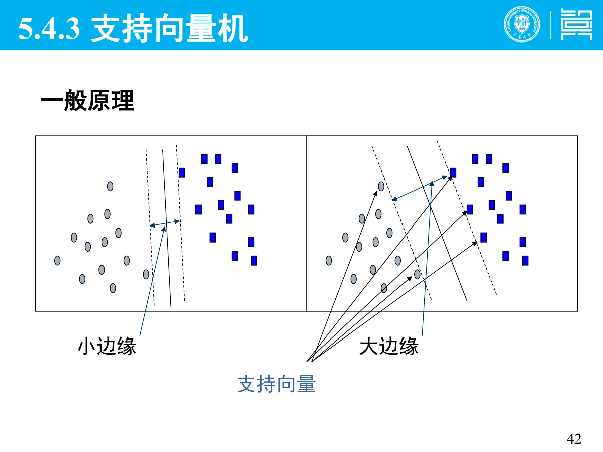
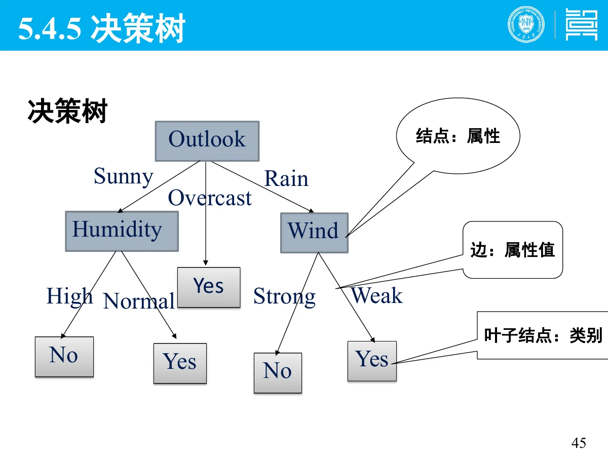
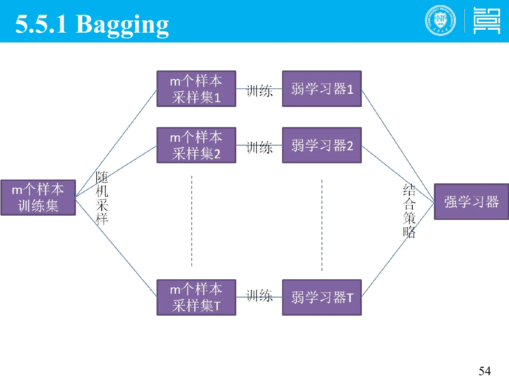
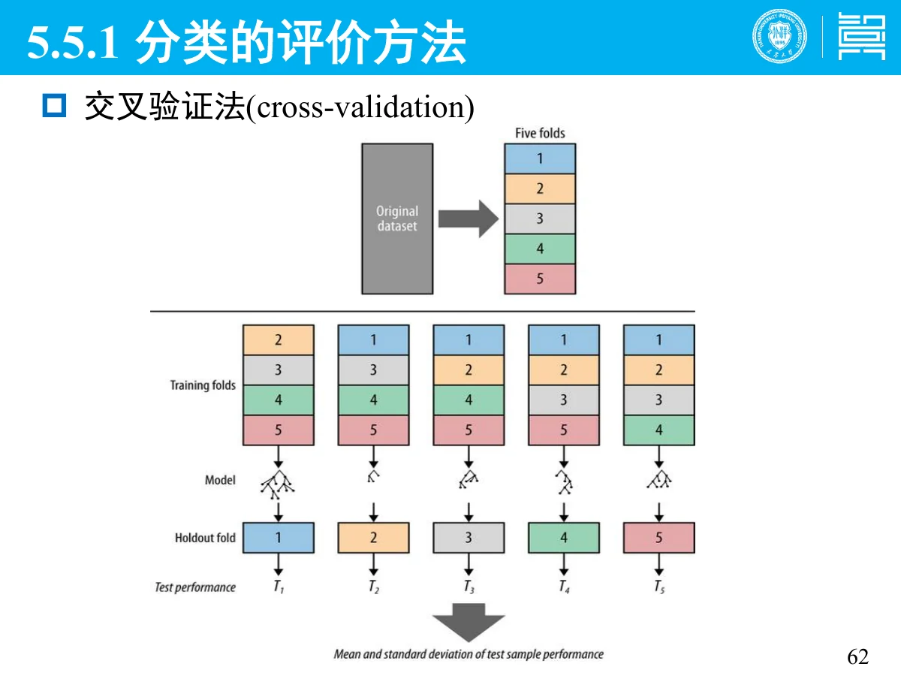

# 5 分类

一句话：分类是**有监督**学习——用带标签的训练数据学一个映射 $y=f(X)$，再拿它给新样本贴标签；本章重点是 **SVM 的核心思想与核函数**、**一元线性回归的模型/损失/求解**，以及分类的评价方法。

## 0 读这一章之前

- **前置知识**：知道「向量」和「求最小值」是什么意思就够了。
- 整章一句话：**给人看过的例子，让它学会给没见过的例子贴标签**。
- 三个新词：**有监督**（有标准答案）、**分类器**（那个映射函数）、**过拟合**（把训练集背下来了，换新数据就错）。
- 本章与第 6 章的关系：本章要标签，第 6 章不要标签——这就是有监督与无监督的区别。

## 总览（思维导图）

$$
\text{第 5 章 分类}
\begin{cases}
5.1\ \text{有监督 / 无监督}:\ \text{分类 vs 回归 vs 聚类}\\
5.3\ \text{分类过程}:\ \text{训练}\to\text{测试}\to\text{准确率（过拟合）}\\
5.4\ \text{常用方法}
\begin{cases}
\text{kNN}:\ \text{看最近的 }k\text{ 个邻居}\\
\text{SVM}:\ \text{最大间隔超平面}+\text{核函数}\\
\text{其他}:\ \text{Logistic、神经网络、决策树、朴素贝叶斯}\\
\text{一元线性回归}:\ \text{模型、损失、求解}
\end{cases}\\[4pt]
5.5\ \text{集成学习}:\ \text{Bagging、Boosting}\\
5.5\ \text{评估}:\ \text{训练测试法、交叉验证、四个准则}
\end{cases}
$$

## 考点权重

| 模块         | 真正需要掌握                                          |   优先级 |
| ------------ | ----------------------------------------------------- | -------: |
| 5.1 监督方式 | 有监督与无监督的区别、分类与回归的区别（简答高频）    | **最高** |
| 5.3 分类过程 | 学习/测试两阶段、训练集与测试集、过拟合及其原因与对策 | **很高** |
| 5.4.3 SVM    | **最大间隔超平面**、支持向量、**核函数的作用**        | **最高** |
| 5.1.3 / 回归 | **一元线性回归：模型、损失函数、参数求解过程**        | **最高** |
| 5.4 其他方法 | kNN 思路、决策树、朴素贝叶斯的独立假设                |       高 |
| 5.5 集成学习 | Bagging（自助采样 + 投票/平均）、Boosting（调权重）   |       高 |
| 5.5 评估     | 训练测试法、十折交叉验证、四个评价准则                | **很高** |

# 5.1 分类、回归与聚类

> **人话**：有标准答案的叫有监督，没有答案只有一堆数据的叫无监督。

## 5.1.1 有监督与无监督

| 类型   | 别名 | 用在哪     | 条件                                   |
| ------ | ---- | ---------- | -------------------------------------- |
| 有监督 | —    | 分类、回归 | 需要训练集和测试集，训练集带**类标号** |
| 无监督 | —    | 聚类       | 只有数据，按**自身相似性**自动聚成几类 |

- 有监督：在已知训练集的前提下，把测试样本的特征与训练集对比，分到对应的类。
- 无监督：有一堆数据，按它们内部的相似性自动聚成几类。

## 5.1.2 分类与回归的区别

| 项     | 分类                             | 回归                             |
| ------ | -------------------------------- | -------------------------------- |
| 预测值 | **离散**的类标号                 | **连续**的函数值                 |
| 例子   | 贷款申请者分「安全 / 有风险」    | 预测贷给该顾客多少钱是安全的     |
| 目标   | 构建模型分类现有数据并分类新数据 | 建立连续函数值模型（可填缺失值） |

两者都属于**有监督**，都是「提取描述重要数据类的模型 / 预测未来趋势」。

## 5.1.3 回归的由来

「回归」一词 1855 年由高尔顿研究父子身高时提出：父母高，子女一般也高，但不如父母那么高；父母矮，子女一般也矮，但不如父母那么矮——下一代身高有**向中间值回归**的趋势（回归效应）。研究两个数值变量关系的这类方法就叫回归分析。

# 5.2 分类过程

> **人话**：先拿带答案的题练习（训练），再用没做过的题考试（测试），考出来的分才是真本事。

## 5.2.1 四个关键步骤

1. **获取数据**：输入数据并量化；
2. **预处理**：去噪、处理空缺值、数据集成与变换；
3. **学习阶段**：划分数据集，在**训练集**上构造分类器；
4. **测试阶段**：对未知类标号的测试样本分类，评估准确率。

## 5.2.2 训练集与测试集

- **训练集**：由数据样本（$d$ 维属性向量）及其类标号组成。
- **训练样本**：训练集中的单个样本，假定每个样本属于一个预定义的类。
- 分类算法通过分析训练集来**学习一个映射 $y=f(X)$**；学到的模型可以用分类规则、决策树或数学公式表示。
- **测试集必须独立于训练集**，否则会「过分拟合」。
- **准确率** = 被正确分类的测试样本百分比。

## 5.2.3 过拟合

定义（Mitchell）：给定假设空间 $H$，若存在 $h'\in H$，使 $h$ 在训练样例上的错误率比 $h'$ 小，但在整个实例分布上 $h'$ 的错误率更小，则称 $h$ **过度拟合**训练数据。

| 原因                         | 对策                                       |
| ---------------------------- | ------------------------------------------ |
| 样本太少 / 抽样方法有问题    | **交叉验证**                               |
| 噪声干扰过大，模型记住了噪声 | **加正则项**（L1 更易稀疏，L2 让参数趋 0） |
| 建模假设在新数据上不成立     | 针对树模型：提前停止生长、或生长后剪枝     |

# 5.3 常用的分类方法

> **人话**：不同算法只是「怎么划那条分界线」的不同想法。

## 5.3.1 k-近邻（kNN）

给定未知样本，搜索模式空间找出**最接近的 $k$ 个训练样本**，用这 $k$ 个中最常见的类作为预测结果。

两个研究点：**近邻个数 $k$ 的选取**、**近邻的度量方法**（距离）。

## 5.3.2 支持向量机（SVM）

> **人话**：能分开两类的线有很多条，SVM 挑那条「离两边都最远」的，最不容易被新样本打脸。

- 数据是 $d$ 维向量，被分为两类；SVM 的目的是找一个 **$d-1$ 维的超平面**把 $d$ 维空间分开。
- 决策边界是**最大边距超平面（maximum-margin hyperplane）**：不仅分开，还要让两侧最近的样本点到它的距离最大。
- 离超平面最近、决定边距的那些样本点叫**支持向量**——换个说法：模型只由这几个点撑起来。
- **核函数的作用**：把样本从低维映到高维，使原本线性不可分的数据在高维变得线性可分（核技巧），从而用线性方法做**非线性分类**。常见核：线性核、多项式核、RBF 核。

对比记忆：小边缘 → 新样本稍微一动就越界；大边缘 → 容错空间大。

## 5.3.3 其他常用方法

| 方法          | 核心                                   | 特点                                           |
| ------------- | -------------------------------------- | ---------------------------------------------- |
| Logistic 回归 | 用 sigmoid 把线性输出压到 (0,1) 当概率 | 输出可解释为概率                               |
| 神经网络      | 多层带权连接，学习时调权               | 精度较高、鲁棒；训练慢、不可解释、难融领域知识 |
| 决策树        | 按属性不断划分，形成树形规则           | 可读性强，容易解释                             |
| 朴素贝叶斯    | 贝叶斯定理 + **属性相互独立**假设      | 简单快速；独立性假设常常不成立                 |

朴素贝叶斯公式：

$$
P(c\mid x)=\frac{P(x\mid c)P(c)}{P(x)}
$$

## 5.3.4 一元线性回归（考试计算/简答）

> **人话**：找一条直线，让所有点到它的垂直距离平方和最小。

**模型**（一元 = 一个自变量）：

$$
\hat y=wx+b
$$

**损失函数**（均方误差 MSE）：

$$
L(w,b)=\frac{1}{n}\sum_{i=1}^{n}\big(y_i-(wx_i+b)\big)^2
$$

**求解过程**两条路：

1. **最小二乘（闭式解）**：对 $w$、$b$ 求偏导并令其为 0，得

$$
w=\frac{\sum_i (x_i-\bar x)(y_i-\bar y)}{\sum_i (x_i-\bar x)^2},\qquad b=\bar y-w\bar x
$$

2. **梯度下降（迭代解）**：随机给初值，沿负梯度方向反复更新

$$
w\leftarrow w-\eta\frac{\partial L}{\partial w},\qquad b\leftarrow b-\eta\frac{\partial L}{\partial b}
$$

$\eta$ 是学习率。数据量大或无法闭式求解时用梯度下降。

# 5.4 集成学习

> **人话**：一个模型容易错，那就训练一堆，然后投票或取平均。

**Bagging（套袋法）**：

1. 从训练集**有放回**抽样（Bootstrapping）$N$ 次，得到与训练集同大小的训练集，重复 $K$ 次得到 $K$ 个训练集；
2. 每个训练集训练一个模型，共 $K$ 个模型；
3. 分类问题**投票**、回归问题**取平均**。

**Boosting**：串行训练，后一个模型重点纠正前一个的错误。**AdaBoost** 通过调整样本权重实现：**提高**前一轮错分样本的权重、**降低**分对样本的权重，让错分样本受到更多关注。

一句话区别：Bagging 并行、样本重采样；Boosting 串行、样本加权。

# 5.5 分类的评估

## 5.5.1 两种评估方法

| 方法       | 做法                                                                                              |
| ---------- | ------------------------------------------------------------------------------------------------- |
| 训练测试法 | 随机划分：约 2/3 训练、1/3 测试，算准确率；可重复多次取平均                                       |
| 交叉验证法 | **十折交叉验证**：把数据分 10 份，轮流 9 份训练 1 份测试，10 次结果取均值；常做多次十折以提高精度 |

## 5.5.2 四个评价准则

| 准则     | 含义                                               |
| -------- | -------------------------------------------------- |
| 准确度   | 正确预测新的或未见过的数据类标号的能力             |
| 速度     | 产生模型与使用模型的计算花费（建模速度、分类速度） |
| 鲁棒性   | 在噪声或缺失值下仍能正确分类的能力                 |
| 可解释性 | 模型能被理解的程度                                 |

# 5.6 长尾分布建模（了解即可）

现实中一部分类别样本极多、更多类别样本极少；80% 的样本集中在 20% 的头部类别上，形成极端不平衡分布。这就是长尾分布，也是分类模型在稀有类上表现差的根源。

# 5.7 本章小结

- 有监督（分类、回归）需要标签；无监督（聚类）不需要——这是简答必问。
- 分类输出离散类标号，回归输出连续值。
- 过拟合＝训练集上更好、新数据上更差；对策：交叉验证、正则项、剪枝/早停。
- SVM：最大间隔超平面 + 支持向量；核函数负责把低维线性不可分变成高维可分。
- 一元线性回归：$\hat y=wx+b$，MSE 损失，最小二乘闭式解或梯度下降。
- Bagging 并行重采样投票，Boosting 串行调权重。
- 评估：十折交叉验证；准则看准确度、速度、鲁棒性、可解释性。

# 5.8 考前速查表

| 题目出现                       | 立刻想到                           |
| ------------------------------ | ---------------------------------- |
| 有无监督的区别                 | 是否需要带类标号的训练集           |
| 分类 vs 回归                   | 离散类标号 vs 连续值               |
| 训练集 / 测试集要独立          | 否则过拟合                         |
| 准确率                         | 正确分类的测试样本百分比           |
| 训练好、新数据差               | 过拟合；对策：交叉验证、正则、剪枝 |
| 交叉验证                       | 十折：9 训 1 测，10 次取均值       |
| $y=f(X)$                       | 分类器学到的映射                   |
| 最大间隔超平面                 | SVM 的核心思想                     |
| 支持向量                       | 离超平面最近、决定边距的点         |
| 核函数                         | 映射到高维，使线性不可分变可分     |
| 朴素贝叶斯                     | 假设属性相互独立                   |
| $\hat y=wx+b$、MSE             | 一元线性回归的模型与损失           |
| 正规方程 / 偏导令 0            | 最小二乘闭式解                     |
| 学习率 $\eta$                  | 梯度下降的步长                     |
| 有放回抽样 + 投票/平均         | Bagging                            |
| 提高错分样本权重               | AdaBoost                           |
| 准确度、速度、鲁棒性、可解释性 | 四个评价准则                       |
