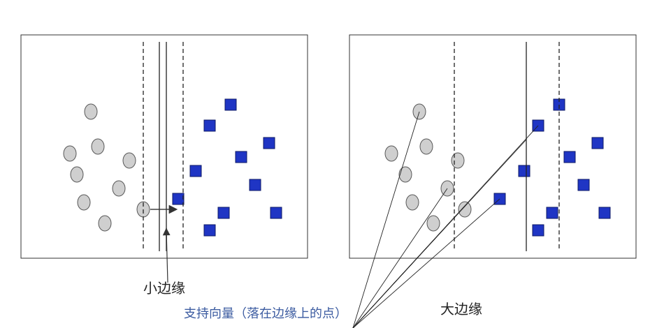
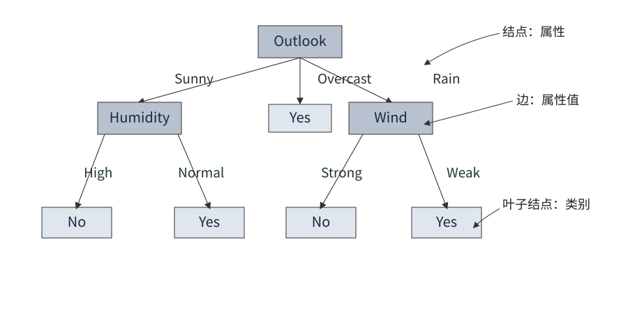
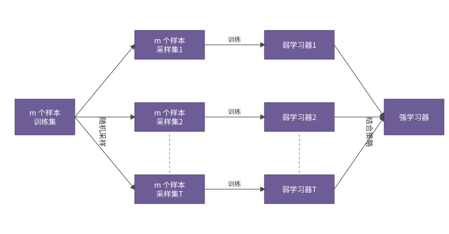
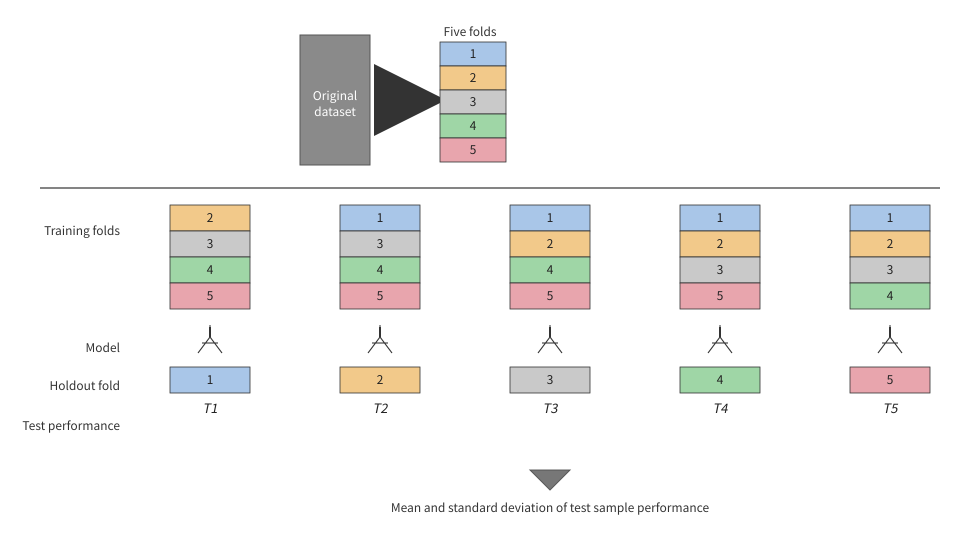

# 5 分类

一句话：分类是==有监督==学习——用带类标号的训练集学一个映射 $y=f(X)$，再拿它给没见过的新样本贴标签；本章讲清「分类过程（训练 → 测试 → 准确率 / 过拟合）」这条主线，认识 kNN、Logistic 回归、SVM、神经网络、决策树、朴素贝叶斯这几类方法，最后是集成学习（Bagging / Boosting）、评估方法和长尾分布。

## 0 读这一章之前

- **前置**：知道「向量就是一串数」「拿已知数据找一条分界线」就够了；第 3 章的去噪、填空缺值在这里会用到。
- 整章一句话：==看过带答案的例子，学会给没答案的例子贴标签==。
- 三个新词：**类标号**（样本属于哪个类）、**分类器**（学到的那个映射）、**过拟合**（训练集上很准、新数据上很差）。
- 计算题集中在这几处：训练测试法 / 十折交叉验证怎么划分样本、朴素贝叶斯的后验概率、kNN 的距离与投票；简答题集中在 SVM 的核心思想、过拟合的原因与对策、Bagging 与 Boosting 的区别。

## 总览（思维导图）

$$
\text{第 5 章 分类}
\begin{cases}
5.1\ \text{分类 / 回归 / 聚类} & \text{有监督 vs 无监督}\\
5.2\ \text{应用案例} & \text{垃圾邮件 / 信用卡 / 视觉}\\
5.3\ \text{分类概念} & \text{两类属性、分类模式、分类过程、数学定义}\\
5.4\ \text{常用方法} & \text{kNN / Logistic / SVM / 神经网络 / 决策树 / 朴素贝叶斯}\\
5.5\ \text{集成学习} & \text{Bagging (并行) / Boosting (串行)}\\
5.6\ \text{评估} & \text{训练测试法、交叉验证 + 四个准则}\\
5.7\ \text{长尾分布} & \text{重采样 / 重加权 / 头尾知识迁移}
\end{cases}
$$

# 5.1 分类、回归与聚类

> [!tip] 人话
> 给例子配好标准答案再学，是==有监督==（分类、回归）；只丢一堆数据让它自己抱团，是==无监督==（聚类）。

## 5.1.1 有监督与无监督

- **有监督**：用于==分类或者回归==，需要有训练集和测试集。在已知训练集的前提下，对测试样本根据它的特征，把它与训练集中的样本进行对比，把它分到对应的那一类中。
- **无监督**：用于==聚类==。有一堆数据，将这堆数据按照它们自身内部的相似性，自动地聚成几类。

## 5.1.2 分类

图像分类示例：给定一张图，判别它是苹果还是香蕉。分类输出的是==离散的类标号==（苹果 / 香蕉），不是数值。

## 5.1.3 回归

「回归」一词是 1855 年由英国生物学家高尔顿（Galton）在研究孩子的身高与父母身高的关系时提出的。

- 当时他研究的问题是：高个子的人所生子女一般偏高，照这样看，各代人的身高分布会有两极分化的趋势——很高和很矮的越来越多，处在中间状态的越来越少。
- 研究发现：父母个子高，子女一般也高，但==不如父母那么高==；父母个子矮，子女一般也矮，但也不如父母那么矮。下一代身高有向中间值回归的趋势，这种趋势叫「回归效应」，研究两个数值变量关系的这类方法就叫回归分析。
- 回归属于==有监督==学习范畴。
- 回归问题的目标：给定 $D$ 维输入变量 $x$，每个输入矢量 $x$ 都有对应的值 $y$；要求对新来的数据预测它对应的==连续的目标值== $t$。
- 例子：房屋估值、股票预测、风速预报。

## 5.1.4 分类 VS. 回归

分类和回归是两种数据分析形式，都用于提取描述重要数据类的模型或预测未来数据趋势的模型。

| 项 | 分类 | 回归 |
| --- | --- | --- |
| 预测什么 | 类对象的==分类标号（离散值）== | 建立==连续函数值==模型 |
| 怎么建模 | 根据训练数据集和类标号属性构建模型，用它分类现有数据和新数据 | 拟合一个连续函数，用它对新的输入给出数值 |
| 银行例子 | 分析数据弄清哪些贷款申请者是「安全」的、哪些是「有风险」的（分成两类） | 预测贷给某个顾客多少钱是安全的 |

## 5.1.5 聚类

图像聚类：给一堆图片，事先不知道有几组、组叫什么，按图片之间的相似性自动分成若干组。

# 5.2 分类的应用案例

> [!tip] 人话
> 凡是「判定它属于哪一类」的现实问题都是分类：垃圾邮件还是正常邮件、这个申请人风险高还是低、这张图是猫还是狗。

「物以类聚，人以群分」，自然科学和社会科学中存在着大量的分类问题。

## 5.2.1 垃圾邮件过滤

- **案例阐述**：对企业和个人来说，处理垃圾邮件都很头疼——邮箱容量不够，或者漏过的垃圾邮件会造成糟糕的用户体验。
- **表述问题**：如何对每个邮箱收到的每封邮件进行处理，保留有用邮件、过滤掉垃圾邮件。
- **解决问题**：目前的垃圾邮件过滤主要采用==文本挖掘==（text mining）技术；作为数据挖掘的重要分支，文本挖掘在传统方法的基础上引入了语义处理等其它学科知识。分类技术中最常见的是==贝叶斯分类法==，它扫描并判别邮件的信封标题、主题和内容。由于专门发垃圾邮件的人越来越多地改用附件（PDF、图像等）投递，扫描内容又增加了一项检查附件。

## 5.2.2 信用卡分级

- **案例阐述**：金融行业竞争激烈，银行要吸引低风险高价值的客户，尽量避免高风险的申请者；如何准确分析申请人的信用风险是最关注也最头痛的事。
- **表述问题**：如何把信用卡申请者分类为低、中、高风险。
- **解决问题**：建设==客户风险模型==来对客户风险分类。申请表中已含大量个人信息，加上通常还会做客户信用查询，可参考的数据维度多，建模的精准度也相对更高。

课件给出的客户数据（类别属性是「风险」）：

| 姓名 | 年龄 | 收入 | 学生 | 信誉 | 风险 |
| --- | --- | --- | --- | --- | --- |
| 张三 | 23 | 4000 | 否 | 良 | 中 |
| 李四 | 34 | 2800 | 否 | 优 | 中 |
| 王二 | 50 | 1000 | 否 | 良 | 高 |
| 赵五 | 18 | 900 | 是 | 良 | 中 |
| 刘兰 | 34 | 2500 | 否 | 优 | 中 |
| 杨俊 | 27 | 8900 | 否 | 优 | 低 |
| 张毅 | 38 | 9500 | 否 | 优 | 低 |

## 5.2.3 计算机视觉

图像分类：针对给定的图像，利用数据挖掘算法使计算机具备把它==预测为某一类别==的能力。

# 5.3 分类概念

> [!tip] 人话
> 分类就是拿一堆「属性 → 答案」的样本，学出一个能对任意属性组合给出答案的规则。

## 5.3.1 分类的定义与两类属性

**分类**：把数据样本映射到一个事先定义的类中的学习过程——给定一组输入的属性向量及其对应的类，用机器学习算法得出分类。

看课件的数据表，属性分两种角色：

| Age | Salary | Class |
| --- | --- | --- |
| 30 | high | $c_1$ |
| 25 | high | $c_2$ |
| 21 | low | $c_2$ |
| 43 | high | $c_1$ |
| 18 | low | $c_2$ |
| 33 | low | $c_1$ |

- **描述属性**：可以是连续型属性或离散型属性。上表里 Age、Salary 是描述属性。
- **类别属性**：一定是==离散型属性==。上表里 Class 是类别属性。
- **连续型属性**：取值在某一个区间或无穷区间内是连续的。例如 Age。
- **离散型属性**：取值是不连续的。例如 Salary（high / low）和 Class（$c_1$ / $c_2$）。

## 5.3.2 分类模式

按「一个样本该给几个标签」分成三种：

- **二类问题**（binary）：属于或不属于。例：这张图==是 / 不是风景==。
- **多类问题**（multi-class）：多个类别里选一个。例：这张图是海边、市内、高速等多类中的一类。
- **多标签问题**（multi-label）：一个样本同时打多个标签。例：同一张海边照片同时标上「天空、白云、沙滩、树、山」。

> [!warning] 易错
> 多类和多标签的区别在==一个样本能挂几个答案==：多类只能挂一个，多标签可以挂多个。别把「类别很多」当成多标签。

## 5.3.3 分类过程

> [!tip] 人话
> 先用带答案的题练手（==训练==），再用没做过的题考试（==测试==），考出来的分才代表真本事。

分类要做两件事：**分类器设计**（从训练集学出模型）与**分类决策**（用模型给新样本定类）。

```text
训练集（属性 + 类标号）
      │  学习 / 训练
      ▼
   分类算法  ──►  分类规则（模型）
                      │  分类决策
                      ▼
                 测试集（只有属性）──► 预测的类标号 ──► 与真实类标号比较得准确率
```

### 关键步骤

1. **获取数据**：输入数据，对数据进行量化。
2. **预处理**：去除噪声数据、对空缺值进行处理；数据集成或者变换。
3. **学习阶段**：划分数据集，在训练集上构造分类器。
4. **测试阶段**：对未知类标号的测试数据样本进行分类。

### 学习阶段

学习阶段的目标是建立描述预先定义的数据类或概念集的==分类器==。

- **训练集**：由数据样本（用 $d$ 维属性向量表示）和它们相对应的类标号组成。
- **训练样本**：训练数据集中的单个样本；假定每个样本属于一个预定义的类。
- 分类算法通过分析训练集、或从训练集「学习」来构造分类器，也就是学习一个映射或函数 $y=f(X)$。
- 学到的模型可以用==分类规则、决策树或数学公式==等形式表示。

课件用「教师是否获得终身教职」举例，训练集：

| NAME | RANK | YEARS | TENURED |
| --- | --- | --- | --- |
| Mike | Assistant Prof | 3 | no |
| Mary | Assistant Prof | 7 | yes |
| Bill | Professor | 2 | yes |
| Jim | Associate Prof | 7 | yes |
| Dave | Assistant Prof | 6 | no |
| Anne | Associate Prof | 3 | no |

### 测试阶段

测试阶段使用模型，对将来的或未知的对象进行分类，并评估模型的预测准确率。

- 对每个测试样本，把已知的类标号和该样本在模型下的预测类标号比较。
- **准确率**是==正确被模型分类的测试样本的百分比==。
- 测试集要==独立于训练样本集==，否则会出现「过分拟合」（overfitting）的情况。

课件给同一问题的测试集（只有属性，答案留空）：

| NAME | RANK | YEARS | TENURED |
| --- | --- | --- | --- |
| Tom | Assistant Prof | 2 | ? |
| Merlisa | Associate Prof | 7 | ? |
| George | Professor | 5 | ? |
| Joseph | Assistant Prof | 7 | ? |

拿模型给未知样本 `(George, Professor, 5)` 判类，输出「Tenured?」的答案，就是一步分类决策。

### 过拟合

用训练集学出来的模型在训练集上误差可以很小，但在整个样本分布上未必最好——这就是过拟合。

**定义**（Mitchell《Machine Learning》）：给定一个假设空间 $H$，一个假设 $h \in H$，如果存在其它的假设 $h' \in H$，使得在训练样例上 $h$ 的错误率比 $h'$ 小，但在整个实例分布上 $h'$ 比 $h$ 的错误率小，那么就说假设 $h$ ==过度拟合==训练数据。

对应的三种状态：模型太简单会**欠拟合**（high bias，训练集上都分不对）；复杂度适中是**恰当拟合**（just right）；模型太复杂会**过拟合**（high variance，训练集上几乎全对、新数据上一塌糊涂）。

**产生原因**：

1. 建模样本抽取错误——样本数量太少、抽样方法错误、抽样时没有充分考虑业务场景，导致样本不能有效代表业务逻辑。
2. 样本里的噪音数据干扰过大，大到模型过分记住了噪音特征，反而忽略了真实的输入输出关系。
3. 建模时的「逻辑假设」到了模型应用时已经不成立（例如假设建模数据与后来的应用数据相似）。
4. 参数太多、模型复杂度高。

**解决方案**：

- **交叉验证**：换更可靠的评估方式，避免被一次划分骗到。
- **添加正则项**：L1 正则==更容易产生稀疏解==，L2 正则倾向于让参数 $w$ 趋向 0。
- **针对树模型**：在树过于大之前停止生长，或者等树生长到足够大之后进行修剪。

> [!warning] 易错
> 过拟合不是「训练误差大」，恰恰是==训练误差小、测试误差大==；训练误差大通常是欠拟合。

## 5.3.4 分类的数学定义

**给定**：分类问题中使用的数据集（训练集）

$$
X=\{(x_i,y_i)\mid i=1,2,\ldots,N\}
$$

其中 $\boldsymbol{x}_i=(x_{i1},x_{i2},\ldots,x_{id})$，$x_{i1},\ldots,x_{id}$ 分别对应 $d$ 个描述属性 $A_1,A_2,\ldots,A_d$ 的具体取值；$y_i$ 表示样本 $x_i$ 的==类标号==，假设数据集含 $m$ 个类别，则

$$
y_i \in \{c_1,c_2,\ldots,c_m\}
$$

$c_1,\ldots,c_m$ 是类别属性 $C$ 的具体取值。

**要做的**：确定一个分类函数

$$
y=f(X)
$$

使未知类标号的测试样本 $x'=(x_1,x_2,\ldots,x_d)$ 代入后，得到它所属的类别。

# 5.4 常用的分类方法

> [!tip] 人话
> 各种分类方法只是「==怎么划那条分界线==」的不同想法：看邻居（kNN）、划间隔最大的平面（SVM）、按属性一路问下去（决策树）、算概率（贝叶斯）……

分类技术是一种根据输入数据集建立分类模型的系统方法：一般用一种==学习算法==确定分类模型，该模型能很好地拟合输入数据中类标号和属性集之间的联系。

学到的模型不仅要很好地拟合输入数据，还要能正确预测未知样本的类标号。因此训练算法的主要目标是建立具有很好==泛化能力==的模型。

分类方法的实例包括：决策树、支持向量机、神经网络、k-近邻方法、朴素贝叶斯分类方法等。

数据挖掘领域的十大经典算法（ICDM'06，课件按得票列出）：

1. C4.5（分类）
2. K-Means（聚类）
3. SVM（分类）
4. Apriori（关联规则）
5. EM
6. PageRank
7. AdaBoost
8. kNN（分类）
9. Naive Bayes（分类）
10. CART（分类）

> [!note] 注
> 课件这一页的票数与名次并不对应（如 C4.5 记 51 票、SVM 记 58 票），此处按课件原样抄录，不必记票数。

## 5.4.1 K-近邻（kNN）

> [!tip] 人话
> 想知道新样本是什么类，就看离它==最近的 k 个老样本==都投给谁，票多者胜。

给定一个未知样本，k-最近邻分类法搜索模式空间，找出最接近未知样本的 $k$ 个训练样本；然后使用 $k$ 个最临近者中==最公共的类==来预测当前样本的类标号。

两个研究点：

- **近邻个数 $k$ 的选取**：$k$ 太小容易被个别噪声点带偏，$k$ 太大又会把远处的异类拉进来。
- **近邻的度量方法**：常用欧氏距离；换一种距离（如曼哈顿距离）可能会改变「最近的 k 个」是谁。

#### 例题 1（简算）：用 kNN 给新样本定类

**题目**：训练样本为 A 类：$(1,1)$、$(2,2)$；B 类：$(1,4)$、$(4,5)$、$(5,5)$。用欧氏距离、$k=3$，判断新样本 $x=(2,3)$ 属于哪一类。

**解**：欧氏距离平方逐点算（开方值只用于排序）：

- 到 $(2,2)$：$(2-2)^2+(3-2)^2=1$，距离 $1.00$，类 A
- 到 $(1,4)$：$(2-1)^2+(3-4)^2=2$，距离 $1.41$，类 B
- 到 $(1,1)$：$(2-1)^2+(3-1)^2=5$，距离 $2.24$，类 A
- 到 $(4,5)$：$(2-4)^2+(3-5)^2=8$，距离 $2.83$，类 B
- 到 $(5,5)$：$(2-5)^2+(3-5)^2=13$，距离 $3.61$，类 B

取最近的 3 个：$1.00$（A）、$1.41$（B）、$2.24$（A）。

**答**：三票中 A 得 2 票、B 得 1 票，按多数表决新样本判为 **A 类**。

> [!warning] 易错
> $k$ 的取值会改变结论：这里取 $k=4$ 就是 A 两票、B 两票==打平==，需要额外的平票规则。答题必须写清 $k$ 是几、距离用哪一种（换曼哈顿距离「最近的 $k$ 个」可能换人）。

## 5.4.2 Logistic 回归

用线性打分再过一层概率函数，输出「属于该类的概率」，因此它虽然叫回归，做的是分类。

课件给出的训练目标（对数损失，$\pi(\boldsymbol{x})=\sigma(\boldsymbol{w}^{\mathsf T}\boldsymbol{x})$ 是把线性输出压到 $(0,1)$ 的概率）：

$$
\mathcal{L}(\boldsymbol{w})=\sum_{n=1}^{N}\left[-y^{(n)}\log \pi(\boldsymbol{x}^{(n)})-\left(1-y^{(n)}\right)\log\left(1-\pi(\boldsymbol{x}^{(n)})\right)\right]
$$

$$
\mathcal{L}(\boldsymbol{w})=\sum_{n=1}^{N}\left[-y^{(n)}\left(\boldsymbol{w}^{\mathsf T}\boldsymbol{x}^{(n)}\right)+\log\left(1+\exp\left(\boldsymbol{w}^{\mathsf T}\boldsymbol{x}^{(n)}\right)\right)\right]
$$

## 5.4.3 支持向量机（SVM）



> [!tip] 人话
> 能把两类分开的线有无穷多条，SVM 挑那条==离两边都最远==的，新样本稍微跑偏也不容易越界。

- 一个数据被认为是 $d$ 维向量，数据在这 $d$ 维向量空间中被分为两类；SVM 的目的是找到一个 $d-1$ 维的==超平面==，来划分 $d$ 维向量空间的数据。
- 其决策边界是对学习样本求解的**最大边距超平面**（maximum-margin hyperplane）。
- SVM 可以通过==核方法==（kernel method）进行非线性分类，是常见的核学习（kernel learning）方法之一。
- 离超平面最近、决定边距的那些样本点叫**支持向量**——模型实际上只由这几撑起来。

#### 例题 2（简答）：SVM 的核心思想与核函数的作用

**题目**：简述支持向量机的核心思想，并说明核函数的作用。

**答题要点**：

1. 数据是 $d$ 维向量、分两类，目标是找一个 $d-1$ 维的**超平面**把两类分开。
2. 能分开的超平面有无穷多个，SVM 选**间隔最大**的那个（最大边距超平面）：不仅分开，还要让两侧最近的样本离它尽量远，从而对新样本更稳。
3. 离超平面最近、决定边距的样本叫**支持向量**，模型只由它们决定；其它样本删掉不影响结果。
4. 线性不可分时，用**核方法**把样本隐式映射到更高维空间，使数据在高维近似线性可分，再用线性方法分类，从而在原空间得到**非线性**的决策边界；不必显式算出高维坐标（核技巧）。

> [!warning] 易错
> 核函数==不是降维==，方向相反；也不要答成「SVM 一定能把两类完全分开」——边距解法允许少量样本越界。

## 5.4.4 神经网络

> [!tip] 人话
> 一堆带权重的连接单元连成网，学习就是==不停调这些权重==，直到输出对得上标准答案。

神经网络是一组连接的输入/输出单元，每个连接都与一个权相连。在学习阶段，通过调整神经网络的权，使得能够预测输入样本的正确标号来学习。

- **优点**：预测精度总的来说较高；健壮性好，训练样本中包含错误时也可正常工作；输出可能是离散值、连续值，或者是离散或量化属性的向量值。
- **缺点**：训练（学习）时间长；蕴涵在学习到的权中的符号含义很难理解；很难结合专业领域知识。

## 5.4.5 决策树



> [!tip] 人话
> 从最重要的属性开始一路提问，走到叶子就知道分到哪一类——整棵树就是一组==if-then 规则==。

课件用「今天是否打球」的 14 天数据：

| Day | Outlook | Temperature | Humidity | Wind | PlayTennis |
| --- | --- | --- | --- | --- | --- |
| D1 | Sunny | Hot | High | Weak | No |
| D2 | Sunny | Hot | High | Strong | No |
| D3 | Overcast | Hot | High | Weak | Yes |
| D4 | Rain | Mild | High | Weak | Yes |
| D5 | Rain | Cool | Normal | Weak | Yes |
| D6 | Rain | Cool | Normal | Strong | No |
| D7 | Overcast | Cool | Normal | Strong | Yes |
| D8 | Sunny | Mild | High | Weak | No |
| D9 | Sunny | Cool | Normal | Weak | Yes |
| D10 | Rain | Mild | Normal | Weak | Yes |
| D11 | Sunny | Mild | Normal | Strong | Yes |
| D12 | Overcast | Mild | High | Strong | Yes |
| D13 | Overcast | Hot | Normal | Weak | Yes |
| D14 | Rain | Mild | High | Strong | No |

学出来的树（根是 Outlook）：

```text
Outlook
├─ Sunny ──► Humidity ──┬─ High   ──► No
│                       └─ Normal ──► Yes
├─ Overcast ────────────────► Yes
└─ Rain ──► Wind ──┬─ Strong ──► No
                  └─ Weak   ──► Yes
```

一棵树可以写成**合取的析取表达式**（每条从根到叶的路径是一个合取式，多条路径用 OR 连起来）：

```text
(Outlook=Sunny AND Humidity=Normal) OR (Outlook=Overcast) OR (Outlook=Rain AND Wind=Weak)
```

关键问题是如何选择属性的顺序，可以采用==信息增益、增益率、Gini 指标==等。

## 5.4.6 贝叶斯分类

> [!tip] 人话
> 先看每个类在历史数据里占多大比例（先验），再看这个样本在各属性上的表现像哪一类，两者相乘比大小，谁大归谁。

- 贝叶斯分类利用统计学中的==贝叶斯定理==来预测类成员的概率：给定一个样本，计算该样本属于某个特定类的概率。
- **朴素贝叶斯分类**：假设每个属性之间都是相互独立的，并且每个属性对分类问题产生的影响都是一样的。

$$
P(c\mid x)=\frac{P(x\mid c)\,P(c)}{P(x)}
$$

- $P(c\mid x)$：给定证据 $x$ 后类 $c$ 的**后验概率**（要比较的就是它）。
- $P(c)$：类 $c$ 的**先验概率**（训练集里各类的占比）。
- $P(x\mid c)$：类 $c$ 产生证据 $x$ 的概率（似然）；朴素假设下拆成各属性概率相乘。
- $P(x)$：证据 $x$ 出现的概率，对同一批候选类都相同，比较时可以不精确计算。

#### 例题 3（计算）：用朴素贝叶斯判「今天是否打球」

**题目**：用 5.4.5 的 14 天数据，判断样本 $x=(\text{Outlook}=\text{Sunny},\ \text{Temperature}=\text{Cool},\ \text{Humidity}=\text{High},\ \text{Wind}=\text{Strong})$ 该打球（Yes）还是不打（No）。

**解**：训练集里 Yes 有 9 条、No 有 5 条，故先验 $P(\text{Yes})=\frac{9}{14}$、$P(\text{No})=\frac{5}{14}$。

各属性在该类下的条件概率（数该类的 9 条 / 5 条里取值命中的条数）：

| 属性取值 | Yes（共 9 条） | No（共 5 条） |
| --- | --- | --- |
| Outlook=Sunny | $\frac{2}{9}$ | $\frac{3}{5}$ |
| Temperature=Cool | $\frac{3}{9}$ | $\frac{1}{5}$ |
| Humidity=High | $\frac{3}{9}$ | $\frac{4}{5}$ |
| Wind=Strong | $\frac{3}{9}$ | $\frac{3}{5}$ |

$$
P(x\mid \text{Yes})P(\text{Yes})=\frac{9}{14}\cdot\frac{2}{9}\cdot\frac{3}{9}\cdot\frac{3}{9}\cdot\frac{3}{9}=\frac{9}{14}\cdot\frac{54}{6561}\approx 0.00529
$$

$$
P(x\mid \text{No})P(\text{No})=\frac{5}{14}\cdot\frac{3}{5}\cdot\frac{1}{5}\cdot\frac{4}{5}\cdot\frac{3}{5}=\frac{5}{14}\cdot\frac{36}{625}\approx 0.02057
$$

**答**：$0.02057>0.00529$，样本判为 **No（今天不打球）**。

> [!warning] 易错
> 条件概率的分母是==该类的样本数==（这里 9 和 5），不是总数 14；连乘后比较的是 $P(x\mid c)P(c)$，分母 $P(x)$ 两边相同可以不除。

# 5.5 集成学习

> [!tip] 人话
> 一个模型容易错，那就==训练一堆再投票==——「三个臭皮匠，顶个诸葛亮」。

## 5.5.1 Bagging



Bagging 即套袋法，算法过程：

1. 从训练样本集中==随机有放回抽样==（Bootstrapping）$N$ 次，得到与训练集相同大小的训练集；重复抽样 $K$ 次，得到 $K$ 个训练集。
2. 每个训练集得到一个最优模型，$K$ 个训练集得到 $K$ 个最优模型。
3. 结合：**分类问题**对 $K$ 个模型采用==投票==得到分类结果；**回归问题**对 $K$ 个模型的值==求平均==。

## 5.5.2 Boosting

**AdaBoost**（Adaptive Boosting）算法采用调整样本权重的方式来调整样本分布：

- **调权重**：提高前一轮个体学习器==错误分类==样本的权重，降低那些正确分类样本的权重，使错分样本在下一轮受到更多关注、从而被正确分类——分类问题被一系列弱分类器「分而治之」。
- **组合方式**：AdaBoost 采用==加权多数表决==，加大分类误差率小的弱分类器的权值、减小分类误差率大的弱分类器的权值，以此调整它们在表决中的作用。

## 5.5.3 Bagging 与 Boosting 的四个区别

| 比较项 | Bagging | Boosting |
| --- | --- | --- |
| 训练样本集 | 训练集是有放回抽样，从原始集中选出的 $K$ 组训练集==相互独立== | 每一次迭代的训练集==不变== |
| 训练样本权重 | 每个训练样本的权重相等，即 $1/N$ | 根据学习器的错误率不断调整样例的权值，错误率越大、权值越大 |
| 预测函数的权重 | $K$ 组学习器的权重相等，即 $1/K$ | 学习器性能好的分配较大权重，性能差的分配较小权重 |
| 并行计算 | $K$ 组学习器模型可以==并行生成== | $K$ 组学习器只能==顺序生成==，因为后一个模型的样本权值需要前一个学习器的结果 |

常用刷榜算法（课件列举）：

- **随机森林**（前身是 Bagging / 随机抽样，并行算法）
- **AdaBoost**（串行算法）
- **GBDT**（gradient boosting decision tree，梯度提升树，串行算法）
- **XGBoost**（eXtreme Gradient Boosting），经过优化的分布式梯度提升树，旨在高效、灵活且可移植

# 5.6 评估

> [!note] 注
> 课件这一部分的页标题写作「5.5.1 分类的评价方法 / 5.5.2 分类的评价准则」，与 5.5 集成学习重号；按章节目录的顺序，这里记为 5.6。

> [!tip] 人话
> 评估方法解决的是==「这份准确率可不可信」==：留一部分数据当考卷，或者轮流当考卷再取平均。

## 5.6.1 两种评价方法

- **训练测试法**（training-and-testing）：把数据随机分成训练集和测试集：训练集（例如 $2/3$）用于模型构建；测试集（例如 $1/3$）用于评估准确率。
- **交叉验证法**（cross-validation）：例如十折交叉验证——将数据集分成十份，轮流将其中 9 份做训练、1 份做测试，==10 次结果的均值==作为对算法精度的估计。一般还需要进行多次 10 折交叉验证求均值，例如 10 次 10 折交叉验证，更精确一点。



#### 例题 4（计算）：14 个样本怎么划分

**题目**：课件用 5.4.5 的天气数据（14 个样本）做评估。分别说明训练测试法（$2/3$ 训练、$1/3$ 测试）与十折交叉验证各怎么划分。

**解**：

训练测试法：$14\times\frac{2}{3}\approx 9.33$，课件取大约 ==10 个样本用于训练==，其余 4 个样本用于测试。随机采样可以重复 $k$ 次，取 $k$ 次的平均值。

十折交叉验证：每折的理论大小为 $14/10=1.4$，因此 10 次取的测试样本个数分别为

```text
1  1  1  1  2  2  2  2  2      （4 + 5×2 = 14）
```

其余样本组成训练集。

**答**：训练测试法按 2:1 分成约 10 个训练、4 个测试；十折交叉验证 10 折的测试样本数为 1、1、1、1、2、2、2、2、2，总计 14 个样本每折轮流出任一次测试集。

> [!warning] 易错
> 十折是==训练 10 次、测试 10 次==，不是把数据切十份只训练一次；样本数除不尽时要先把多出来的样本分配到各折，不是直接四舍五入成 1。

#### 例题 5（计算）：十折交叉验证的平均准确率

**题目**：某模型做十折交叉验证，各折在测试集上的准确率为 $0.86,0.82,0.90,0.78,0.84,0.88,0.80,0.86,0.92,0.74$。求平均准确率，并说明为什么报告平均值。

**解**：

$$
\bar{acc}=\frac{0.86+0.82+0.90+0.78+0.84+0.88+0.80+0.86+0.92+0.74}{10}=\frac{8.40}{10}=0.84
$$

**答**：平均准确率 $84\%$。理由是单折结果依赖这次的训练/测试划分（这里最高 $0.92$、最低 $0.74$，相差 18 个百分点），十折轮流当测试集再取平均，能削弱划分带来的偶然性，比单次留出更稳。

## 5.6.2 四个评价准则

- **准确度**：模型正确地预测新的或先前未见过的数据的类标号的能力。
- **速度**：产生和使用模型的计算花费——分==建模的速度==与==分类的速度==。
- **鲁棒性**：给定噪声数据或具有缺失值的数据，模型仍能正确分类的能力。
- **可解释性**：模型的解释能力。

# 5.7 长尾分布建模

> [!tip] 人话
> 现实数据是==少数类别占绝大多数样本==：模型自然把火力集中在头部类别，稀有的尾部类别就学不好，而关键的意外情况往往正好落在尾部。

## 5.7.1 长尾分布的定义

- 现实应用中，一部分类别常常出现、样本众多；更多的类别较为罕见，每个类别样本较少。
- **80/20 法则**：20% 的人掌握着 80% 的社会财富。类比到分类数据：==80% 的样本分布在 20% 的头部类别上==，大量尾部类别样本稀少，呈现一种极端不平衡分布。
- 常见场景和数据中都存在长尾分布。课件举的儿童疾病数据（按患病率排序，前几名就吃掉绝大部分比例）：

| 排名 | 疾病种类 | 0-4 岁患病率 (%) | 疾病分布比例 | 5-14 岁患病率 (%) | 疾病分布比例 |
| --- | --- | --- | --- | --- | --- |
| 1 | 呼吸系统疾病 | 160.91 | 79.82% | 74.41 | 73.96% |
| 2 | 消化系统疾病 | 20.43 | 10.13% | 9.15 | 9.09% |
| 3 | 传染病 | 5.9 | 2.93% | 4.8 | 4.77% |
| 4 | 皮肤和皮下组织疾病 | 5.37 | 2.66% | 2.54 | 2.52% |
| 5 | 损伤和中毒 | 2.2 | 1.09% | 2.01 | 2.00% |
| 6 | 眼及附器疾病 | 1.5 | 0.74% | 2.24 | 2.23% |
| 7 | 病情不详 | 1.14 | 0.57% | 0.74 | 0.74% |
| 8 | 神经系统疾病 | 0.88 | 0.44% | 0.71 | 0.71% |
| 9 | 耳和乳突疾病 | 0.53 | 0.26% | 0.61 | 0.61% |
| 10 | 泌尿生殖系统疾病 | 0.62 | 0.31% | 0.51 | 0.51% |
| 11 | 其他 | 0.18 | 1.04% | 2.75 | 2.75% |
| — | 总体 | 201.6 | 100.00% | 100.61 | 100.00% |

## 5.7.2 长尾分布的挑战

- 极度不均衡问题：传统机器学习模型==偏向于头部类别==建模，尾部类别由于难以学习到鲁棒有效的表示而识别困难。
- 尾部类别数量极多，严重影响任务整体的分类与识别性能。
- 某些关键场景（自动驾驶、疾病诊断、科学发现）中尾部类别的重要性更高。

## 5.7.3 长尾分布的三种建模思路

长尾分布问题本质上是「大多数」和「少数」在兼容性上的矛盾，当前主要从三个思路解决：

| 思路                           | 做法                                       | 为什么有效               |
| ---------------------------- | ---------------------------------------- | ------------------- |
| 重采样 Re-sampling              | 头部类别==欠采样==或尾部类别==过采样==（用头部数据分布信息生成尾部样本） | 人为形成更均衡的数据分布        |
| 重加权 Re-weighting             | 减小头部类的学习权重，增大尾部类的学习权重                    | 让模型在学习过程中的损失更新更加均衡  |
| 头尾知识迁移 Head-to-tail Transfer | 迁移头部类别中的知识协助尾部类别的学习                      | 尾部类别基于头部提供的先验知识补充学习 |

重采样缩小的是数据量上的头尾差距；重加权则是在损失里减小头部样本的权重、增大尾部样本的权重。

**头尾知识迁移**要回答两个问题：如何形成知识？形成知识后如何迁移？课件给的答案是：

- ==聚类形成分层知识结构==：基于类均值的谱聚类。
- ==多粒度知识迁移==：上下层异步学习，上层知识逐步迁移到下层，帮助下层更好地学习。

> [!note] 注
> 5.7 在课件里是介绍性内容：记住长尾的定义、三个挑战和三条思路即可，没有公式推导；后面标注 CVPR、IEEE TNNLS 的论文只是这些思路的来源。
