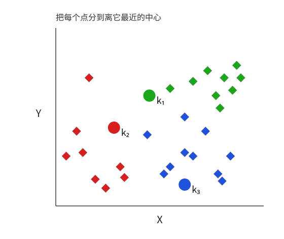
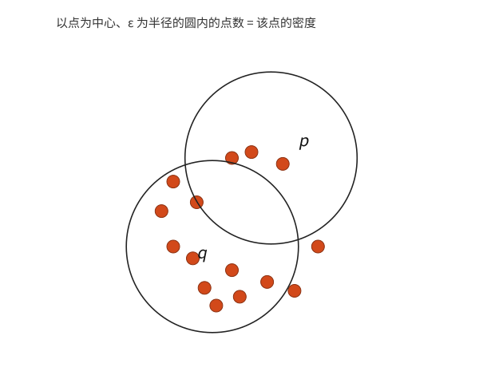
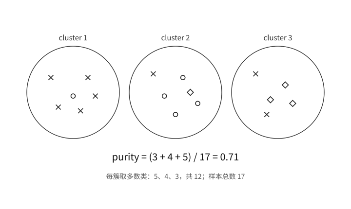

# 6 聚类

一句话：聚类是**无监督**学习——没有标签，只按数据自身的相似性把它们分成若干**簇（cluster）**，使**簇内相似、簇间相异**；本章重点是 **k-means 的步骤与优缺点**、**聚类有效性怎么评价**。

## 0 读这一章之前

- **前置知识**：知道「距离」怎么算（欧氏距离）、知道「平均值」就行。
- 整章一句话：**物以类聚——把靠得近的点自动归成一堆**。
- 三个新词：**簇**（一堆相似的点）、**聚类中心**（这堆点的平均位置）、**准则函数**（衡量分得好不好的分数）。
- 与第 5 章的分界：分类要标准答案，聚类没有答案，连分几类常常都要自己定。

## 总览（思维导图）

$$
\text{第 6 章 聚类}
\begin{cases}
7.1\ \text{聚类分析}:\ \text{簇、簇内相似、簇间相异}\\
7.3\ \text{k-means}
\begin{cases}
\text{三要点}:\ \text{距离度量、准则函数、初始划分}\\
\text{步骤}:\ \text{选中心}\to\text{分配}\to\text{更新中心}\to\text{迭代}\\
\text{优缺点}
\end{cases}\\[4pt]
7.4\ \text{典型方法}:\ \text{划分、密度（DBSCAN）、图、层次}\\
7.5\ \text{评估}:\ \text{外在（purity、NMI、RI/ARI）、内在（WSS、BSS）}
\end{cases}
$$

# 6.1 聚类分析

> [!tip] 人话
> 把一堆点按「谁离谁近」自动分成几堆，分完==每堆内部要像、堆与堆之间要不像==。

- **聚类（clustering）**：把数据对象划分为子集的过程。
- **簇（cluster）**：每个子集就是一个簇。**同一簇内的对象彼此相似，不同簇的对象相异**。
- 目标可以写成两句话：**最大化类内相似（最小化类内距离）**、**最大化类间距离**。
- 与分类的区别：分类是**有监督**（有事先定义的类、有标签）；聚类是**无监督**（没有事先定义的类）。

这是「物以类聚、人以群分」的算法版本。

# 6.2 k-means 聚类

> [!tip] 人话
> 先随便点几堆的中心，然后「==谁离谁近就归谁==」，归完把中心挪到这堆的中间，再重新归——反复几轮就稳定了。

## 6.2.1 划分聚类的三个要点

划分聚类（partitioning）的思路：选择合适的初始代表点做初始聚类，再通过不断迭代调整聚类结果，直到满足聚类评价准则。三个要点：

- **相似性度量**：选一种距离：欧氏距离、曼哈顿距离、明考斯基距离（**最常用欧氏距离**）
- **准则函数**：**误差平方和（SSE）**：所有样本与所属簇中心的方差之和，最优时类内紧凑、类间分开
- **初始划分与迭代**：先选初始代表点，再迭代使准则函数取得最优值

## 6.2.2 误差平方和准则（SSE）

$$
SSE=\sum_{i=1}^{k}\sum_{x\in C_i}\lVert x-m_i\rVert^2
$$

$C_i$ 是第 $i$ 个簇，$m_i$ 是该簇的中心（均值），$k$ 是簇的个数。**SSE 越小，簇内越紧凑。**

## 6.2.3 算法思想与步骤

k-means 用**各簇内所有样本的均值**作为该簇的代表点，通过迭代使准则函数达到最优，从而**类内紧凑、类间独立**。

1. **选初始中心**：从数据中随机选 $k$ 个点作为初始聚类中心；
2. **分配样本**：把每个样本分到距离最近的中心所在簇；
3. **更新中心**：把每个簇的中心重算为该簇所有点的均值；
4. **迭代**：重复 2、3，直到中心不再变化或准则函数值稳定。

#### 例题 1（计算）：k-means 手工迭代

**题目**：5 个样本 $A(1,1)$、$B(2,1)$、$C(4,3)$、$D(5,4)$、$E(3,2)$，取 $k=2$，初始中心为 $c_1=A$、$c_2=D$。做一轮完整迭代，判断是否收敛，并计算最终 SSE。

**解**：

1. **轮次：初始**
   - **归属（到 $c_1$ / $c_2$ 的欧氏距离）**：$c_1=(1,1)$，$c_2=(5,4)$
   - **新中心**：—
2. **轮次：1**
   - **归属（到 $c_1$ / $c_2$ 的欧氏距离）**：$A\to C_1(0\mid5.00)$，$B\to C_1(1\mid4.24)$，$C\to C_2(3.61\mid1.41)$，$D\to C_2(5.00\mid0)$，$E\to C_1(2.24\mid2.83)$
   - **新中心**：$c_1=(2,\ 4/3)$，$c_2=(4.5,\ 3.5)$
3. **轮次：2**
   - **归属（到 $c_1$ / $c_2$ 的欧氏距离）**：$A,B,E\to C_1$（最近距离 $1.05$、$0.33$、$1.20$），$C,D\to C_2$（$0.71$、$0.71$）
   - **新中心**：归属不变 → **收敛**

第 1 轮归属：$C_1=\{A,B,E\}$，$C_2=\{C,D\}$，新中心

$$
c_1=\Big(\frac{1+2+3}{3},\ \frac{1+1+2}{3}\Big)=(2,\ 4/3),\qquad c_2=\Big(\frac{4+5}{2},\ \frac{3+4}{2}\Big)=(4.5,\ 3.5)
$$

SSE：

$$
SSE=\sum_{i=1}^{k}\sum_{x\in C_i}\lVert x-m_i\rVert^2
$$

$$
\begin{array}{l}
C_1:\ (1-2)^2+(1-\tfrac43)^2=1+\tfrac19\\[2pt]
\qquad +(2-2)^2+(1-\tfrac43)^2=\tfrac19\\[2pt]
\qquad +(3-2)^2+(2-\tfrac43)^2=1+\tfrac49\\[4pt]
C_2:\ (4-4.5)^2+(3-3.5)^2=0.5\\[2pt]
\qquad +(5-4.5)^2+(4-3.5)^2=0.5
\end{array}
$$

$$
SSE=\Big(1+\tfrac19+\tfrac19+1+\tfrac49\Big)+0.5+0.5=\tfrac83+1=\tfrac{11}{3}\approx3.67
$$

$$
=\Big(1+\tfrac19\Big)+\tfrac19+\Big(1+\tfrac49\Big)+0.5+0.5=\tfrac{8}{3}+1=\tfrac{11}{3}\approx3.67
$$

**答**：第 2 轮归属不再变化，算法收敛；簇为 $\{A,B,E\}$ 与 $\{C,D\}$，中心 $(2,\ 4/3)$、$(4.5,\ 3.5)$，$SSE=11/3\approx3.67$。

> [!warning] 易错
> ① 距离用欧氏距离，别用曼哈顿；② ==每轮先全部重新分配，再用新分配算新中心==，不要边分配边更新；③ $k$-means 通常迭代多轮才收敛，本例子恰好 2 轮；④ 结果依赖初始中心，不同初值可能得到不同局部最优。

## 6.2.4 优缺点

- **优点**：
  - 简单、易实现、收敛快
  - 对**连续型属性**效果较好
  - 时间复杂度与样本数近线性
- **缺点**：
  - 需要**事先指定 $k$**
  - **不适合离散型属性**
  - 对**初始中心敏感**，可能收敛到局部最优；对噪声和离群点敏感

一句话：k-means 简单快，但要先定 $k$、怕离群点、可能陷在局部最优。

#### 例题 2（简答）：k-means 的步骤与优缺点

**题目**：简述 k-means 算法的步骤，并说明它的优缺点。

**答题要点**：

1. 选定 $k$，**随机选 $k$ 个样本作为初始中心**。
2. 把每个样本分配给离它**最近的**中心，得到 $k$ 个簇。
3. 用每个簇内样本的**均值**作为新中心。
4. 重复第 2、3 步，直到中心不再变化（或准则函数 $SSE$ 不再下降）。

优点：原理简单、易于实现；时间复杂度近似 $O(nkt)$（$n$ 样本、$k$ 簇、$t$ 轮迭代），对大数据集高效；当簇是**密集的、球状或团状**时效果很好。

缺点：① $k$ 要预先给定，而 $k$ 往往未知；② 对**离群点**敏感（均值被拉偏）；③ 只能处理**连续型属性**，不适合离散/标称属性；④ 结果依赖初始中心，可能陷入**局部最优**；⑤ 不适合非凸、大小差别很大的簇。

# 6.3 典型聚类方法

> [!tip] 人话
> 除了「按中心分堆」（k-means），还有「按==密度==连线」「按==图==分割」「由下往上==合并==」等思路。

## 6.3.1 数据挖掘对聚类的要求

- **处理不同数据类型**：数值型、二元型、标称型、序数型等。
- **发现任意形状**：基于距离的算法往往只得到==球形==簇，而现实簇常是任意形状。
- **少依赖先验知识和参数**：初始值、簇个数等参数在高维下很难定。
- **处理噪声**：对缺失值、离群点、噪声不敏感。
- **可解释性与可用性**：低维靠可视化、高维靠降维；并要结合具体应用选算法。

## 6.3.2 簇的三种类型（按“簇怎么定义”）

- **中心型（Center-based）**：簇中心在成员平均值附近 → 适合==球形==簇。
- **密度型（Density-based）**：簇 = 被低密度区隔开的高密度点区域 → 适合不规则、交织、含噪声的数据。
- **连续型（Contiguous，最近邻/传递）**：相邻相连成一片。

## 6.3.3 四类典型方法（总览）

| 方法 | 核心思路 | 代表算法 | 适合 |
| --- | --- | --- | --- |
| 划分 | 分成 $k$ 个互不重叠的簇，迭代优化准则（最小化簇内误差） | k-means、**k-中心点（k-medoids）** | 球形簇 |
| 密度 | 邻域内点数（密度）超阈值就连成一簇，==不用预设簇数== | **DBSCAN**、OPTICS、DENCLUE、CLIQUE | 任意形状、含噪声 |
| 图 | 把数据看成图，按连通性或割来聚类 | **谱聚类** | 任意形状、高维 |
| 层次 | 自底向上**凝聚**（AGNES）或自顶向下**分裂**（DIANA），形成树 | BIRCH、Chameleon | 有层次结构 |

## 6.3.4 密度聚类：DBSCAN

### 思想与主要特征

- **动机**：基于距离的方法只能发现球状簇；密度法可发现==任意形状==并==过滤噪声==。
- **思想**：只要临近区域的密度（点数）超过阈值就继续聚类；簇内每个对象在半径 $\varepsilon$ 的邻域里至少含 MinPts 个对象。
- **特征**：发现任意形状、去除噪声、需要参数 $(\varepsilon,\ \text{MinPts})$ 作终止条件。
- **代表算法**：DBSCAN（KDD'96）、OPTICS、DENCLUE、CLIQUE（偏网格）。

### 基本术语

- **$\varepsilon$-邻域**：给定对象在半径 $\varepsilon$ 内的区域。
- **核心对象**：$\varepsilon$-邻域内至少含 MinPts 个对象（含自身）。
- **直接密度可达**：$p$ 在核心对象 $q$ 的 $\varepsilon$-邻域内 → $p$ 从 $q$ 直接密度可达。
- **密度可达**：存在对象链 $p_1=q,\dots,p_n=p$，逐级直接密度可达 → $p$ 从 $q$ 密度可达（==不一定对称==）。
- **密度相连**：存在对象 $o$，使 $p$、$q$ 都能从 $o$ 密度可达。
- **基于密度的簇**：密度可达的==最大密度相连对象集合==。
- **边界点**：非核心点，但落在某个核心点的邻域内。
- **噪声**：不属于任何簇的对象（既非核心也非边界）。

### 算法流程

输入 $n$ 个对象的数据库、半径 $\varepsilon$、MinPts；输出所有满足密度要求的簇：

1. REPEAT：从库中取一个未处理过的点；
2. 若它是**核心点** → 找出所有从它密度可达的对象，形成一个簇；
3. 否则是**边界点** → 结束本轮，取下一个点；
4. 直到所有点都被处理。

### DBSCAN 算例（课件：$\varepsilon=1$，MinPts=4）

| 序号 | 属性 1 | 属性 2 | 序号 | 属性 1 | 属性 2 |
| --- | --- | --- | --- | --- | --- |
| 1 | 2 | 1 | 7 | 5 | 2 |
| 2 | 5 | 1 | 8 | 6 | 2 |
| 3 | 1 | 2 | 9 | 1 | 3 |
| 4 | 2 | 2 | 10 | 2 | 3 |
| 5 | 3 | 2 | 11 | 5 | 3 |
| 6 | 4 | 2 | 12 | 2 | 4 |

- 点 1、2、3、6、8、9、11、12 的 $\varepsilon$-邻域点数都 $<4$ → 非核心。
- 点 **4**、**7** 的 $\varepsilon$-邻域各有 5 个点 → **核心对象**。
- 从 4 出发 → 簇 $C_1=\{1,3,4,5,9,10,12\}$；从 7 出发 → 簇 $C_2=\{2,6,7,8,11\}$；其余被处理时已在簇中。

### 复杂度与优缺点

- **时间复杂度**：$O(N\times\text{邻域查询})$，最坏 $O(N^2)$；低维用 KD 树等可降到 $O(N\log N)$。
- **空间复杂度**：$O(N)$；大簇需保存大量核心对象信息。
- **优点**：能发现任意形状、抗噪声、对数据输入顺序不敏感。
- **缺点**：对 $\varepsilon$、MinPts 敏感且==全局唯一==，密度不均/簇间距大时效果差；计算复杂度大、需空间索引、大数据频繁 I/O。

## 6.3.5 图方法：谱聚类

- **优点**：只需数据间的==相似度矩阵==，处理稀疏数据有效；基于谱图理论，能在任意形状空间聚类、适合高维。
- **缺点**：复杂度高；对相似度图和聚类参数的选择==非常敏感==。

## 6.3.6 层次方法

- **思路**：对数据集分层划分，形成以各聚类为结点的==树（dendrogram）==；分**凝聚型**（AGNES，自底向上合并）与**分裂型**（DIANA，自顶向下分裂）。
- **改进方法**：BIRCH（平衡迭代规约聚类）、Chameleon（多阶段层次聚类）。
- **优点**：简单、易实现、容易理解。
- **缺点**：==不能纠正错误的合并或分裂==；可伸缩性差（每步要检查、估算大量对象或簇）。

# 6.4 聚类评估

> [!tip] 人话
> 分得好不好，要看「==每堆内部紧不紧==」和「==堆与堆离得远不远==」；有标准答案时还能直接数对错。

## 6.4.1 两类评估方法

| 类型         | 何时用                 | 看什么                             |
| ------------ | ---------------------- | ---------------------------------- |
| **外在方法** | 有基准（真实划分）可用 | 把聚类结果与基准比较               |
| **内在方法** | 没有基准可用           | 考察簇的**分离情况**与**紧凑情况** |

## 6.4.2 常用指标

**（1）纯度 purity（外在）**

正确聚类的样本数占总样本数的比例，取值 $0\sim1$，完全错误为 0、完全正确为 1。

$$
\text{purity}=\frac{\text{各簇中占多数的真实类别的样本数之和}}{\text{总样本数}}
$$

**（2）误差平方和 SSE / 凝聚度 WSS（内在）**

凝聚度用簇内误差平方和衡量（越小越紧凑）：

$$
WSS=\sum_{i}\sum_{x\in C_i}\lVert x-m_i\rVert^2
$$

**（3）分离度 BSS（内在）**

用簇中心与整体中心的距离平方和衡量（越大越分开）：

$$
BSS=\sum_{i}\lvert C_i\rvert\,\lVert m-m_i\rVert^2
$$

$m$ 是所有样本的中心。好的聚类：**WSS 小、BSS 大**（总量固定时两者互补）。

**（4）其他外在指标**：NMI（归一化互信息）、RI（兰德指数）、ARI（调整兰德指数）。

考试答题模板：聚类有效性分**外在方法**与**内在方法**；前者有基准，用 purity / NMI / RI 比较；后者无基准，用簇内紧凑（SSE/WSS）与簇间分离（BSS）衡量。

#### 例题 3（计算 + 简答）：聚类有效性与两个指标

**题目 A**：3 个簇、已知真实类标号如下，求 purity。**题目 B**：简述如何评价聚类有效性，并列两个常用指标。

| 簇       | 真实类别分布         | 簇大小 |
| -------- | -------------------- | ------ |
| cluster1 | $x$: 3 个，$o$: 1 个 | 4      |
| cluster2 | $x$: 3 个，$o$: 1 个 | 4      |
| cluster3 | $x$: 2 个            | 2      |
| 合计     | —                    | 10     |

**A 解**：先找每个簇中占多数的真实类别，取其样本数：$3+3+2=8$。

$$
\text{purity}=\frac{3+3+2}{10}=0.8
$$

**A 答**：$purity=0.8$（取值 $[0,1]$，完全正确为 1，完全错误为 0）。

**B 答**：聚类有效性分两类——**外在方法**（有真实类标号可比）与**内在方法**（无标签，只看簇本身）。常用指标：① **purity**（外在）：各簇多数类样本数之和 / 总样本数；② **SSE（即 WSS，凝聚度）**（内在）：$\sum_i\sum_{x\in C_i}\lVert e-m_i\rVert^2$，越小簇内越紧凑。掌握更多可补 NMI、RI/ARI（外在）与 BSS（簇间分离度，越大越好）。

> [!warning] 易错
> purity 只奖励「多数类」的正确，==簇数越多越容易刷高==（极端情况每个点一个簇，purity $=1$），所以不能只看 purity；SSE 会随 $k$ 增大单调下降，也不能只靠它选 $k$。

