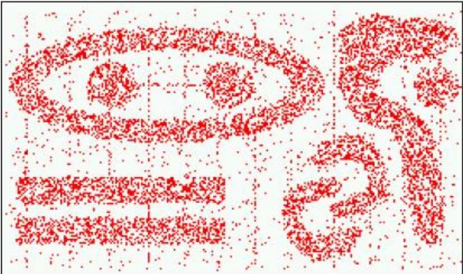
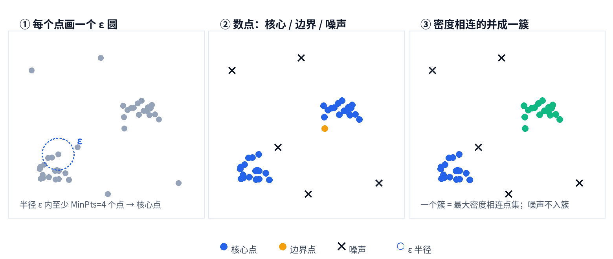
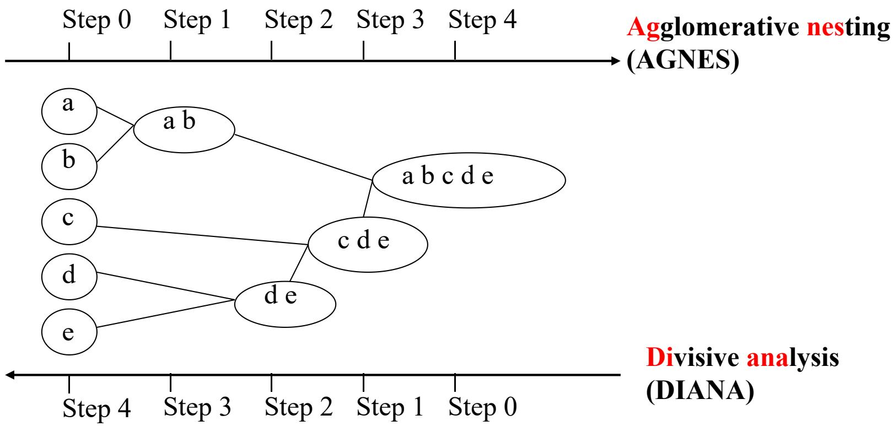
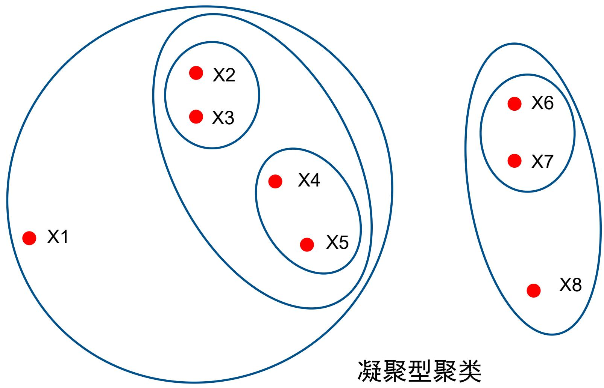

# 6 聚类

一句话：聚类是**无监督**学习——没有标签，只按数据自身的相似性把对象分成若干**簇**，要求**簇内相似、簇间相异**；主线是 聚类分析 → 典型应用 → ==k-means==（步骤、优缺点、改进）→ 四类典型方法（划分、密度、图、层次）→ 评估（purity、WSS/BSS）。

## 0 读这一章之前

- **前置知识**：会算欧氏距离、会算平均值就够了。第 5 章的分类是有标签的版本，这里**没有标签**。
- **一句话概括**：==物以类聚、人以群分==——把靠得近的点自动归成一堆。
- **三个新词**：**簇（cluster）**（一堆相似的点）、**代表点**（簇的“中心”：k-means 用均值，k-中心点用某个真实对象）、**准则函数**（误差平方和 SSE，衡量分得好不好）。
- **计算题集中在**：k-means 手工迭代（算距离 → 重新指派 → 更新中心 → 判收敛）、SSE、DBSCAN 判核心点/密度可达、purity。

## 总览（思维导图）

$$
\text{第 6 章 聚类}
\begin{cases}
6.1\ \text{聚类分析}:\ \text{簇、无指导、高类内/低类间、距离或相似度}\\
6.2\ \text{典型聚类应用}:\ \text{图像分色、银行客户分群}\\
6.3\ \text{k-means}
\begin{cases}
\text{划分方法三要点}:\ \text{距离、准则函数、初始划分}\\
\text{步骤}:\ \text{选代表点}\to\text{指派}\to\text{更新均值}\to\text{迭代}\\
\text{3 缺点}:\ \text{k、初始值、噪声}\ \to\ 3\ \text{组改进（含 k-中心点）}
\end{cases}\\
6.4\ \text{典型方法}:\ \text{划分（球形）、密度（DBSCAN）、图（谱聚类）、层次}\\
6.5\ \text{评估}:\ \text{外在（purity、NMI、RI、ARI）、内在（WSS、BSS）}
\end{cases}
$$

# 6.1 聚类分析

> [!tip] 人话
> 把一堆点按「谁离谁近」自动分成几堆，分完==每堆内部要像、堆与堆之间要不像==；整个过程没人告诉算法正确答案。

## 6.1.1 定义：聚类与簇

- **聚类分析（cluster analysis，简称聚类 clustering）**：==把数据对象划分为子集的过程==。
- **簇（cluster）**：每一个子集就是一个簇。**同一簇中的对象彼此相似，不同簇中的对象相异**。
- **聚类是一种无指导的学习**：没有预定义的类编号。
- **好的聚类分析方法产生高质量的聚类**：==高类内相似度、低类间相似度==。
- **聚类方法中主要的因素是距离或相似度**。

## 6.1.2 聚类分析的数据挖掘功能

- **作为独立的工具**：获得数据分布的情况。
- **作为其他算法的预处理步骤**（如特征选择、分类）。

## 6.1.3 示例数据集（没有类别属性）

课件用一个 7 个样本、2 个描述属性的数据集贯穿全章（后面 k-means 算例就是它）：

| 样本序号 | 描述属性 1 | 描述属性 2 |
| --- | --- | --- |
| $X_1$ | 1 | 3 |
| $X_2$ | 1 | 7.5 |
| $X_3$ | 1.5 | 4 |
| $X_4$ | 4.5 | 7.5 |
| $X_5$ | 4 | 8.5 |
| $X_6$ | 5.5 | 9 |
| $X_7$ | 4.5 | 8 |

==聚类分析的数据集没有类别属性==，也没有训练集和测试集之分——只有描述属性。

> [!warning] 易错
> 表里第二行是 $X_2=(1,\ 7.5)$，不是 $(1,\ 6.5)$；$6.5$ 出现在后面的 k-means 实例里（那是另一套 $(1,\ 6.5)$ 的点），两套数据别串。

## 6.1.4 分类 vs 聚类

| 对比项 | 分类 | 聚类 |
| --- | --- | --- |
| 学习方式 | **有监督**学习 | **无监督**（无指导）学习 |
| 输入 | 有预标注（已分类）的实例 | 未标注数据，只有描述属性 |
| 做什么 | 学一个从特征预测实例类标号的**方法** | 找出数据**自然的**分组 |
| 类 | 事先定义好类编号 | ==没有事先定义的类== |

课件英文原句：分类是 “learns a method for predicting the instance class from pre-labeled instances”，聚类是 “finds natural grouping of instances given un-labeled data”。

# 6.2 典型聚类应用

> [!tip] 人话
> 聚类最典型的用法不是“算出答案”，而是==先自动分成几群，再逐群解释这群有什么特点==。

## 6.2.1 图像像素聚类

把图像里每个像素看成一个点（$R$、$G$、$B$ 三通道值就是它的属性），聚成 $K$ 类后用每类的代表色重画整幅图，就得到“只用 $K$ 种颜色”的版本：

- $K=10$：几乎接近原图，只用了 10 种颜色。
- $K=3$：只剩 3 种颜色，人脸、条纹都被压成色块，细节明显丢失。
- $K=2$：只剩两种色调，接近剪影，只能看出大致轮廓。

同一幅图，==K 越小信息越少==——这直观说明“簇数要自己定”。课件另一行例子是一张沙滩照片：对颜色相似的区域聚类后，得到一张按区域上色的“主题地图”（天空、海、沙、树各成一块）。

## 6.2.2 各领域的应用

- **图像数据分析**：对相似区域聚类，产生主题地图；图像数据集的聚类。
- **商务数据分析**：帮市场分析人员发现不同的顾客群；企业信用等级聚类。
- **万维网数据分析**：对 WEB 上的文档聚类；对 WEB 日志聚类，以发现相同的用户访问模式。
- **经济领域**：从客户数据库发现不同客户群，并用购买模式刻画各群特征；对住宅区聚类，确定自动提款机（ATM）的安放位置；股票市场板块分析，找出最具活力的板块龙头股。
- **生物学领域**：推导植物和动物的分类；对基因聚类，获得对种群的认识。
- **数据挖掘领域**：作为其他数学算法的预处理步骤，获得数据分布状况，集中对特定的类做进一步研究；离群点检测、数据归约。

## 6.2.3 案例：银行客户分群（课件完整案例）

### 数据与参数

- **数据**：客户数据集包含 ==10,000 条客户数据==。
- **部分特征**：Bank No（银行代码，取值如 004、024、077）、Account num（账户代码）、Short Name（客户名字）、First Contact Date（第一次接触日期）、account open date（开户日期）、account balance（当前余额）、account low balance（曾经最低余额）、account high balance（曾经最高余额）、balance category（余额类型）、Statement Low Balance（最低交易账目，有正有负）……
- **目标**：对客户进行分群，使银行可以对不同群体的客户提供不同的服务——==聚类分析是对客户自动分群的有效方法==。
- **方法**：k-means 算法。
- **选取的特征**：从 31 个原始属性值中选 **23 个**属性用作聚类（都是数值型或标称型）。
- **聚类参数**：在**规格化处理**后的数据集上，用 k-means 在选定的 23 个属性上聚类，==设定聚类数为 10==。

### 各簇的大小

| 聚类 | 客户数量 |
| --- | --- |
| 聚类 1 | 145 |
| 聚类 2 | 69 |
| 聚类 3 | 133 |
| 聚类 4 | 6183 |
| 聚类 5 | 1985 |
| 聚类 6 | 213 |
| 聚类 7 | 46 |
| 聚类 8 | 446 |
| 聚类 9 | 413 |
| 聚类 10 | 368 |

### 从“大小”能读出什么

- 各簇有大有小、且大小悬殊，但也合乎客户关系处理的目的：客户关系管理往往要==找出占 20% 左右的一小部分特殊客户==来特别对待。
- 去掉最大的聚类 4 后，其余 9 个聚类共 **3818 人**，占总量 **38.18%**。
- 再去掉聚类 5，其余 8 个聚类共 **1833 人**，占 **18.33%**。
- ==大簇可以继续细分==：把大簇当成一个新数据集再聚类，或直接提高聚类个数 $k$。

> [!note] 注
> 课件表里 10 个簇的客户数相加是 10001（课件原样），而上面两个百分比是按 10,000 算出来的：$3818/10000=38.18\%$、$1833/10000=18.33\%$。按课件数字理解即可，别自己改数。

### 还原规格化数据

聚类用的是规格化后的数据，要直观分析各簇特点，==必须把规格化数据还原为原始数据==。例如当前账户余额最小值 $-10000$、最大值 $1000000$，规格化成 $[0,1]$ 后就看不出账户之间的巨大差距；还原回原始区间才能直观理解。

还原后再统计：**数值型特征算均值和标准差**，**标称型特征算各取值的数量**。

### 按属性分析：账户当前余额

下表是 10 个簇在“账户当前余额”上的正负计数、均值和标准差：

| 聚类 | 余额为正 | 余额为负 | 均值 | 标准差 |
| --- | --- | --- | --- | --- |
| 聚类 1 | 145 | 0 | 24445.50 | 73408.73 |
| 聚类 2 | 69 | 0 | 29164.41 | 78077.97 |
| 聚类 3 | 133 | 0 | 152882.48 | 604633.58 |
| 聚类 4 | 6182 | 1 | 5571.17 | 23957.76 |
| 聚类 5 | 1985 | 0 | 22102.61 | 64825.42 |
| 聚类 6 | 119 | 94 | 8432.82 | 18680.66 |
| 聚类 7 | 46 | 0 | 2093.91 | 5798.48 |
| 聚类 8 | 380 | 66 | 7729.67 | 33233.11 |
| 聚类 9 | 0 | 413 | $-24728.68$ | 61844.23 |
| 聚类 10 | 368 | 0 | 36264.24 | 93389.14 |

### 逐簇解读（课件原文结论）

- **聚类 3**：均值约 **15 万**，比其他簇高出一个数量级 → 初步判断是==存款额高、也就是高收入==的客户群；其标准差也很大，说明这个富有群体内部差距很大（有的百万、千万甚至上亿）。
- **聚类 9**：413 个客户的余额**全为负值**，均值达 **$-2$ 万多** → 认定为==高透支==客户群（后续透支额、透支次数、透支时间的分析也能印证）。
- **聚类 4**：占 **61.81%** 的最大普通客户群，几乎所有客户余额为正，均值 **5 千多**，标准差两万多（不算小）→ ==这个庞大群体还可以继续细分==。
- **聚类 5**：占 **19.85%** 的第二大客户群，均值比聚类 4 高很多，可达 **2 万多** → 属于大量普通客户中的==中等存款额度==账户（不含低额度）。
- **聚类 7**：余额为正但==存款额度较低==的客户群。
- **聚类 1、2、6、8、10**：在“余额”这一个属性上看不出明显特征，要在后续其他属性上分析才能发现其聚类特征。

> [!warning] 易错
> 案例里“结论”都来自==还原后的原始数据统计==，不是规格化后的数；写简答时别漏掉这一步：先还原 → 再算均值/标准差（数值型）或计数（标称型）→ 再解释业务含义。

# 6.3 k-means 聚类方法

> [!tip] 人话
> 先随便点几个中心，然后「==谁离谁近就归谁==」，归完把中心挪到这一堆的中间，再重新归——反复几轮，点不动了就算收敛。

## 6.3.1 划分聚类方法

- **思路**：选择合适的初始代表点把数据样本做初始聚类，之后==通过不断迭代调整聚类结果，直到满足聚类评价的准则==为止；通常通过计算对象间距离进行划分。
- **典型的划分方法**：k-means、k-中心点（k-medoids），以及这两种方法的变种。
- ==划分方法适合发现球形的聚类结构==。

划分聚类对数据集聚类时有**三个要点**：

1. **选定某种距离作为相似性度量**：可按实际需要选欧氏距离、曼哈顿距离或明考斯基距离，==最常用的是欧氏距离==。
2. **选择评价聚类性能的准则函数**：误差平方和准则表示所有样本与相应聚类中心的方差之和，该值达到最优时，各个簇类内尽可能紧凑、簇间尽可能分开。
3. **选择某个初始分类，再用迭代方法得到聚类结果**，使准则函数取得最优值：通常先从数据集中选出各个簇的代表点，再把其余样本按某种方式归到相应簇中。

### k-means 的地位：ICDM'06 十大经典算法

《数据挖掘领域的十大经典算法》（ICDM'06，括号内为票数）：#1 C4.5（61，分类）、#2 **k-means（60，聚类）**、#3 SVM（58，分类）、#4 Apriori（52，关联规则）、#5 EM（48）、#6 PageRank（46）、#7 AdaBoost（45）、#7 kNN（45，分类）、#7 Naive Bayes（45，分类）、#10 CART（34，分类）。

## 6.3.2 算法思想

k-means 是划分聚类方法中最常用、最流行的经典算法，许多其他方法都是它的变种。

- 把==各个簇内所有样本的均值作为该簇的代表点==。
- 通过迭代把数据集划分为不同的类，使评价聚类性能的准则函数达到最优，从而让每个簇==类内紧凑、类间独立==。
- ==不适合处理离散型属性，对连续型属性聚类效果较好==。
- 出处：J. MacQueen (1967), *Some Methods for Classification and Analysis of Multivariate Observations*。

## 6.3.3 算法步骤

**输入**：数据集 $X=\{x_j\mid j=1,2,\dots,\text{total}\}$（只含描述属性，不含类别属性），聚类个数 $k$。

**输出**：使误差平方和准则最小的 $k$ 个聚类。

1. 从 $X$ 中**随机选择 $k$ 个数据样本**作为聚类的初始代表点，每一个代表点表示一个类别。
2. 对 $X$ 中任一数据样本 $x_j$，计算它与 $k$ 个初始代表点的距离，把它划分到**距离最近**的代表点所表示的类别中。
3. 完成划分后，对每一个簇计算其中所有样本的**均值**，作为该簇新的代表点，得到 $k$ 个均值代表点。
4. 对每个样本 $x_j$，计算它与 $k$ 个均值代表点的距离，重新划分到距离最近的那个。
5. **重复步骤 3 和 4**，直到各个聚类不再发生变化，即误差平方和准则函数的值达到最优。


## 6.3.4 误差平方和准则

$$
J_e=\sum_{i=1}^{c}\sum_{x\in D_i}\lVert x-m_i\rVert^{2},\qquad m_i=\frac{1}{n_i}\sum_{x\in D_i}x
$$

$c$ 是簇个数，$D_i$ 是第 $i$ 个簇，$m_i$ 是它的均值代表点，$n_i$ 是簇内样本数。$J_e$ ==越小，簇内越紧凑==；聚类通常用欧氏距离作相似性度量，从而把特征空间划分成若干子区间，每个子区间相当于一个聚类。

#### 例题 1（计算）：课件 k-means 算例（7 点，$k=2$）

**题目**：课件 k-means 实例数据：$X_1(1,3)$、$X_2(1,6.5)$、$X_3(1.5,4)$、$X_4(4.5,7.5)$、$X_5(4,8.5)$、$X_6(5.5,9)$、$X_7(4.5,8)$（与 6.1.3 的示例数据集只差 $X_2$ 的第二坐标）。取 $k=2$，随机选到的初始代表点是 $X_1$ 与 $X_2$。用**距离平方**做指派，迭代到收敛，并算最终 SSE。

下表给的是精确的距离平方；课件原表取一位小数（如 $12.3$、$13.3$），比大小的结论完全一样。

**解**：

**第 1 轮**：$c_1=(1,3)$、$c_2=(1,6.5)$（表中为距离平方）。

| 样本 | 到 $c_1$ | 到 $c_2$ | 归属 |
| --- | --- | --- | --- |
| $X_1$ | 0 | 12.25 | $C_1$ |
| $X_2$ | 12.25 | 0 | $C_2$ |
| $X_3$ | 1.25 | 6.5 | $C_1$ |
| $X_4$ | 32.5 | 13.25 | $C_2$ |
| $X_5$ | 39.25 | 13 | $C_2$ |
| $X_6$ | 56.25 | 26.5 | $C_2$ |
| $X_7$ | 37.25 | 14.5 | $C_2$ |

新中心：

$$
c_1=\Big(\frac{1+1.5}{2},\frac{3+4}{2}\Big)=(1.25,\ 3.5),\qquad c_2=\Big(\frac{1+4.5+4+5.5+4.5}{5},\frac{6.5+7.5+8.5+9+8}{5}\Big)=(3.9,\ 7.9)
$$

**第 2 轮**：$c_1=(1.25,3.5)$、$c_2=(3.9,7.9)$。

| 样本 | 到 $c_1$ | 到 $c_2$ | 归属 |
| --- | --- | --- | --- |
| $X_1$ | 0.31 | 32.42 | $C_1$ |
| $X_2$ | 9.06 | 10.37 | $C_1$（改判） |
| $X_3$ | 0.31 | 20.97 | $C_1$ |
| $X_4$ | 26.56 | 0.52 | $C_2$ |
| $X_5$ | 32.56 | 0.37 | $C_2$ |
| $X_6$ | 48.31 | 3.77 | $C_2$ |
| $X_7$ | 30.81 | 0.37 | $C_2$ |

$X_2$ 这一轮从 $C_2$ 改判到 $C_1$（$9.06<10.37$），新中心：

$$
c_1=\Big(\frac{1+1+1.5}{3},\frac{3+6.5+4}{3}\Big)\approx(1.17,\ 4.5),\qquad c_2=\Big(\frac{4.5+4+5.5+4.5}{4},\frac{7.5+8.5+9+8}{4}\Big)=(4.625,\ 8.25)
$$

**第 3 轮**：$c_1=(1.17,4.5)$、$c_2=(4.625,8.25)$。

| 样本 | 到 $c_1$ | 到 $c_2$ | 归属 |
| --- | --- | --- | --- |
| $X_1$ | 2.28 | 40.7 | $C_1$ |
| $X_2$ | 4.03 | 16.2 | $C_1$ |
| $X_3$ | 0.36 | 27.83 | $C_1$ |
| $X_4$ | 20.11 | 0.58 | $C_2$ |
| $X_5$ | 24.03 | 0.45 | $C_2$ |
| $X_6$ | 39.03 | 1.33 | $C_2$ |
| $X_7$ | 23.36 | 0.08 | $C_2$ |

归属与第 2 轮完全相同 → **收敛**。最终 $C_1=\{X_1,X_2,X_3\}$、$C_2=\{X_4,X_5,X_6,X_7\}$。

SSE（用最终中心 $(7/6,\ 4.5)$ 与 $(4.625,\ 8.25)$）：

$$
SSE=(2.2778+4.0278+0.3611)+(0.5781+0.4531+1.3281+0.0781)=6.6667+2.4375=9.10
$$

**答**：簇为 $\{X_1,X_2,X_3\}$ 与 $\{X_4,X_5,X_6,X_7\}$，中心 $(1.17,\ 4.5)$、$(4.625,\ 8.25)$，$SSE\approx9.10$。注意 $X_2$ 是第 2 轮才从另一簇改判过来的，这正是 k-means 迭代的意义。

> [!warning] 易错
> (1) 指派时用**距离（或距离平方）比大小**，不用欧氏距离本身也能比，但**重算中心必须用坐标均值**；(2) 每轮要==先用上一轮中心把所有点重新指派，再用新指派算新中心==，不能边指派边更新；(3) 判断收敛看“归属不再变化”，等价于准则函数不再下降；(4) $X_2$ 初始是中心之一，第 2 轮照样可能被改判——初始代表点不保证留在自己那簇。

#### 例题 2（计算）：两轮迭代与 SSE（补充练习）

**题目**：5 个样本 $A(1,1)$、$B(2,1)$、$C(4,3)$、$D(5,4)$、$E(3,2)$，取 $k=2$，初始中心 $c_1=A$、$c_2=D$。做完整迭代并算 SSE。

**解**：

**第 1 轮**：$c_1=(1,1)$、$c_2=(5,4)$。

- 指派（括号内为“到 $c_1$ 的距离 $\mid$ 到 $c_2$ 的距离”）：$A\to C_1$（$0\mid5.00$）、$B\to C_1$（$1\mid4.24$）、$C\to C_2$（$3.61\mid1.41$）、$D\to C_2$（$5.00\mid0$）、$E\to C_1$（$2.24\mid2.83$）。
- 新中心：$C_1=\{A,B,E\}$、$C_2=\{C,D\}$，

$$
c_1=\Big(\frac{1+2+3}{3},\frac{1+1+2}{3}\Big)=\Big(2,\ \frac43\Big),\qquad c_2=\Big(\frac{4+5}{2},\frac{3+4}{2}\Big)=(4.5,\ 3.5)
$$

**第 2 轮**：$c_1=(2,\tfrac43)$、$c_2=(4.5,3.5)$。

- 指派：$A,B,E\to C_1$（$1.05$、$0.33$、$1.20$），$C,D\to C_2$（$0.71$、$0.71$）→ ==归属不变，收敛==。

SSE：

$$
SSE=\Big(1+\tfrac19\Big)+\tfrac19+\Big(1+\tfrac49\Big)+0.5+0.5=\frac83+1=\frac{11}{3}\approx3.67
$$

**答**：收敛于 $C_1=\{A,B,E\}$、$C_2=\{C,D\}$，中心 $(2,\ \tfrac43)$、$(4.5,\ 3.5)$，$SSE=11/3\approx3.67$。

> [!warning] 易错
> 第 1 轮 $E(3,2)$ 到两个中心的距离是 $2.24$ 与 $2.83$，只差一点——==边界点会随中心移动而改判，所以必须真算，不能靠眼看==。

## 6.3.5 k-means 的优点

- 与层次聚类相比，k 均值可以得到**更紧密的簇**，尤其是对于==球状簇==。
- 对**大数据集**，是可伸缩和高效率的。
- 算法试图找出使平方误差函数最小的 $k$ 个划分；当**结果簇是密集的、簇与簇之间区别明显**时效果较好。

## 6.3.6 k-means 的缺点

1. **聚类的个数 $k$** 要事先给定。
2. **对初始值敏感**：不同初值可能收敛到不同的局部最优。
3. **对噪声点非常敏感**：均值会被离群点拉偏。

## 6.3.7 改进方法

### 针对缺点 1：$k$ 怎么定

- 先采用**层次凝聚算法**决定结果簇的数目，并找到一个初始聚类，再用迭代重定位改进该聚类。
- 或对不同的 $k$ 值多次跑 k-means：$k$ ==增大时误差平方和必然减小==，据此画出“准则函数随 $k$ 变化”的曲线（肘部图），结合实际问题经验选一个相对最合适的 $k$。

### 针对缺点 2：初始代表点怎么选

课件列了四种做法：

1. 按实际问题特点、凭经验确定聚类数量，从数据中挑出直观上比较合适的 $k$ 个初始代表点。
2. **随机**选择 $k$ 个数据样本作为初始代表点。
3. 把数据集**随机分成 $k$ 个聚类**，计算每个聚类的均值，把这些均值作为初始代表点。
4. 在 k-means 之前**先跑一轮 k-means**，得到一个初始聚类，再用迭代重定位改进它。

初始代表点的选择往往影响最终性能：==得到的是局部最优解，而不是全局最优解==。

### 针对缺点 3：噪声与离群点

- **样本数据预处理**：计算样本对象两两之间的距离，==筛掉与其它所有样本距离和最大的对象==（共 $m$ 个）。
- **初始聚类中心的选择**：不采用簇中的平均值作参考点，而==选用簇中位置最靠近中心的对象==，避免孤立点的影响。
- **改进的算法：k-中心点（k-medoids）**：选一个对象叫 medoid 代替中心的作用，这个 medoid 就标识这个类。与 k-means 的区别只在于中心点的选取：
  - k-means：中心点取为当前 cluster 中所有数据点的**平均值**；
  - k-medoids：从当前 cluster 中选取==到其他所有（同簇）点距离之和最小的那个点==作为中心点。

> [!warning] 易错
> k-medoids 的“代表点”必须是==数据集中真实存在的对象==（所以能抗离群点），而 k-means 的“代表点”是算出来的均值，可以不在数据集中。

#### 例题 3（简答）：k-means 的步骤与优缺点

**题目**：简述 k-means 算法的步骤，并说明它的优缺点与改进方向。

**答题要点**：

1. 给定 $k$，随机选 $k$ 个样本作初始代表点。
2. 每个样本按到代表点的距离分到最近的一类。
3. 用每类样本的均值作为新代表点。
4. 重复 2、3，直到各簇不再变化（误差平方和准则最优）。

优点：类内紧凑（尤其球状簇，比层次聚类更紧）；对大数据集可伸缩、高效；簇密集且簇间分得开时效果好。

缺点：$k$ 要事先给；对初始值敏感（局部最优）；对噪声点非常敏感；不适合离散型属性。

改进：用层次凝聚先定 $k$，或多次取不同 $k$ 画肘部曲线；初值用经验法、随机法、随机分 $k$ 组取均值、或先跑一轮 k-means；噪声用“筛掉距离和最大的 $m$ 个对象”“代表点取最靠近中心的对象”，或直接改用 k-medoids。

# 6.4 典型聚类方法

> [!tip] 人话
> 除了「按中心分堆」（k-means），还有「按==密度==连线」「按==图==切开」「由下往上==合并==」三套思路，各自适合不同形状的簇。

## 6.4.1 簇的三种类型

- **中心型（center-based）**：簇的中心通常在簇中所有点的平均值附近 → 适合球形簇。
- **密度型（density-based）**：簇是一块高密度区域，被低密度区域与其他高密度区域隔开；用于簇不规则、互相交织、且有噪声和离群点的数据。
- **连续型（contiguous，最近邻/传递）**：点靠“相邻”关系连成一片。

## 6.4.2 数据挖掘对聚类分析的要求

1. **处理不同数据类型的能力**：数值型、二元型、标称型、序数型等。
2. **发现任意形状的能力**：基于距离的算法往往只发现球形簇，而现实的簇是任意形状的。
3. **减小对先验知识和用户自定义参数的依赖性**：高维数据下参数很难决定，聚类质量也很难控制（初始值、聚类个数都是这类参数）。
4. **处理噪声数据的能力**：对空缺值、离群点、数据噪声不敏感。
5. **可解释性和可用性**：聚类要和特定语义解释、应用相联系；低维可借助可视化，高维可先降维，再按具体问题选算法。

## 6.4.3 四类典型方法总览

| 方法 | 核心思路 | 代表算法 | 适合 |
| --- | --- | --- | --- |
| 划分 | 分成 $k$ 个互不重叠的簇，迭代优化准则使簇内误差最小 | k-means、k-中心点 | 球形簇 |
| 密度 | 邻域内点数（密度）超阈值就并入同一簇，==不用预设簇数== | DBSCAN、OPTICS、DENCLUE、CLIQUE | 任意形状、含噪声 |
| 图 | 把数据看成图（结点是点、边是相似度），按连通性或割来分 | 谱聚类 | 任意形状、稀疏/高维 |
| 层次 | 分层划分成一棵树：凝聚型自底向上合并，分裂型自顶向下拆分 | BIRCH、Chameleon（改进） | 有层次结构的簇 |

## 6.4.4 划分方法（7.4.1）

划分方法把数据分成若干互不重叠的簇，==适合发现球形的聚类结构==；k-means 与 k-中心点（含变种）已在 6.3 讲完，这里只记住它的适用形状。

## 6.4.5 密度方法（7.4.2）

### 为什么需要密度方法

- 基于样本之间**距离**的聚类方法只能发现**球状**的簇。
- 密度方法可用来过滤“噪声”孤立点，从而==发现任意形状的簇==。

### 主要思想、特征与方法

- **主要思想**：只要临近区域的密度（样本数目）超过某个阈值就继续聚类，即对于给定簇中的每个样本，在一个给定范围的区域中必须至少包含某个数目的样本。
- **主要特征**：可以发现任意形状的簇；可以去除噪声；==需要参数作为终止条件==。
- **主要方法**：DBSCAN（Ester et al., KDD'96）、OPTICS（Ankerst et al., SIGMOD'99）、DENCLUE（Hinneburg & Keim, KDD'98）、CLIQUE（Agrawal et al., SIGMOD'98，更偏网格方法）。
- **指导思想**：以数据集在空间分布上的稠密程度为依据，==无需预先设定簇的数量==，特别适合未知内容的数据集；只要一个区域中点的密度大于某个阈值，就把它加到相近的聚类中——对簇中每个对象，在给定的半径 $\varepsilon$ 邻域内至少要包含最小数目 MinPts 个对象。
- 这类算法能克服基于距离的算法只能发现“类圆形”聚类的缺点，可发现任意形状的聚类，且对噪声数据不敏感。



### DBSCAN：簇与密度的定义

- **全称**：Density-Based Spatial Clustering of Applications with Noise（带噪声的基于密度的空间聚类）。
- **簇的定义**：DBSCAN 把簇定义为==密度相连的点的最大集合==，能够把具有足够高密度的区域划分为簇，并可在有噪声的空间数据库中发现任意形状的聚类（与层次聚类不同，它不按距离合并，而是按密度向外扩展）。
- **基于中心的密度定义**：数据集中特定点的密度，通过该点 $\varepsilon$ 半径之内的点计数（==包括本身==）来估计；==密度依赖半径==（$\varepsilon$ 越大，邻域里点越多）。


### 六个基本术语

- **$\varepsilon$-邻域**：给定对象在半径 $\varepsilon$ 内的区域。
- **核心对象**：如果一个对象的 $\varepsilon$-邻域至少包含 MinPts 个对象，则称它为核心对象。
- **直接密度可达**：给定对象集合 $D$，如果 $p$ 在 $q$ 的 $\varepsilon$-邻域内，而 $q$ 是核心对象，则对象 $p$ 从对象 $q$ 出发是直接密度可达的。
- **密度可达**：存在对象链 $p_1=q,\dots,p_n=p$，对 $p_i\in D$，$p_{i+1}$ 是从 $p_i$ 关于 $\varepsilon$ 和 MinPts 直接密度可达的，则 $p$ 从 $q$ 关于 $\varepsilon$ 和 MinPts 密度可达。
- **密度相连**：若对象集合 $D$ 中存在对象 $o$，使 $p$ 和 $q$ 都从 $o$ 关于 $\varepsilon$、MinPts 密度可达，则 $p$ 和 $q$ 密度相连。
- **基于密度的簇**：基于密度可达性的==最大密度相连对象的集合==；**边界点**：不是核心点，但落在某个核心点的邻域内；**噪声**：不包含在任何簇中的对象（既不是边界点也不是核心点）。

### 课件小例（$\varepsilon$ 用一个相应半径表示，MinPts=3，考察 $Q,M,P,S,O,R$）

- 由于有标记的各点 $M$、$P$、$O$ 和 $R$ 的 $\varepsilon$ 近邻都包含 3 个以上的点，因此它们都是==核对象==。
- $M$ 是从 $P$ **直接密度可达**；$Q$ 则是从 $M$ **直接密度可达** → 于是 $Q$ 是从 $P$ **密度可达**。
- 但 $P$ 从 $Q$ **无法密度可达**——==密度可达是非对称的==。
- $S$ 和 $R$ 从 $O$ 是**密度可达**的；$O$、$R$、$S$ 均是**密度相连**的。

> [!note] 注
> 课件这页题干写的是“这 5 个样本点”，但图上标的是 $Q,M,P,S,O,R$ 六个；结论按图上这六个说。

> [!warning] 易错
> (1) “直接密度可达”要求起点是核心对象，所以==可达是单向的==；判簇看的是“密度相连”，那才是对称关系。(2) 邻域计数==包含点自身==。(3) 判核心对象的门槛按“$\varepsilon$ 邻域内对象数 $\ge$ MinPts”算，课件算法描述里写成“多于 MinPts 个”，两种写法在本章算例里结论一致。

### 算法思想与伪代码

DBSCAN 通过检查数据集中每个对象的 $\varepsilon$-邻域来寻找聚类：

1. 如果一个点 $p$ 的 $\varepsilon$-邻域包含多于 MinPts 个对象，则创建一个以 $p$ 为核心对象的新簇 $C$。
2. 从 $C$ 中寻找未被处理对象 $q$ 的 $\varepsilon$-邻域；如果 $q$ 的 $\varepsilon$-邻域也包含多于 MinPts 个对象，则把尚未包含在 $C$ 中的 $q$ 的邻点加入 $C$，这些点的 $\varepsilon$-邻域在下一步继续检测。
3. 反复执行，当没有新的点可以加入任何簇时结束。

输入：含 $n$ 个对象的数据库、半径 $\varepsilon$、最少数目 MinPts；输出：所有达到密度要求的簇。

```text
REPEAT
    从数据库中抽取一个未处理过的点 p
    IF p 是核心点 THEN
        找出所有从 p 密度可达的对象，形成一个簇
    ELSE
        p 是边缘点（非核心对象），跳出本次循环，寻找下一点
UNTIL 所有点都被处理
```



### 算例（$\varepsilon=1$，MinPts=4）

| 序号 | 属性 1 | 属性 2 | 序号 | 属性 1 | 属性 2 |
| --- | --- | --- | --- | --- | --- |
| 1 | 2 | 1 | 7 | 5 | 2 |
| 2 | 5 | 1 | 8 | 6 | 2 |
| 3 | 1 | 2 | 9 | 1 | 3 |
| 4 | 2 | 2 | 10 | 2 | 3 |
| 5 | 3 | 2 | 11 | 5 | 3 |
| 6 | 4 | 2 | 12 | 2 | 4 |

逐个点判（$\varepsilon$ 圆内点数与 MinPts=4 比较）：

| 步 | 选择的点 | $\varepsilon$ 内点数 | 结果 |
| --- | --- | --- | --- |
| 1 | 1 | 2 | 非核心，取下一个 |
| 2 | 2 | 2 | 非核心，取下一个 |
| 3 | 3 | 3 | 非核心，取下一个 |
| 4 | 4 | 5 | **核心** → 簇 $C_1=\{1,3,4,5,9,10,12\}$ |
| 5 | 5 | 3 | 已在 $C_1$ 中 |
| 6 | 6 | 3 | 非核心，取下一个 |
| 7 | 7 | 5 | **核心** → 簇 $C_2=\{2,6,7,8,11\}$ |
| 8 | 8 | 2 | 已在 $C_2$ 中 |
| 9 | 9 | 3 | 已在 $C_1$ 中 |
| 10 | 10 | 4 | 已在 $C_1$ 中 |
| 11 | 11 | 2 | 已在 $C_2$ 中 |
| 12 | 12 | 2 | 已在 $C_1$ 中，最后一点，程序终止 |

要点：点 **4** 的邻域含 5 个点，从它出发直接可达 4 个、间接可达 2 个，聚出 $C_1$；点 **7** 同理聚出 $C_2$；其余点不是核心点，或已在某个簇里。$\varepsilon$ 圆内点数==是否含自身==，写法不同会差 1，这里按含自身。

### 复杂度

- **时间**：$O(N\times\text{找出 }\varepsilon\text{ 邻域中的点所需时间})$，$N$ 为点数；最坏 $O(N^2)$。低维空间用 KD 树等空间索引，可降到 $O(N\log N)$。
- **空间**：低维或高维都是 $O(N)$。聚类过程中一旦找到核心对象就向外扩展，核心对象不断增多、未处理对象保留在内存；若存在庞大的簇需要很大内存，数据量增大时内存与 I/O 消耗都很大。

### 优缺点

- **优点**：能克服基于距离的算法只能发现“类圆形”聚类的缺点，可发现任意形状的聚类，有效处理噪声数据，==数据输入顺序不敏感==。
- **缺点**：
  - **输入参数敏感**：确定 $\varepsilon$、MinPts 困难，选取不当会降低聚类质量；而且这两个参数在 DBSCAN 中是==全局唯一==的，当空间聚类密度不均匀、簇间距离相差很大时，聚类质量较差。
  - **计算复杂度大**：需要建立空间索引来降低计算量，对数据维数伸缩性差；这类方法要扫描整个数据库，每个对象都可能引起一次查询，数据量大时造成频繁 I/O。

## 6.4.6 图方法：谱聚类（7.4.3）

- **优点**：谱聚类只需要数据之间的==相似度矩阵==，因此处理稀疏数据很有效；建立在谱图理论基础上，能在任意形状的样本空间上聚类，适合高维数据。
- **缺点**：复杂度高；对相似度图的改变和聚类参数的选择==非常敏感==。

## 6.4.7 层次方法（7.4.4）



- **思路**：对给定数据集==分层进行划分，形成一个以各个聚类为结点的树形结构==。
- **两种方式**：**凝聚型**（自底向上：每个样本先算一类，逐步合并，直到所有样本在一类或满足终止条件）与**分裂型**（自顶向下：先一个大类，逐步拆分）。
- **改进的层次聚类方法**：BIRCH（利用层次方法的平衡迭代规约和聚类）、Chameleon（变色龙，多阶段层次聚类）。



- **优点**：简单、易实现、容易理解。
- **缺点**：==不能纠正错误的合并或分裂==；可伸缩性不好，因为合并或分裂的决定需要检查和估算大量的对象或簇。

> [!note] 注
> 课件只讲“凝聚型/分裂型”两种方式，没有点名具体算法；教材里把这两类分别叫 AGNES（凝聚）与 DIANA（分裂），答题时点名要说明是教材补充。

# 6.5 聚类评估

> [!tip] 人话
> 分得好不好，要看「==每堆内部紧不紧==」（紧凑）和「==堆与堆离得远不远==」（分离）；如果手里有标准答案，还能直接数对错。

## 6.5.1 外在方法与内在方法

- **外在方法**：==有基准（真实的划分）可用时==，把聚类结果与基准比较来评估。
- **内在方法**：==没有基准可用时==，通过考察簇的分离情况和紧凑情况来评估。

## 6.5.2 purity（外在）

纯度 purity 是极为简单的一种聚类评价方法：只需计算==正确聚类的样本数占总样本数的比例==，即每个簇取“多数类”的样本数，全部加起来除以总数。

$$
\text{purity}=\frac{\sum_{i}\max_{j}\ \text{簇 }i\text{ 中属于真实类 }j\text{ 的样本数}}{\text{总样本数}}
$$

purity 计算简单，取值 $0\sim1$，==完全错误为 0、完全正确为 1==。


#### 例题 4（计算）：课件的 purity 算例

**题目**：3 个簇共 17 个点，真实类别用 $x$、$o$、$\diamond$ 表示。

| 簇 | $x$ | $o$ | $\diamond$ | 簇大小 | 多数类计数 |
| --- | --- | --- | --- | --- | --- |
| cluster 1 | 5 | 1 | 0 | 6 | 5 |
| cluster 2 | 1 | 4 | 1 | 6 | 4 |
| cluster 3 | 2 | 0 | 3 | 5 | 3 |
| 合计 | 8 | 5 | 4 | 17 | 12 |

**解**：每个簇取多数类的样本数，再除以总样本数：

$$
\text{purity}=\frac{5+4+3}{17}=\frac{12}{17}\approx0.71
$$

**答**：$\text{purity}=12/17\approx0.71$。课件原文是 $purity=(3+4+5)/17=0.71$——“第一类正确的有 5 个、第二个 4 个、第三个 3 个，总数 17”，加号顺序不同，值相同。

> [!warning] 易错
> purity ==只奖励“多数类”的正确，簇数越多越容易刷高==（极端到每个点一个簇，purity 就是 1），所以不能只看 purity。

## 6.5.3 最小误差：WSS 与 BSS（内在）

误差平方和准则表示所有样本与相应聚类中心的方差之和，该准则值达到最优时，各簇类内尽可能紧凑、簇间尽可能分开。

- **凝聚度（cohesion）**用簇内误差平方和衡量：

$$
WSS=\sum_{i}\sum_{x\in C_i}(x-m_i)^{2}
$$

- **分离度（separation）**用簇间平方和衡量：

$$
BSS=\sum_{i}\lvert C_i\rvert\,(m-m_i)^{2}
$$

其中 $C_i$ 是第 $i$ 个簇（$\lvert C_i\rvert$ 是它的大小，$m_i$ 是它的中心），$m$ 是==所有样本的中心==。

好的聚类：==WSS 小、BSS 大==（样本总量固定时两者互补，一个升另一个降）。

## 6.5.4 其他外在指标

- **NMI（Normalized Mutual Information）**：归一化互信息。
- **RI（Rand Index）**：把聚类看成一系列决策过程来评价。
- **ARI（Adjusted Rand Index）**：调整兰德指数。

#### 例题 5（简答）：如何评价聚类有效性

**答题要点**：

1. 分两类：**外在方法**（有真实划分作基准，把结果与基准比较）与**内在方法**（无基准，只看簇的紧凑与分离）。
2. 外在常用：**purity**（各簇多数类样本数之和 / 总样本数，$0\sim1$）、NMI、RI、ARI。
3. 内在常用：**WSS**（簇内误差平方和，越小越紧凑）与 **BSS**（簇间平方和，越大越分离）。

> [!warning] 易错
> (1) 写成“purity 越大越好”不算错，但要说清==它偏向簇数多==；(2) SSE/WSS 会随 $k$ 增大单调下降，不能只靠它选 $k$；(3) 得分清“外在=有基准”“内在=无基准”，这是最常考的一句。
