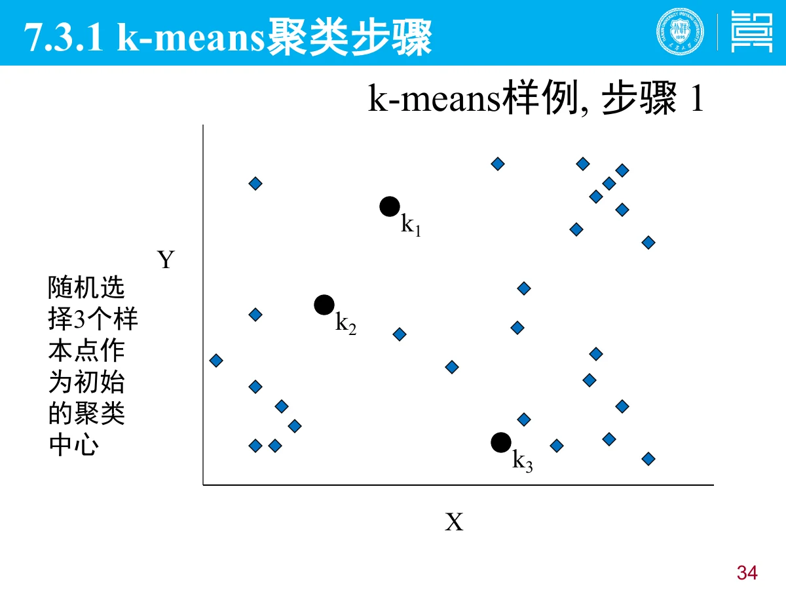
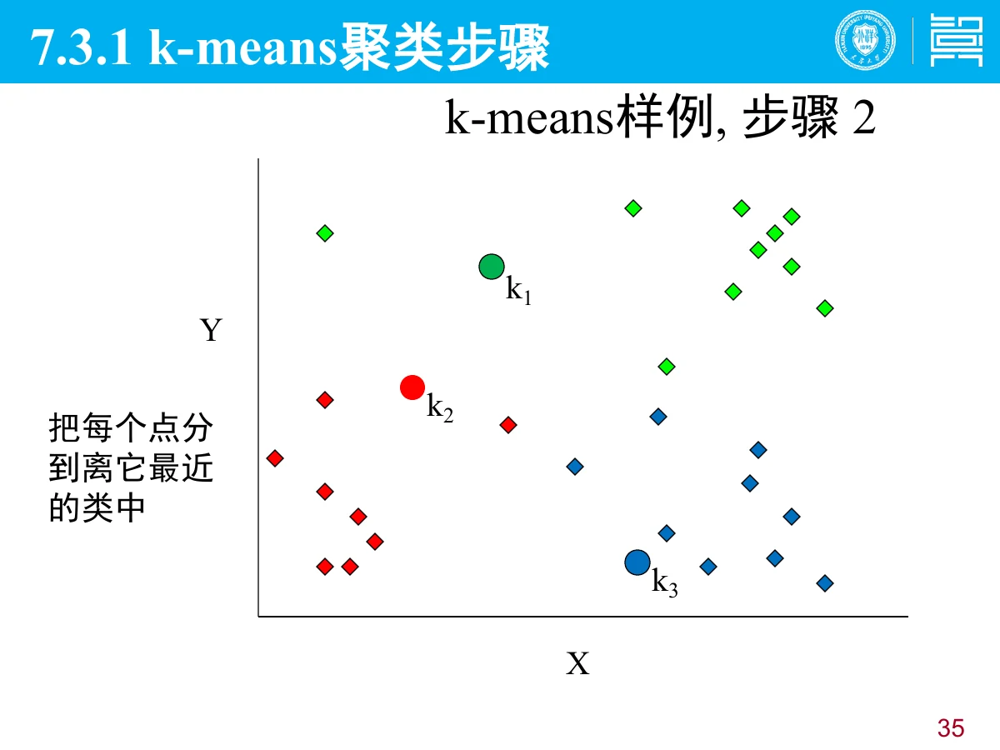
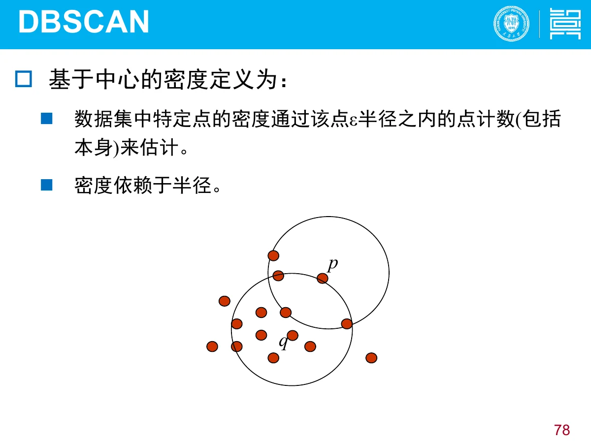
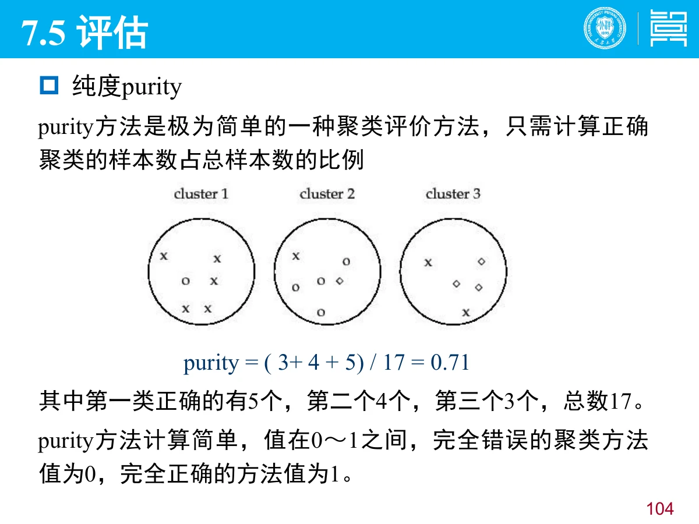

# 6 聚类

一句话：聚类是**无监督**学习——没有标签，只按数据自身的相似性把它们分成若干**簇（cluster）**，使**簇内相似、簇间相异**；本章重点是 **k-means 的步骤与优缺点**、**聚类有效性怎么评价**。

## 0 读这一章之前

- **前置知识**：知道「距离」怎么算（欧氏距离）、知道「平均值」就行。
- 整章一句话：**物以类聚——把靠得近的点自动归成一堆**。
- 三个新词：**簇**（一堆相似的点）、**聚类中心**（这堆点的平均位置）、**准则函数**（衡量分得好不好的分数）。
- 与第 5 章的分界：分类要标准答案，聚类没有答案，连分几类常常都要自己定。

## 总览（思维导图）

$$
\text{第 6 章 聚类}
\begin{cases}
7.1\ \text{聚类分析}:\ \text{簇、簇内相似、簇间相异}\\
7.3\ \text{k-means}
\begin{cases}
\text{三要点}:\ \text{距离度量、准则函数、初始划分}\\
\text{步骤}:\ \text{选中心}\to\text{分配}\to\text{更新中心}\to\text{迭代}\\
\text{优缺点}
\end{cases}\\[4pt]
7.4\ \text{典型方法}:\ \text{划分、密度（DBSCAN）、图、层次}\\
7.5\ \text{评估}:\ \text{外在（purity、NMI、RI/ARI）、内在（WSS、BSS）}
\end{cases}
$$

## 考点权重

| 模块         | 真正需要掌握                                        |   优先级 |
| ------------ | --------------------------------------------------- | -------: |
| 7.1 基本概念 | 聚类是无监督、簇的定义、与分类的区别                | **很高** |
| 7.3 k-means  | **算法步骤、准则函数 SSE、优缺点**（简答必考）      | **最高** |
| 7.4 典型方法 | 层次聚类的凝聚/分裂与缺点、密度聚类思想             |       高 |
| 7.5 评估     | **外在方法与内在方法、至少两个指标（SSE、purity）** | **最高** |

# 6.1 聚类分析

> **人话**：把一堆点按「谁离谁近」自动分成几堆，分完每堆内部要像、堆与堆之间要不像。

- **聚类（clustering）**：把数据对象划分为子集的过程。
- **簇（cluster）**：每个子集就是一个簇。**同一簇内的对象彼此相似，不同簇的对象相异**。
- 目标可以写成两句话：**最大化类内相似（最小化类内距离）**、**最大化类间距离**。
- 与分类的区别：分类是**有监督**（有事先定义的类、有标签）；聚类是**无监督**（没有事先定义的类）。

这是「物以类聚、人以群分」的算法版本。

# 6.2 k-means 聚类

> **人话**：先随便点几堆的中心，然后「谁离谁近就归谁」，归完把中心挪到这堆的中间，再重新归——反复几轮就稳定了。

## 6.2.1 划分聚类的三个要点

划分聚类（partitioning）的思路：选择合适的初始代表点做初始聚类，再通过不断迭代调整聚类结果，直到满足聚类评价准则。三个要点：

| 要点           | 内容                                                                            |
| -------------- | ------------------------------------------------------------------------------- |
| 相似性度量     | 选一种距离：欧氏距离、曼哈顿距离、明考斯基距离（**最常用欧氏距离**）            |
| 准则函数       | **误差平方和（SSE）**：所有样本与所属簇中心的方差之和，最优时类内紧凑、类间分开 |
| 初始划分与迭代 | 先选初始代表点，再迭代使准则函数取得最优值                                      |

## 6.2.2 误差平方和准则（SSE）

$$
SSE=\sum_{i=1}^{k}\sum_{x\in C_i}\lVert x-m_i\rVert^2
$$

$C_i$ 是第 $i$ 个簇，$m_i$ 是该簇的中心（均值），$k$ 是簇的个数。**SSE 越小，簇内越紧凑。**

## 6.2.3 算法思想与步骤

k-means 用**各簇内所有样本的均值**作为该簇的代表点，通过迭代使准则函数达到最优，从而**类内紧凑、类间独立**。

1. **选初始中心**：从数据中随机选 $k$ 个点作为初始聚类中心；
2. **分配样本**：把每个样本分到距离最近的中心所在簇；
3. **更新中心**：把每个簇的中心重算为该簇所有点的均值；
4. **迭代**：重复 2、3，直到中心不再变化或准则函数值稳定。

## 6.2.4 优缺点

| 优点                     | 缺点                                                       |
| ------------------------ | ---------------------------------------------------------- |
| 简单、易实现、收敛快     | 需要**事先指定 $k$**                                       |
| 对**连续型属性**效果较好 | **不适合离散型属性**                                       |
| 时间复杂度与样本数近线性 | 对**初始中心敏感**，可能收敛到局部最优；对噪声和离群点敏感 |

一句话：k-means 简单快，但要先定 $k$、怕离群点、可能陷在局部最优。

# 6.3 典型聚类方法

> **人话**：除了「按中心分堆」，还有「按密度连线」「由下往上合并」等不同思路。

| 方法     | 思路                                                   | 代表 / 特点                                |
| -------- | ------------------------------------------------------ | ------------------------------------------ |
| 划分方法 | 把数据分成 $k$ 个互不重叠的簇，迭代优化准则函数        | k-means、k-中心点                          |
| 密度方法 | 以空间分布的**稠密程度**为依据：密度够大的区域连成一簇 | **DBSCAN**，能发现任意形状的簇、能识别噪声 |
| 图的方法 | 把数据看成图上的点，按连通性或割来聚类                 | 谱聚类                                     |
| 层次方法 | 自底向上**凝聚**或自顶向下**分裂**，形成层次树         | BIRCH、Chameleon                           |

**层次聚类**的优缺点：

- 优点：简单、易实现、容易理解；
- 缺点：**不能纠正错误的合并或分裂**；可伸缩性差（每一步都要检查大量对象）。

# 6.4 聚类评估

> **人话**：分得好不好，要看「每堆内部紧不紧」和「堆与堆离得远不远」；有标准答案时还能直接数对错。

## 6.4.1 两类评估方法

| 类型         | 何时用                 | 看什么                             |
| ------------ | ---------------------- | ---------------------------------- |
| **外在方法** | 有基准（真实划分）可用 | 把聚类结果与基准比较               |
| **内在方法** | 没有基准可用           | 考察簇的**分离情况**与**紧凑情况** |

## 6.4.2 常用指标

**（1）纯度 purity（外在）**

正确聚类的样本数占总样本数的比例，取值 $0\sim1$，完全错误为 0、完全正确为 1。

$$
\text{purity}=\frac{\text{各簇中占多数的真实类别的样本数之和}}{\text{总样本数}}
$$

**（2）误差平方和 SSE / 凝聚度 WSS（内在）**

凝聚度用簇内误差平方和衡量（越小越紧凑）：

$$
WSS=\sum_{i}\sum_{x\in C_i}\lVert x-m_i\rVert^2
$$

**（3）分离度 BSS（内在）**

用簇中心与整体中心的距离平方和衡量（越大越分开）：

$$
BSS=\sum_{i}\lvert C_i\rvert\,\lVert m-m_i\rVert^2
$$

$m$ 是所有样本的中心。好的聚类：**WSS 小、BSS 大**（总量固定时两者互补）。

**（4）其他外在指标**：NMI（归一化互信息）、RI（兰德指数）、ARI（调整兰德指数）。

考试答题模板：聚类有效性分**外在方法**与**内在方法**；前者有基准，用 purity / NMI / RI 比较；后者无基准，用簇内紧凑（SSE/WSS）与簇间分离（BSS）衡量。

# 6.5 本章小结

- 聚类无监督，目标是簇内相似、簇间相异。
- 划分聚类三要点：距离度量、准则函数（SSE）、初始划分与迭代。
- k-means：选中心 → 分配 → 更新 → 迭代；简单快，但需指定 $k$、不适合离散属性、对初值和离群点敏感。
- 其他方法：密度（DBSCAN，任意形状）、层次（凝聚/分裂，错了改不回来）。
- 评估：外在（purity、NMI、RI/ARI）与内在（WSS 紧凑、BSS 分离）。

# 6.6 考前速查表

| 题目出现                                        | 立刻想到                                      |
| ----------------------------------------------- | --------------------------------------------- |
| 没有标签、按相似性分组                          | 聚类（无监督）                                |
| 簇                                              | 簇内相似、簇间相异                            |
| 划分聚类三要点                                  | 距离度量、准则函数、初始划分 + 迭代           |
| $SSE=\sum_i\sum_{x\in C_i}\lVert x-m_i\rVert^2$ | 误差平方和准则函数                            |
| k-means 四个步骤                                | 选初始中心 → 分配样本 → 更新均值 → 迭代       |
| k-means 的缺点                                  | 要指定 $k$、不适合离散属性、对初值/离群点敏感 |
| 能发现任意形状的簇                              | 密度聚类（DBSCAN）                            |
| 不能纠正错误的合并/分裂                         | 层次聚类                                      |
| 有基准 / 无基准                                 | 外在方法 / 内在方法                           |
| purity                                          | 正确聚类样本占比（0~1）                       |
| WSS 小、BSS 大                                  | 好的聚类（紧凑且分离）                        |
| NMI、RI、ARI                                    | 其他外在指标                                  |
