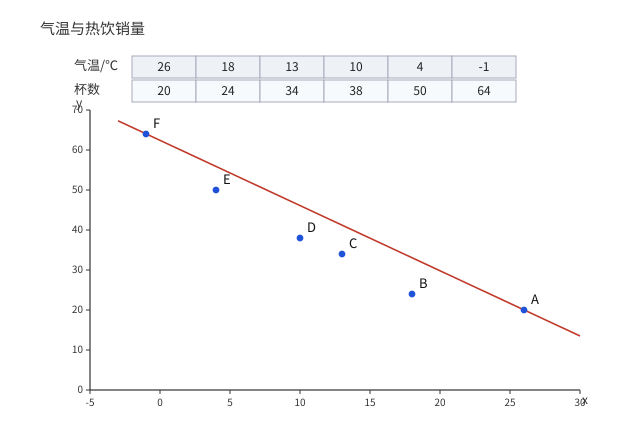
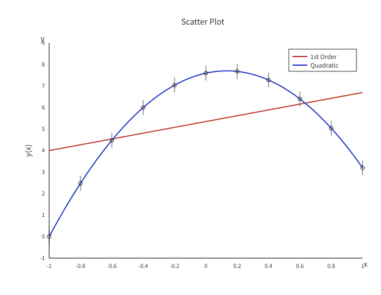
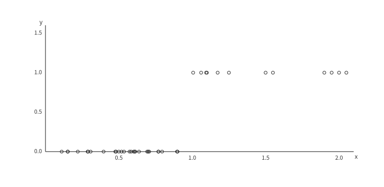
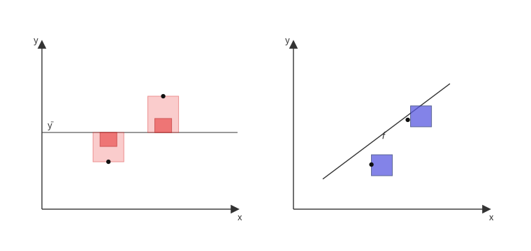
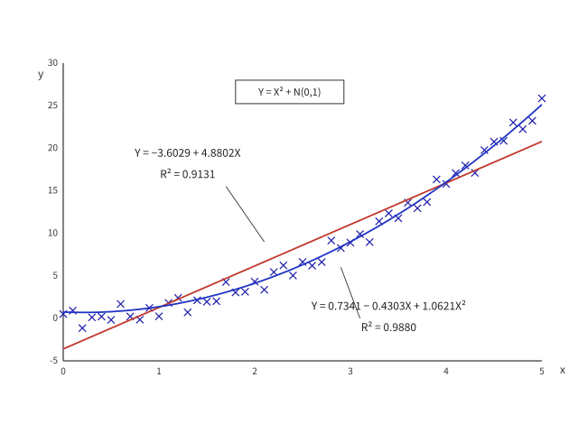

# 7 回归

一句话：回归是**有监督**学习里预测**连续值**的那一支——从 Galton 研究父子身高提出「回归」开始，找一个函数 $y=f(X)$ 让**残差平方和最小**；本章主线是**一元最小二乘 → 多元正规方程 → 多项式 → 非线性线性化 → Logistic → MSE / $R^2$ 评估**。

## 0 读这一章之前

- **前置知识**：第 5 章 5.3.4 已经见过 $\hat y=wx+b$、MSE 和最小二乘闭式解；本章换成 $\beta_0,\beta_1$ 的记号重讲，再往多元、曲线、分类扩。
- 整章一句话：**给一堆散点找误差最小的那条曲线**；找到后既能解释（$x$ 每变 1，$y$ 平均变多少），也能预测。
- 三个新词：**残差**（真实值与预测值之差）、**最小二乘**（让残差平方和最小）、**对数似然**（Logistic 回归的求解目标）。
- 计算题集中在：一元最小二乘的 $\beta_0,\beta_1$、多元的 $\beta=(X^{T}X)^{-1}X^{T}Y$、以及 MSE / RMSE / MAE / $R^2$。
- 编号说明：课件封面写的是**第 6 章 回归分析**、节号 6.1–6.6；本笔记按课程的章序（第 7 章）记作 7.1–7.6，顺序与内容一一对应。

## 总览（思维导图）

$$
\text{第 7 章 回归}
\begin{cases}
7.1\ \text{回归概述}:\ \text{Galton 与回归效应，自变量与因变量，三种分类}\\
7.2\ \text{应用案例}:\ \text{热饮，化肥，凝血，年龄，房价，二手车，出租车}\\
7.3\ \text{线性回归}
\begin{cases}
7.3.1\ \text{一元}:\ m(x)=\beta_0+\beta_1x,\ \text{最小化}\ RSS\\
7.3.2\ \text{多元}:\ \beta=(X^{T}X)^{-1}X^{T}Y,\ \text{不可逆则岭回归}\\
7.3.3\ \text{多项式}:\ x^{k}\ \text{当新特征，注意过拟合}\\
7.3.4\ \text{减少过拟合}:\ L1\ \text{与}\ L2\ \text{范数}
\end{cases}\\[4pt]
7.4\ \text{非线性回归}:\ \text{指数与对数取对数后变线性}\\
7.5\ \text{Logistic 回归}:\ \text{sigmoid，对数几率，最大对数似然}\\
7.6\ \text{评估}:\ MSE,\ RMSE,\ MAE,\ SST/SSE,\ R^{2}
\end{cases}
$$

# 7.1 回归概述

> [!tip] 人话
> 回归就是「用已知的 $x$ 猜一个==连续的== $y$」，并且把这个关系写成一个能算的公式。

## 7.1.1 「回归」这个词从哪来

1855 年，英国生物学家**高尔顿（Galton）**在研究子女身高与父母身高的关系时提出了「回归」这个词。

- 他担心的问题：高个子的人的子女一般也偏高，照这样看，各代人的身高分布会有**两极分化**的趋势——很高和很矮的越来越多，处在中间状态的越来越少。
- 实测结果：父母个子高，子女一般也高，但**不如父母那么高**；父母个子矮，子女一般也矮，但**不如父母那么矮**。
- 结论：下一代身高有**向中间值靠拢**的趋势，这种趋势叫==回归效应==；他提出的这种研究两个数值变量关系的方法，就叫**回归分析**。

> [!tip] 人话
> 高个子的儿子平均也高，但没父亲那么高；矮个子的儿子平均也矮，但没父亲那么矮。数据有「==往回拉==」的趋势，这就是「回归」两个字的本意。

## 7.1.2 一个具体的线性关系

高尔顿和统计学家 **Karl Pearson** 对上千个家庭的身高、臂长等做了测量，发现儿子身高 $Y$ 与父亲身高 $X$（单位：英寸）存在线性关系：

$$
\hat Y = 33.73 + 0.516X
$$

斜率 $0.516<1$：父亲比平均高 1 英寸，儿子的平均身高只高出 0.516 英寸——正是上面说的回归效应。

## 7.1.3 什么是回归分析

**回归分析**（regression analysis）：确定两种或两种以上变量间**相互依赖的定量关系**的一种统计分析方法。

- $x$：**自变量**（输入、特征）；$y$：**因变量**（输出、目标）。
- 任务就是==确定 $y$ 随 $x$ 的变化情况==，并写成函数式；有几个自变量时，是确定 $y$ 随这一组自变量共同的变化。

## 7.1.4 三种分类

| 分类依据                     | 类别                                       |
| ---------------------------- | ------------------------------------------ |
| 因变量的多少                 | 简单回归分析（一个因变量）、多重回归分析   |
| 自变量的多少                 | 一元回归、多元回归                         |
| 自变量与因变量之间的关系类型 | 线性回归、非线性回归                       |

> [!note] 注
> 三个维度可以叠加：一个自变量、一个因变量、关系是直线，就是==一元线性回归==，它是 7.3.1 的重点。

# 7.3 线性回归

> [!tip] 人话
> 线性回归就是在所有候选直线里，挑「每个点到直线的==竖直距离平方之和==」最小的那条。

课件先抛出问题：**Which line is the best estimate?**（用鞋码预测身高，单位英寸）。三条候选直线各有自己的截距和斜率：

| 直线   | 截距 $\beta_0$ | 斜率 $\beta_1$ |
| ------ | -------------- | -------------- |
| Line 1 | 48.6           | 1.9            |
| Line 2 | 51.5           | 1.6            |
| Line 3 | 45.0           | 2.3            |

光看图说不清谁最好，==需要一把尺子==——这把尺子就是下面 7.3.1 的残差平方和 $R(\beta_0,\beta_1)$。

## 7.3.1 一元线性回归

> [!tip] 人话
> 模型是一条直线，损失是所有点竖直偏差的平方和；最小二乘就是对两个系数各求一次偏导、令其为 0，直接解出公式。

模型（一元 = 一个自变量）：

$$
m(x)=\beta_0+\beta_1x
$$

- $\beta_0$：**截距**；$\beta_1$：**斜率**，$x$ 每增加 1 个单位，$y$ 平均变化 $\beta_1$。

损失用==残差平方和==（RSS），课件记作 $R(\beta_0,\beta_1)$：

$$
R(\beta_0,\beta_1)=\sum_{i=1}^{n}\Bigl(y_i-(\beta_0+\beta_1x_i)\Bigr)^{2}
$$

**求解：两个偏导都令 0**。

$$
\frac{\partial R}{\partial \beta_0}=-2\sum_{i=1}^{n}\Bigl(y_i-(\beta_0+\beta_1x_i)\Bigr)=0
\ \Longrightarrow\ \beta_0=\bar y-\beta_1\bar x
$$

$$
\frac{\partial R}{\partial \beta_1}=-2\sum_{i=1}^{n}x_i\Bigl(y_i-(\beta_0+\beta_1x_i)\Bigr)=0
\ \Longrightarrow\ \beta_1=\frac{\sum_{i=1}^{n}x_iy_i-n\bar x\bar y}{\sum_{i=1}^{n}x_i^{2}-n\bar x^{2}}
$$

把第二个式子的分子分母同除以 $n$，就是离差形式：

$$
\beta_1=\frac{S_{xy}}{S_{xx}}
=\frac{\sum_{i=1}^{n}(x_i-\bar x)(y_i-\bar y)}{\sum_{i=1}^{n}(x_i-\bar x)^{2}}
$$

两个能直接用的事实：

- 回归直线==必过样本中心点== $(\bar x,\bar y)$——因为 $\beta_0=\bar y-\beta_1\bar x$；
- 残差之和为 0：$\sum_{i=1}^{n}(y_i-\hat y_i)=0$——第一个偏导方程直接给出。

> [!note] 注
> 数据量大、或模型没有闭式解时的梯度下降解法见第 5 章 5.3.4；本章课件只给最小二乘的闭式解。

#### 例题 1（计算）：气温与热饮销量的一元线性回归

**题目**：7.2.1 的 6 天数据（气温 $x$：26，18，13，10，4，−1；销量 $y$：20，24，34，38，50，64），求 $\hat y=\beta_0+\beta_1x$、判定系数 $R^2$，并解释斜率。

**解**：$n=6$，先算五个和。

$$
\sum x_i=70,\quad \sum y_i=230,\quad \sum x_iy_i=1910,\quad \sum x_i^{2}=1286,\quad \sum y_i^{2}=10172
$$

$$
\bar x=\frac{70}{6}=11.667,\qquad \bar y=\frac{230}{6}=38.333
$$

$$
S_{xx}=\sum x_i^{2}-n\bar x^{2}=1286-6\times136.111=469.33
$$

$$
S_{xy}=\sum x_iy_i-n\bar x\bar y=1910-6\times11.667\times38.333=-773.33
$$

$$
\beta_1=\frac{S_{xy}}{S_{xx}}=\frac{-773.33}{469.33}=-1.648
$$

$$
\beta_0=\bar y-\beta_1\bar x=38.333-(-1.648)\times11.667=57.56
$$

$$
S_{yy}=\sum y_i^{2}-n\bar y^{2}=10172-6\times1469.444=1355.33
$$

$$
R^{2}=\frac{S_{xy}^{2}}{S_{xx}S_{yy}}=\frac{(-773.33)^{2}}{469.33\times1355.33}=0.940
$$

**答**：$\hat y=57.56-1.65x$，$R^{2}=0.940$。

**解释**：气温每升高 1 ℃，热饮销量平均**减少 1.65 杯**；气温解释了销量约 **94%** 的波动。截距 57.56 是「0 ℃ 时约卖 58 杯」的外推，现实中不必当真。

**核对**：代回 6 个 $x$ 得 $\hat y=(14.72,27.90,36.14,41.08,50.97,59.20)$，残差 $(5.28,-3.90,-2.14,-3.08,-0.97,4.80)$，残差和为 0（差 0.01 是四舍五入）；$SSE=81.09$，$R^{2}=1-81.09/1355.33=0.940$，与上式一致。

> [!warning] 易错
> ① 分母是 $S_{xx}$（$x$ 的离差平方和），==不是== $S_{yy}$，写反就变成「$x$ 对 $y$ 回归」；② 用 $\sum x_iy_i-n\bar x\bar y$ 时，$\bar x\bar y$ 要乘 $n$；③ $\beta_0$ 必须用 $\bar y-\beta_1\bar x$ 回代，不能把某个点的 $y$ 当截距。

## 7.3.2 多元线性回归

> [!tip] 人话
> 自变量不止一个，就给每个自变量配一个系数，还是==加权求和再加截距==；把所有样本叠成矩阵，一次解出全部系数。

课件的数据是 27 名病人的体检数据：$X_1$ 总胆固醇、$X_2$ 甘油三酯、$X_3$ 胰岛素、$X_4$ 糖化血红蛋白，因变量 $Y$ 是血糖。

| 序号 | $X_1$ | $X_2$ | $X_3$ | $X_4$ | $Y$   |
| ---- | ----- | ----- | ----- | ----- | ----- |
| 1    | 5.68  | 1.90  | 4.53  | 8.2   | 11.2  |
| 2    | 3.79  | 1.64  | 7.32  | 6.9   | 8.8   |
| ⋮    | ⋮     | ⋮     | ⋮     | ⋮     | ⋮     |
| 26   | 5.84  | 0.92  | 8.61  | 6.4   | 13.3  |
| 27   | 3.84  | 1.20  | 6.45  | 9.6   | 10.4  |

模型：

$$
m(x_i)=\beta_0+\beta_1x_{i1}+\beta_2x_{i2}+\cdots+\beta_dx_{id}
=\beta_0+\sum_{k=1}^{d}\beta_kx_{ik}
$$

把所有样本排成矩阵（$X$ 的第一列是全 1，用来吸收截距 $\beta_0$）：

$$
Y=\begin{bmatrix}y_1\\y_2\\\vdots\\y_n\end{bmatrix},\quad
X=\begin{bmatrix}1&x_{11}&\cdots&x_{1d}\\1&x_{21}&\cdots&x_{2d}\\\vdots&\vdots&&\vdots\\1&x_{n1}&\cdots&x_{nd}\end{bmatrix},\quad
\beta=\begin{bmatrix}\beta_0\\\beta_1\\\vdots\\\beta_d\end{bmatrix}
$$

损失写成矩阵形式 $R(\beta)=(Y-X\beta)^{T}(Y-X\beta)$，对 $\beta$ 求导并令其为 0：

$$
\frac{\partial R}{\partial\beta}=0
\ \Longrightarrow\ \frac{\partial}{\partial\beta}\Bigl(Y^{T}Y-Y^{T}X\beta-\beta^{T}X^{T}Y+\beta^{T}X^{T}X\beta\Bigr)=0
$$

$$
\Longrightarrow\ X^{T}X\beta=X^{T}Y
\ \Longrightarrow\ \beta=(X^{T}X)^{-1}X^{T}Y
$$

**$X^{T}X$ 不可逆时怎么办**（课件专门点出的问题）：

- $(X^{T}X)^{-1}$ ==不可逆时无法求出 $\beta$==；
- $X^{T}X$ 越趋近于 0，会使得回归系数趋向于**无穷大**，这时得到的回归系数是无意义的。

课件给的两条出路，都是给损失加惩罚项：

$$
\text{岭回归（Ridge）}:\quad R(\beta)=(Y-X\beta)^{T}(Y-X\beta)+\lambda\lVert\beta\rVert_2
$$

$$
\text{Lasso}:\quad R(\beta)=(Y-X\beta)^{T}(Y-X\beta)+\lambda\lVert\beta\rVert_1
$$

$\lambda$ 越大惩罚越重，系数被压得越狠。

> [!note] 注
> 课件把惩罚项写成 $\lambda\lVert\beta\rVert_2$；很多教材写成平方形式 $\lambda\lVert\beta\rVert_2^{2}$，两者思路相同（都是压小系数），答题按课件写法即可。

#### 例题 2（计算）：正交设计的二元线性回归

**题目**：4 个样本，两个特征与目标如下，求 $\beta=(X^{T}X)^{-1}X^{T}Y$ 与 $R^{2}$。

- **样本 1**：$x_1=-1$，$x_2=-1$，$y=2.5$
- **样本 2**：$x_1=-1$，$x_2=1$，$y=-0.5$
- **样本 3**：$x_1=1$，$x_2=-1$，$y=5.5$
- **样本 4**：$x_1=1$，$x_2=1$，$y=4.5$

**解**：设计矩阵与响应向量

$$
X=\begin{bmatrix}1&-1&-1\\1&-1&1\\1&1&-1\\1&1&1\end{bmatrix},\qquad
Y=\begin{bmatrix}2.5\\-0.5\\5.5\\4.5\end{bmatrix}
$$

$$
X^{T}X=\begin{bmatrix}4&0&0\\0&4&0\\0&0&4\end{bmatrix}=4I,\qquad
X^{T}Y=\begin{bmatrix}12\\8\\-4\end{bmatrix}
$$

所以

$$
\beta=\frac{1}{4}\begin{bmatrix}12\\8\\-4\end{bmatrix}=\begin{bmatrix}3\\2\\-1\end{bmatrix}
$$

**答**：$\hat y=3+2x_1-x_2$。

**核对**：预测值 $(2,0,6,4)$，残差 $(0.5,-0.5,-0.5,0.5)$，$SSE=1$；$\bar y=3$，$SST=0.25+12.25+6.25+2.25=21$，故 $R^{2}=1-1/21=0.952$。

**为什么这么快**：$x_1,x_2$ 是==正交设计==（两列内积为 0、各自均值为 0），于是 $X^{T}X$ 是对角阵，求逆只是各自除以 4，三个系数互不干扰；这也说明特征正交时多元回归可以拆成三个一元回归分别做。

> [!warning] 易错
> $X^{T}Y$ 的第一个分量是 $\sum y_i=12$（对应全 1 列），后两个是 $\sum x_{1i}y_i$、$\sum x_{2i}y_i$；==漏掉全 1 列就没有截距==。

## 7.3.3 多项式回归

> [!tip] 人话
> 一条直线不够弯，就把 $x,x^{2},\dots,x^{d}$ 当成 $d$ 个==新特征==喂给线性回归——对系数还是线性的，只是对 $x$ 弯了。

课件的原话是「有时候只用一条直线是不充分的」。**多项式回归**（Polynomial Regression）：

$$
m(x)=\beta_0+\beta_1x+\beta_2x^{2}+\cdots+\beta_dx^{d}=\beta_0+\sum_{k=1}^{d}\beta_kx^{k}
$$

做法：令 $x_1=x,\ x_2=x^{2},\ \dots,\ x_d=x^{d}$，就变成 7.3.2 的多元线性回归，矩阵是「第一列全 1，后面每列一个幂次」：

$$
X=\begin{bmatrix}1&x_{1}&x_{1}^{2}&\cdots&x_{1}^{d}\\1&x_{2}&x_{2}^{2}&\cdots&x_{2}^{d}\\\vdots&\vdots&\vdots&&\vdots\\1&x_{n}&x_{n}^{2}&\cdots&x_{n}^{d}\end{bmatrix}
$$

损失仍是 $R(\beta)=(Y-X\beta)^{T}(Y-X\beta)$。课件在这一页专门写了四个字：==注意过拟合==。

> [!warning] 易错
> 「线性回归」的**线性**指==对系数 $\beta$ 线性==，不是对 $x$ 线性。所以 $x^{2}$、$\ln x$、$x_1x_2$ 这些项都还能算线性回归；而对参数非线性的模型（如 $y=e^{\beta x}$）才要按 7.4 的办法先变换。

## 7.3.4 如何减少过拟合风险：L1 与 L2 范数

> [!tip] 人话
> 模型太灵活，会把噪声也当规律背下来；给系数加一笔「==罚款==」，逼它别乱拐——罚的方式有两种：$L1$ 和 $L2$。

对向量 $x=(x_1,\dots,x_n)$：

$$
\lVert x\rVert_1=\sum_{i=1}^{n}\lvert x_i\rvert
\qquad(\text{各元素绝对值之和})
$$

$$
\lVert x\rVert_2=\sqrt{\sum_{i=1}^{n}x_i^{2}}
\qquad(\text{欧氏距离})
$$

课件这一页的原话是：**$L2$ 范数越小，可以使得 $w$ 的每个元素都很小、接近于 0，但和 $L1$ 范数不同的是，它不会让元素等于 0，而是接近于 0。**

> [!warning] 易错
> 课件的这句措辞与通行结论**正好相反**，考试照抄会丢分。通行结论是：==$L1$ 惩罚会把一部分系数压到恰好 0==（稀疏，等于自动做了特征选择），$L2$ 只把系数整体压小、一般不会正好为 0。原因是 $L1$ 的约束区域是带尖角的菱形，等高线更容易切在坐标轴上；$L2$ 的约束区域是圆，切点几乎不会落在坐标轴上。答题时按通行结论写。

对应的两种回归模型（目标函数见 7.3.2）：

- **岭回归（Ridge）**：加 $L2$ 惩罚，系数整体收缩，适合 $X^{T}X$ 接近不可逆的情形；
- **Lasso**：加 $L1$ 惩罚，产生稀疏解，同时完成特征选择。

#### 例题 3（计算）：带 $L2$ 惩罚的一元回归

**题目**：数据 $(x,y)=(1,2),(2,4)$，只拟合过原点的模型 $\hat y=wx$。求普通最小二乘的 $w$；再求加 $L2$ 惩罚、$\lambda=1$ 时的 $w$。

**解**：目标函数

$$
J(w)=\sum_{i=1}^{2}(y_i-wx_i)^{2}+\lambda w^{2}
$$

求导令 0：

$$
-2\sum_{i=1}^{2}x_i(y_i-wx_i)+2\lambda w=0
\ \Longrightarrow\ w=\frac{\sum x_iy_i}{\sum x_i^{2}+\lambda}
$$

$\lambda=0$：$w=\dfrac{1\times2+2\times4}{1+4}=\dfrac{10}{5}=2$（正是 $y=2x$，残差 0）。

$\lambda=1$：$w=\dfrac{10}{5+1}=\dfrac{10}{6}\approx1.667$。

**答**：普通最小二乘 $w=2$；加 $L2$ 惩罚后 $w\approx1.667$，被**向 0 收缩**了约 17%。

**规律**：$\lambda$ 越大收缩越狠，$\lambda\to\infty$ 时 $w\to0$。若把惩罚换成 $L1$，由于 $\lvert w\rvert$ 在 0 点不可导，没有这种简单除法，且较小的 $\lambda$ 就能把 $w$ 直接压成 0。

> [!warning] 易错
> 正则化**不惩罚截距** $\beta_0$：截距只负责把整体平移，==压它没有防过拟合的意义==。

# 7.4 非线性回归

> [!tip] 人话
> 曲线也能套用线性回归——==两边取对数，把乘法变加法==；换完变量，剩下的还是那条直线。

## 7.4.1 指数函数模型

$$
y_i=ae^{bx_i+u_i}
$$

对上式等号两侧同取自然对数：

$$
\ln y_i=\ln a+bx_i+u_i
$$

令 $\ln y_i=y_i^{*}$、$\ln a=a^{*}$，则

$$
y_i^{*}=a^{*}+bx_i+u_i
$$

变量 $y_i^{*}$ 与 $x_i$ 已经是**线性关系**，可以按 7.3.1 的一元线性回归求解；求出 $a^{*}$、$b$ 后反变换 $a=e^{a^{*}}$。其中 $u_i$ 是随机误差项。

- $b>0$：单调递增，越涨越快；$b<0$：单调衰减，越来越慢地往 0 靠。
- $b$ 的含义：$x$ 每增加 1，$y$ ==乘以== $e^{b}$（不是加一个常数）。

#### 例题 4（计算）：指数模型的线性化

**题目**：某指标随时间变化，测得 $(0,2.0)$、$(1,6.0)$，设 $y=ae^{bx}$，求 $a,b$。

**解**：取对数得 $\ln y=\ln a+bx$，两个点变成

$$
(0,\ \ln 2=0.6931),\qquad (1,\ \ln 6=1.7918)
$$

$$
b=\frac{1.7918-0.6931}{1-0}=1.0986\approx\ln 3
$$

$$
\ln a=0.6931\ \Longrightarrow\ a=e^{0.6931}=2.0
$$

**答**：$y=2e^{1.0986x}=2\cdot3^{x}$；验证：$x=1$ 时 $2\times3=6$。

**解释**：时间每过 1 个单位，指标变为原来的 $e^{1.0986}=3$ 倍。

> [!warning] 易错
> ① 反变换要取指数 $a=e^{a^{*}}$，别把 $\ln a$ 当成 $a$；② 在 $\ln y$ 空间最小化残差，等价于在原空间最小化**相对误差**，与直接拟合原空间不是一回事；③ 预测时先算 $\ln\hat y$ 再取指数。

## 7.4.2 对数函数模型

$$
y_i=a+b\ln x_i+u_i
$$

令 $x_i^{*}=\ln x_i$，则

$$
y_i=a+bx_i^{*}+u_i
$$

变量 $y_i$ 与 $x_i^{*}$ 已经是线性关系，同样按一元线性回归求解。

- $b>0$：$y$ 随 $x$ 递增，但增速越来越慢；
- $b<0$：$y$ 随 $x$ 递减。

> [!note] 注
> 课件 6.4 只给了这两个非线性模型（指数、对数），做法都是「换一个变量，把关系变成对系数线性」。

# 7.5 Logistic 回归

> [!tip] 人话
> $y$ 只有 0 和 1，硬套直线会给出 $-0.3$、$1.4$ 这种「概率」；用==sigmoid== 把任意实数压进 $(0,1)$，输出就是「属于正类的概率」。

## 7.5.1 问题：因变量只有两个取值

课件的提问是「$y\in\{0,1\}$，$y\sim X$？」——因变量只取两个值，散点在图上就是两条水平线。

这时不能直接用一条直线去拟合 $y$：直线会给出 $[0,1]$ 之外的值，那些值当不了概率。

## 7.5.2 模型：sigmoid 与对数几率

课件假设

$$
P(y=1)=p,\qquad P(y=0)=1-p
$$

并把 $p$ 写成

$$
p=\frac{1}{1+e^{-(\beta_0+\beta_1x_1+\beta_2x_2+\cdots+\beta_dx_d)}}
$$

右边是一个 **sigmoid** 函数：括号里是线性部分 $z=\beta_0+\beta_1x_1+\cdots+\beta_dx_d$，$z$ 取遍实数，$p$ 被压在 $(0,1)$。

把它反解出来，就是把 $p$ 变成线性：

$$
\ln\Bigl(\frac{p}{1-p}\Bigr)=\beta_0+\beta_1x_1+\beta_2x_2+\cdots+\beta_dx_d
$$

左边是「正类概率 / 负类概率」取对数，叫==对数几率==（log-odds），所以 Logistic 回归的实质是**用线性模型去拟合对数几率**。

由公式直接得到的三个值：$z=0\Rightarrow p=0.5$；$z>0\Rightarrow p>0.5$；$z<0\Rightarrow p<0.5$。默认阈值 0.5 因此等价于「看 $z$ 的正负」。

## 7.5.3 求解：最大化对数似然

课件给的目标函数是**对数似然值**：

$$
L(\beta)=\frac{1}{n}\sum_{i=1}^{n}\log p\bigl(y^{(i)};\beta\bigr)
$$

然后求 $\max(L)$：让「已经观测到的这组标签」出现的概率最大，解出来的 $\beta$ 就是模型的参数。这个目标对 $\beta$ 没有闭式解，只能迭代优化。

> [!note] 注
> 最大化对数似然与最小化交叉熵是同一件事：二分类下 $-\log p(y^{(i)};\beta)$ 就是第 $i$ 个样本的交叉熵损失。

#### 例题 5（计算）：给定 $z=2x-3$ 求概率与决策边界

**题目**：某 Logistic 模型 $z=2x-3$。求 $x=1$、$x=2$ 时 $y=1$ 的概率；求决策边界；$x=2$ 时的几率是多少。

**解**：

$$
x=1:\ z=-1,\quad p=\frac{1}{1+e^{1}}=\frac{1}{1+2.718}=0.269
$$

$$
x=2:\ z=1,\quad p=\frac{1}{1+e^{-1}}=\frac{2.718}{1+2.718}=0.731
$$

边界：$z=0\Rightarrow 2x-3=0\Rightarrow x=1.5$。

$x=2$ 的几率：$\dfrac{p}{1-p}=e^{z}=e^{1}=2.718$。

**答**：$p(x=1)=0.269$（判为负类），$p(x=2)=0.731$（判为正类）；决策边界 $x=1.5$；$x=2$ 时正类几率是负类的 2.72 倍。

> [!warning] 易错
> ① 不要把 $z$ ==直接当概率==；② $e^{-z}$ 的符号别丢，$z=1$ 时 $p=1/(1+e^{-1})$ 而不是 $1/(1+e)$；③ 几率是 $e^{z}$，不是 $z$。

# 7.6 评估

> [!tip] 人话
> 误差要能算成一个数（==MSE / RMSE / MAE==），还要知道这个数算好还是坏（$R^2$）。

## 7.6.1 三个误差指标

$$
MSE=\frac{1}{n}\sum_{i=1}^{n}(y_i-\hat y_i)^{2}
$$

$$
RMSE=\sqrt{\frac{1}{n}\sum_{i=1}^{n}(y_i-\hat y_i)^{2}}
$$

$$
MAE=\frac{1}{n}\sum_{i=1}^{n}\lvert y_i-\hat y_i\rvert
$$

- **MSE**（均方误差，Mean Squared Error）：平方的平均，==量纲被平方==，对大误差特别敏感；
- **RMSE**（均方根误差，Root Mean Squared Error）：MSE 开根，==量纲回到 $y$==，仍对大误差敏感；
- **MAE**（平均绝对误差，Mean Absolute Error）：绝对值的平均，最直观、对离群点更稳，但在 0 点不可导。

> [!warning] 易错
> MSE 与 RMSE 会**放大离群点**（误差 10 的平方是 100），MAE 只按绝对值算；数据有极端值时两者给出的模型排序可能不一样。

## 7.6.2 总离差平方和与残差平方和

$$
SST=\sum_{i=1}^{n}(y_i-\bar y)^{2}
$$

$$
SSE=\sum_{i=1}^{n}(y_i-\hat y_i)^{2}
$$

- **SST**（Sum of Squares Total，总离差平方和）：只用均值 $\bar y$ 预测时留下的误差，也就是 $y$ 自己的波动；
- **SSE**（Sum of Squares Error，回归残差平方和）：用了回归模型之后剩下的误差。

## 7.6.3 决定系数 $R^2$

$$
R^{2}=\frac{SST-SSE}{SST}=1-\frac{SSE}{SST}
$$

- 含义：模型==解释掉的波动比例==。$R^2=1$ 表示残差为 0；$R^2=0$ 表示和「只用均值预测」一样。
- $R^2$ 随特征增多一定不会下降（加变量至少不会让训练误差变大），所以「$R^2$ 更高」==本身不能证明模型更好==，要比测试集误差。

#### 例题 6（判断）：$R^2$ 从 0.9131 升到 0.9880 说明什么

**题目**：课件第 38 页用 $Y=X^{2}+N(0,1)$ 生成一批点。一次拟合 $\hat Y=-3.6029+4.8802X$ 得 $R^{2}=0.9131$；二次拟合 $\hat Y=0.7341-0.4303X+1.0621X^{2}$ 得 $R^{2}=0.9880$。问：为什么二次更好？能不能一直升次？

**答**：真实关系是 $Y=X^{2}$，一次模型**欠拟合**（抓不住弯曲），残差里还留着系统性结构；二次模型把 $X^{2}$ 项加进来，正好匹配真实形状，$R^{2}$ 从 0.913 升到 0.988，残差接近纯噪声。

**不能一直升次**：次数越高，曲线越能穿过每一个训练点，训练 $R^{2}$ 会趋近 1，但**测试误差先降后升**（过拟合，见 7.3.3）；高次项还会让两端剧烈摆动、系数方差爆炸。实操上用交叉验证选次数 $d$，或加 $L1/L2$ 惩罚把高次项压小。

> [!warning] 易错
> $R^{2}$ 更高不等于模型更好——它只是在**训练集**上拟合得更紧；判断过拟合必须看没见过的数据（测试集误差）。

#### 例题 7（计算）：五个点的 MSE、RMSE、MAE 与 $R^2$

**题目**：真实值 $y=(2,4,5,4,5)$，模型预测 $\hat y=(2.2,3.6,5.4,4.2,4.6)$。求 MSE、RMSE、MAE 与 $R^{2}$。

**解**：残差 $e=y-\hat y=(-0.2,0.4,-0.4,-0.2,0.4)$。

$$
MSE=\frac{0.04+0.16+0.16+0.04+0.16}{5}=\frac{0.56}{5}=0.112
$$

$$
RMSE=\sqrt{0.112}=0.335,\qquad
MAE=\frac{0.2+0.4+0.4+0.2+0.4}{5}=\frac{1.6}{5}=0.32
$$

$\bar y=4$，故

$$
SST=(2-4)^{2}+(4-4)^{2}+(5-4)^{2}+(4-4)^{2}+(5-4)^{2}=4+0+1+0+1=6
$$

$$
R^{2}=1-\frac{0.56}{6}=1-0.0933=0.907
$$

**答**：$MSE=0.112$，$RMSE\approx0.335$，$MAE=0.32$，$R^{2}\approx0.907$。

> [!warning] 易错
> ① $SST$ 减的是 $\bar y$，==不是 0==；② $RMSE$ 是 $MSE$ ==开根==，不是除以 2；③ $SSE$ 与 $MSE$ 差一个 $\frac1n$，别混用。
