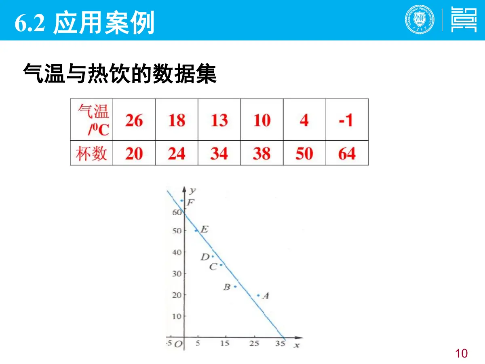
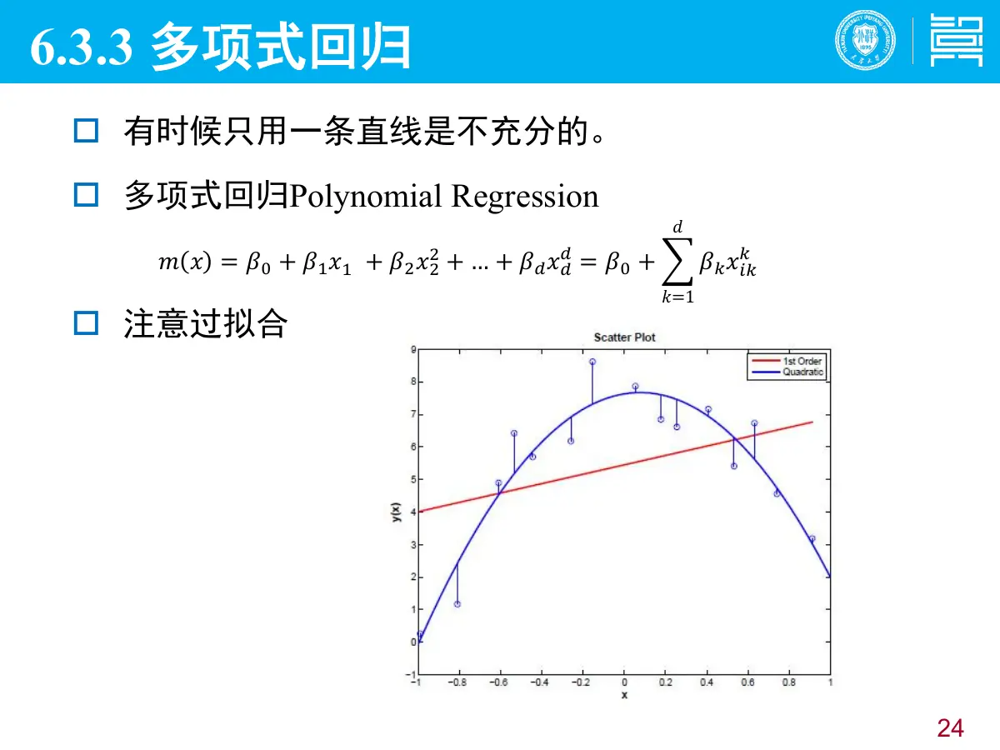
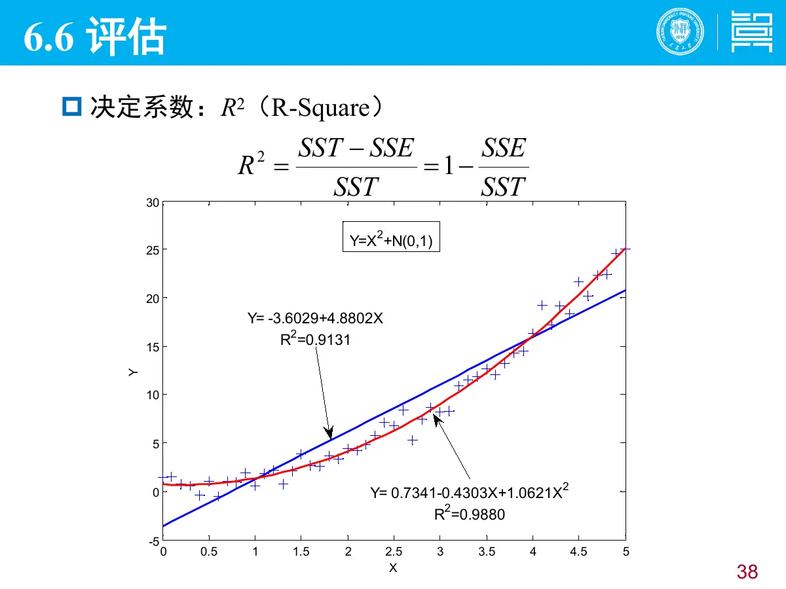
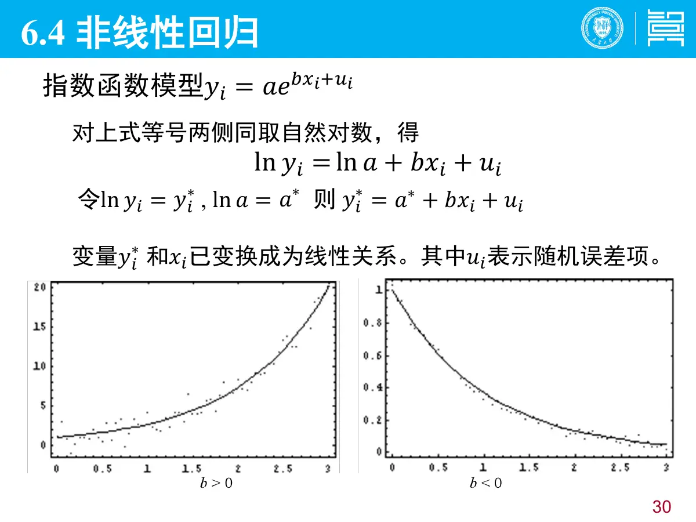
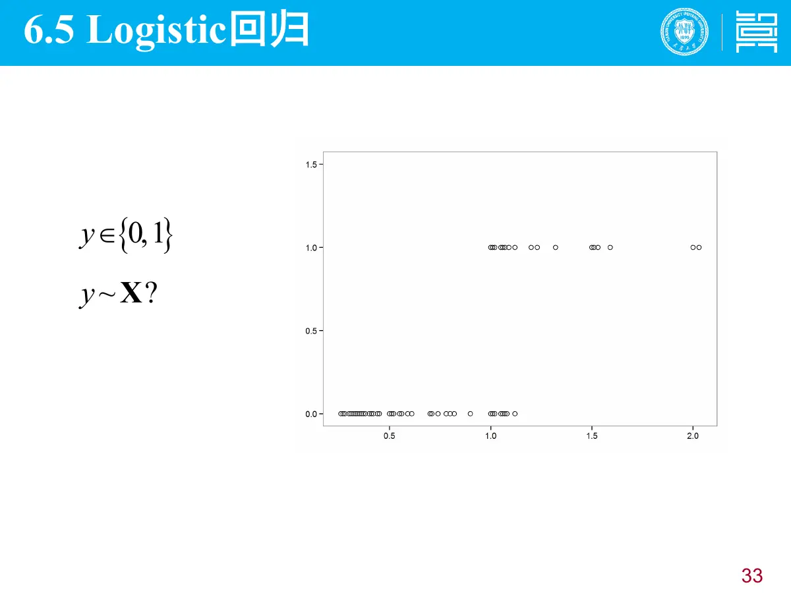
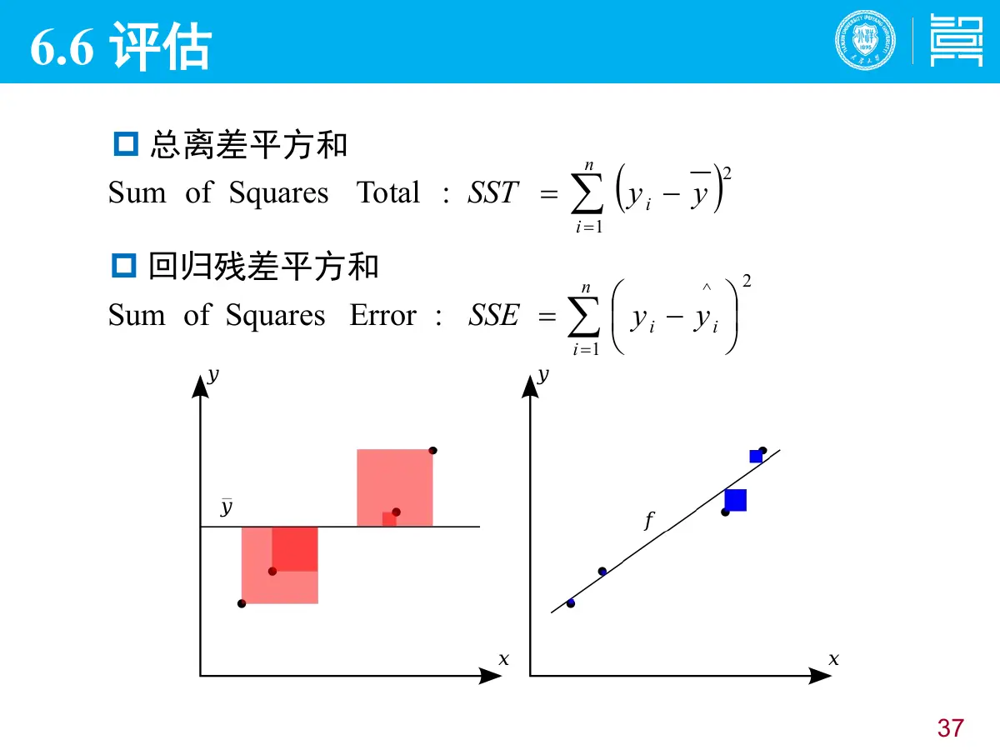

# 7 回归

一句话：回归是**有监督**学习里预测**连续值**的那一支——找一条（或一族）曲线 $y=f(X)$，让残差平方和最小；本章重点是**一元线性回归的模型、损失与最小二乘求解**（期末简答⑤直接考它）、**多元回归的正规方程**、**过拟合与 L1/L2 正则化**、**Logistic 回归**，以及 **MSE / $R^2$ 这套评价指标**。

## 0 读这一章之前

- **前置知识**：第 5 章 5.3.4 已经见过 $\hat y=wx+b$、MSE、闭式解和梯度下降。这一章把那条线讲透，再扩到多变量、曲线和分类。
- 整章一句话：**给一堆散点，找一条误差最小的曲线穿过它们**；找到后既能**解释**（$x$ 每变 1，$y$ 平均变多少），也能**预测**（新样本的 $y$ 是多少）。
- 三个新词：**残差**（预测值与真实值之差）、**最小二乘**（让残差平方和最小）、**正则化**（给系数加罚款，防止曲线乱拐）。
- 与第 5、6 章的分界：分类输出**离散类标号**，聚类**没有标签**，回归输出**连续数值**——三者是「有监督/无监督 × 离散/连续」这张表上的三格。

## 总览（思维导图）

$$
\text{第 7 章 回归}
\begin{cases}
7.1\ \text{回归概述}:\ \text{相关 vs 回归、Galton、Spearman}\ \rho\\
7.2\ \text{一元线性回归}
\begin{cases}
\text{模型}:\ m(x)=\beta_0+\beta_1x\\
\text{损失}:\ RSS=\sum_{i=1}^{n}(y_i-\hat y_i)^2\\
\text{求解}:\ \text{偏导}=0\ \Rightarrow\ \beta_1=\dfrac{S_{xy}}{S_{xx}},\ \beta_0=\bar y-\beta_1\bar x
\end{cases}\\[4pt]
7.3\ \text{多元线性回归}:\ \beta=(X^{T}X)^{-1}X^{T}Y\\
7.4\ \text{多项式回归}:\ \text{升次后仍是线性模型}\\
7.5\ \text{正则化}:\ L1\ \text{稀疏}\ /\ L2\ \text{收缩}\\
7.6\ \text{非线性回归}:\ \text{两边取对数}\Rightarrow\text{线性}\\
7.7\ \text{Logistic 回归}:\ \text{sigmoid}+\text{对数几率}+\text{交叉熵}\\
7.8\ \text{评估}:\ MSE,\ RMSE,\ MAE,\ SST/SSE/R^2
\end{cases}
$$

# 7.1 回归概述

> **人话**：回归就是「用已知的 $x$ 去猜一个连续的 $y$」，而且猜的方式要能说清——$x$ 动一个单位，$y$ 平均动多少。

## 7.1.1 从 Galton 的父子身高说起

19 世纪 Galton 研究父亲身高 $X$ 与儿子身高 $Y$，拟合出一条直线：

$$
\hat Y = 33.73 + 0.516X,\qquad r=0.73
$$

斜率 $0.516<1$ 说明：父亲比平均高很多时，儿子的平均身高**没有父亲那么极端**，会往人群均值靠一点。这种「向均值靠拢」的现象被他叫作 **regression（回归）**——这就是本章名字的来历。

> **人话**：高个子的儿子平均也高，但没父亲那么高；矮个子的儿子平均也矮，但没父亲那么矮。数据有「往回拉」的趋势。

## 7.1.2 相关分析与回归分析

两者都研究两个变量一起变的关系，但**问的问题不一样**。

| 对比项       | 相关分析（correlation）               | 回归分析（regression）                       |
| ------------ | ------------------------------------- | -------------------------------------------- |
| 问的问题     | 两个变量**有没有**一起动？**多强**？  | $x$ **怎么决定** $y$？给一个 $x$，$y$ 是多少？ |
| 变量地位     | **对称**：$x$ 与 $y$ 谁放前面都一样   | **不对称**：分自变量 $x$ 与因变量 $y$        |
| 输出         | 一个系数 $r\in[-1,1]$                 | 一个模型 $\hat y=f(x)$（带系数）             |
| 能否预测     | 不能                                  | 能                                           |
| 量纲         | 无量纲                                | 系数有量纲（$y$ 的单位 / $x$ 的单位）        |

Pearson 相关系数：

$$
r=\frac{\sum_{i=1}^{n}(x_i-\bar x)(y_i-\bar y)}
{\sqrt{\sum_{i=1}^{n}(x_i-\bar x)^2}\sqrt{\sum_{i=1}^{n}(y_i-\bar y)^2}}
=\frac{S_{xy}}{\sqrt{S_{xx}S_{yy}}}
$$

其中 $S_{xy}=\sum(x_i-\bar x)(y_i-\bar y)$ 叫**协方差的和**（未除以 $n$），$S_{xx},S_{yy}$ 同理。

- $r>0$ 正相关，$r<0$ 负相关，$r=0$ 无**线性**关系（但可能有曲线关系）。
- $|r|$ 越接近 1 越强：$|r|>0.8$ 强、$0.5\sim0.8$ 中等、$<0.3$ 弱（经验阈值，不同教材略有出入）。

Spearman **等级**相关系数（PPT 第 6 页）——当数据是排名而不是数值时用它：

$$
\rho=1-\frac{6\sum_{i=1}^{n}d_i^2}{n(n^2-1)}
$$

$d_i$ 是同一个对象在两个变量上的**名次之差**，$n$ 是对象个数。

#### 例题 1（计算）：Spearman 等级相关系数

**题目**：5 名学生的数学排名与物理排名如下（1 为最好），求等级相关系数 $\rho$。

- **学生 A**：数学排名：1；物理排名：2
- **学生 B**：数学排名：2；物理排名：1
- **学生 C**：数学排名：3；物理排名：4
- **学生 D**：数学排名：4；物理排名：5
- **学生 E**：数学排名：5；物理排名：3

**解**：逐人求名次差 $d_i$：

- **学生 A**：$d_i$：−1；$d_i^2$：1
- **学生 B**：$d_i$：1；$d_i^2$：1
- **学生 C**：$d_i$：−1；$d_i^2$：1
- **学生 D**：$d_i$：−1；$d_i^2$：1
- **学生 E**：$d_i$：2；$d_i^2$：4

$\sum d_i^2=1+1+1+1+4=8$，$n=5$：

$$
\rho=1-\frac{6\times8}{5\times(5^2-1)}=1-\frac{48}{120}=0.6
$$

**答**：$\rho=0.6$，两个排名呈中等偏强的正相关。

**易错**：① $d_i$ 是**同一个对象**在两个变量上的名次之差，不是把两个排名数组相减；② 出现并列名次时，要给并列者取平均名次再算；③ $\rho$ 与 Pearson $r$ 是两个公式，数据是排名时用 $\rho$。

> **易错**：相关不等于因果。冰淇淋销量与溺水人数高度正相关，共同原因是「夏天」。回归系数也只能说明「一起变」，不能单独证明因果。

## 7.1.3 回归能做什么

- **预测**：给新样本的 $X$，算出 $\hat y$；例子：按面积、地段、房龄预测房价
- **解释**：看每个系数的大小与符号，判断该因素影响方向与强度；例子：气温每升 1 ℃，热饮少卖约 1.65 杯
- **控制**：想让 $y$ 落在某区间，反推 $x$ 该取多少；例子：施肥量取多少，产量能到 450

课件里的应用案例：气温与热饮销量、施肥量与水稻产量、Kaggle 房价预测、天池二手车价格预测、通过手机行为预测用户年龄与性别。它们的共同结构都是「若干特征 $X$ → 一个连续目标 $y$」。

# 7.2 一元线性回归

> **人话**：在所有直线里，挑一条让「每个点到直线的竖直距离的平方」加起来最小的。

## 7.2.1 模型与损失函数

模型（$m(x)$ 表示模型给出的预测）：

$$
m(x)=\beta_0+\beta_1x,\qquad \hat y_i=\beta_0+\beta_1x_i
$$

- $\beta_0$：**截距**（intercept），$x=0$ 时 $y$ 的基准值。
- $\beta_1$：**斜率**（slope），$x$ 每增加 1 个单位，$y$ 平均变化 $\beta_1$。

损失用**残差平方和**（RSS，Residual Sum of Squares），课件里也记作 $R(\beta_0,\beta_1)$：

$$
R(\beta_0,\beta_1)=\sum_{i=1}^{n}\bigl(y_i-(\beta_0+\beta_1x_i)\bigr)^2
$$

**为什么用平方而不是绝对值**（简答常问）：

1. 正负残差不会互相抵消（否则一条穿过数据中点的烂线也能得 0）；
2. 处处可导，能用「偏导 = 0」直接解出闭式解；
3. 对大误差惩罚更重，拟合更怕「离谱的点」。

**为什么要有 $\beta_0$**：没有截距时直线被迫过原点；只要 $y$ 的均值不为 0，就会系统性偏差。

## 7.2.2 最小二乘的闭式解（推导）

对 $R$ 分别求 $\beta_0$、$\beta_1$ 的偏导并令其为 0：

$$
\frac{\partial R}{\partial \beta_0}\Big|_{=0}
\Rightarrow -2\sum_{i=1}^{n}\bigl(y_i-\beta_0-\beta_1x_i\bigr)=0
\Rightarrow \beta_0=\bar y-\beta_1\bar x
$$

$$
\frac{\partial R}{\partial \beta_1}\Big|_{=0}
\Rightarrow -2\sum_{i=1}^{n}x_i\bigl(y_i-\beta_0-\beta_1x_i\bigr)=0
\Rightarrow \beta_1=\frac{\sum x_iy_i-n\bar x\bar y}{\sum x_i^2-n\bar x^2}
$$

把分子分母同除以 $n$，就得到更常用的**离差形式**：

$$
\beta_1=\frac{S_{xy}}{S_{xx}}
=\frac{\sum_{i=1}^{n}(x_i-\bar x)(y_i-\bar y)}{\sum_{i=1}^{n}(x_i-\bar x)^2},
\qquad \beta_0=\bar y-\beta_1\bar x
$$

**记住三个结论，考试直接用**：

1. $\beta_1$ 的符号与 $r$ 的符号一致（同正同负）；
2. 回归直线**必过样本中心点** $(\bar x,\bar y)$——因为 $\beta_0=\bar y-\beta_1\bar x$；
3. 残差之和为 0：$\sum(y_i-\hat y_i)=0$（由第一个偏导方程直接得到）。

> **人话**：先把数据中心化（各减均值），直线就过原点了；此时斜率 = 「$x$ 与 $y$ 一起偏离的乘积和」除以「$x$ 自己偏离的平方和」。

## 7.2.3 几何直觉

- 最小二乘解等价于把向量 $Y$ 正交投影到由「全 1 列」和「$x$ 列」张成的平面上——投影残差与这个平面垂直，这正是「偏导为 0」的几何版本。
- 直线被**离群点**拉得很厉害：一个远处的点能显著改变斜率（杠杆效应），所以建模前要先看散点图。
- 一元时 $R^2=r^2$：判定系数与相关系数平方是同一个数（见 7.8.2）。

## 7.2.4 完整手算

#### 例题 2（计算）：气温与热饮销量

**题目**：某店记录 6 天的气温 $x$（℃）与热饮销量 $y$（杯）：

- **气温 $x$**：26，18，13，10，4，−1
- **销量 $y$**：20，24，34，38，50，64

求一元线性回归方程 $\hat y=\beta_0+\beta_1x$、判定系数 $R^2$，并解释斜率。

**解**：$n=6$，先算五个和：

$$
\sum x_i=70,\quad \sum y_i=230,\quad \sum x_iy_i=1910,\quad \sum x_i^2=1286,\quad \sum y_i^2=10172
$$

$$
\bar x=\frac{70}{6}=11.667,\qquad \bar y=\frac{230}{6}=38.333
$$

$$
S_{xx}=\sum x_i^2-n\bar x^2=1286-6\times136.11=469.33
$$

$$
S_{xy}=\sum x_iy_i-n\bar x\bar y=1910-6\times11.667\times38.333=-773.33
$$

$$
\beta_1=\frac{S_{xy}}{S_{xx}}=\frac{-773.33}{469.33}=-1.648
$$

$$
\beta_0=\bar y-\beta_1\bar x=38.333-(-1.648)\times11.667=57.56
$$

$$
S_{yy}=\sum y_i^2-n\bar y^2=10172-6\times1469.44=1355.33
$$

$$
R^2=\frac{S_{xy}^2}{S_{xx}S_{yy}}
=\frac{(-773.33)^2}{469.33\times1355.33}=0.940
$$

**答**：$\hat y=57.56-1.65x$，$R^2=0.940$（等价地 $r=-0.970$）。

**解释**：气温每升高 1 ℃，热饮销量平均**减少 1.65 杯**；气温解释了销量约 **94%** 的变异，拟合很好。截距 57.56 是「0 ℃ 时约卖 58 杯」的外推值，现实中不必当真。

**核对**：把 6 个 $x$ 代回，得 $\hat y=(14.72,27.90,36.14,41.08,50.97,59.20)$，残差 $(5.28,-3.90,-2.14,-3.08,-0.97,4.80)$，残差和约为 0（差 0.01 是四舍五入），$SSE=81.09$，$R^2=1-81.09/1355.33=0.940$，与上式一致。

**易错**：① 分母是 $S_{xx}$（$x$ 的离差平方和），不是 $S_{yy}$，写反斜率就变成「$x$ 对 $y$ 回归」；② 用 $\sum x_iy_i-n\bar x\bar y$ 时，中间的 $\bar x\bar y$ 要乘 $n$；③ $\beta_0$ 必须用 $\bar y-\beta_1\bar x$ 回代，不能把某个点的 $y$ 直接当截距。

## 7.2.5 没有闭式解时：梯度下降

数据量很大、或模型复杂到解不出方程时，用迭代法。以均方误差 $MSE=\frac1n\sum(y_i-\hat y_i)^2$ 为损失：

$$
\beta_0\leftarrow\beta_0-\eta\cdot\frac{\partial MSE}{\partial \beta_0},
\qquad
\beta_1\leftarrow\beta_1-\eta\cdot\frac{\partial MSE}{\partial \beta_1}
$$

其中

$$
\frac{\partial MSE}{\partial \beta_0}=-\frac{2}{n}\sum_{i=1}^{n}(y_i-\hat y_i),
\qquad
\frac{\partial MSE}{\partial \beta_1}=-\frac{2}{n}\sum_{i=1}^{n}x_i(y_i-\hat y_i)
$$

$\eta$ 是**学习率**（步长）：太小收敛慢，太大会震荡甚至发散。线性回归的 MSE 是凸函数，只要 $\eta$ 合适一定能收敛到全局最优（也就是闭式解那个点）。

> **人话**：闭式解是「一次算到位」，梯度下降是「摸着坡往下走一小步、再走一小步」。

## 7.2.6 简答模板：一元线性回归的模型、损失与求解

期末简答⑤就按这四步答，一步一分：

1. **模型**：假设 $y$ 与 $x$ 近似线性，$\hat y=\beta_0+\beta_1x$，$\beta_0$ 截距、$\beta_1$ 斜率。
2. **损失**：用残差平方和 $RSS=\sum(y_i-\hat y_i)^2$ 衡量拟合好坏，最小二乘即求 $\min_{\beta_0,\beta_1}RSS$。
3. **求解**：分别对 $\beta_0,\beta_1$ 求偏导并令其为 0，得正规方程；解出 $\beta_1=S_{xy}/S_{xx}$、$\beta_0=\bar y-\beta_1\bar x$。
4. **备选**：数据大或无法求逆时，用梯度下降迭代逼近同一最优解。

# 7.3 多元线性回归

> **人话**：$x$ 不止一个，就给每个 $x$ 配一个系数，仍然是「加权求和再加截距」。

## 7.3.1 模型与矩阵形式

$$
m(x)=\beta_0+\beta_1x_1+\beta_2x_2+\cdots+\beta_px_p
$$

把每个样本写成一行、把 $\beta_0$ 吸收进 $X$ 的第一列（全 1 列），$n$ 个样本就排成矩阵：

$$
Y=X\beta+\varepsilon,\qquad
X=\begin{bmatrix}1&x_{11}&\cdots&x_{1p}\\1&x_{21}&\cdots&x_{2p}\\\vdots&\vdots&&\vdots\\1&x_{n1}&\cdots&x_{np}\end{bmatrix},
\quad
\beta=\begin{bmatrix}\beta_0\\\beta_1\\\vdots\\\beta_p\end{bmatrix}
$$

课件里的医学数据就是这个形状：27 个样本，$X_1$ 总胆固醇、$X_2$ 甘油三酯、$X_3$ 胰岛素、$X_4$ 糖化血红蛋白，$Y$ 血糖。

## 7.3.2 正规方程

损失写成矩阵形式（$R(\beta)=(Y-X\beta)^T(Y-X\beta)$），对 $\beta$ 求导令 0：

$$
X^{T}X\beta=X^{T}Y
\quad\Longrightarrow\quad
\boxed{\beta=(X^{T}X)^{-1}X^{T}Y}
$$

- $X^TX$ 是 $(p+1)\times(p+1)$ 的方阵，可逆时解唯一。
- **什么时候不可逆**：特征之间完全共线（一列是另一列的线性组合）、或样本数 $n$ 小于特征数 $p+1$。对策：删冗余特征、用岭回归（$X^TX+\lambda I$ 一定可逆）、或用伪逆。

> **易错**：$(X^TX)^{-1}X^TY$ 里 $X^T$ 在**左**、$Y$ 在**右**，顺序不能换（矩阵乘法不交换）；也不能写成 $X^{-1}Y$——$X$ 通常不是方阵。

## 7.3.3 正规方程手算

#### 例题 3（计算）：正交设计的二元回归

**题目**：4 个样本，两个特征与目标如下，求 $\beta=(X^TX)^{-1}X^TY$ 及 $R^2$。

- **样本 1**：$x_1$：−1；$x_2$：−1；$y$：2.5
- **样本 2**：$x_1$：−1；$x_2$：1；$y$：−0.5
- **样本 3**：$x_1$：1；$x_2$：−1；$y$：5.5
- **样本 4**：$x_1$：1；$x_2$：1；$y$：4.5

**解**：设计矩阵与响应向量

$$
X=\begin{bmatrix}1&-1&-1\\1&-1&1\\1&1&-1\\1&1&1\end{bmatrix},
\qquad
Y=\begin{bmatrix}2.5\\-0.5\\5.5\\4.5\end{bmatrix}
$$

$$
X^{T}X=\begin{bmatrix}4&0&0\\0&4&0\\0&0&4\end{bmatrix}=4I,
\qquad
X^{T}Y=\begin{bmatrix}12\\8\\-4\end{bmatrix}
$$

所以

$$
\beta=\frac{1}{4}\begin{bmatrix}12\\8\\-4\end{bmatrix}
=\begin{bmatrix}3\\2\\-1\end{bmatrix}
$$

**答**：$\hat y=3+2x_1-x_2$。

**核对**：预测值 $(2,0,6,4)$，残差 $(0.5,-0.5,-0.5,0.5)$，$SSE=1$；$\bar y=3$，$SST=0.25+12.25+6.25+2.25=21$，故 $R^2=1-1/21=0.952$。

**为什么这么快**：$x_1,x_2$ 的取值是**正交设计**（两列内积为 0、各自均值为 0），于是 $X^TX$ 是对角阵，求逆只是各自除以 4，三个系数互不干扰。这也说明**特征正交时多元回归可以拆成三个一元回归分别做**。

**易错**：$X^TY$ 的第一个分量是 $\sum y_i=12$（对应全 1 列），后两个是 $\sum x_{1i}y_i$、$\sum x_{2i}y_i$；漏掉全 1 列就没有截距了。

## 7.3.4 几个必须知道的坑

- **多重共线性**：表现：特征高度相关，$X^TX$ 接近奇异，系数符号乱跳、方差爆炸；对策：删特征、做主成分、岭回归；看 VIF（>10 视为严重）
- **量纲差异**：表现：一个特征以「万」计、一个以「0.01」计，梯度下降很慢；对策：标准化 / 归一化后再迭代（闭式解不受影响）
- **过拟合**：表现：特征越多，训练误差越低，测试误差反而升；对策：正则化、特征选择、交叉验证（见 7.5）
- **系数解释**：表现：系数是「**控制其他变量不变**时」$x_j$ 加 1 的效果；对策：不能像一元那样单独解读

**调整 $R^2$**（adjusted $R^2$）用来惩罚「乱加特征」：

$$
R^2_{adj}=1-\frac{(1-R^2)(n-1)}{n-p-1}
$$

$p$ 是自变量个数。加一个没用的特征，$R^2$ 只会微升或不变，但 $R^2_{adj}$ 会下降——所以比较不同特征数的模型时看调整 $R^2$。

# 7.4 多项式回归

> **人话**：直线不够弯，就把 $x$、$x^2$、$x^3$ 当成三个**新特征**喂给线性回归——模型对系数还是线性的，只是对 $x$ 弯了。

$$
m(x)=\beta_0+\beta_1x+\beta_2x^2+\cdots+\beta_dx^d
=\beta_0+\sum_{k=1}^{d}\beta_kx^k
$$

做法：令 $x_1=x,\ x_2=x^2,\ \dots,\ x_d=x^d$，就退化成 7.3 的多元线性回归，正规方程照用。

> **关键区分**：「线性回归」的**线性**指对**参数 $\beta$** 线性，不是对 $x$ 线性。所以 $x^2$、$\ln x$、$x_1x_2$ 这些项都还能算线性回归；而 $y=e^{\beta x}$ 对 $\beta$ 非线性，才需要 7.6 的变换。

**案例**：施肥量 $x=(15,20,25,30,35,40,45)$、水稻产量 $y=(330,345,365,405,445,450,455)$。散点先陡后缓，一条直线会系统性低估中段、高估两端——典型的「该升次」信号。

## 7.4.1 升次之后：拟合更好，风险更大

#### 例题 4（判断）：$R^2$ 从 0.9131 到 0.9880 说明什么

**题目**：课件第 38 页用 $Y=X^2+N(0,1)$ 生成 30 个点。一次拟合 $\hat Y=-3.6029+4.8802X$ 得 $R^2=0.9131$；二次拟合 $\hat Y=0.7341-0.4303X+1.0621X^2$ 得 $R^2=0.9880$。问：为什么二次更好？能不能继续升到 10 次？

**答**：真实关系是 $Y=X^2$，一次模型**欠拟合**（模型太简单，抓不住弯曲），残差里还留着系统性结构；二次模型把 $X^2$ 项加进来，正好匹配真实形状，$R^2$ 从 0.913 提到 0.988，残差接近纯噪声。

**不能无限升次**：次数越高，曲线越能穿过每一个训练点，训练 $R^2$ 会趋近 1，但**测试误差先降后升**（过拟合）；高次项还会让两端剧烈摆动、系数方差爆炸。实操上用**交叉验证**选次数 $d$，或加正则化把高次项压小。

**易错**：$R^2$ 一定随特征增多而**不降**（加变量至少不会让训练误差变大），所以「$R^2$ 更高」本身不能证明模型更好——要比**测试集**误差或调整 $R^2$。

# 7.5 过拟合与正则化

> **人话**：模型太灵活，会把噪声也当成规律背下来；给系数加一笔「罚款」，逼它别乱拐。

## 7.5.1 过拟合长什么样

| 现象         | 欠拟合（underfit）        | 合适                  | 过拟合（overfit）              |
| ------------ | ------------------------- | --------------------- | ------------------------------ |
| 训练误差     | 高                        | 低                    | **很低（接近 0）**             |
| 测试误差     | 高                        | 低                    | **高**                         |
| 曲线形状     | 太直，抓不住趋势          | 贴合主趋势            | 剧烈摆动，穿过每个点           |
| 系数         | 都接近 0                  | 适中                  | 绝对值很大、正负相间           |

对策：增加数据、降低模型复杂度（降次/减特征）、**正则化**、早停、交叉验证。

## 7.5.2 $L1$ 范数与 $L2$ 范数

对系数向量 $w=(w_1,\dots,w_p)$：

$$
\lVert w\rVert_1=\sum_{i=1}^{p}|w_i|
\qquad\text{（绝对值之和，曼哈顿）}
$$

$$
\lVert w\rVert_2=\sqrt{\sum_{i=1}^{p}w_i^2}
\qquad\text{（欧氏长度）}
$$

几何上：$\lVert w\rVert_1\le t$ 是**菱形**（有尖角落在坐标轴上），$\lVert w\rVert_2\le t$ 是**圆**（处处光滑）。损失等高线与约束区域相切时，菱形更容易切在**坐标轴上**——于是某些系数**恰好为 0**；圆只会让系数整体变小、几乎不会正好为 0。

> **结论（考试按这个答）**：$L1$ 产生**稀疏解**（一部分系数恰为 0，相当于自动做了特征选择）；$L2$ 让系数**整体收缩**到接近 0 但不为 0。

> **易错**：课件第 27 页那段话的措辞容易读反（「$L2$ 让元素接近 0，$L1$ 不会让它等于 0」）。按标准结论记：**$L1$ 才会压到恰好 0**，$L2$ 只是压小。

## 7.5.3 Ridge 与 Lasso

| 名称                    | 目标函数                              | 效果                             |
| ----------------------- | ------------------------------------- | -------------------------------- |
| **Ridge（岭回归，$L2$）** | $\min\ RSS+\lambda\sum w_i^2$         | 系数整体收缩、稳定共线性、不解 0 |
| **Lasso（$L1$）**         | $\min\ RSS+\lambda\sum\lvert w_i\rvert$          | 稀疏、自动选特征                 |
| **Elastic Net**         | 两者加权和                            | 兼顾稀疏与稳定                   |

$\lambda\ge0$ 是**正则化强度**：$\lambda=0$ 退化为普通最小二乘；$\lambda$ 越大，系数被压得越狠（趋近全 0，模型趋近「只用均值预测」）。$\lambda$ 用**交叉验证**选。

## 7.5.4 正则化的手算

#### 例题 5（计算）：带 $L2$ 惩罚的一元回归

**题目**：数据 $(x,y)=(1,2),(2,4)$，只拟合过原点的模型 $\hat y=wx$。求普通最小二乘的 $w$；再求加 $L2$ 惩罚、$\lambda=1$ 时的 $w$。

**解**：目标函数

$$
J(w)=\sum_{i=1}^{2}(y_i-wx_i)^2+\lambda w^2
$$

求导令 0：

$$
-2\sum x_i(y_i-wx_i)+2\lambda w=0
\Longrightarrow
w=\frac{\sum x_iy_i}{\sum x_i^2+\lambda}
$$

$\lambda=0$：$w=\dfrac{1\times2+2\times4}{1+4}=\dfrac{10}{5}=2$（正是 $y=2x$，残差 0）。

$\lambda=1$：$w=\dfrac{10}{5+1}=\dfrac{10}{6}\approx1.667$。

**答**：普通最小二乘 $w=2$；加 $L2$ 惩罚后 $w\approx1.667$，被**向 0 收缩**了约 17%。

**规律**：$\lambda$ 越大收缩越狠；$\lambda\to\infty$ 时 $w\to0$。若把 $\lambda$ 换成 $L1$ 惩罚，$w$ 的闭式解不再是简单除法（绝对值不可导），要用坐标下降/软阈值，且较小的 $\lambda$ 就能把 $w$ 直接压成 0。

**易错**：正则化**不惩罚截距** $\beta_0$（截距只负责把整体平移，压它没有防过拟合的意义）。

# 7.6 非线性回归

> **人话**：曲线不是多项式也能变成直线——两边取对数，把乘法变成加法。

## 7.6.1 指数模型

$$
y_i=ae^{bx_i+u_i}
$$

两边取自然对数：

$$
\ln y_i=\ln a+bx_i+u_i
$$

令 $y_i^{*}=\ln y_i$、$a^{*}=\ln a$，就变成**线性**模型：

$$
y_i^{*}=a^{*}+bx_i+u_i
$$

对 $(x_i,y_i^{*})$ 做一元线性回归，得到 $a^{*}$ 与 $b$，再反变换 $a=e^{a^{*}}$。

- $b>0$：单调递增（复利、细菌繁殖）；$b<0$：单调衰减（放射性、冷热饮温度趋近室温）。
- $b$ 的含义：$x$ 每增加 1，$y$ **乘以** $e^{b}$（不是加一个常数）。

## 7.6.2 对数模型与幂函数

| 原模型                    | 变换                                             | 变换后                |
| ------------------------- | ------------------------------------------------ | --------------------- |
| $y=a+b\ln x$              | 令 $x^{*}=\ln x$                                 | $y=a+bx^{*}$（线性）  |
| $y=ax^{b}$（幂函数）      | 两边取对数：$\ln y=\ln a+b\ln x$                 | 双对数线性            |
| $y=a+\dfrac{b}{x}$        | 令 $x^{*}=1/x$                                   | $y=a+bx^{*}$（线性）  |

> **人话**：把「$x$ 或 $y$ 被套了一层函数」的那个函数，整体换成一个新变量，剩下的就是线性回归。

## 7.6.3 线性化的手算

#### 例题 6（计算）：指数模型的线性化

**题目**：某指标随时间变化，测得 $(0,2.0)$、$(1,6.0)$，设 $y=ae^{bx}$，求 $a,b$。

**解**：取对数得 $\ln y=\ln a+bx$。两点：

$$
(0,\ \ln2=0.6931),\qquad (1,\ \ln6=1.7918)
$$

$$
b=\frac{1.7918-0.6931}{1-0}=1.0986\approx\ln3
$$

$$
\ln a=0.6931\ \Rightarrow\ a=e^{0.6931}=2.0
$$

**答**：$y=2e^{1.0986x}=2\cdot3^{x}$。验证：$x=1$ 时 $2\times3=6$ ✓。

**解释**：时间每过 1 个单位，指标变为原来的 $e^{1.0986}=3$ 倍（增长 200%）。

**易错**：① 反变换要取指数 $a=e^{a^{*}}$，别把 $\ln a$ 当 $a$；② 在 $\ln y$ 空间最小化残差，等价于在原空间最小化**相对误差**，与直接拟合原空间不同；③ 预测时先算 $\ln\hat y$ 再取 $e$，直接对 $\hat y$ 取平均会有偏差。

# 7.7 Logistic 回归

> **人话**：$y$ 只有 0 和 1，硬套直线会给出 −0.3 或 1.4 这种「概率」；用 sigmoid 把任意实数压进 $(0,1)$，输出的就是「属于正类的概率」。

## 7.7.1 为什么不能直接用线性回归

1. 预测值 $z=w^Tx+b$ 可以取任意实数，落到 $[0,1]$ 之外就不是概率；
2. 残差只取两个值，**不服从正态分布**、方差随 $p$ 变化（异方差），最小二乘的假设全破；
3. 用 MSE 做损失时目标函数**非凸**，梯度里还带 sigmoid 导数，两端会**梯度消失**、学得很慢；
4. 一条直线穿过 0/1 点，稍微移动一个点斜率就剧烈变化，不稳定。

## 7.7.2 sigmoid 与对数几率

$$
p(y=1\mid x)=\sigma(z)=\frac{1}{1+e^{-z}},
\qquad z=w^{T}x+b
$$

$\sigma$ 把 $(-\infty,+\infty)$ 压到 $(0,1)$：$z=0\Rightarrow p=0.5$；$z\to+\infty\Rightarrow p\to1$；$z\to-\infty\Rightarrow p\to0$。

把它反解出来，得到**对数几率**（log-odds / logit）：

$$
\ln\frac{p}{1-p}=z=w^{T}x+b
$$

左边是「正类概率 / 负类概率」取对数，叫**几率**（odds）的对数。所以 Logistic 回归的本质是：**用线性模型去拟合对数几率**——对 $x$ 线性的是 logit，不是概率本身。

| 概念     | 公式                        | 含义                              |
| -------- | --------------------------- | --------------------------------- |
| 概率 $p$ | $\sigma(z)$                 | 属于正类的可能性，$0\sim1$        |
| 几率     | $\dfrac{p}{1-p}=e^{z}$      | 正类可能性是负类的多少**倍**      |
| 对数几率 | $\ln\dfrac{p}{1-p}=z$       | 线性部分，$w_j$ 是 $x_j$ 对 logit 的贡献 |

## 7.7.3 损失函数：交叉熵（负对数似然）

$$
L(w)=-\sum_{i=1}^{n}\Bigl[y_i\ln p_i+(1-y_i)\ln(1-p_i)\Bigr]
$$

由来：把每个样本看成伯努利试验，$P(y_i)=p_i^{y_i}(1-p_i)^{1-y_i}$，取负对数即上式（**极大似然**）。它等价于最小化两个分布的交叉熵。

- $y=1$ 时只剩 $-\ln p$：预测 $p$ 越接近 1 损失越小；
- $y=0$ 时只剩 $-\ln(1-p)$：预测 $p$ 越接近 0 损失越小；
- 损失是**凸函数**，梯度很干净：

$$
\frac{\partial L}{\partial w}=\sum_{i=1}^{n}(p_i-y_i)x_i
$$

（残差乘以特征，和线性回归形状一样，只是 $p_i$ 换成了 sigmoid 输出。）常用梯度下降或牛顿法求解。

## 7.7.4 决策边界与阈值

默认阈值 0.5：

$$
p\ge0.5\iff z\ge0\iff w^{T}x+b\ge0
$$

所以 Logistic 回归的**决策边界是线性的**（一条直线/超平面）；想得到弯曲边界，要么造多项式特征，要么换模型（如核 SVM、树模型）。

阈值不必是 0.5：正类很少（欺诈检测、疾病筛查）时把阈值调低，宁可误报也别漏报——这就是**查全率与查准率的权衡**（第 5 章评价部分）。

#### 例题 7（计算）：给定 $z=2x-3$ 求概率与边界

**题目**：某 Logistic 模型 $z=2x-3$。求 $x=1$、$x=2$ 时 $y=1$ 的概率；求决策边界；$x=2$ 时的几率是多少？

**解**：

$$
x=1:\ z=-1,\quad p=\frac{1}{1+e^{1}}=\frac{1}{1+2.718}=0.269
$$

$$
x=2:\ z=1,\quad p=\frac{1}{1+e^{-1}}=\frac{2.718}{1+2.718}=0.731
$$

边界：$z=0\Rightarrow2x-3=0\Rightarrow x=1.5$。

$x=2$ 的几率：$\dfrac{p}{1-p}=e^{z}=e^{1}=2.718$。

**答**：$p(x=1)=0.269$（判为负类），$p(x=2)=0.731$（判为正类）；决策边界 $x=1.5$；$x=2$ 时正类几率是负类的 2.72 倍。

**易错**：① 不要把 $z$ 直接当概率；② $e^{-z}$ 的符号别丢，$z=1$ 时 $p=1/(1+e^{-1})$ 而不是 $1/(1+e)$；③ 几率是 $e^z$，不是 $z$。

## 7.7.5 平行知识点

- **softmax 回归**：多分类版本，$p_k=e^{z_k}/\sum_j e^{z_j}$，保证各类概率和为 1；二分类时退化为 sigmoid。
- **正则化**：Logistic 同样加 $L1/L2$，尤其特征多、样本少时。
- **评价**：回归用 MSE/$R^2$，分类用准确率、Precision/Recall、F1、ROC-AUC；类别不平衡时准确率会骗人（全判负类也能 99%）。

# 7.8 评估

> **人话**：误差要能算成一个数，还要知道这个数算好还是坏——前者靠 MSE/MAE，后者靠 $R^2$。

## 7.8.1 三个误差指标

$$
MSE=\frac{1}{n}\sum_{i=1}^{n}(y_i-\hat y_i)^2
\qquad
RMSE=\sqrt{\frac{1}{n}\sum_{i=1}^{n}(y_i-\hat y_i)^2}
\qquad
MAE=\frac{1}{n}\sum_{i=1}^{n}|y_i-\hat y_i|
$$

| 指标     | 单位       | 特点                                             |
| -------- | ---------- | ------------------------------------------------ |
| **MSE**  | $y$ 的平方 | 可导、对大误差敏感，量纲被平方，不好直观解释     |
| **RMSE** | 同 $y$     | MSE 开根，量纲还原，仍对大误差敏感               |
| **MAE**  | 同 $y$     | 绝对值平均，直观、对离群点更稳健，但不可导       |

> **易错**：$MSE$ 与 $RMSE$ 会**放大离群点**的影响（误差 10 的平方是 100），$MAE$ 只按绝对值算。数据有极端值时两者会给出很不一样的排序。

## 7.8.2 总离差平方和、残差平方和与 $R^2$

$$
SST=\sum_{i=1}^{n}(y_i-\bar y)^2
\qquad
SSE=\sum_{i=1}^{n}(y_i-\hat y_i)^2
$$

$$
\boxed{R^2=\frac{SST-SSE}{SST}=1-\frac{SSE}{SST}}
$$

- $SST$：$y$ 自己相对均值的总波动（「什么都不学，只用 $\bar y$ 预测」的误差）；
- $SSE$：用了模型之后的残差波动；
- $R^2$：模型**解释掉的波动比例**，取值 $[0,1]$（在训练集上；测试集上可能为负）。

几个必须记住的性质：

1. 一元线性回归中 $R^2=r^2$（相关系数的平方）；
2. $SST=SSR+SSE$，其中 $SSR=\sum(\hat y_i-\bar y)^2$ 是回归解释掉的平方和；
3. $R^2$ 随特征增加**不会下降**，比较模型要用调整 $R^2$ 或测试集误差；
4. $R^2=0.9$ 只说明拟合了这批判数据 90% 的波动，**不代表因果关系**，也不代表预测新数据一定准。

#### 例题 8（计算）：五个点的 MSE、RMSE、MAE 与 $R^2$

**题目**：真实值 $y=(2,4,5,4,5)$，模型预测 $\hat y=(2.2,3.6,5.4,4.2,4.6)$。求 MSE、RMSE、MAE、$R^2$ 与调整 $R^2$。

**解**：残差 $e=y-\hat y=(-0.2,0.4,-0.4,-0.2,0.4)$。

$$
MSE=\frac{0.04+0.16+0.16+0.04+0.16}{5}=\frac{0.56}{5}=0.112
$$

$$
RMSE=\sqrt{0.112}=0.335,\qquad
MAE=\frac{0.2+0.4+0.4+0.2+0.4}{5}=\frac{1.6}{5}=0.32
$$

$\bar y=4$，故

$$
SST=(2-4)^2+(4-4)^2+(5-4)^2+(4-4)^2+(5-4)^2=4+0+1+0+1=6
$$

$$
R^2=1-\frac{0.56}{6}=1-0.0933=0.9067
$$

$$
R^2_{adj}=1-\frac{(1-0.9067)\times(5-1)}{5-1-1}
=1-\frac{0.0933\times4}{3}=1-0.1244=0.876
$$

**答**：$MSE=0.112$，$RMSE\approx0.335$，$MAE=0.32$，$R^2\approx0.907$，调整 $R^2\approx0.876$。

**易错**：① $SST$ 除的是 $\bar y$，不是 0；② $R^2$ 与 $r^2$ 只在**一元线性 + 有截距**时相等；③ $RMSE$ 是 $MSE$ 开根，不是 $MSE$ 的一半；④ 调整 $R^2$ 公式里 $p$ 是自变量个数，本例 $p=1$、$n=5$。

## 7.8.3 平行知识点：怎么判断模型真的能用

- **训练/测试划分（如 7:3）**：用没见过的数据估误差，识别过拟合
- **$k$ 折交叉验证**：数据少时更稳，轮流当测试集取平均（第 5 章）
- **残差图**：残差应随机散布在 0 附近；出现曲线说明模型形式不对
- **调整 $R^2$、AIC/BIC**：在拟合优度与模型复杂度之间折中
- **正态性/异方差检验**：线性回归的经典假设（残差独立、等方差、近似正态）

