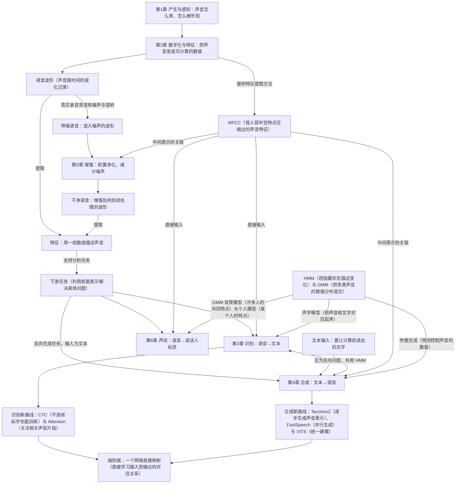

# 0 复习总览：课程全景框架

> 闭卷 2 小时（11 月 11 日 15:25–17:25）。复习范围以 **2026 复习课件**为准：小节标「掌握 / 基本概念」的要考，标「了解」的不考（小节内单独标「了解」的页面同样不考）；复杂公式推导不考。六章笔记已按此裁剪，每章开头的思维导图即该章的复习摘要，看一遍图就能过完重点细节。

本文档不背细节，只回答一个问题：**这门课的整体知识图景是什么，六章之间怎么串起来**。细节进各章笔记。

## 一句话看懂整门课

语音信息处理的一切，都围绕同一条信号链：

```
说话人 → 声道调制产生语音 → 数字采样 → 提取特征（帧级表示）→ 各种下游任务
```

第 1 章讲**语音怎么来、怎么被听到**；第 2 章讲**怎么把连续语音变成计算机可用的特征**；第 3~6 章是四个下游任务，全部吃第 2 章的特征，只是各自的模型和目标不同：

| 任务 | 输入特征 | 输出 | 核心范式 |
| --- | --- | --- | --- |
| 3 语音识别 | MFCC 等声学特征 | 文字序列 | 声学模型 + 语言模型 + 解码 |
| 4 语音合成 | 文本（语言学特征） | 波形 | 前端文本分析 + 后端声学模型与声码器 |
| 5 语音增强 | 带噪语音频谱 | 干净语音频谱 | 估噪声 → 算增益（含掩蔽 / 波束形成） |
| 6 声纹识别 | MFCC → 段级向量 | 说话人身份/得分 | 注册 + 测试，辨认 1:N / 确认 1:1 |

**对称关系值得记住**：识别是「语音 → 文本」，合成是「文本 → 语音」，两者共用 HMM 等同一套建模语言；声纹识别是识别的「谁在说」版本；增强则是所有任务的前置净化步骤。

## 总览（一页速查：概念 + 结论式公式）

下面这一版把整门课压成一页，适合已经复习过一遍后扫读；第一次看建议先看下一节的 **Mermaid 分层思维导图**（层级更细、每个术语都有人话解释）。

读的时候注意：这里出现的式子都不是要你推的东西，只是「这条结论长什么样」的备忘。

$$
\text{语音信息处理：产生}\to\text{数字化}\to\text{特征}\to\text{任务}
\begin{cases}
\text{第 1 章 产生与感知}
\begin{cases}
\text{声源（浊=准周期脉冲 / 清=白噪 / 爆破）}+\text{声道滤波（共振峰）}+\text{辐射}\\
\text{音素（物理生理）}\ne\text{音位（社会语言）}; \ \text{元音看}\ F_1\ \text{张口度}, F_2\ \text{舌位}\\
\text{外耳道}\ f_n=\dfrac{(2n-1)c}{4l}\ (3.5\,\text{kHz}); \ \text{中耳带通 500-2000\,Hz；基底膜频率}\to\text{位置}\\
\text{响度 phon（主观）、音调 Mel（主观）}\colon \text{Mel}(f)=2595\log_{10}(1+\tfrac{f}{700})\\
\text{言语链（掌握）}\colon \text{产生方向 4 步 / 感知方向反向；}\to\text{ASR / TTS / 声纹}
\end{cases}\\[6pt]
\text{第 2 章 信号处理基础（全课地基）}
\begin{cases}
\text{采样}\colon f_s/2\ \text{奈奎斯特}, B\le f_s/2\ \text{不混叠；帧长 20-25ms（1-7 基音周期）；加窗减泄漏}\\
\text{时域}\colon E_n\ \text{（浊清/端点）、ZCR（}\approx1400/4500\,\text{Hz）、自相关（周期估计）}\\
\text{频域}\colon \text{DFT}(\text{FFT 加速}); \text{语谱图：宽带 5ms 竖纹共振峰 / 窄带 40ms 横纹谐波}\\
\text{倒谱（掌握）}\colon \text{取对数把卷积变加法}; C(n)\ge F_0\ \text{声源}, <F_0\ \text{声道，Lifter 取包络}\\
\text{LPC（掌握）}\colon H(z)=\dfrac{G}{1-\sum a_iz^{-i}}\ \text{全极点建模声道}\\
\text{MFCC（掌握）}\colon \text{预加重}\to\text{分帧加窗}\to\text{DFT}\to\text{Mel 滤波}\to\text{取对数}\to\text{DCT}; C_0\ \text{不用}
\end{cases}\\[6pt]
\text{第 3 章 语音识别（分量最重）}
\begin{cases}
\text{噪音通道（掌握）}\colon \arg\max_W P(X|W)P(W)\ \text{——声学模型}\times\text{语言模型}\\
\text{HMM（掌握）}\colon \lambda=(\pi,A,B)\ \text{双重随机；三问题：}\\
\quad \text{1) 前向/后向（求和，}N^2T\text{）Viterbi（取最大+}\varphi\text{回溯）Baum-Welch（EM 特例，局部极值）}\\
\text{GMM（掌握）}\colon P(x)=\sum_m c_m\mathcal N(x;\mu_m,\Sigma_m)\ \text{算观测概率}\\
\text{LVCSR（基本概念）}\colon \text{子词层/词层/句法层；三音素 }l\text{-}c\text{+}r\text{，}N^3\to\text{决策树}\\
\text{DNN-HMM（基本概念）}\colon \text{DNN 替换 GMM；拼接帧；强制对齐打标签}\\
\text{N-gram（掌握）}\colon PP(W)=P(w_1\cdots w_N)^{-1/N}\ \text{越低越好}\\
\text{端到端（基本概念）}\colon \text{CTC（blank）与 Attention；3.4 解码、大模型均「了解」不考}
\end{cases}\\[6pt]
\text{第 4 章 语音合成}
\begin{cases}
\text{前端（文本分析+韵律）}+\text{后端（声学模型+声码器）——框架重点掌握}\\
\text{文本分析}\colon \text{分词词性、归一化（120M}\to\text{一百二十米）、字音转换（多音字消歧）}\\
\text{韵律}\colon \text{韵律词}\to\text{韵律短语}\to\text{语调短语；由}\ F_0\text{、时长、能量实现}\\
\text{HMM 合成}\colon \text{与识别互为反向问题（掌握）——训练 Baum-Welch、解码 Viterbi 相同}\\
\quad \text{训练：单音素}\to\text{上下文相关}\to\text{决策树聚类}\to\text{聚类后训练；缺陷=过平滑}\\
\text{DNN 合成（基本概念）}\colon \text{时长模型（音素级）}+\text{参数生成模型（帧级）}\\
\text{端到端（基本概念）}\colon \text{Tacotron2 / FastSpeech（非自回归）/ VITS（统一建模）/ VALL-E（条件语言模型）}\\
\text{评价}\colon \text{MOS / CMOS}[-3,3]\ /\ \text{ABX；客观 MCD}
\end{cases}\\[6pt]
\text{第 5 章 语音增强}
\begin{cases}
y=x*h+v; \ \text{混响=乘性（相关高）、噪声=加性（相关低）}\\
\text{传统（掌握）}\colon \text{VAD+噪声估计}\to\text{增益}\\
\quad \text{谱减 }\hat X=\sqrt{\lvert Y\rvert^2-\lvert\hat V\rvert^2}\ \text{（音乐噪声）；维纳 }H=\dfrac{P_x}{P_x+P_v}\ \text{（MMSE）}\\
\text{深度学习}\colon \text{三步（STFT}\to\text{网络增强振幅}\to\text{ISTFT+原相位）；}\\
\quad \text{映射=回归干净谱 / 掩蔽=预测 mask 再相乘（掌握）；IBM 0/1 交叉熵、IRM 软掩蔽 MSE}\\
\text{阵列（掌握）}\colon \tau_s=\dfrac{d\sin\theta_s}{c}\ \text{互相关求 TDOA}; \text{DSB=延迟补偿+加权求和}\\
\text{技巧（掌握）}\colon \text{多目标训练（映射+掩蔽互补）、多任务学习（ASR/ASV 互补）}
\end{cases}\\[6pt]
\text{第 6 章 声纹识别（谁在说）}
\begin{cases}
\text{分类}\colon \text{文本相关（性能高）/ 无关；辨认 1:N / 确认 1:1}\\
\text{指标}\colon \text{FRR 误拒 / FAR 误受；EER}=FRR=FAR\ \text{处，越小越好}\\
\text{框架（掌握）}\colon \text{特征提取（MFCC/LPCC+VAD+CMN）}\to\text{注册}\to\text{测试}\\
\text{GMM-UBM（基本概念）}\colon \text{UBM 先验（EM 训练）+ MAP 自适应得个人模型}\\
\quad \text{似然比（掌握）}\ \Lambda=\mathcal L(Y|\theta_{\text{spk}})-\mathcal L(Y|\theta_{\text{UBM}})\gtrless\eta; \text{超向量=只调均值串接}\\
\text{x-vector（掌握）}\colon \text{帧处理（TDNN）}\to\text{池化（均值+标准差）}\to\text{嵌入（瓶颈层）}\to\text{softmax+交叉熵}\\
\text{展望（了解）不考}
\end{cases}
\end{cases}
$$


## 全课思维导图（Mermaid 版）

整门课可以先看成一条信号链（声音从产生到被计算机处理的过程），不用一开始就背公式。这棵树按「产生→数字化（把声音变成数字）→特征（用少量数值描述声音）→任务」排列：先知道声音怎么来，再让计算机能记录它、描述它，最后用它解决问题。增强（减少语音里的噪声）是前置净化步骤，不是一定要等识别（把语音转成文字）做完才学的最后一环。mindmap（树状思维导图）只能清楚地展示上下层级，不能画出跨章交叉连线，所以下面另配一张关系图。树中的 ★ 表示最高频考点，先理解它所在的分支，再集中记忆。

```mermaid
mindmap
  root((语音信息处理))
    第一章 语音怎么产生、又怎么被听见
      发声链（把气流变成语音）
        声源（最初的振动）
          肺供气，声带像阀门
            声门（两片声带间的开口）
          浊音（声带振动的声音）
            准周期脉冲（大致重复的气流）
          清音（声带不振动的声音）
            白噪声（气流摩擦形成的杂声）
          爆破音（先堵住再放气）
            声道关闭、压缩后突然打开
        声道（可变形的共鸣管道）
          调音（改变管道形状）
            共振峰（被声道放大的频率峰）
        辐射（声音从身体传到空气）
          嘴唇、鼻孔放射声波
            声道壁振动也向外辐射
        基频 F0（声带每秒振动次数）
          基音周期 T0（声带开合一次用时）
            F0＝1/T0，勿当成共振峰
      发音分类（把相近声音归类）
        范畴化（姿势略变仍算同类）
          音素（按发音区分的最小单元）
            区分依据是物理和生理属性
          音位（按语言区分的最小单元）
            一个音位可包含多个音素
        元音（声道开放，气流不受阻）
          F1（第一共振峰）看张口度
            F1 越大，张口越大
          F2（第二共振峰）看舌位前后
            F2 越大，舌位越靠前
        辅音（声道部分或完全受阻）
          与清音、浊音是两套分类
            浊辅音也有声带振动
      听觉器官（把振动送到大脑）
        外耳（收集声音）
          外耳道像闭管（一端开一端闭）
            f_n＝（2n−1）c/4l
            c 是声速，l 是耳道长度
            n 是共振序号，首次约 3.5 kHz
        中耳（用听骨链放大振动）
          带通（主要传递一段频率）
            频率范围为 500—2000 Hz
        内耳（把振动变成电信号）
          基底膜（不同位置响应不同频率）
            高频靠耳蜗基部，低频靠蜗顶
          内毛细胞（把振动转为电信号）
            外毛细胞（放大弱声、抑制强声）
      听觉感受（主观上听到什么）
        响度（感觉声音有多响）
          phon（响度的单位）
            同样音强，不同频率可不一样响
        音调（感觉声音有多高）
          Mel（按听感划分音高的尺度）
            Mel（f）＝2595·log10（1+f/700）
            f 是以 Hz 为单位的频率
      言语链（从说话意图到听懂）
        产生方向（把想法编码成声音）
          第一步：言语规划（安排说什么）
            排出音素、语调和时长顺序
          第二步：编排发音运动程序
            按时序把程序传给神经系统
          第三步：指令驱动肌肉和气流
            产生不同类型的声源
          第四步：声道调制后向外辐射
            ★产生四步：规划→编排→驱动→辐射
        感知方向（由声音还原意图）
          振动→行波（水中波动）→神经脉冲
            传到听觉皮层（大脑听觉区域）
          识别音素，再结合语境理解
            感知与产生的方向相反
    第二章 怎么把声音变成数字和特征
      数字化（把连续声音变成数字）
        采样（隔一小段时间记录一次）
          fs（每秒记录的次数）
            奈奎斯特频率（采样率一半）＝fs/2
          最高频率不超过 fs/2
            混叠（采样太慢，把快振动看错）
        分帧（把语音切成短段）
          帧长通常为 20—25 ms
            包含约 1—7 个基音周期
          帧移（相邻帧起点的时间差）
            相邻帧重叠，避免边界信息丢失
        加窗（让短段边缘过渡柔和）
          减少泄漏（截断带来的假频率）
            更好满足周期性要求
      时域（直接看波形随时间变化）
        En（短段声音的能量）
          对加窗后的采样值平方求和
            端点检测（找声音开始和结束）
        ZCR（波形穿过零点的频繁程度）
          清音通常比浊音过零更频繁
            与 En 结合区分有声和无声
        自相关（与错开后的自己比相似）
          周期整数倍处容易出现峰值
            可估计浊音的基音周期
          关于零延迟对称，零延迟最大
            白噪声仅在零延迟处有强峰
      频域（看各个频率有多强）
        DFT（把波形拆成频率成分）
          FFT（快速计算 DFT 的算法）
            是加速算法，不是另一种特征
        语谱图（按时间排开的频率图）
          宽带（短窗，时间分辨更清楚）
            5 ms：竖纹间隔对应基音周期
            共振峰明显，频率分辨较低
          窄带（长窗，频率分辨更清楚）
            40 ms：横纹显示谐波（基频整数倍）
            时间分辨较低，可观察基频
      产生模型（用数学零件模拟发声）
        激励（声源）→声道→辐射
          LTI（线性且短时间内性质不变）
            声道在约 20 ms 内近似不变
        LPC（用过去采样预测当前采样）
          全极点模型（用反馈模拟声道）
            H（z）＝G/（1−各阶反馈项之和）
            G 是增益（整体放大倍数）
          ai（过去各采样的加权系数）
            用前 p 个采样值的加权和预测
          残差（真实值减去预测值）
            ★最小化残差均方误差求 ai
      倒谱（把声源与声道分开看）
        卷积（声源经过声道的混合）
          频域相乘，取对数变为相加
            再做逆变换（从频域变回去）
        C（n）（取对数后逆变换的结果）
          笔记以 F0 为界区分信息
            C（n）≥F0：声源基音信息
            C（n）＜F0：声道包络信息
        Lifter（在倒谱中截取需要的部分）
          保留低阶、去掉高阶后再变换
            包络（频谱整体起伏的轮廓）
      MFCC（模仿人耳提取的一组数字）
        六步流程（把一帧波形变成特征）
          第一步：预处理（先整理波形）
            预加重（提升高频）→分帧→加窗
          第二步：DFT 后取能量谱
            变换结果的幅度平方表示能量
          第三步：Mel 滤波（按听感分组）
            三角滤波器汇总各频带能量
          第四步：对各频带能量取对数
          第五步：DCT（把各频带重新组合）
          第六步：取低阶系数作为特征
            ★C0（平均强度）在识别中一般不用
        特征用途（给后续模型输入数字）
          关联：MFCC 直接输入第三、六章
            关联：也是第四、五章的中间表示
    第三章 语音识别：把声音变成文字
      识别框架（给候选句子打分）
        噪音通道（从听到的声音反推原话）
          X（声音特征）；W（候选词串）
          argmax（选得分最大的词串）
            ★目标：argmax P（X给定W）P（W）
        声学模型（声音像不像这些词）
          P（X给定W）（词串产生声音的概率）
        语言模型（这串词说不说得通）
          P（W）（词串本身的概率）
        解码（综合两种概率选句子）
          声学概率 × 语言概率 → 最优词串
      方法与评价（怎样识别与判对错）
        方法演化（从手写规则到学习规律）
          规则法（由专家规定怎么认）
          DTW（把快慢不同的模板对齐）
            硬匹配（相似模板难以区分）
          统计模型（用数据学习概率）
        WER（词错误率）
          插入 I（多写）；替换 S（写错）
          删除 D（漏写）
            ★WER＝100×（I+S+D）/正确词数
      HMM（看不见的状态推动声音）
        马尔可夫链（状态依次变化）
          无后效性（下一步只看当前状态）
        双重随机（两层都由概率决定）
          隐状态（当前发音状态看不见）
          观测（实际能测到的声音特征）
        参数组（描述模型的三类概率）
          λ＝（π，A，B）
            π（起点）；A（转移）；B（观测）
        概率计算（这段声音有多可能）
          前向算法（从前往后累加路径）
            ★所有路径求和；复杂度 N²T
          后向算法（从后往前累加路径）
            同样求和；复杂度 N²T
          N（状态数）；T（帧数）
            帧（切出来的一小段声音）
        最优状态串（声音对应哪条状态路径）
          Viterbi（每步保留最好的路径）
            ★取最大 → 记录来路 → 回溯
        参数训练（从数据学出概率）
          Baum-Welch（反复更新参数）
            EM（先算期望再更新）的特例
            局部极值（可能停在非全局最优处）
      声学建模（让声音特征对应发音）
        GMM（多个钟形分布加权混合）
          观测概率（当前状态产生这帧的可能）
            多个高斯分布加权相加；权重和为一
        GMM-HMM（概率与时序分工）
          GMM 算观测概率
          HMM 管时序转移（发音先后顺序）
        孤立词识别（一次只说一个词）
          每词一个 HMM；选择声音得分最高者
        LVCSR（大词汇表连续语音识别）
          子词层（比词更小的发音单位）
          词层（词典把发音单位拼成词）
          句法层（规定词怎样组成句子）
        三音素（把左右邻音一起考虑）
          音素（最小的语音单位）
          l-c+r（左邻音、中心音、右邻音）
            N 个音素 → N³ 种组合；参数暴涨
          决策树聚类（相似状态共用参数）
            缓解组合太多与训练样本不足
        DNN-HMM（深层网络替换 GMM）
          DNN（多层网络计算观测概率）
          拼接帧（合并相邻小段一起输入）
          强制对齐（按已知文本给声音定位）
            GMM-HMM 给每帧打状态标签
      词串概率（让识别结果更通顺）
        N-gram（只看前面少量词来预测）
          只看前 N−1 个词；截断全部历史
          相对频率（用出现次数之比估概率）
            句首句尾也要加开始与结束标记
        困惑度 PP（平均还有多少种词可选）
          句子概率取倒数，再按句长开方
            PP 越低，模型预测越确定
      端到端（由声音直接学到文字）
        CTC（允许声音帧与文字不对齐）
          blank（不输出文字的空白标记）
            吃掉多余帧；同一输出的路径求和
        Attention（每步关注相关声音位置）
          编码器（读声音）→ 解码器（写文字）
        考试边界
          解码细节与大模型不考
      对偶关系（交换输入与输出）
        语音 → 文本；第四章为文本 → 语音
          关联：与第四章共用 HMM 建模语言
    第四章 语音合成：把文字变成声音
      整体框架（先决定怎么念再发声）
        前端（把文字变成怎么念的信息）
          文本分析（确定词与读音）
          韵律（安排快慢轻重与停顿）
        后端（把怎么念变成实际声音）
          声学模型（预测声音参数）
          声码器（把参数变成波形）
            ★文字 → 语言信息 → 声音参数 → 波形
      文本分析（先断词再定读音）
        分词与词性（词在哪分、属于哪类）
          给词语边界与类别作标记
        文本归一化（数字符号变口语词）
          120M → 一百二十米
        字音转换（把文字换成对应读音）
          多音字消歧（按语境选择正确读音）
      韵律分析（决定停顿与快慢轻重）
        三级结构（停顿单位由小到大）
          韵律词（最小的节奏词组）
            → 韵律短语（较大的停顿组）
          语调短语（带完整腔调的大组）
            韵律词 → 韵律短语 → 语调短语
        声音控制（用三个量表达韵律）
          F0（基频，控制音高）
          时长（控制读多久）与能量（控制强弱）
        易混概念（腔调、字调、强调）
          语调（句子腔调）；声调（字的四声）
          重音（把要强调的地方读突出）
      HMM 合成（用隐状态生成声音）
        双重随机（隐状态与可见声音）
          与第三章采用相同建模语言
        训练四步（从简单发音到共享模型）
          单音素（先单独建模每个音素）
            → 上下文相关（考虑邻近发音）
          决策树聚类（相似模型共享参数）
            → 聚类后再训练
        识别与合成（输入输出方向相反）
          ★训练同用 Baum-Welch
          解码同用 Viterbi
        合成阶段（根据文本生成参数）
          似然最大化（选最可能的声音参数）
            声音参数 → 声码器 → 波形
        过平滑（统计平均抹掉声音细节）
          听起来平淡、发闷，音质变差
      DNN 合成（多层网络预测声音参数）
        时长模型（预测每个发音读多久）
          音素级输入（每个音素给一条信息）
            输出音素时长与各状态时长
        参数生成模型（预测每帧声音特征）
          帧级输入（按时长展开到每小段）
            输出该帧的声音特征
      端到端合成（直接从文字学到声音）
        Tacotron2（注意力加声码器）
          注意力（按生成位置关注输入文字）
        FastSpeech（并行生成声音特征）
          非自回归（不用等前一步生成完）
            单调对齐（文字与声音先后顺序一致）
        VITS（声音参数与波形统一建模）
          声学模型与声码器合成一个模型
        VALL-E（按条件接着预测语音编码）
          条件语言模型（按文字与提示续写）
            离散编码（把声音表示为一串编号）
      评价（听得懂而且像真人）
        MOS（听者对单段声音打分）
          五级评分（评价绝对质量）
        CMOS（两段声音比较打分）
          范围 −3 到 3；零表示无差别
        ABX（选 A、选 B 或无差别 X）
          比较两组声音哪组更好
        MCD（合成与真人声音的倒谱距离）
          客观评价（用计算而非听者打分）
      对偶关系（交换输入与输出）
        文本 → 语音；第三章为语音 → 文本
          关联：与第三章共用 HMM 建模语言
    第五章 语音增强：先把噪声和混响去掉
      任务与受损模型
        语音增强（还原干净人声）
          去噪（分开人声与非人声）
            去混响（去掉自己的拖尾回声）
          说话人分离（分开不同人的声音）
        受损模型（听到的声音从哪来）
          y＝x＊h+v
            x 是干净声，y 是听到的声
          h 是房间响应（房间怎样拖尾）
            ＊是卷积（把反射声叠起来）
          混响（房间反射形成的拖尾）
            乘性干扰，与原语音相关高
          v 是噪声（周围额外混入的声）
            加性干扰，与原语音相关低
        目标与代价
          可懂度（人能听懂多少）要提高
            失真（人声被改坏）会伤可懂度
      传统路线（按公式算保留几成）
        前端准备（先分清人声与噪声）
          VAD（判断这一小段有没有人声）
            只在无人说话时更新噪声估计
          噪声估计（猜出噪声频谱）
            VAD 误判会把人声当噪声
        抑制增益（每处声音保留几成）
          ★VAD+噪声估计→算增益
          幅度谱（各频率声音有多强）乘增益
            相位（各频率的起伏位置）沿用原声
        谱减（从含噪声中扣掉噪底）
          功率谱（各频率的能量分布）相减
            再开平方得到干净幅度估计
          广义谱减（多减一点并设下限）
            超估计因子管多减，下限防负值
          音乐噪声（残留像断续的口哨声）
            低信噪比（人声比噪声弱）易伤人声
        维纳滤波（按语音占比保留声音）
          MMSE（让估计的平方误差最小）
            H＝Px/（Px+Pv）
          Px 为语音功率，Pv 为噪声功率
            语音强时保留，噪声强时压低
      深度学习（让网络学怎样去噪）
        频域三步（在声音的频率图上处理）
          STFT（分短段再看各频率成分）
            得到语谱图（声音随时间的频率图）
          网络增强振幅（修正每处的强弱）
          ISTFT（把频率图还原成波形）
            ★增强振幅+原相位重构
        映射（直接预测干净的频谱）
          训练：含噪谱输入，干净谱作目标
            回归（学习预测连续数值）
          增强：含噪谱送入网络
            直接输出干净谱，再重构波形
        掩蔽（预测每处声音该保留几成）
          训练：含噪谱输入，掩蔽值作目标
          增强：含噪谱乘网络输出的掩蔽
            再配原相位重构波形
          IBM（只有开关两种取值的掩蔽）
            0 或 1；交叉熵（衡量分类偏差）
          IRM（按比例保留的软掩蔽）
            MSE（预测与目标的平方差均值）
          IRM 针对加性噪声
            不适用于混响的卷积干扰
      麦克风阵列（用多个麦克风一起听）
        波束形成（对准一个方向增强）
          目标方向增强，其他方向压低
            固定波束（设计后权重不再变）
        TDOA（同一句话到达的时间差）
          τ＝d·sinθ/c
            d 为麦距，θ 为来向角，c 为声速
          互相关（比较两路信号错开后多像）
            找峰值对应的延迟，估计来声方向
        DSB（先对齐再加起来的波束形成）
          延迟补偿（补齐各路到达的先后差）
            ★先对齐，再加权求和
          加权求和（按各路份量相加）
            目标声对齐后叠加强，其他声削弱
      训练技巧（让增强多得到帮助）
        多目标训练（同时学两种输出）
          同时输出干净谱与掩蔽
            映射与掩蔽在不同噪声下互补
        多任务学习（借其他任务帮增强）
          语音识别（听出说了什么）供语义
          说话人确认（核对是不是某个人）供身份
            增强后也能改善这些任务
        耳脑协作（声音刺激与任务共同引导）
          自下而上（先分析听到的声音）
          自上而下（按想听谁来选择声音）
        关联：所有语音任务的前置净化
        关联：增强后可接 MFCC 特征提取
    第六章 声纹识别：判断这是谁在说
      任务分类（看输入内容与输出形式）
        声纹识别（根据声音判断身份）
          输入语音，输出说话人身份
            关联：语音识别的「谁在说」版本
        文本相关（注册测试说相同内容）
          内容至少部分相同，性能更高
        文本无关（说不同内容也能认人）
          不限制话语内容，使用更便利
        辨认（从已注册的人里找出是谁）
          1：N，与多个身份比较
        确认（核对是不是声称的那个人）
          1：1，只与指定身份比较
      评价指标（认错人有两种方向）
        FRR（真人被错拒的比例）
          本人来了，却判为不是本人
        FAR（冒名者被错收的比例）
          不是本人，却让他通过
        EER（两种错误率相等时的值）
          调阈值（调判定通过的分数线）
            FAR＝FRR 时取值，越小越好
      系统框架（先提特征再建档比对）
        特征提取（把声音变成可比较的数）
          MFCC（按人耳频率习惯提取音色）
          LPCC（把预测声道的参数变成特征）
          VAD（只留下有人说话的片段）
          CMN（减去特征均值以减轻干扰）
            关联：增强净化声音，再提 MFCC
        注册（用本人语音建立身份档案）
          提取特征后建立说话人模型
            测试（新语音与档案比较并判决）
      GMM—UBM（大众模型微调成个人模型）
        GMM（用多组概率分布描述声音）
          单人注册语音太少，难训可靠模型
        UBM（用大量人的语音建立大众模型）
          EM（交替估计并更新模型参数）训练
            作先验（个人语音不足时的已有依据）
        MAP（结合大众依据适应个人语音）
          从 UBM 出发得到个人模型
            可调权重、均值与协方差
          权重（每组占比）、均值（每组中心）
            协方差（每组的形状与分散程度）
        似然比（比大众更像本人多少）
          ★个人模型对数分数减 UBM 分数
            超过阈值接受，否则拒绝
        超向量（把多组均值接成一条长向量）
          只调均值，权重与协方差不变
            各组均值按固定顺序首尾串接
      x-vector（网络提取的定长身份向量）
        第一步：帧级 TDNN（结合前后片段）
          帧（很短的一段声音）输入网络
            空洞卷积（跳着取输入）扩大范围
        第二步：池化（把长短不同的语音汇总）
          对各维特征求均值与标准差
            标准差（声音特征起伏有多大）
        第三步：瓶颈嵌入（用少量数代表身份）
          ★取瓶颈线性层的输出作嵌入
            嵌入（代表这个人的定长向量）
        第四步：分类（训练网络分清不同的人）
          softmax（把输出变成各身份的概率）
            交叉熵（衡量概率与正确身份的偏差）
```



### 跨章逻辑关系图

树状图只能表达「谁包含谁」，画不出「谁给谁供料」。下面这张关系图补上 mindmap 画不出的交叉连线，两图配合着看，六章就串成一条链：



> 看图顺序：先看树（每章内部的知识骨架，从章 → 主题 → 概念 → 细节 → 易错点/关联），再看关系图（章与章之间的供给与对偶）。树里所有 `关联：` 开头的叶子节点，都是这张关系图上的一条边。

## 三条贯穿全课的主线

1. **特征主线**：第 2 章的 MFCC 是 3、6 章的直接输入，也是 4、5 章的中间表示。理解「帧 → 特征 → 模型 → 决策」这条流水线，六章就成了一张图。
2. **统计建模主线**：HMM + GMM 是这门课的建模语言。识别用它做声学模型，合成用它做参数生成，声纹用它做 GMM-UBM。第 3 章学透 HMM 三问题，4、6 章只剩应用差异。
3. **任务对偶主线**：识别与合成互为**反向问题**（语音→文本 / 文本→语音，共用 HMM 那套建模语言）；声纹识别是识别的「谁在说」版本；增强是所有任务前面的**前置净化**。抓住这层对偶，第 4、5、6 章就不用当新内容学，只需看「同一个模型换了什么输入输出」。

## 必背结论清单

| 结论 | 要记的是这句话 | 出处 |
| --- | --- | --- |
| $f_n=\dfrac{(2n-1)c}{4l}$（闭管谐振） | 外耳道一端闭一端开，第一次谐振约 3.5 kHz，故它对 3~4 kHz 最敏感 | 1 章 |
| $\text{Mel}(f)=2595\log_{10}(1+f/700)$ | 音高是主观量，Mel 是它的「等距尺子」，低频密、高频疏 | 1、2 章 |
| $E_n=\sum_m x^2(m)h(n-m)$、$R(m)=\frac{1}{2N-1}\sum x(n)x(n+m)$ | 能量看「有多响」、自相关看「错开一个周期最像」，所以能分浊清、估基音周期 | 2 章 |
| $H(z)=\dfrac{G}{1-\sum a_iz^{-i}}$ | 声道被当成全极点（AR）滤波器，$a_i$ 就是声道的「指纹」 | 2 章 LPC |
| $\alpha_t(j)=[\sum_i\alpha_{t-1}(i)a_{ij}]b_j(o_t)$、$\beta_t(i)=\sum_j\beta_{t+1}(j)a_{ij}b_j(o_{t+1})$ | 前向/后向都是**求和**（所有路径），复杂度 $N^2T$，算的是「这段观测有多可能」 | 3 章 |
| $\delta_t(j)=\max_i[\delta_{t-1}(i)a_{ij}]b_j(o_t)$ + 回溯 | Viterbi 把求和换成**取最大**并记录来路，求的是「最可能的状态串」 | 3 章 |
| $PP(W)=P(w_1\cdots w_N)^{-1/N}$ | 困惑度越小语言模型越好，可理解为「平均每步有几个候选」 | 3 章 |
| $\hat X=\sqrt{\lvert Y\rvert^2-\lvert\hat V\rvert^2}$、$H=\dfrac{P_x}{P_x+P_v}$ | 谱减＝从带噪幅度里扣掉估计的噪声幅度（会有音乐噪声）；维纳＝按信噪比给一个 0~1 的增益 | 5 章 |
| $\tau_s=\dfrac{d\sin\theta_s}{c}$ | 声源斜入射时两麦克风的时间差由几何决定，互相关求 TDOA，再延迟补偿求和（DSB） | 5 章 |
| $\Lambda=\mathcal L(Y|\theta_{\text{spk}})-\mathcal L(Y|\theta_{\text{UBM}})\gtrless\eta$ | 声纹打分比的是「像本人」与「像大众」的对数似然差，过阈值才认 | 6 章 |
| $EER$：$FRR=FAR$ 处 | 一个数就概括系统好坏，越小越好 | 6 章 |

## 复习顺序建议（由重到轻）

按下面的顺序把概念讲一遍：能合上书用自己的话说清楚，就过关。

1. **先过 3 章**（分值最重）：HMM 是什么（双重随机）、三个基本问题各问什么、前向/后向为何是求和、Viterbi 为何是取最大＋回溯、GMM 在此处干什么、语言模型为何要独立建模。**能答出「谁求什么」就算过**。
2. **再 2 章**（全课地基）：采样/分帧/加窗各解决什么问题、语谱图宽窄带各看什么、倒谱为何取对数、LPC 与倒谱的区别、MFCC 六步顺序。这一章通了，3、6 章的输入端不用再担心。
3. **5 章**：为什么增强要估噪声、谱减与维纳的区别与副作用、深度学习增强三步、映射与掩蔽的差别、TDOA 与 DSB 的物理直觉。
4. **1、6 章**：概念为主，靠各章速查表 + 「概念速答」问答过一遍。
5. **4 章**：前后端框架、合成与识别为何是反向问题、评价指标（MOS 等）、端到端三种路线各解决什么。
6. **最后一遍**：只看每章思维导图 + 文末「概念速答」，掐时间自问自答。

## 怎么读这套笔记

- **零基础路线**：每章开头「读这一章之前」→ `> **人话**` → 定义和公式。
- **图示用法**：带 `PPT 第 N 页` 的图直接来自课件，存于 `assets/`。
- **级别标记**：依据 2026 复习课件，「掌握 / 基本概念」保留，「了解」一律不写。
- **应试路线**：直接背每章「总览（思维导图）」——它已按 2026 考点重写，包含要考的细节。

## 配套材料

- 交互复习页（旧版，含全部内容未裁剪）：[[交互复习/index|交互复习入口]]
- 原始课件：`raw/slides/` 下 1~6 章复习版 PPT 与《语音信息处理-2025（补充说明）》
- 课程与考试安排：`raw/README.md`
