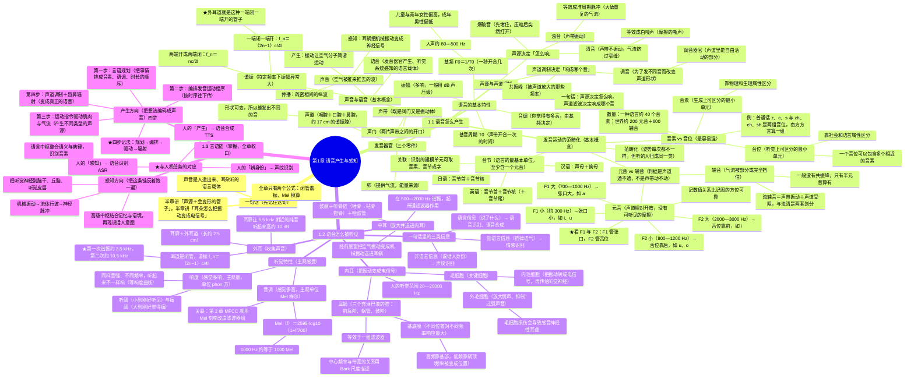

# 1 语音产生与感知机理

一句话：语音是**发音器官产生、听觉系统感知**的语言载体；本章只留考纲内的三块——**发声机理（声源 + 声道调制）**、**发音运动的范畴化（音素 / 音位 / 元音 / 辅音）**、**听觉器官与听觉特性**，最后用**言语链**把两侧接起来。

## 0 读这一章之前

- 这门课研究两件事：**人怎么把想法变成声音**，以及**机器怎么处理这段声音**。
- 读懂本章只需要接受三个直觉：① 声音是空气的振动；② 语音 = 一个声源 + 一根会变形的管子；③ 耳朵把振动变成电信号。
- 公式重点是**声波各量的关系、声管谐振频率与 Mel 换算**，其余主要掌握概念。
- 看笔记的顺序建议：先看图，再读「人话」，最后才看定义和公式。

## 总览（思维导图）

## 考点权重

| 模块 | 真正要掌握的内容 | 优先级 |
| --- | --- | ---: |
| 1.1.1 有声语言的形成 | 声音/语音的定义、言语与语音之别、产生-传播-感知三步、声管谐振规律 | 高 |
| 1.1.2 发音器官与发声机理 | 发音器官三大部分、声源—声道调制—辐射、浊/清/爆破三类激励、基音周期与基频 | **最高** |
| 1.1.3 发音运动的范畴化 | 范畴化、音素 vs 音位、元音 vs 辅音、$F_1$-$F_2$ 与发音动作、音节结构 | **最高** |
| 1.2.1 听觉器官 | 外耳/中耳/内耳分工、外耳道谐振频率、内外毛细胞、基底膜频率—位置映射 | **很高** |
| 1.2.2 听觉特性 | 响度（phon、听阈、痛阈）、音调（Mel 尺度） | 高 |
| 1.3.1 言语链 | 产生方向四步、感知方向四步、与人机任务的对应 | **最高** |

---

## 1.1 语音产生的机理

### 1.1.1 有声语言（语音）的形成（基本概念）

> [!tip] 人话
> 声音是空气被推来推去；语音只是其中一种——人用嘴造出来、耳朵听着的那种。

| 概念 | 定义 |
| --- | --- |
| **声音（Sound）** | 振动产生的声波，通过介质（空气、固体、液体）传播、并能被人或动物听觉器官感知的波动现象 |
| **语音（Speech）** | 声音的一种，是人在言语交流过程中**由发音器官产生、由听觉系统感知**的语言载体 |

因此语音信息处理的研究，长期围绕**人的发音（产生）与听觉（感知）机理**以及相关语言学概念展开。

#### 语音的属性与研究范围

- **物理属性**：语音是**由语言信息调制的声波**，声音作为载体体现语音的生理物理特性。
- **社会属性**：语音是传达人类意图的重要方式之一，声音承载的语言内容体现其社会特性。
- **科学属性**：语音是**言语产生与感知机理相互作用的媒介**，需要从产生、感知和信号处理三个方面理解。
- **科学方法**：回答“为什么”，研究语音产生与感知的机理。
- **工程方法**：回答“怎么样”，研究语音识别与合成等实现方法，两种方法需要相互贯通。

**计算机听觉（computer audition）**不只研究语音，还包括一般音频和音乐：

| 研究分支 | 典型内容 |
| --- | --- |
| **语音信息处理** | 语音产生与感知、语音增强与分离、语音识别、语音合成、说话人识别、语音情感识别、语音理解与交互 |
| **一般音频信息处理** | 音频事件检测、音频场景理解 |
| **音乐信息处理** | 音乐信息检索、音乐生成 |

> [!note] 术语提醒
> 考虑有声语言（Spoken language）的「语言信息」时用「**言语**」；把它当作物理信号处理时称「**语音**」。不引起混淆时一般不严格区分。

**声音的一生三步**

| 环节 | 内容 |
| --- | --- |
| 产生 | 物体振动引起介质（如空气）粒子做简谐（正弦规律）运动，形成波动 |
| 传播 | 空气分子的简谐振动使周围空气疏密变化，形成**疏密相间的纵波**向外传播 |
| 感知 | 耳蜗把中耳传来的机械运动转成淋巴液波动，所含频率在基底膜对应位置引起谐振而被分解，再传入大脑 |

感知并不只靠耳朵：语音感知过程会**融入其他知识对声音做综合判断**。

**声波的三个基本量**：频率 $f$、波长 $\lambda$、声速 $c$，满足 $f=\dfrac{1}{T}=\dfrac{c}{\lambda}$（$T$ 为周期）。

**谐振（resonance）**：一物理系统在特定频率和波长下，比其他频率以更大的振幅振动的现象。管子的谐振规律：

- **两端都开放、或两端都关闭**的声管（以及两端固定的弦）：所有整数倍谐振都存在，第 $n$ 次是基频的 $n$ 倍；
- **一端关闭、另一端开放**的声管（一段固定一端自由同理）：**只有奇次谐振**，第 $n$ 次的波长是管长的 $\dfrac{4}{2n-1}$，最低一次对应波长等于 **4 倍管长**。

两种边界条件的**谐振频率**分别为：

$$
f_n=\frac{nc}{2l}
$$

$$
f_n=\frac{(2n-1)c}{4l}
$$

- **符号含义**：**$n$** 为第几次谐振，取正整数，**$l$** 为管长，**$c$** 为声速。
- **对应条件**：第一式对应两端同为开放或关闭，第二式对应一端开、一端闭。弦的对应公式中，**$c$** 指振动沿弦传播的速度。
- **传播图的读法**：空气的**压缩区与扩张区交替**前进，相邻两个同相位位置的距离是**波长 $\lambda$**，粒子振动的大小是**振幅（amplitude）**。波向前传播不等于空气粒子随波一直向前移动。

> [!question]- PPT 第 9 页 · 语音与音频、声音的关系？
> **参考答案**
>
> 三者是层层包含的关系：
>
> - **声音**：振动经介质传播、能被听觉器官感知的波动现象，是最宽的概念。
> - **音频**：声音的「信号形式」——被录制、传输、播放时的电信号或数字信号，泛指一切可听的声音（人声、动物声、自然界声音、音乐都可归入）。
> - **语音**：声音的一个子集，特指**由发音器官产生、由听觉系统感知、并承载语言信息**的那部分声音。
>
> 所以：语音 ⊂ 声音；音频 ≈ 声音在技术层面的信号表示；语音是音频里唯一带语言学结构的那一类。

### 1.1.2 语音的发音器官及其发音机理（基本概念）

> [!tip] 人话
> 把发声想成吹口哨：肺负责吹气，声带是哨片，声道是那根能变形的管子。

**发音器官**：肺、气管、喉（包括声带）、咽、口、鼻。它们共同形成一条形状复杂的管道。

| 器官 | 要点 |
| --- | --- |
| 肺 | 产生气流，是发声的**能量来源**（绝大多数来自正常呼吸时呼出的稳定气流） |
| **声带（Vocal Cords）** | 长约 **10~14 mm** 的韧带褶；既是一个**阀门**，又是一个**振动部件** |
| **声门（Glottis）** | 两个声带之间形成的开闭自如的开口 |
| **声道（Vocal Tract）** | 由**咽腔、口腔、鼻腔**三个空气腔体组成；从声门延伸到嘴唇的非均匀截面声管，成年男性约 **17 cm** |

**发音器官图中的位置关系**：

- **口腔及边界**：上唇、下唇、牙齿、齿龈、硬腭、软腭、小舌、舌根共同影响声道形状。
- **鼻腔与鼻咽**：鼻腔经鼻咽与咽部相连，软腭的运动影响气流是否进入鼻腔。
- **喉部及邻近结构**：图中还标有下颚骨、舌骨、会厌、喉管、甲状软骨、环状软骨、气管与食道，需区分发声通路与食物通路。
- **声带位置**：声带位于喉内，从甲状软骨内侧前部延伸到后部的杓状软骨附近，两侧声带之间是声门。

**人的发声分两步**（即「激励—调制」模型）：

1. **声门/声带产生不同频率的声音**——准周期气流脉冲或白噪声（激励过程）；
2. **声道对声源进行调制**（调制过程），最后经唇、鼻孔辐射出去。

**声源（激励源）的产生**：呼吸时左右两声带打开（声门开）；说话时两声带合拢，肺提供的气流经气管冲击声门，形成「打开—闭合—打开—闭合……」的振动，从而产生准周期声源，再经声道响应变成语音。

**声道调制**：声道是一个谐振腔，作用是**放大某些频率、衰减其他频率**。当激励频率达到声道的固有频率时，声道以最大振幅振荡（共鸣），这些被放大的频率称**共振频率（formant frequency，共振峰）**，由每一瞬间的声道外形决定，是声道最重要的声学特征。

**调音（Articulation）**：

- 为发出各种声音而调整声道形状
- 声道各部分的动作叫**调音运动**
- 声道中可以自由活动、用于调音的部分（舌、唇、软腭、小舌等）叫**调音器官**

**三类激励**

| 类型 | 声源形态 | 例子 |
| --- | --- | --- |
| **浊音（voiced）** | 声带张弛振动，气流被调制成**准周期脉冲** | /U/、/d/、/i/ |
| **清音（unvoiced）** | 声带不振动，某处收缩使气流高速通过产生湍流，等效为**白噪声** | /ʃ/ |
| **爆破音（plosive）** | 声道先关闭、压缩空气，然后**突然打开** | /tʃ/ |

**浊音的两个动作层次**：在课件的基本模型中，声道保持气流可通过，声带反复张开与闭合，气流因此成为准周期脉冲。**清音的湍流声源**则由气流高速通过声道的狭窄处形成，再经咽腔、口腔等声道结构调制。

**语音的基本特性**

| 特性 | 定义 |
| --- | --- |
| **振幅（Amplitude）** | 波振动的大小，一般用 dB（声压级）表示 |
| **基音周期（Pitch Period）** | 声带**开启—闭合一次**的时间 |
| **基频（Pitch Frequency, $F_0$）** | 基音周期的倒数，即声带振动的基本频率 |
| **音调** | 由基音（声带振动频率）决定：频率高则音调高 |

**人的基音范围约 80~500 Hz**，儿童与青年女性偏高，成年男性偏低。

### 1.1.3 发音运动及其范畴化（基本概念）

> [!tip] 人话
> 每次发音姿势都不可能一模一样，但听的人会把它们归成同一类，这个过程叫范畴化。

**范畴化**：一个相对独立的语音单元，即使**发音姿势在一定范围内变动，其声学特性仍稳定不变**。人类的语音发音运动被**范畴化和符号化**（动物叫声——鸟类除外——无法符号化），每个范畴的声学特征对应一组范畴化的运动指令。

发音姿势需要满足两个条件：

1. **简单易学**
2. **能产生稳定的声学特性**。

（头大约有 8000 个运动神经元单位可供调用。）

**音素与音位**

人类约有 7000 种语言，包含约 200 个元音、600 个辅音；而任一种具体语言大约只有 **40 个音素**。

| 项 | **音素（Phone）** | **音位（Phoneme）** |
| --- | --- | --- |
| 定义 | **生成上**可区分的最小语音单元 | **听觉上**可区分的最小语音单元 |
| 区分标准 | 物理和生理属性 | 社会和语言属性 |
| 关系 | 若干相近的音素归为一个音位 | 一个音位可包含多个音素 |

例：普通话里 z、c、s 与 zh、ch、sh 是**两组不同音位**；南方许多方言里它们是**同一组音位**。

**元音与辅音**

| 项 | 判据 |
| --- | --- |
| **元音（vowel）** | 由**相对开放的声道**产生，有声带振动，但**没有可听见的摩擦音** |
| **辅音（consonant）** | 发音器官形变使气流在声道中**部分或完全受阻**而产生的语音 |

注意：「声道是否受阻」与「声带是否振动（浊/清）」是两套独立划分——浊辅音同时满足「声带振动 + 声道受阻」。组合方式：一个语言单元可以由单元音、双元音或元音化辅音单独构成，也可以以元音为中心、前后加一个或多个辅音构成。

**元音的共振峰**

- **共振峰 = 声道共振产生的波峰**，同时受声源特性的影响；可用单端封闭管中的驻波解释。
- 均匀单端封闭管只有奇次谐振（最低一次波长是管长的 4 倍），所以声道的共振峰大致按 1 : 3 : 5 排列。
- **在声学上，元音的特征主要取决于前两个共振峰 $F_1$ 与 $F_2$**，把它们画在 $F_1$-$F_2$ 平面上即可把元音分开。
- **辅音一般没有共振峰**，只有半元音可以被认为有共振峰。

$F_1$-$F_2$ 平面怎么读：

| 数值关系 | 对应发音动作 | 例子 |
| --- | --- | --- |
| $F_1$ 大（约 700~1000 Hz） | 张口度大（低元音） | /a/ |
| $F_1$ 小（约 300 Hz） | 张口度小（高元音） | /i/、/u/ |
| $F_2$ 大（约 2000~3000 Hz） | 舌位靠前（前元音） | /i/ |
| $F_2$ 小（约 800~1200 Hz） | 舌位靠后，圆唇会进一步拉低 | /u/、/o/ |

方位随坐标轴摆法而变，**记数值关系比记方位可靠**。

**音节与建模单元**

音节是语言的**最基本单位**，**至少包含一个元音**，可以带也可以不带辅音；一个音节分「开头」和「韵脚」，韵脚由音核及其后的辅音组成。

- **音节（syllable）与词**：一个音节可以构成一个词的整体，也可以只是一个词的一部分。
- **连续发音**：课件把音节描述为由一个不间断的声音构成，可由单元音、双元音或元音化辅音独立形成，也可在这个中心前后配上辅音。
- **韵脚（rime）**：由**音节核（nucleus）**加可选的**音节尾（coda）**组成，位于**音节首（onset）**之后。汉语拼音中的韵母对应声母之后的部分，不应把韵脚误记成只有最后一个辅音。

| 语言 | 结构 |
| --- | --- |
| 英语 | 音节首 + 音节核（+ 音节尾） |
| 汉语 | 声母 + 韵母（**字的发音**） |
| 日语 | 音节首 + 音节核（**字或子字的发音**） |

**语音识别的建模单元**：可取音素、音节、字等。

---

## 1.2 语音感知的机理

### 1.2.1 听觉器官的构造及其功能（基本概念）

> [!tip] 人话
> 外耳收声、中耳放大、内耳把振动变成电信号。

| 器官 | 结构 | 功能 |
| --- | --- | --- |
| **外耳** | 耳廓 + 外耳道（长约 **2.5 cm**） | **集声**；耳廓形状可使频谱峰压在 **5.5 kHz** 的纯音提高约 **10 dB** |
| **中耳** | 鼓膜 + 听骨链（锤骨→砧骨→镫骨）+ 中耳肌 + 咽鼓管 | **放大**来自外耳的声音并传给内耳；听骨链对 **500~2000 Hz** 谐振，起**带通滤波器**作用 |
| **内耳** | 骨迷路 = 耳蜗 + 前庭系统 | **兼有听觉与感受位置变化的双重功能**：前庭系统是平衡觉末梢器官，耳蜗把机械振动转成神经电信号 |

传声路径：鼓膜振动 → 锤骨 → 砧骨 → 镫骨 → 耳蜗**前庭窗**，完成「空气振动 → 机械振动」。

外耳道一端开放、另一端由鼓膜封闭，属于**闭管**，只有奇次谐振；代入管长 2.5 cm、声速约 350 m/s，**初次谐振约 3.5 kHz，二次谐振约 10 kHz**——所以人耳对 3~4 kHz 附近特别敏感。

> [!question]- PPT 第 34 页 · 外耳道的初次和二次谐振频率大约为多少 Hz？
> **参考答案**
>
> 外耳道是一端开口、一端由鼓膜封闭的闭管，谐振频率为 $f_n=\dfrac{(2n-1)c}{4l}$。取 $l=0.025$ m、$c\approx350$ m/s：**初次谐振 $f_1=\dfrac{350}{4\times0.025}=3.5$ kHz**，**二次谐振 $f_2=\dfrac{3\times350}{4\times0.025}=10.5$ kHz（约 10 kHz）**。这解释了人耳在 3~4 kHz 附近的灵敏度峰。

**耳蜗与毛细胞**

- **耳蜗（cochlea）的外形**：位于内耳深处，呈螺旋状，约盘绕**两周半**，与负责平衡的前庭系统分工不同。
- 耳蜗由三个充满淋巴液的腔组成：**前庭阶、蜗管、鼓阶**。
- **内毛细胞**：把耳蜗内液体的声音振动**转化为电学信号**，经听觉神经传到听觉脑干，再到听觉皮层。
- **外毛细胞**：机械地把低水平声音**放大**，也能对过强声音做**能动的抑制**。
- 毛细胞损伤会导致听觉灵敏度下降，甚至**感音神经性耳聋**。

**耳蜗的声音分析**

- 基底膜长约 **35 mm**，波动**从耳蜗基部开始，依次向蜗顶移动**。
- 不同频率各自在最匹配的那段基底膜上振动最大：**高频靠基部、低频靠蜗顶**——频率被转换成**位置**。
- 因此耳蜗等效为一个**滤波器组**，中心谐振频率与临界带宽的关系用**巴克（Bark）尺度**描述；**高频处频率分辨率急速下降**。
- 人的听觉范围 **20~20000 Hz**，受基底膜谐振频率范围制约。

### 1.2.2 听觉特性（基本概念）

> [!tip] 人话
> 同样大小的声音，不同频率听起来响度不一样，所以响度是主观量。

**响度（Loudness）**：反映人**主观**感觉不同频率成分声音强弱的物理量，单位**方（phon）**。它是主观心理量，**与频率有关**——同样的音强，频率不同则响度不同（等响度曲线）。

- **听阈**：声音小到人耳刚刚能听见时的大小；
- **痛阈**：声音大到人耳刚刚感觉痛时的大小。

**音调**：听觉分辨声音高低时的特性。客观上用频率表示，主观上的单位是**梅尔（Mel）**尺度。Mel 刻度是按「听起来等间距」画出来的，低频一格很窄、高频越来越宽，整体近似对数：

$$
\text{Mel}(f)=2595\log_{10}\!\left(1+\frac{f}{700}\right)
$$

三个标定点足以记住形状：$f=0\to0$、$f=700\text{ Hz}\to$ 约 $781$、$f=1000\text{ Hz}\to1000$ Mel（1 kHz 以下近似线性，往上被压缩）。

---

## 1.3 产生与感知的相互作用

### 1.3.1 言语链（掌握）

> [!tip] 人话
> 说话是「意图→规划→发声」，听话是把这条链反过来跑一遍。

言语链反映「说话人的意图如何编码成言语传给听话人」以及「听话人如何在大脑中解码、再现说话人意图」。**生成感知认知回路与言语交互理解回路在同一知识语境与语言语境下工作。**

**言语（语音）产生方向**

1. 基于意图决定说话内容 → 言语中枢进行**言语规划**（把抽象概念映射到词汇表征，并按正确顺序给出音素、语调和时长）；
2. 大脑**言语运动中心**编排发音运动程序，按时序传给下一级神经系统；
3. 运动指令传给负责发声的全部肌肉；肌肉收缩使肺提供的气流穿过声带，产生**不同类型的声源**；
4. 声源经声道**调制**，再由唇、鼻孔的声波放射与声道壁振动**辐射**，产生语音信号。

**言语（语音）感知方向**（言语链反向运作）

1. 机械振动 → 流体的行波 → 神经脉冲，经听觉神经传到脑干、丘脑和听觉皮层；
2. 语言中枢整合语义、语调、时长与能量包络等信息，识别传达意义的**音素**；
3. 通过音质等额外信息辨识说话者、了解其健康与情绪状态；
4. 高级中枢把声学特征与语言信息同记忆、语境结合，**再现**说话人的意图。

**与人机语音交互的对应**

| 人的环节 | 机器任务 |
| --- | --- |
| **语音感知** | **ASR 语音识别** |
| **语音产生** | **TTS 语音合成** |
| 非语言信息感知（辨识说话人） | **说话人识别 / 声纹识别** |

**机器任务的全称与章节对应**：

- **自动语音识别（Automatic Speech Recognition，ASR）**：对应人的语言信息感知，识别“说了什么”，在**第 3 章**展开。
- **文语转换（Text-to-Speech，TTS）**：对应人的语音生成，把文字变为语音，在**第 4 章**展开。
- **说话人识别（Speaker Recognition）**：对应非语言信息感知，辨识“谁在说”，在**第 6 章**展开。
- **信号处理与语音增强**：**第 2 章**提供语音信号分析和处理基础，**第 5 章**研究语音增强，为后续感知任务改善输入信号。
- **自然语言处理（Natural Language Processing，NLP）**：对应更高层的**言语认知与交互**，把识别到的语言内容与意义理解、交互联系起来。

---

## 本章小结

> [!summary] 全章路线
> 发音器官 → 发音机理 → 发音运动的范畴化 → 听觉器官 → 听觉感知机理 → 听觉特性 → 言语链。

> [!important] 一句话收束
> **语音 = 声源（激励）经声道（调制）再辐射的产物；听觉 = 把频率分解成基底膜上的位置、再变成神经脉冲的过程。**
