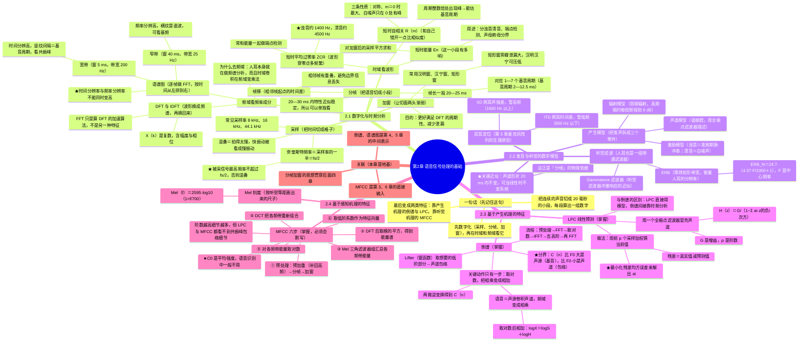

# 2 语音信号处理的基础

一句话：把连续的语音变成**一帧一帧的向量**——先采样分帧加窗，再在**时域**（能量、过零率（zero-crossing rate）、自相关（autocorrelation））和**频域**（DFT（Discrete Fourier Transform，离散傅里叶变换）、语谱图）看它，最后提炼成两类特征：**基于产生机理的倒谱 / LPC（Linear Predictive Coding，线性预测编码）** 与**基于感知机理的 MFCC（Mel-Frequency Cepstral Coefficients，梅尔频率倒谱系数）**。

## 0 读这一章之前

- **前置知识**：只需知道「频率」= 每秒振动多少次（单位 Hz）。
- 本章只干一件事：把连续的声音切成 20 毫秒的小段，每段算出一组数字。
- 要建立的三个直觉：**采样**是把时间切成格子、**帧**是把语音切成小段、**窗**是让切面不要那么硬。
- 公式看着多，其实都在回答同一句话：「这一小段声音，用几个数怎么描述」。

## 总览（思维导图）

## 考点权重

| 模块 | 真正要掌握的内容 | 优先级 |
| --- | --- | ---: |
| 2.1.1 数字化与预处理 | 奈奎斯特与混叠、常用采样率、分帧（帧长/帧移）、加窗目的与三种窗 | **最高** |
| 2.1.2 时域分析 | 短时能量（short-time energy）、短时平均过零率、短时自相关的定义/性质/应用 | **最高** |
| 2.1.3 频域分析 | DFT/IDFT 在做什么、FFT 只是加速、语谱图宽带与窄带的取舍 | **很高** |
| 2.2 数学模型 | 激励/声道/辐射三模型、20 ms 内近似线性时不变、ERB、ITD 与 IID | 高 |
| 2.3.1 倒谱 | 定义、取对数为什么能分开声源与声道、$F_0$ 分界、Lifter | **最高** |
| 2.3.2 线性预测 | AR 全极点模型、预测与残差、$a_i$ 的含义 | **最高** |
| 2.4.1 MFCC | Mel 尺度、提取五步、$C_0$ 与阶数的物理意义 | **最高** |

---

## 2.1 语音信号的数字化和时频分析

### 2.1.1 语音信号的数字化与预处理

**为什么需要语音信号处理？** 一段语音信号里同时装着多层信息，每一种信息对应一个任务：

| 语音信号中的信息 | 内容 / 说话人 / 性别 / 情感 / 噪音 / 韵律 / 语言 / 口音 / 空间信息 |
| --- | --- |
| 对应任务 | **语音识别** / **声纹识别** / **情感识别** / **口音识别** / **语音增强** / **语言识别** |

> [!question]- PPT 第 2 页 · 为什么需要语音信号处理？
> **参考答案**
>
> **同一段语音混合了多种信息**，需要通过处理提取任务关心的部分：
>
> - **内容**用于语音识别
> - **说话人身份**用于声纹识别
> - **情感、语言和口音**分别用于相应的识别任务
> - **噪声与空间信息**用于语音增强、声源定位等任务

**语音是经过语言调制的声学信号**：语音信号处理主要关注「调制」与「解调」过程，较少涉及语言规划与语义理解。

- **调制**：发音器官运动生成动态声道，对浊音/清音声源滤波 → 即**声源—滤波器模型**；
- **解调**：内耳基底膜把声波振动分解为不同频率的神经电信号，传给听觉皮层感知。

**语音信号处理要解决的问题**（输入、系统、输出三者知二求一）：

| 已知 | 求 | 说明 |
| --- | --- | --- |
| 输入和脉冲响应 | 输出 | 正问题（合成） |
| 输入和输出 | 系统特性 | 系统辨识 |
| 输出 | 系统特性和输入 | **语音信号处理多属这一种**（只听到语音，反推内容与说话人） |

#### 奈奎斯特频率与采样定理

- **奈奎斯特频率**：离散系统的**采样频率的一半**。
- **奈奎斯特—香农采样定理**：给定采样频率 $f_s$，可完全重构的频带限制为 $B\le f_s/2$。只要奈奎斯特频率高于被采样信号的最高频率（带宽），就**不会混叠**。
- 人的听觉范围 20~20000 Hz，**常用采样频率：8 kHz、16 kHz、44.1 kHz**。

> [!question]- PPT 第 7 页 · 哪种音频信号的采样频率为 44.1 kHz？为什么采用 44.1 kHz？
> **参考答案**
>
> **CD（激光唱片）**的音频采样率就是 44.1 kHz。原因有两层：
>
> 1. 按采样定理，要无损记录人耳可听上限 20 kHz，采样率至少要 40 kHz
> 2. 早期数字录音设备用磁带录像机（PCM 适配器）存储音频，44.1 kHz = 245×180 = 490×90，能和 PAL/NTSC 的**行频/场频**整除，方便把音频样本铺进视频行里，于是成为事实标准并被 CD 沿用。

#### 分帧（Framing）

> [!tip] 人话
> 语音一直在变，但 20 毫秒内几乎不变，所以切成小段单独看。

- 语音是**非周期信号**，但在 20~30 ms 内近似**准周期**、特性稳定，所以切成短帧处理。
- **帧长**：通常取 20~25 ms（人的基音周期约 2~12.5 ms，即 1~7 个基音周期）；**帧移**：相邻帧起点的时间差，帧之间留有重叠，避免边界信息丢失。

#### 加窗（Windowing）

> [!tip] 人话
> 直接截一小段会在边界产生「突然断开」的假象，加个两头渐弱的窗来减轻它。

**目的：使时域信号更好地满足离散傅里叶变换的周期性要求，减少泄漏。** 做法就是逐点相乘：

$$
x'(n)=x(n)w(n)
$$

- **符号含义**：$x(n)$ 是加窗前的第 $n$ 个采样，$w(n)$ 是该位置的窗权重，$x'(n)$ 是加窗后的采样，$n$ 是帧内采样下标。

常用三种窗：**汉明窗（Hamming）**、**汉宁窗（Hanning）**、**矩形窗（Rectangular）**。矩形窗的旁瓣泄漏大，汉明/汉宁可压低旁瓣。

### 2.1.2 时域分析

#### 短时能量

> [!tip] 人话
> 这一小段有多响。

把加窗后这一帧的采样值**逐个平方再求和**（平方让正负都计为能量）：

$$
E_n=\sum_{m=-\infty}^{\infty}\big[x(m)w(n-m)\big]^2
=\sum_{m=-\infty}^{\infty}x^2(m)h(n-m),\qquad h(n)=w^2(n)
$$

$E_n$ 就是「从第 $n$ 点开始加窗」的短时能量。窗越宽，能量曲线越平滑。

- **符号含义**：$x(m)$ 是第 $m$ 个采样值，$m$ 是求和的采样下标，$n$ 标记当前分析位置，$w(n-m)$ 选取并加权附近的采样，$h(n)=w^2(n)$ 是窗函数的平方。
- **物理含义**：$E_n$ 衡量这一小段信号的**幅度（amplitude）平方总量**，幅度越大、参与求和的有效采样越多，能量一般越大。固定窗长后，能量变化可反映语音强弱变化。
- **能量与平均能量**：若一帧有 $N$ 个采样，除以 $N$ 得到该帧的**平均平方幅度**。比较不同窗长时，要区分「求和的总量」与「每点的平均量」。

**应用**：浊音与清音的区分、**语音端点检测**（有声段/无声段）、声母与韵母的分界、语音情感分类的特征。

#### 短时平均过零率（ZCR）

> [!tip] 人话
> 波形一秒穿过零点几次；穿得越勤，听起来越「嘶」。

定义：信号采样点**符号变化的次数**，再按采样率和窗长折算成频率：

$$
Z=\frac{f_s}{N}\sum_{n=0}^{N-1}\big|\operatorname{sgn}x(n)-\operatorname{sgn}x(n+1)\big|,
\qquad \operatorname{sgn}x(n)=\begin{cases}1,&x(n)\ge 0\\-1,&x(n)<0\end{cases}
$$

- **符号含义**：$f_s$ 是**采样频率**，$N$ 是**窗内采样点数**，$\operatorname{sgn}$ 是**符号函数**。相邻采样异号时，绝对差为 **2**，同号时为 **0**。
- **计数约定**：上式沿用课件的频率表征写法。若要让**每次符号变化只计一次**，应把符号差除以 **2**。对含 $N$ 个采样的一帧，实际只有 $N-1$ 对相邻采样，常用归一化过零率及每秒过零次数为：

$$
\mathrm{ZCR}_{\mathrm{frame}}
=\frac{1}{2(N-1)}\sum_{n=0}^{N-2}
\left|\operatorname{sgn}x(n)-\operatorname{sgn}x(n+1)\right|,
\qquad
\nu_{\mathrm{zc}}=f_s\,\mathrm{ZCR}_{\mathrm{frame}}
$$

- **量纲区别**：$\mathrm{ZCR}_{\mathrm{frame}}$ 是无量纲的相邻点过零比例，$\nu_{\mathrm{zc}}$ 是每秒过零次数。纯正弦波每周期过零 **2 次**，因此每秒过零次数约为其频率的 **2 倍**，不能不加区分地当作基频。

**ZCR 反映包括主能量在内区域的平均频率**：

| 类型 | ZCR 大致值 |
| --- | --- |
| 浊音 | 约 **1400 Hz** |
| 清音 | 约 **4500 Hz** |

**应用**：浊音/清音区分、端点检测（**短时能量 + ZCR 结合**）。

#### 短时自相关

> [!tip] 人话
> 把这段声音和自己错开一点比相似度；错开正好一个周期时最像。

**自相关函数**衡量同一信号在时域内的相似度（把信号与其延迟版本逐点相乘再求和）：

$$
R(i)=\sum_{n=-\infty}^{\infty}x(n)x(n-i),\qquad i=0,1,2,\dots
$$

限制在一个短时窗内做，就是**短时自相关函数**：主要用来研究信号本身的同步性与周期性。

$$
R(m)=\frac{1}{2N-1}\sum_{n=-N+1}^{N-1}x(n)x(n+m),\quad m=0,1,\dots,N-1
$$

- **符号含义**：第一式的 $i$、第二式的 $m$ 都表示**延迟的采样点数**。第二式的 $n$ 是求和下标，区间 $[-N+1,N-1]$ 共含 **$2N-1$ 个采样位置**，前面的因子用于求平均。有限帧计算时，窗外信号按零处理。
- **零延迟的意义**：$R(0)$ 是信号与自身逐点相乘后的平方和或平均平方量，所以它也与**短时能量**有关。
- **周期与基频换算**：若零延迟以外的周期峰间距为 $P$ 个采样，**基音周期**为 $T_0=P/f_s$，**基频**为 $f_0=f_s/P$。

**性质**：

1. **对称性** $R(m)=R(-m)$
2. $m=0$ 时取最大值，即 $\lvert R(m)\rvert\le R(0)$
3. **连续时间白噪声的自相关只在 $m=0$ 处有强峰值**，其他 $m\neq0$ 处为 0。

**应用**：浊音/清音区分、浊音周期估计。

> [!question]- PPT 第 17 页 · 短时自相关函数为什么可以应用到以上任务？
> **参考答案**
>
> 若 $x(n)$ 是**周期信号**，其自相关 $R(i)$ 会在 $i$ 等于**周期的整数倍**处取极大值。浊音由声带振动产生、具有准周期性，所以它的短时自相关在基音周期的整数倍处出现峰，峰的位置就能给出**基音周期**；清音近似白噪声、无周期性，自相关只在 $m=0$ 有强峰、其余处接近 0。因此只看自相关的峰形就能把浊音/清音分开，并估计浊音的基音周期。

### 2.1.3 频域分析

**为什么要在频域看**：

1. 人类听觉系统本身具有频谱分析功能
2. **频域计算更简便**——时域的卷积在频域变成乘积。

语音信号的频谱分析是认识和处理语音的重要方法。

> [!question]- PPT 第 19 页 · 为什么需要频域分析？
> **参考答案**
>
> 1. **符合听觉机理**：人耳本身具有频谱分析功能，频域便于观察各频率成分。
> 2. **便于计算与建模**：时域卷积在频域变成乘积，声源与声道的共同作用更容易表示和分析。

#### DFT 与 IDFT

> [!tip] 人话
> 把「每刻多响」换算成「每个频率各多响」，反变换再换回来。

**离散傅里叶变换（DFT）** 把时间窗内的 $N$ 个采样 $x(n)$ 换成 $N$ 个频率分量组成的**复数序列** $X(k)$（同时含幅度与相位）：

$$
X(k)=\sum_{n=0}^{N-1}x(n)\,e^{-j\frac{2\pi kn}{N}},\quad 0\le k\le N-1
$$

**离散傅里叶逆变换（IDFT）** 再把它换回时域：

$$
x(n)=\frac{1}{N}\sum_{k=0}^{N-1}X(k)\,e^{j\frac{2\pi kn}{N}},\quad 0\le n\le N-1
$$

- **符号含义**：$N$ 是变换使用的采样点数，$n$ 是时间采样下标，$k$ 是频率下标，$j$ 是虚数单位，$X(k)$ 是复数频谱。若采样率为 $f_s$，第 $k$ 个频率点对应 $f_k=kf_s/N$，相邻频率点间隔为 $f_s/N$。

实际计算用 **FFT（快速傅里叶变换）** 加速。FFT 只是算得更快，**不是另一种特征**。

**从语音信号到频谱向量的序列**：把语音切成帧 → 每帧做 FFT 得到一列频谱 → 把每帧的幅度谱按时间依次排列 → 就得到时频表示。把幅度谱**旋转 90 度**、用颜色深浅（能量越高颜色越深）表示幅度，就是**语谱图**。

#### 语谱图

> [!tip] 人话
> 逐帧做 FFT，再把结果按时间从左排到右，就成了图。

| 类型 | 滤波器带宽 / 窗长 | 分辨率特点 | 看什么 |
| --- | --- | --- | --- |
| **宽带** | 200 Hz / 窗长 **5 ms** | 频率分辨率低、**时间分辨率高**（周期性清晰） | **垂直条纹**，条纹间隔＝基音周期；观测**共振峰** $F_1,F_2,\dots$ |
| **窄带** | **25 Hz** / 窗长 **40 ms** | 频率分辨率高、**时间分辨率低**（周期性被抹杀） | **水平条纹**，观测**谐波** $H_1,H_2,\dots$，可看基音频率 |

核心权衡：**时间分辨率与频率分辨率不能同时高**——窗越长频率越准、时间越糊。

- **图的坐标**：语谱图横轴是**时间**，纵轴是**频率**，颜色深浅表示对应时间、频率处的幅度或能量强弱。
- **宽带图读法**：课件用 **5 ms 汉明窗**分析「**阿姨**」中的 /a/ 与 /yi/。短窗能分开一次次声门激励，所以看到**直条纹**，沿频率方向的较宽能量带显示**共振峰（formant）** $F_1,F_2,F_3,F_4$。
- **窄带图读法**：课件用 **40 ms 汉明窗**，能分开相邻的**谐波（harmonic）**，所以看到**横条纹**。横纹频率间隔约为**基频**，横纹整体的强弱分布还可反映元音共振峰及其随时间的变化，但单次声门脉冲的时间位置不再清晰。

---

## 2.2 语音产生与感知的数学模型

### 2.2.1 语音产生的数学模型（基本概念）

> [!tip] 人话
> 把发声拆成三个零件：声源、声道、嘴唇。

**语音产生系统的线性模型**由三部分串联而成：

| 模型 | 内容 |
| --- | --- |
| **激励模型** | 浊音 → 声门脉冲（如斜三角形脉冲串，准周期）；清音 → 随机白噪声 |
| **声道模型** | 谐振腔，用全极点滤波器描述 |
| **辐射模型** | 唇端辐射，使高频端约每倍频程抬升 6 dB |

**声学理论**（Mueller、Chiba-Kajiyama、Fant）：声带振动产生元音的声源，准周期脉冲通过声道（相当于滤波器，抑制某些频率、增强另一些频率），形成可辨识的元音特征；**辅音声源处在声道的不同位置，把声道分成前后两个腔，因此辅音需要两个以上的滤波器来建模**。

- **浊音激励**：声带振动形成**准周期声门脉冲**，斜三角形脉冲串是对这种复杂激励的一种近似。
- **清音激励**：**声带不振动**，气流在狭窄处产生湍流噪声，模型用**随机白噪声（white noise）**近似其激励，而不是用周期脉冲串。
- **前后腔建模**：辅音的噪声源不一定在声门处，它所在的位置把声道分成**前腔与后腔**，需要分别考虑各腔的声学作用。整体的**激励、声道、辐射**是级联建模的三个环节，不能把辅音的前后腔误认为只需一个元音式的单腔滤波器。
- **滤波器级联**：在线性模型中，多个串联滤波器的**总冲激响应是卷积**，**总传递函数是乘积**。例如声道传递函数为 $H_{\mathrm{v}}(z)$、辐射传递函数为 $H_{\mathrm{r}}(z)$，则两者级联为 $H_{\mathrm{tot}}(z)=H_{\mathrm{v}}(z)H_{\mathrm{r}}(z)$。

**声源—滤波器模型**：发音器官连续运动形成时变声道形状，由声源驱动产生语音，输出是声源与声道冲激响应的**卷积**。**发音器官的运动频率约在 50 Hz 以下，所以可以近似认为声道形状在 20 ms 内稳定不变**；于是语音生成系统在 **20~30 ms** 区间可用**线性时不变（LTI）系统**近似——这正是「分帧」的物理依据。

连续时间的卷积关系可写为：

$$
y(t)=(x*h)(t)=\int_{-\infty}^{\infty}x(\tau)h(t-\tau)\,d\tau
$$

- **符号含义**：$x(t)$ 是声源输入，$h(t)$ 是系统的**冲激响应**，$y(t)$ 是语音输出，$\tau$ 是积分变量，$*$ 表示卷积。这里的 $x$ 指输入，而后文倒谱部分用 $x$ 指最终语音，需按各节的定义读。

### 2.2.2 语音感知的数学模型（了解）

**听觉滤波器**：带通滤波器，实现听觉末梢系统中的声学频率分析。**等效矩形带宽（ERB）** 是心理物理实验测得的滤波器带宽；$\mathrm{ERB}_N$ 是听力正常人对应的 ERB，传递能量与相应听觉滤波器相同：

$$
\mathrm{ERB}_N=24.7\left(4.37\frac{F}{1000}+1\right)
$$

$F$ 是以 Hz 为单位的中心频率。要抓的是**趋势**：带宽随中心频率**线性变宽**，低频约 25 Hz、1 kHz 约 133 Hz、10 kHz 已超过 1 kHz——**人耳低频分得细、高频分得粗**。

- **英文名称**：**等效矩形带宽（Equivalent Rectangular Bandwidth，ERB）**用一个传递同等能量的矩形滤波器来表征实际听觉滤波器的有效带宽。下标 $N$ 表示**听力正常**，式中 $\mathrm{ERB}_N$ 的单位也是 **Hz**。

**双耳声源定位**（麦克风阵列的生理原型）：

| 线索 | 机制 | 适用频段 |
| --- | --- | --- |
| **两耳时间差 ITD** | 右侧来的声音先到右耳，后到左耳 | **低频 < 800 Hz** |
| **两耳声强差 IID** | 头部遮挡使远侧耳朵强度更低，差异随频率增加 | **高频 > 1600 Hz** |

阵列信号模型：两路麦克风收到的是同一语音 $s(t)$ 经各自房间响应与延迟（$\delta$）后的版本，再叠加各自的噪声。

- **定位目标**：声源定位是判断声音来源的**方向和距离**，而不只是判断左右。
- **时间线索**：**两耳时间差（Interaural Time Difference，ITD）**利用声音到达两耳的先后，右侧声源通常先到右耳。
- **强度线索**：**两耳声强差（Interaural Intensity Difference，IID）**利用头部遮挡造成的两耳强弱差，高频更容易受到头部遮挡，因此该线索随频率增加更明显。

$$
x_1(t)=h_1(t)*s(t)+n_1(t)
$$

$$
x_2(t)=h_2(t)*s(t-\delta)+n_2(t)
$$

- **符号含义**：$x_1(t),x_2(t)$ 是两路观测，$s(t)$ 是共同的目标语音，$h_1(t),h_2(t)$ 是各路传播或房间冲激响应，$n_1(t),n_2(t)$ 是各路噪声，$\delta$ 是相对到达延迟，$*$ 表示卷积。
- **阵列对应关系**：双耳像两个接收器，麦克风阵列也比较各路信号的**到达时间差和强度差**，据此估计声源方位。

---

## 2.3 基于语音产生机理的特征分析方法

### 2.3.1 倒谱分析（掌握）

> [!tip] 人话
> 倒谱的关键动作只有一步：取对数，把「相乘」变成「相加」。

#### 语音频谱、包络与细节

- **语音频谱**：表示不同频率分量的强弱，浊音频谱中常见一系列谐波尖峰。
- **频谱包络（spectral envelope）**：沿频谱峰值总体走势得到的平滑轮廓，主要反映**声道的共振特性**，其峰值对应共振峰。
- **频谱细节（spectral fine structure）**：包络之下快速起伏的谐波结构，主要体现**声源的周期性**。谐波间距与基频有关，不能把每根谐波都当成共振峰。
- **分析目标**：把缓慢变化的**声道包络**与快速变化的**声源细节**分开，这就是倒谱分析要解决的问题。

#### 倒谱定义与频域推导

**定义**：**倒谱**是信号的傅里叶变换经**对数运算**后再做**傅里叶反变换**得到的谱；语音中一般先取幅度。

**为什么取对数能分开声源与声道**：语音序列 $x(n)$ 是声源 $s(n)$ 与声道冲激响应 $h(n)$ 的**卷积**；频域上语音谱等于声源谱与声道谱的**乘积**：

$$
X(k)=S(k)H(k)\;\Longrightarrow\;\log X(k)=\log S(k)+\log H(k)
$$

对 $\log X(k)$ 做 IFFT，结果不落在时域而落在**类频率（quefrency）**空间，记为 $C(n)$，即**倒频谱（cepstrum）**。

**完整的分离关系**：设 $x(n)$ 是语音，$s(n)$ 是声源激励，$h(n)$ 是声道冲激响应，先在时域写卷积，再在频域取幅度和对数：

$$
x(n)=\sum_{i=-\infty}^{\infty}s(i)h(n-i),
\qquad X(k)=S(k)H(k)
$$

$$
\log|X(k)|=\log|S(k)|+\log|H(k)|
$$

$$
C(n)=\frac{1}{N}\sum_{k=0}^{N-1}\log|X(k)|e^{j2\pi kn/N}
=C_s(n)+C_h(n)
$$

- **符号含义**：$N$ 是变换长度，$k$ 是频率下标，$j$ 是虚数单位，$C_s(n)$ 和 $C_h(n)$ 分别是声源、声道的倒谱。**频域乘积经对数变成加法**，反变换的线性性使两部分在倒谱域仍相加。
- **幅度谱约定**：上述实倒谱使用 $\log|X|$。如果改用**对数功率谱** $\log|X|^2$，则等于 $2\log|X|$，得到的倒谱幅值相差 **2 倍**，不能把幅度谱和功率谱混用。
- **连续频率形式**：课件的积分写法与离散 IFFT 表示同一分析思路，$\omega$ 是数字角频率：

$$
C(n)=\frac{1}{2\pi}\int_{-\pi}^{\pi}
\log|X(e^{j\omega})|e^{j\omega n}\,d\omega
=\frac{1}{2\pi}\int_{-\pi}^{\pi}
\left[\log|S(e^{j\omega})|+\log|H(e^{j\omega})|\right]
e^{j\omega n}\,d\omega
$$

- **类频率不等于原时域**：虽然也用 $n$ 作下标，$C(n)$ 已不是原波形的采样值，而是描述**对数频谱沿频率轴起伏快慢**的系数。若按采样间隔换算，其横坐标为 $q=n/f_s$，单位可用**秒**。

**关键分界**：声源频谱 $S(k)$ 变化比声道频谱 $H(k)$ 快得多，于是

| 位置 | 对应信息 |
| --- | --- |
| $C(n)\ (n\ge F_0)$ | **声源信息（基音）** |
| $C(n)\ (n< F_0)$ | **系统信息（声道包络）** |

- **分界记号说明**：上表保留课件的 $F_0$ 写法，这里应读成**划分低、高倒谱区的截取界限**，不能把单位为 Hz 的基频直接与采样下标 $n$ 比较。若实际基频记为 $f_0$，声源周期峰对应的类频率约为 $T_0=1/f_0$，或倒谱下标 $n_0=f_s/f_0$。**低类频率偏向声道，高类频率中的周期峰偏向声源**，实际 Lifter 截止位置应据此选取。

想取哪一段就用 **Lifter 窗函数**去截：保留低阶得声道包络，保留高阶得声源细节。流程：**语音 → 预处理 → FFT → 取对数 → IFFT → Lifter 截取 → 需要时再 FFT 回包络**。

**Lifter 的数学写法**：设 $n_c$ 为选定的截取界限，低阶部分与高阶部分可表示为：

$$
C_L(n)=
\begin{cases}
C(n),&n<n_c\\
0,&n\ge n_c
\end{cases},
\qquad
C_H(n)=
\begin{cases}
0,&n<n_c\\
C(n),&n\ge n_c
\end{cases},
\qquad C(n)=C_L(n)+C_H(n)
$$

> 命名梗（PPT 特别标出）：**cepstrum** 是把 **spectrum** 的前四个字母倒过来拼的，**quefrency / lifter** 也同理——「倒」过来的谱。

**两个出处**（课件 p42）：

- 倒谱的命名与历史：**Oppenheim, A. V. & Shafer, R. W. (2004), “From frequency to quefrency: A history of the cepstrum”, IEEE Signal Processing Magazine**
- 推导中取对数时的前提：**假设声源频谱 $S(k)$ 与声道频谱 $H(k)$ 无关**，因此 $\log\lvert X\rvert=\log\lvert S\rvert+\log\lvert H\rvert$ 才能拆成两项

### 2.3.2 线性预测编码 LPC（掌握）

> [!tip] 人话
> 用一个全极点滤波器冒充声道，解出的系数就是声道的「指纹」。

把语音 $x(n)$ 看作声源 $s(n)$ 激励一个**全极点（自回归 AR）系统** $H(z)$ 的输出：

$$
H(z)=\frac{G}{1-\sum_{i=1}^{p}a_iz^{-i}}
$$

$G$ 为常数增益，$a_i$ 为实数系数，$p$ 为模型阶数。**用系数 $\{a_i\}$ 就可以定义一个 $p$ 阶线性预测器。**

- **模型全称**：**自回归模型（Autoregressive Model，AR）**把当前输出表示为过去输出的加权组合与当前激励之和。
- **输入与输出**：$s(n)$ 是**声源输入**，浊音时可近似为准周期脉冲，清音时可近似为随机噪声。$x(n)$ 是经模型滤波后的**语音输出**。
- **传递关系**：令 $S(z)$、$X(z)$ 分别为输入、输出的 $z$ 变换，$z^{-i}$ 表示延迟 $i$ 个采样，则

$$
X(z)=H(z)S(z),
\qquad
x(n)=\sum_{i=1}^{p}a_ix(n-i)+Gs(n)
$$

- **全极点的含义**：$H(z)$ 的分子只有常数增益 $G$，频谱形状由分母的极点决定，用于近似声道共振。下文预测残差 $\varepsilon(n)$ 在该模型成立时对应 **$Gs(n)$**，只有把增益吸收到激励中时才可直接把残差记为 $s(n)$。

**预测与残差**：用前 $p$ 个采样的线性组合推测当前值，

$$
\hat x(n)=\sum_{i=1}^{p}a_ix(n-i),\qquad
\varepsilon(n)=x(n)-\hat x(n)=x(n)-\sum_{i=1}^{p}a_ix(n-i)
$$

$\varepsilon(n)$ 是**残差**，$a_i$ 是加权系数。最优 $a_i$ 由**最小化残差均方误差** $E[\varepsilon^2(n)]$ 定出（数学上会导出一组线性方程，用自相关法求解——思路记住即可）。

要点：LPC **直接利用**声源—滤波器模型，得到的是声道滤波器系数；倒谱则是**间接**通过时频分析把声源与声道分开。

---
## 2.4 基于语音感知机理的特征分析方法

### 2.4.1 梅尔频率倒谱系数 MFCC（掌握）

> [!tip] 人话
> 一串固定工序：从一段波形，算出十几个数。

**Mel 尺度**：人耳对不同频率的灵敏度不同，以 Hz 为单位时听觉系统是**非线性**的，整体呈对数趋势；Mel 频率恰好模拟这条感知曲线：

$$
\text{Mel}(f)=2595\log_{10}\!\left(1+\frac{f}{700}\right)
$$

- **坐标含义**：$f$ 是以 **Hz** 为单位的客观声频率，$\mathrm{Mel}(f)$ 是以 **mel** 为单位的感知音高刻度，两者不是线性比例。
- **感知特性曲线**：在较低频率范围，Mel 与 Hz 的关系近似线性。频率升高后，曲线逐渐变缓，同样增加一段 Hz，带来的 Mel 增量更小，因此**低频刻度密、高频刻度疏**。
- **非线性转换的作用**：在 Mel 轴上等间隔布置频带，再映射回 Hz 轴，就得到**低频较窄、高频较宽**的滤波器分布，更接近人耳的频率分辨特性。Mel 描述的是**音高刻度**，不是直接计算响度。

**提取五步**

1. **预处理**：**预加重**（提升高频，补偿辐射造成的 −6 dB/倍频程跌落）→ **分帧** → **加窗**，得到帧序列；
2. **DFT**：对每帧做 DFT，取模的平方得到离散能量谱 $S(k)=\lvert X(k)\rvert^2$（$1\le k\le N/2-1$）；
3. **Mel 滤波器组**：用一组三角滤波器把能量谱按 Mel 刻度汇总到 $L$ 个频带，得到各带能量 $m(i)$；
4. **取对数**：$\lg[m(i)]$；
5. **DCT（离散余弦变换）**：对 $L$ 个对数值做余弦变换，得到 MFCC 系数 $C_{\text{MFCC}}(n)$，再**取低阶系数**作为特征向量。

$$
C_{\text{MFCC}}(n)=\sum_{i=1}^{L}\lg[m(i)]\cos\!\left(\frac{(i-0.5)n\pi}{L}\right)
$$

- **滤波器组能量**：若第 $i$ 个 Mel 三角滤波器为 $H_i(k)$，则 $m(i)=\sum_k S(k)H_i(k)$。$H_i(k)$ 是该滤波器对第 $k$ 个频率点的权重，$L$ 是滤波器个数，相邻三角滤波器通常有重叠。
- **DCT 符号含义**：**离散余弦变换（Discrete Cosine Transform，DCT）**中的 $i$ 是频带序号，$n$ 是倒谱系数阶数，$\lg$ 为以 **10** 为底的对数。先按频带求能量，再取对数，最后做 DCT，不能把这三步交换顺序。

**物理意义（重点）**：

- **$C_0$ 是语音的平均强度**，在语音识别中一般**不直接使用**；
- 阶数越高，MFCC 表示越多频谱细节；但**无论是 MFCC 还是 LPC 系数，都不能直接展示共振峰的频谱包络的细节**。

---
## 本章小结

> [!summary] 全章路线
> 数字化（采样）→ 分帧加窗 → 时域三件套（能量、过零率、自相关）→ 频域（DFT/FFT、语谱图）→ 产生侧特征（倒谱、LPC）与感知侧特征（Mel、MFCC）。

> [!important] 一句话收束
> **所有特征都在做同一件事——把一帧 20 ms 的波形压成十几个数，同时尽量保住「说了什么」和「谁在说」。**
