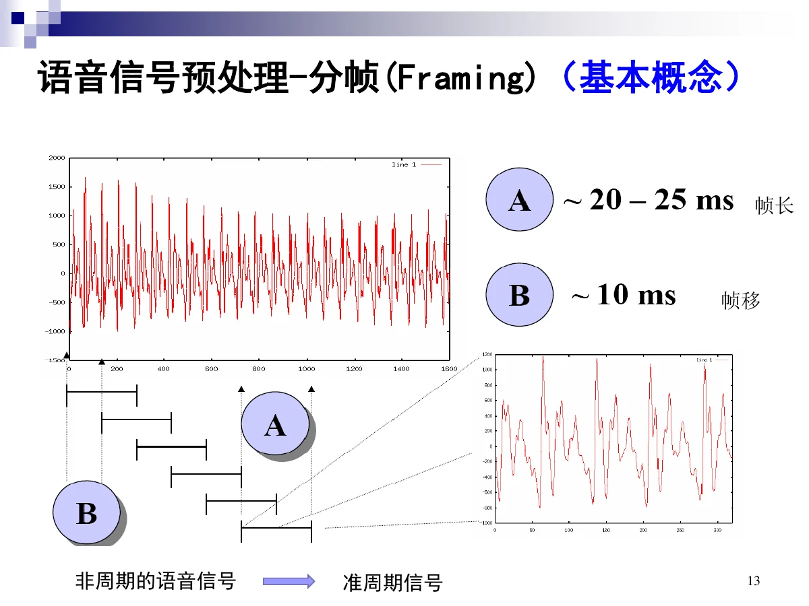
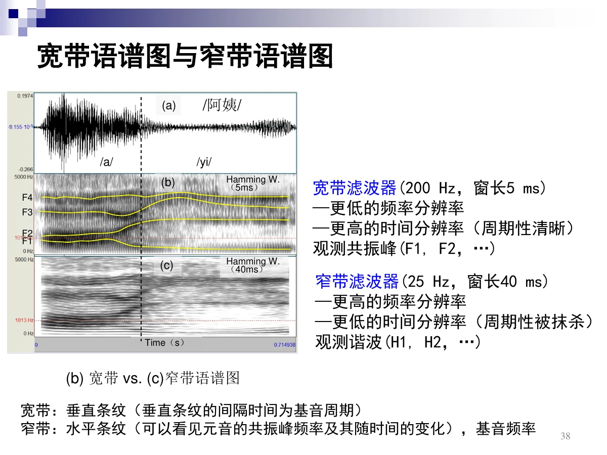
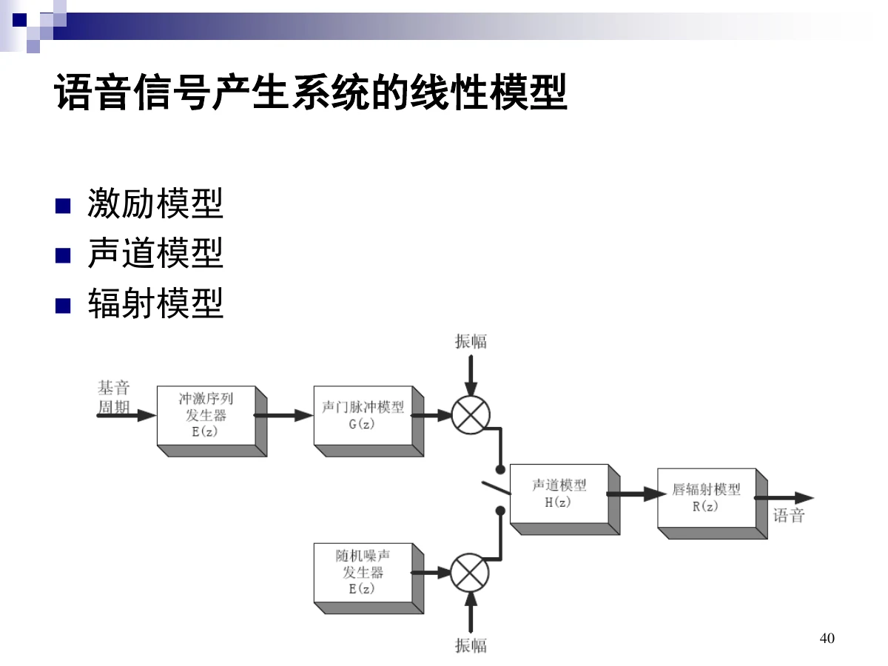
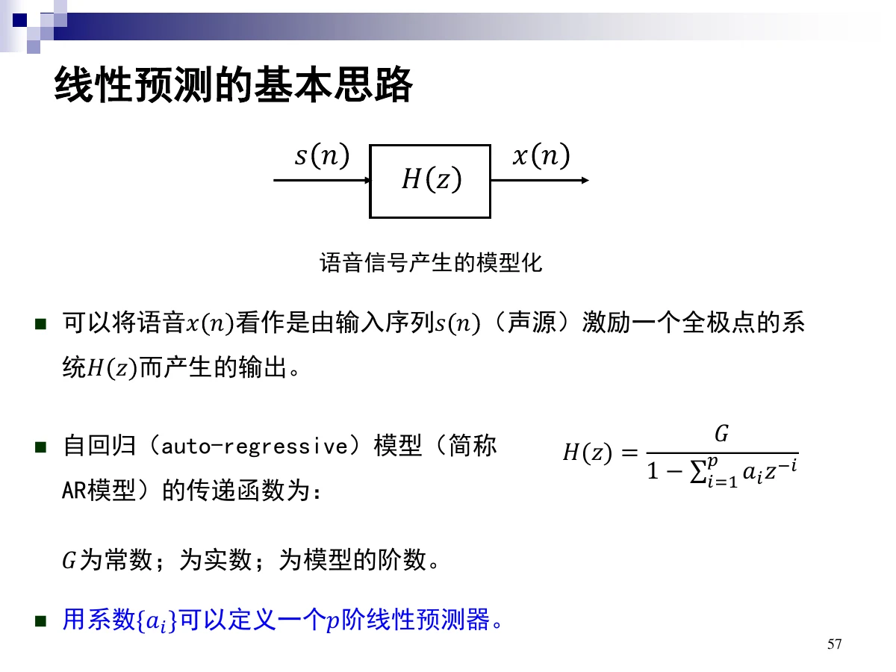
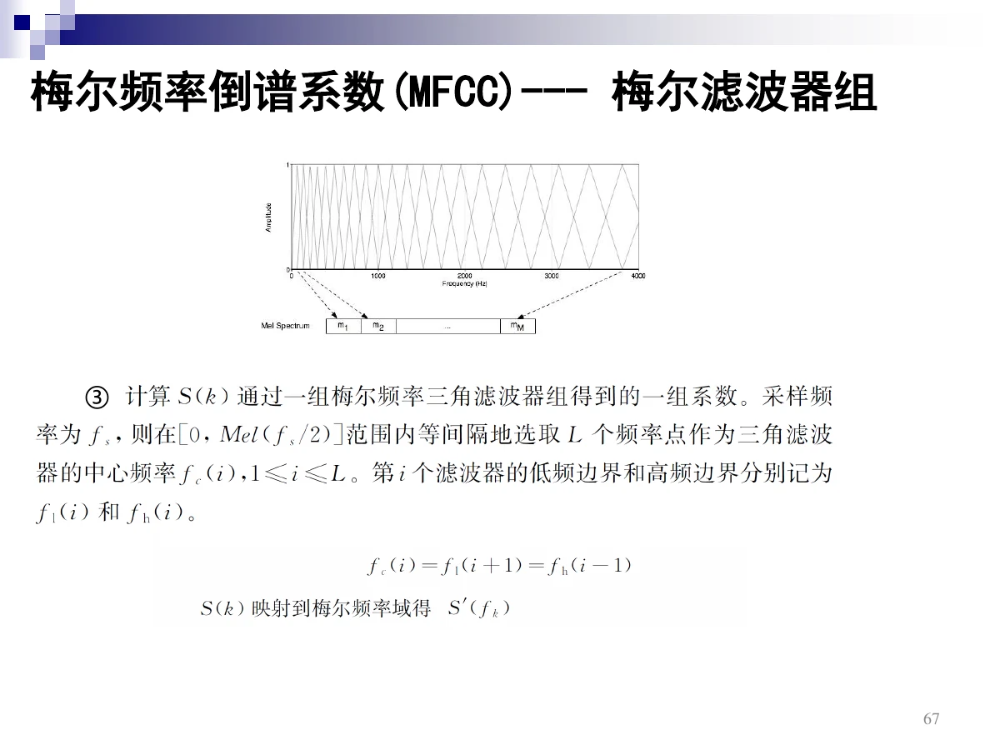

# 2 语音信号处理的基础

一句话：把连续的语音变成**一帧一帧的向量**——先采样分帧加窗，再在**时域**（能量、过零率、自相关）和**频域**（DFT、语谱图）看它，最后提炼成两类特征：**基于产生机理的倒谱 / LPC** 与**基于感知机理的 MFCC**。

## 总览（思维导图）

$$
\text{第 2 章}
\begin{cases}
2.1\ \text{数字化与时频分析}
\begin{cases}
\text{采样定理、奈奎斯特频率}\\
\text{分帧、加窗}\\
\text{时域}:\ \text{短时能量、过零率、短时自相关}\\
\text{频域}:\ \text{DFT、语谱图（宽带 / 窄带）}
\end{cases}\\[4pt]
2.2.1\ \text{产生的数学模型}:\ \text{激励}+\text{声道}+\text{辐射}\\
2.2\ \text{听觉滤波（基本概念）}:\ \text{听觉滤波器、ERB}\\[4pt]
2.3\ \text{基于产生机理}:\ \text{倒谱（掌握）、LPC（掌握）}\\
2.4\ \text{基于感知机理}:\ \text{Mel、MFCC（掌握）}
\end{cases}
$$

## 考点权重

| 模块                 | 真正需要掌握                                      |   优先级 |
| -------------------- | ------------------------------------------------- | -------: |
| 2.1.1 采样/分帧/加窗 | 奈奎斯特与混叠、帧长为什么 20~25 ms、加窗目的     | **最高** |
| 2.1.2 时域分析       | 短时能量、短时平均过零率、短时自相关的公式与性质  | **最高** |
| 2.1.3 频域分析       | DFT 公式、宽带 5 ms / 窄带 40 ms 的分辨率权衡     | **很高** |
| 2.2.1 产生的数学模型 | 激励 / 声道 / 辐射三模型、20 ms 内近似 LTI        |       高 |
| 2.2 听觉滤波         | 听觉滤波器、ERB 公式                              |       高 |
| 2.3.1 倒谱分析       | 定义、为什么要取对数、$n$ 与 $F_0$ 的分界、Lifter | **最高** |
| 2.3.2 线性预测编码   | AR 全极点模型、预测公式与残差、$a_i$ 的含义       | **最高** |
| 2.4.1 MFCC           | Mel 公式 + 提取六步 + $C_0$ 的含义                | **最高** |

已剔除：谐波分析、信号的时间频率特性、语谱图例子、2.3.3 基频提取、2.4.2 PLP，以及 LPC 求解推导等标注「了解」的内容。

# 2.1 数字化与时频分析

## 2.1.1 采样、分帧与加窗

### 奈奎斯特频率与采样定理

- **奈奎斯特频率**：离散信号系统**采样频率的一半**。
- **奈奎斯特—香农采样定理**：给定采样频率 $f_s$，能完全重构的频带限制为 $B\le f_s/2$；只要奈奎斯特频率高于被采样信号的最高频率（带宽），就**不会产生混叠**。

### 分帧

- 语音是**非周期**信号，但在 20~30 ms 内近似**准周期**、特性稳定，所以切成短帧处理。
- 帧与帧之间留**帧移**，相邻帧有重叠，避免边界信息丢失。

**为什么帧长一般取 20~25 ms？** 人的基音范围 80~500 Hz，对应基音周期 **2 ms~12.5 ms**；窗长取 **1~7 个基音周期**，既能包含足够周期数，又不至于跨越音素变化。

### 加窗

目的：**使时域信号更好地满足 DFT 的周期性要求，减少泄漏**。

$$
x'(n)=x(n)w(n)
$$

常用窗：**汉明窗、汉宁窗、矩形窗**（矩形窗旁瓣泄漏大，汉明/汉宁可压低旁瓣）。

## 2.1.2 时域分析

### 短时能量

$$
E_n=\sum_{m=-\infty}^{\infty}\big[x(m)w(n-m)\big]^2
=\sum_{m=-\infty}^{\infty}x^2(m)h(n-m),\quad h(n)=w^2(n)
$$

应用：**浊音与清音的区分**、语音端点检测（有声段 / 无声段）、声母与韵母的分界、情感分类特征。

### 短时平均过零率（ZCR）

定义：信号采样点**符号变化**的次数。

$$
Z=\frac{f_s}{N}\sum_{n=0}^{N-1}\big|\operatorname{sgn}x(n)-\operatorname{sgn}x(n+1)\big|
$$

ZCR 反映主能量区域的平均频率：

| 类型 | ZCR 大致值 |
| ---- | ---------- |
| 浊音 | 约 1400 Hz |
| 清音 | 约 4500 Hz |

应用：浊音/清音的区分、端点检测（**短时能量 + ZCR 结合**）。

### 短时自相关

自相关衡量同一信号在时域内的相似度：

$$
R(i)=\sum_{n=-\infty}^{\infty}x(n)x(n-i),\qquad i=0,1,2,\dots
$$

短时自相关（加短时窗）：

$$
R(m)=\frac{1}{2N-1}\sum_{n=-N+1}^{N-1}x(n)x(n+m),\quad m=0,1,\dots,N-1
$$

性质：

1. **对称性**：$R(m)=R(-m)$。
2. $m=0$ 时取最大值：$\lvert R(m)\rvert\le R(0)$。
3. 白噪声的自相关只在 $m=0$ 处有强峰值，其余为 0。

**为什么能用来分浊音/清音、估周期？** 若 $x(n)$ 是周期信号，$R(i)$ 会在 $i$ 等于**周期整数倍**处取极大值；浊音由声带振动产生、有周期性，清音类似白噪声、无周期性。应用：浊音/清音区分、浊音周期估计。

## 2.1.3 频域分析

为什么要在频域看：① 人耳本身有频谱分析功能；② **时域的卷积在频域变成乘积**，计算更简便。

### DFT 与 IDFT

$$
X(k)=\sum_{n=0}^{N-1}x(n)\exp\!\left(-j\frac{2\pi kn}{N}\right),\quad 0\le k\le N-1
$$

$$
x(n)=\frac{1}{N}\sum_{k=0}^{N-1}X(k)\exp\!\left(j\frac{2\pi kn}{N}\right)
$$

$X(k)$ 是复数序列（含幅度与相位），实际计算用 **FFT** 加速。

### 语谱图

把每一帧的 FFT 幅度按时间顺序排成二维图，就是**语谱图**（横轴时间、纵轴频率、深浅表示能量）。

| 类型 | 带宽 / 窗长   | 分辨率特点                     | 看什么                                               |
| ---- | ------------- | ------------------------------ | ---------------------------------------------------- |
| 宽带 | 200 Hz / 5 ms | 频率分辨率低、**时间分辨率高** | **垂直条纹**，间隔为基音周期；观测共振峰             |
| 窄带 | 25 Hz / 40 ms | 频率分辨率高、时间分辨率低     | **水平条纹**，观测谐波 $H_1,H_2,\dots$；可看基音频率 |

核心权衡：**时间分辨率与频率分辨率不能同时高**，窗越长频率越准、时间越糊。

# 2.2 语音产生与感知的数学模型

## 2.2.1 语音产生的数学模型（基本概念）

语音产生系统的线性模型由三部分组成：

| 模型     | 内容                                               |
| -------- | -------------------------------------------------- |
| 激励模型 | 浊音 → 声门脉冲（准周期脉冲串）；清音 → 随机白噪声 |
| 声道模型 | 谐振腔，用全极点滤波器描述                         |
| 辐射模型 | 唇端辐射，使高频端约每倍频程抬升 6 dB              |

**声源—滤波器模型**：准周期脉冲（或白噪声）经过声道这个滤波器，再经辐射形成语音。

关键近似：**发音器官的运动频率约在 50 Hz 以下，所以可认为声道形状在 20 ms 内稳定不变**；语音生成系统在 **20~30 ms** 区间可用**线性时不变（LTI）系统**近似——这正是“分帧”的物理依据。

## 听觉滤波机理与建模（基本概念）

- **听觉滤波器**：带通滤波器，实现听觉末梢系统中的声学频率分析。
- **ERB（等效矩形带宽）**：由心理物理实验得到的滤波器带宽。
- **$ERB_N$**：听力正常人的 ERB，其传递能量与对应听觉滤波器相同：

$$
ERB_N=24.7\left(4.37\frac{F}{1000}+1\right)
$$

$F$ 是以 Hz 为单位的中心频率。

- **Gammatone 滤波器**：听觉滤波器的冲激响应近似，可用 Gamma 分布与余弦信号的乘积表示，中心频率与带宽随频率变化。

# 2.3 基于语音产生机理的特征

## 2.3.1 倒谱分析（掌握）

### 定义

**倒谱**：信号的傅里叶变换经**对数**运算后，再做**傅里叶反变换**得到的谱（语音中一般先取幅度）。

### 为什么取对数：分离声源与声道

语音序列是声源与声道冲激响应的**卷积**：

$$
x(n)=\sum_{i=-\infty}^{n}s(i)h(n-i)
$$

频域变成乘积：

$$
X(k)=S(k)H(k)\;\Longrightarrow\;\log X(k)=\log S(k)+\log H(k)
$$

再做 IFFT：

$$
C(n)=\frac{1}{2\pi}\int_{-\pi}^{\pi}\big(\log S(k)+\log H(k)\big)e^{j\omega n}\,d\omega
$$

结果落在**类频率（quefrency）**空间，$C(n)$ 称为**倒频谱（cepstrum）**。

### 关键分界

声源频谱 $S(k)$ 的变化比声道频谱 $H(k)$ 快得多，因此：

| 位置          | 对应信息         |
| ------------- | ---------------- |
| $C(n)\ge F_0$ | 声源信息（基音） |
| $C(n)<F_0$    | 声道（系统）信息 |

用 **Lifter** 窗函数把想要的低频部分取出，即得声道包络。

流程：**语音 → 预处理 → 傅里叶变换 → 取对数 → 逆傅里叶变换 → 去掉高阶倒谱 → 傅里叶变换 → 包络**。

## 2.3.2 线性预测编码（掌握）

### 基本思路

把语音 $x(n)$ 看作声源 $s(n)$ 激励一个**全极点（自回归 AR）系统** $H(z)$ 的输出：

$$
H(z)=\frac{G}{1-\sum_{i=1}^{p}a_iz^{-i}}
$$

$G$ 为常数增益，$a_i$ 为实数系数，$p$ 为模型阶数。

### 预测与残差

用前 $p$ 个采样线性组合预测当前值：

$$
\hat x(n)=\sum_{i=1}^{p}a_ix(n-i),\qquad
\varepsilon(n)=x(n)-\hat x(n)=x(n)-\sum_{i=1}^{p}a_ix(n-i)
$$

$\varepsilon(n)$ 是**残差**，$a_i$ 是加权系数。最优 $a_i$ 通过**最小化均方误差** $E[\varepsilon^2(n)]$ 求得（由此得到一组线性方程，可用自相关法求解）。

要点：LPC **直接利用**声源—滤波器模型，得到的是声道滤波器系数；倒谱则是**间接**通过时频分析把声源与声道分开。

# 2.4 基于语音感知机理的特征

## 2.4.1 梅尔频率倒谱系数 MFCC（掌握）

### Mel 尺度

人耳对频率的灵敏度是非线性的，整体呈对数趋势；Mel 频率模拟人耳的感知特性：

$$
\text{Mel}(f)=2595\log_{10}\!\left(1+\frac{f}{700}\right)
$$

### 提取六步

1. **预处理**：预加重（提升高频，补偿辐射造成的 −6 dB/倍频程跌落）→ 分帧 → 加窗，得到帧序列。
2. **DFT**：对每帧做 DFT，取模的平方得到离散能量谱，令 $S(k)=\lvert X(k)\rvert^2$。
3. **Mel 滤波器组**：把能量谱通过一组三角滤波器，得到各 Mel 带的能量 $m(i)$。
4. **取对数**：$\lg[m(i)]$。
5. **DCT（离散余弦变换）**：

$$
C_{\text{MFCC}}(n)=\sum_{i=1}^{L}\lg[m(i)]\cos\!\left(\frac{n(i-0.5)\pi}{L}\right)
$$

6. **取低阶系数**作为特征向量。

### 物理意义与考点

- $C_0$ 是语音的**平均强度**，语音识别中一般**不直接使用**。
- 阶数越高，MFCC 表示越多频谱细节；但**无论是 MFCC 还是 LPC 系数，都不能直接展示共振峰包络的细节**。

# 2.5 本章小结

- 采样要有奈奎斯特频率高于信号带宽，否则混叠。
- 分帧窗长 20~25 ms 对应 1~7 个基音周期；加窗是为了减少泄漏。
- 时域三件套：能量（浊清、端点）、过零率（浊清、端点）、自相关（周期估计）。
- 频域：DFT 得到频谱，语谱图是时频表征；宽带 5 ms 看共振峰与周期性，窄带 40 ms 看谐波与基音。
- 倒谱用“取对数把卷积变加法”分离声源与声道，$F_0$ 是分界。
- LPC 用全极点 AR 模型直接建模声道。
- MFCC = Mel 刻度 + 倒谱思路，六步流程必须能默写。

# 2.6 考前速查表

| 题目出现                                          | 立刻想到                                    |
| ------------------------------------------------- | ------------------------------------------- |
| 采样频率的一半                                    | 奈奎斯特频率；$B\le f_s/2$ 才不混叠         |
| 为什么帧长取 20~25 ms                             | 1~7 个基音周期（80~500 Hz，周期 2~12.5 ms） |
| 加窗的目的                                        | 满足 DFT 周期性要求、减少泄漏               |
| $E_n=\sum x^2(m)h(n-m)$                           | 短时能量（$h=w^2$）                         |
| 浊音/清音 ZCR 约 1400 / 4500 Hz                   | 过零率                                      |
| $R(m)=R(-m)$、$m=0$ 最大、白噪声只在 0 有峰       | 短时自相关的三条性质                        |
| 时域卷积 = 频域乘积                               | 为什么要做频域分析                          |
| 宽带 200 Hz / 5 ms                                | 垂直条纹（间隔为基音周期），看共振峰        |
| 窄带 25 Hz / 40 ms                                | 水平条纹，看谐波与基音频率                  |
| 激励 + 声道 + 辐射                                | 语音产生的线性模型                          |
| 20~30 ms 内可用 LTI 近似                          | 声道形状在 20 ms 内近似不变                 |
| $ERB_N=24.7(4.37F/1000+1)$                        | 听觉滤波器的等效矩形带宽                    |
| 取对数把卷积变加法                                | 倒谱的定义与动机                            |
| $C(n)\ge F_0$ / $<F_0$                            | 声源信息 / 声道信息                         |
| 类频率 quefrency、Lifter                          | 倒谱域与倒谱窗                              |
| $H(z)=G/(1-\sum a_iz^{-i})$                       | LPC 的 AR 全极点模型                        |
| 最小化 $E[\varepsilon^2]$                         | LPC 求 $a_i$ 的准则                         |
| 预加重 → 分帧加窗 → DFT → Mel 滤波 → 取对数 → DCT | MFCC 六步                                   |
| $C_0$ 是平均强度、识别中不用                      | MFCC 系数的物理意义                         |
| MFCC / LPC 都看不到共振峰包络细节                 | 特征能力边界                                |
