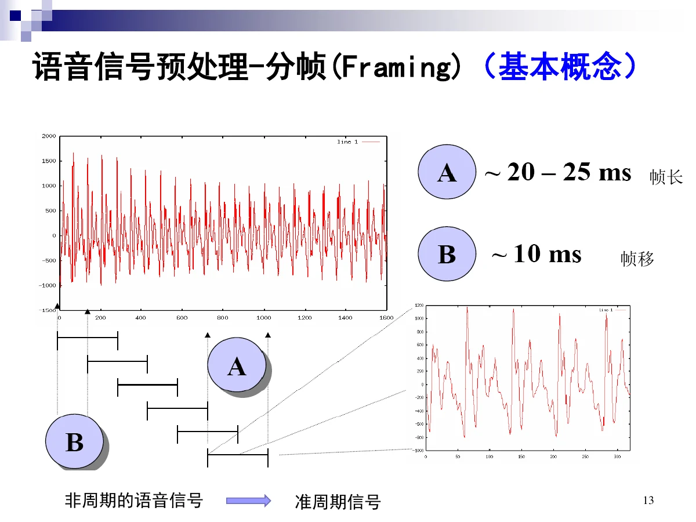
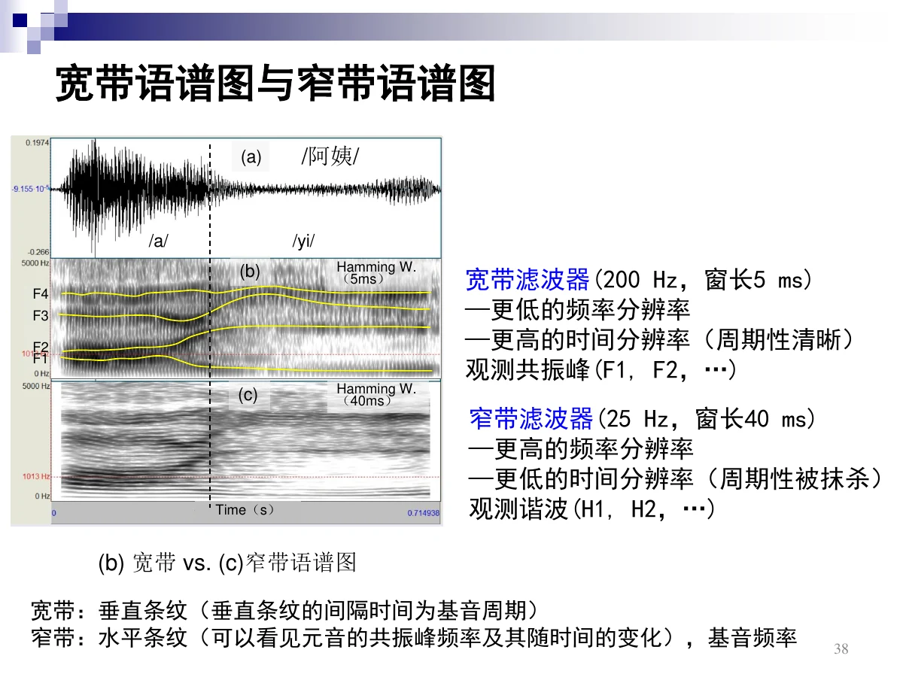
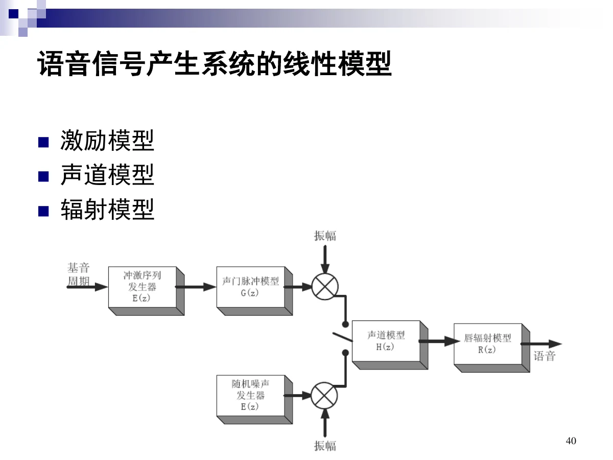
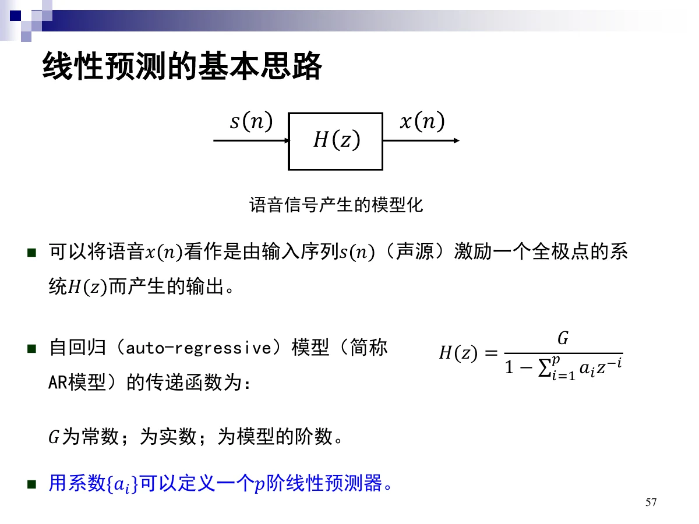
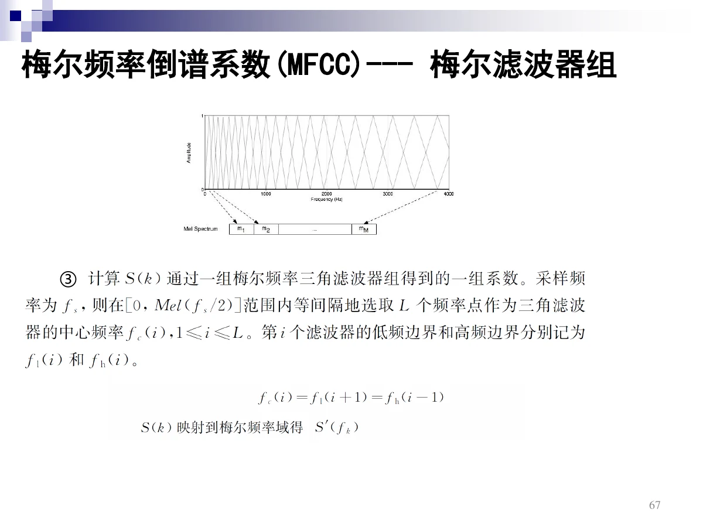

# 2 语音信号处理的基础

一句话：把连续的语音变成**一帧一帧的向量**——先采样分帧加窗，再在**时域**（能量、过零率、自相关）和**频域**（DFT（Discrete Fourier Transform，离散傅里叶变换）、语谱图）看它，最后提炼成两类特征：**基于产生机理的倒谱 / LPC（Linear Predictive Coding，线性预测编码）** 与**基于感知机理的 MFCC（Mel-Frequency Cepstral Coefficients，梅尔频率倒谱系数）**。

## 0 读这一章之前

- **前置知识**：只需知道「频率」= 每秒振动多少次（单位 Hz）。
- 本章只干一件事：把连续的声音切成 20 毫秒的小段，每段算出一组数字。
- 要建立的三个直觉：**采样**是把时间切成格子、**帧**是把语音切成小段、**窗**是让切面不要那么硬。
- 公式看着多，其实都在回答同一句话：「这一小段声音，用几个数怎么描述」。

## 总览（思维导图）

$$
\text{第 2 章}
\begin{cases}
2.1\ \text{数字化与时频分析}
\begin{cases}
\text{采样}:\ \text{奈奎斯特频率}=f_s/2;\ B\le f_s/2\ \text{才不混叠（8k / 16k / 44.1k）}\\
\text{分帧}:\ \text{帧长 20\text{~}25ms（1\text{~}7 个基音周期）}+\text{帧移重叠}\\
\text{加窗}:\ \text{满足 DFT 周期性、减少泄漏（汉明 / 汉宁 / 矩形）}\\
\text{时域}:\ E_n=\sum x^2(m)h(n-m);\ \text{ZCR（浊}\approx1400\text{ / 清}\approx4500\,\text{Hz）};\\
\quad\ \ R(m)\ \text{三性质（对称、}m=0\text{ 最大、白噪声仅 0 有峰）}\to\text{周期估计}\\
\text{频域}:\ \text{DFT/IDFT（FFT 加速）；语谱图：宽带 5ms 竖纹看共振峰，窄带 40ms 横纹看谐波}
\end{cases}\\[4pt]
2.2\ \text{数学模型}
\begin{cases}
\text{产生模型}:\ \text{激励（脉冲/白噪）}+\text{声道（全极点）}+\text{辐射（+6dB/倍频程）}\\
\text{关键近似}:\ \text{声道 20ms 内形状不变}\Rightarrow\text{LTI}\\
\text{听觉滤波}:\ \text{听觉滤波器（带通）}, ERB_N=24.7(4.37F/1000+1), \text{Gammatone}
\end{cases}\\[4pt]
2.3\ \text{基于产生机理的特征}
\begin{cases}
\text{倒谱（掌握）}:\ \text{取对数把卷积变加法}\to\text{IFFT}\\
\quad C(n)\ge F_0\ \text{声源（基音）}, \ C(n)<F_0\ \text{声道（包络）}, \ \text{Lifter 取低频}\\
\text{LPC（掌握）}:\ H(z)=\dfrac{G}{1-\sum_{i=1}^{p}a_iz^{-i}}\ \text{全极点 AR 直接建模声道；最小化残差均方误差求}\ a_i
\end{cases}\\[4pt]
2.4\ \text{基于感知机理的特征}
\begin{cases}
\text{Mel}:\ \text{Mel}(f)=2595\log_{10}(1+f/700)\\
\text{MFCC 六步（掌握）}:\ \text{预加重分帧加窗}\to\text{DFT 取能量谱}\to\text{Mel 三角滤波}\\
\quad\to\text{取对数}\to\text{DCT}\to\text{取低阶系数；}C_0\text{=平均强度（识别不用）}\\
\text{边界}:\ \text{MFCC / LPC 都不能直接展示共振峰包络细节}
\end{cases}
\end{cases}
$$

## 考点权重

| 模块                 | 真正需要掌握                                      |   优先级 |
| -------------------- | ------------------------------------------------- | -------: |
| 2.1.1 采样/分帧/加窗 | 奈奎斯特与混叠、帧长为什么 20~25 ms、加窗目的     | **最高** |
| 2.1.2 时域分析       | 短时能量、短时平均过零率、短时自相关的公式与性质  | **最高** |
| 2.1.3 频域分析       | DFT 公式、宽带 5 ms / 窄带 40 ms 的分辨率权衡     | **很高** |
| 2.2.1 产生的数学模型 | 激励 / 声道 / 辐射三模型、20 ms 内近似 LTI（线性时不变）        |       高 |
| 2.2 听觉滤波         | 听觉滤波器、ERB 公式                              |       高 |
| 2.3.1 倒谱分析       | 定义、为什么要取对数、$n$ 与 $F_0$ 的分界、Lifter | **最高** |
| 2.3.2 线性预测编码   | AR 全极点模型、预测公式与残差、$a_i$ 的含义       | **最高** |
| 2.4.1 MFCC           | Mel 公式 + 提取六步 + $C_0$ 的含义                | **最高** |
| 2.2 双耳声源定位     | ITD 适用低频 <800Hz、IID 适用高频 >1600Hz         |     高   |

已按 PPT 标记剔除（标注「了解」）：语音信号的数字化细节、谐波分析、信号的时间频率特性、语谱图例子、语音感知的数学模型、听觉滤波（续）、2.3.3 基频提取、LPC 求解推导（Yule-Walker 方程）、2.4.2 PLP。

# 2.1 数字化与时频分析

## 2.1.1 采样、分帧与加窗

### 奈奎斯特频率与采样定理

> **人话**：采样像拍快动作，每秒拍得够多，才不会把快速振动拍成慢动作（混叠）。

- **奈奎斯特频率**：离散信号系统**采样频率的一半**。
- **奈奎斯特—香农采样定理**：给定采样频率 $f_s$，能完全重构的频带限制为 $B\le f_s/2$；只要奈奎斯特频率高于被采样信号的最高频率（带宽），就**不会产生混叠**。

### 分帧

> **人话**：语音一直在变，但 20 毫秒内几乎不变，所以切成小段单独看。

- 语音是**非周期**信号，但在 20~30 ms 内近似**准周期**、特性稳定，所以切成短帧处理。
- 帧与帧之间留**帧移**，相邻帧有重叠，避免边界信息丢失。

**为什么帧长一般取 20~25 ms？** 人的基音范围 80~500 Hz，对应基音周期 **2 ms~12.5 ms**；窗长取 **1~7 个基音周期**，既能包含足够周期数，又不至于跨越音素变化。

### 加窗

> **人话**：直接截一小段会在边界产生「突然断开」的假象，加个两头渐弱的窗来减轻它。

目的：**使时域信号更好地满足 DFT 的周期性要求，减少泄漏**。

$$
x'(n)=x(n)w(n)
$$

常用窗：**汉明窗、汉宁窗、矩形窗**（矩形窗旁瓣泄漏大，汉明/汉宁可压低旁瓣）。

## 2.1.2 时域分析

### 短时能量

> **人话**：这一小段有多响。

$$
E_n=\sum_{m=-\infty}^{\infty}\big[x(m)w(n-m)\big]^2
=\sum_{m=-\infty}^{\infty}x^2(m)h(n-m),\quad h(n)=w^2(n)
$$

应用：**浊音与清音的区分**、语音端点检测（有声段 / 无声段）、声母与韵母的分界、情感分类特征。

### 短时平均过零率（ZCR）

> **人话**：波形一秒穿过零点几次；穿得越勤，听起来越「嘶」。

定义：信号采样点**符号变化**的次数。

$$
Z=\frac{f_s}{N}\sum_{n=0}^{N-1}\big|\operatorname{sgn}x(n)-\operatorname{sgn}x(n+1)\big|
$$

ZCR（Zero-Crossing Rate，过零率）反映主能量区域的平均频率：

| 类型 | ZCR 大致值 |
| ---- | ---------- |
| 浊音 | 约 1400 Hz |
| 清音 | 约 4500 Hz |

应用：浊音/清音的区分、端点检测（**短时能量 + ZCR 结合**）。

### 短时自相关

> **人话**：把这段声音和自己错开一点比相似度；错开正好一个周期时最像。

自相关衡量同一信号在时域内的相似度：

$$
R(i)=\sum_{n=-\infty}^{\infty}x(n)x(n-i),\qquad i=0,1,2,\dots
$$

短时自相关（加短时窗）：

$$
R(m)=\frac{1}{2N-1}\sum_{n=-N+1}^{N-1}x(n)x(n+m),\quad m=0,1,\dots,N-1
$$

性质：

1. **对称性**：$R(m)=R(-m)$。
2. $m=0$ 时取最大值：$\lvert R(m)\rvert\le R(0)$。
3. 白噪声的自相关只在 $m=0$ 处有强峰值，其余为 0。

**为什么能用来分浊音/清音、估周期？** 若 $x(n)$ 是周期信号，$R(i)$ 会在 $i$ 等于**周期整数倍**处取极大值；浊音由声带振动产生、有周期性，清音类似白噪声、无周期性。应用：浊音/清音区分、浊音周期估计。

## 2.1.3 频域分析

为什么要在频域看：① 人耳本身有频谱分析功能；② **时域的卷积在频域变成乘积**，计算更简便。

### DFT 与 IDFT

> **人话**：把「每刻多响」换算成「每个频率各多响」，反变换再换回来。

$$
X(k)=\sum_{n=0}^{N-1}x(n)\exp\!\left(-j\frac{2\pi kn}{N}\right),\quad 0\le k\le N-1
$$

$$
x(n)=\frac{1}{N}\sum_{k=0}^{N-1}X(k)\exp\!\left(j\frac{2\pi kn}{N}\right)
$$

$X(k)$ 是复数序列（含幅度与相位），实际计算用 **FFT（Fast Fourier Transform，快速傅里叶变换）** 加速。

### 语谱图

> **人话**：逐帧做 DFT，再把结果按时间从左排到右，就成了图。

把每一帧的 FFT 幅度按时间顺序排成二维图，就是**语谱图**（横轴时间、纵轴频率、深浅表示能量）。

| 类型 | 带宽 / 窗长   | 分辨率特点                     | 看什么                                               |
| ---- | ------------- | ------------------------------ | ---------------------------------------------------- |
| 宽带 | 200 Hz / 5 ms | 频率分辨率低、**时间分辨率高** | **垂直条纹**，间隔为基音周期；观测共振峰             |
| 窄带 | 25 Hz / 40 ms | 频率分辨率高、时间分辨率低     | **水平条纹**，观测谐波 $H_1,H_2,\dots$；可看基音频率 |

核心权衡：**时间分辨率与频率分辨率不能同时高**，窗越长频率越准、时间越糊。

# 2.2 语音产生与感知的数学模型

## 2.2.1 语音产生的数学模型（基本概念）

> **人话**：把发声拆成三个零件：声源、声道、嘴唇。

语音产生系统的线性模型由三部分组成：

| 模型     | 内容                                               |
| -------- | -------------------------------------------------- |
| 激励模型 | 浊音 → 声门脉冲（准周期脉冲串）；清音 → 随机白噪声 |
| 声道模型 | 谐振腔，用全极点滤波器描述                         |
| 辐射模型 | 唇端辐射，使高频端约每倍频程抬升 6 dB              |

**声源—滤波器模型**：准周期脉冲（或白噪声）经过声道这个滤波器，再经辐射形成语音。

关键近似：**发音器官的运动频率约在 50 Hz 以下，所以可认为声道形状在 20 ms 内稳定不变**；语音生成系统在 **20~30 ms** 区间可用**线性时不变（LTI，Linear Time-Invariant）系统**近似——这正是“分帧”的物理依据。

## 听觉滤波机理与建模（基本概念）

> **人话**：人耳的分辨率随频率变差，ERB（Equivalent Rectangular Bandwidth，等效矩形带宽）就是在量这个「分辨率」。

- **听觉滤波器**：带通滤波器，实现听觉末梢系统中的声学频率分析。
- **ERB（等效矩形带宽）**：由心理物理实验得到的滤波器带宽。
- **$ERB_N$**：听力正常人的 ERB，其传递能量与对应听觉滤波器相同：

$$
ERB_N=24.7\left(4.37\frac{F}{1000}+1\right)
$$

$F$ 是以 Hz 为单位的中心频率。

- **Gammatone 滤波器**：听觉滤波器的冲激响应近似，可用 Gamma 分布与余弦信号的乘积表示，中心频率与带宽随频率变化。

### 双耳声源定位及麦克风阵列（基本概念）

> **人话**：两只耳朵怎么知道声音从哪来？低频靠时间差，高频靠强度差。

声音定位是听者在方向和距离上识别声音来源的能力。

| 线索 | 机制 | 适用频段 |
| ---- | ---- | -------- |
| 两耳时间差 ITD（Interaural Time Difference） | 来自右侧的声音先到达右耳 | **低频 <800 Hz** |
| 两耳声强差 IID（Interaural Intensity Difference） | 头部遮挡使远侧耳朵强度更低 | **高频 >1600 Hz** |

这是第 5 章麦克风阵列波束形成的生理原型。

# 2.3 基于语音产生机理的特征

## 2.3.1 倒谱分析（掌握）

### 定义

> **人话**：倒谱的关键动作只有一步：取对数，把「相乘」变成「相加」。

**倒谱**：信号的傅里叶变换经**对数**运算后，再做**傅里叶反变换**得到的谱（语音中一般先取幅度）。

### 为什么取对数：分离声源与声道

> **人话**：声源和声道在频域是相乘的，取对数就变成相加，于是能分开拿走。

语音序列是声源与声道冲激响应的**卷积**：

$$
x(n)=\sum_{i=-\infty}^{n}s(i)h(n-i)
$$

频域变成乘积：

$$
X(k)=S(k)H(k)\;\Longrightarrow\;\log X(k)=\log S(k)+\log H(k)
$$

再做 IFFT（Inverse Fast Fourier Transform，快速傅里叶逆变换）：

$$
C(n)=\frac{1}{2\pi}\int_{-\pi}^{\pi}\big(\log S(k)+\log H(k)\big)e^{j\omega n}\,d\omega
$$

结果落在**类频率（quefrency）**空间，$C(n)$ 称为**倒频谱（cepstrum）**。

### 关键分界

> **人话**：靠前的部分是声道（像哪个音），靠后的部分是声源（音有多高）。

声源频谱 $S(k)$ 的变化比声道频谱 $H(k)$ 快得多，因此：

| 位置          | 对应信息         |
| ------------- | ---------------- |
| $C(n)\ge F_0$ | 声源信息（基音） |
| $C(n)<F_0$    | 声道（系统）信息 |

用 **Lifter** 窗函数把想要的低频部分取出，即得声道包络。

流程：**语音 → 预处理 → 傅里叶变换 → 取对数 → 逆傅里叶变换 → 去掉高阶倒谱 → 傅里叶变换 → 包络**。

## 2.3.2 线性预测编码（掌握）

### 基本思路

> **人话**：用一个全极点滤波器冒充声道，解出的系数就是声道的「指纹」。

把语音 $x(n)$ 看作声源 $s(n)$ 激励一个**全极点（自回归 AR，Auto-Regressive）系统** $H(z)$ 的输出：

$$
H(z)=\frac{G}{1-\sum_{i=1}^{p}a_iz^{-i}}
$$

$G$ 为常数增益，$a_i$ 为实数系数，$p$ 为模型阶数。

### 预测与残差

> **人话**：用前 p 个采样去猜当前值，猜不准的那部分叫残差。

用前 $p$ 个采样线性组合预测当前值：

$$
\hat x(n)=\sum_{i=1}^{p}a_ix(n-i),\qquad
\varepsilon(n)=x(n)-\hat x(n)=x(n)-\sum_{i=1}^{p}a_ix(n-i)
$$

$\varepsilon(n)$ 是**残差**，$a_i$ 是加权系数。最优 $a_i$ 通过**最小化均方误差** $E[\varepsilon^2(n)]$ 求得（由此得到一组线性方程，可用自相关法求解）。

要点：LPC **直接利用**声源—滤波器模型，得到的是声道滤波器系数；倒谱则是**间接**通过时频分析把声源与声道分开。

# 2.4 基于语音感知机理的特征

## 2.4.1 梅尔频率倒谱系数 MFCC（掌握）

### Mel 尺度

人耳对频率的灵敏度是非线性的，整体呈对数趋势；Mel 频率模拟人耳的感知特性：

$$
\text{Mel}(f)=2595\log_{10}\!\left(1+\frac{f}{700}\right)
$$

### 提取六步

> **人话**：一串固定工序：从一段波形，算出十几个数。

1. **预处理**：预加重（提升高频，补偿辐射造成的 −6 dB/倍频程跌落）→ 分帧 → 加窗，得到帧序列。
2. **DFT**：对每帧做 DFT，取模的平方得到离散能量谱，令 $S(k)=\lvert X(k)\rvert^2$。
3. **Mel 滤波器组**：把能量谱通过一组三角滤波器，得到各 Mel 带的能量 $m(i)$。
4. **取对数**：$\lg[m(i)]$。
5. **DCT（Discrete Cosine Transform，离散余弦变换）**：

$$
C_{\text{MFCC}}(n)=\sum_{i=1}^{L}\lg[m(i)]\cos\!\left(\frac{n(i-0.5)\pi}{L}\right)
$$

6. **取低阶系数**作为特征向量。

### 物理意义与考点

> **人话**：$C_0$ 代表总音量，阶数越高细节越多，但都看不到共振峰包络的细节。

- $C_0$ 是语音的**平均强度**，语音识别中一般**不直接使用**。
- 阶数越高，MFCC 表示越多频谱细节；但**无论是 MFCC 还是 LPC 系数，都不能直接展示共振峰包络的细节**。

