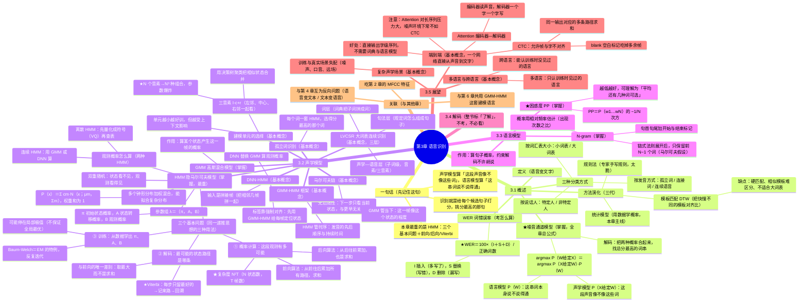

# 3 语音识别

一句话：识别就是求 $\arg\max_W P(X\mid W)P(W)$——**声学模型**算“这段声音像不像这个词”，**语言模型**算“这个词串说不说得通”，**解码**把两者合成最优句子。本章考得最重的是 **HMM（Hidden Markov Model，隐马尔可夫模型）的三个基本问题与前向/后向/Viterbi**。

## 0 读这一章之前

- **前置知识**：只要求知道「概率」大概是什么，以及「求和」和「取最大」的区别。
- 整章可以压缩成一句话：**给每个候选句子打个分，挑分最高的**。声学模型算「像不像」，语言模型算「通不通」。
- 三个新词：**HMM**（看不见的状态推动看得见的声音）、**声学模型**、**语言模型**。
- 公式集中在 HMM 三件套：前向、后向、Viterbi。它们只是同一个递推思想的不同用法（求和 vs 取最大）。

## 总览（思维导图）

## 考点权重

| 模块 | 真正要掌握的内容 | 优先级 |
| --- | --- | ---: |
| 3.1.1 基本概念 | ASR 定义与用途、三种分类维度、WER 计算与它的缺点 | 高 |
| 3.1.2 方法回顾 | 方法演化、规则法的毛病、DTW 思路与缺点、统计框架三件套、噪音通道模型 | 高 |
| 3.2.1 HMM | 双重随机、参数组、三个基本问题、前向/后向/ Viterbi / Baum-Welch 各解决什么 | **最高** |
| 3.2.2 GMM-HMM | GMM 为什么能描述语音、观测概率、孤立词、LVCSR 三层、建模单元、三音素与决策树 | **很高** |
| 3.2.3 DNN-HMM | 用 DNN 替换 GMM、输入/输出/强制对齐、为什么要预训练 | **很高** |
| 3.3 语言模型 | 语言模型的作用、困惑度、N-gram 近似与概率估计、为什么要平滑 | **很高** |
| 3.5 展望 | CTC 为什么被提出、Attention 与 CTC 的差别、多语言 vs 跨语言 | 高 |

# 3.1 语音识别概述

## 3.1.1 基本概念

**定义**：**自动语音识别（Automatic Speech Recognition, ASR）** 是机器通过识别把人类的语音信号转变为相应文本的技术，是语音信息处理最核心的方法。识别结果可以作为**最终输出（转写，Dictation）**，也可以作为**自然语言处理**（对话系统、机器翻译）的输入。

**技术脉络**（一句话记住演化）：70 年代主流是**模板匹配**；80 年代起转向**统计模型**；2010 年前 **GMM-HMM** 是经典声学模型；2010 年前后 **DNN-HMM** 逐步替代 GMM-HMM；2015 年前后**端到端**成为主流；2023 年后**语音大模型**成为热点。

### 分类（三个维度）

| 维度 | 取值 |
| --- | --- |
| 按发音方式 | **孤立词**（isolated words）、**连接词**（connected words）、**连续语音**（continuous speech） |
| 按词汇表大小 | 小（10~100 词条）、中（100~1000）、大（1000 以上） |
| 按说话人 | **特定说话人**（speaker-dependent，只能识别固定某人）、**非特定说话人**（speaker-independent，能识别任意人） |

### 评价指标：单词错误率 WER

把识别结果与正确文本对齐，数出三类错误：**插入 I**、**置换 S**、**删除 D**：

$$
\text{WER}=\frac{100\times(\#\text{Insertions}+\#\text{Substitutions}+\#\text{Deletions})}{\text{Total Words in Correct Transcript}}
$$

**PPT 的对齐示例**：

| | 词序列 |
| --- | --- |
| REF | portable \* PHONE UPSTAIRS last night so（共 6 个词） |
| HYP | portable FORM OF STORES last night so |
| 判定 | — **S** **I** **S** — — — |

替换 2（FORM 顶 PHONE、STORES 顶 UPSTAIRS）、插入 1（OF）、删除 0 → $\text{WER}=100\times(1+2+0)/6=50\%$。

> ❓ **问题（PPT 第 11 页）：单词错误率评价指标的缺点？有没有其他更合适的评价指标？**
>
> **参考解答**：WER 的缺点是**对所有词一视同仁**——不管这个词是实词还是虚词、是否影响语义，错了都记 1 次；也**不考虑错误的严重程度**（把「福州」听成「湖州」和把「的」听成「得」代价完全不同）；它还与**可懂度**不完全一致，WER 低不一定更好懂。更合适的指标有：**字错误率 CER**（中文按字计）、**句错误率 SER**、**关键词错误率 KER**（只统计关键词）、以及面向语义的指标如 **BERTScore / 语义 WER**、**意图理解准确率**；工程上还常配合**可懂度主观测评**一起看。

## 3.1.2 方法回顾

**方法演化三段**：启发式（Heuristic）的**规则法** → 模板匹配（Template matching，确定性的、数据驱动）→ **统计模型**（概率的、数据驱动），三者都属于**模式识别方法**。

**基于规则**：靠**语音学**（发音、声学、听觉等物理/生理特性）、**音韵学**（音位与区别特征在语言中的抽象规则）、**语法**（词法+句法，词如何组合成更大单位）、**语用学**（语境中的用法、言外之意）来指导识别。**缺点：规则难以表达，也难以知道如何提升性能。**

**基于数据驱动**：特征提取（LPC、MFCC 等）→ 模式匹配（DTW、HMM、深度学习）→ 识别结果，参考模板/声学模型来自数据。

### 基于模板匹配：DTW

> **人话**：同一句话两个人说得快慢不同，先拉伸对齐，再逐点比较。

概念：把**输入模板**与**参考模板**逐一比较，找最相似的。问题是两段语音长度不同（$I\ne J$），**直接线性对齐显然不行**（快慢不一样，点对不上）——经典解法是**动态时间弯折/归正（DTW）**：把时间归正与距离测度结合起来的非线性归正技术，用**动态规划（DP）**把复杂的全局问题化成许多局部最优决策。

**做法**：每一条从 $(1,1)$ 到 $(I,J)$ 的路径代表一种对齐情况，路径的累计距离称为**代价**；在所有（受局部路径约束的）路径中，**代价最小的那条就是最优对齐路径**，最后用路径权重之和 $\sum W$ 归正。

- 约束：起点/终点限制、连续性限制（每步只能走到 $(i-1,j)$、$(i,j-1)$、$(i-1,j-1)$）、平行四边形区域限制；
- 递推：$g(i,j)=\min\{g(i-1,j)+dW_1,\; g(i-1,j-1)+dW_2,\; g(i,j-1)+dW_3\}$，一般取 $W_1=W_3=1$、$W_2=2$；
- 回溯：从 $(I,J)$ 沿记录的来路 $p(i,j)$ 退回 $(1,1)$，得到全部匹配点对（求平均模板/聚类中心时必需，识别时往往可跳过）。

**缺点**（也是转向统计模型的理由）：很难区分非常类似的模板（**硬匹配**）；输入与模板的声学条件不同时性能急剧下降（**缺少多样性**）；没有充分利用语音的时序动态信息；**无法利用语言模型**；不利于大词汇量连续语音识别（LVCSR）。

### 基于统计模型的框架（重点掌握）

> **人话**：声学模型管「这段声音像不像这个词」，语言模型管「这个说法通不通」。

框架三件套：**声学模型** $P(X\mid W)$ + **词典**（词怎么由音素拼成）+ **语言模型** $P(W)$；**前端处理**（Front-end）做**语音增强 + 特征抽取**，**后端处理**（Back-end）做**解码**。

> ❓ **问题（PPT 第 26 页）：什么是声学模型？**
>
> **参考解答**：声学模型是**计算发音相似度的模型**——它给出「给定词串 $W$，产生观测特征 $X$ 的概率」$P(X\mid W)$，也就是判断这段声学特征像不像这么一串发音。工程上它由 HMM（管时序）加 GMM/DNN（管每帧特征的分布或后验）构成。

**声学模型的演进**：GMM-HMM（观察值特征 → 观察值概率 + 状态转移概率）→ DNN-HMM（用 DNN 算观察值概率）→ **端到端模型**（不再需要语言模型和词典）。

### 噪音通道模型（掌握）

> **人话**：把识别想成：听到的是原文被通道弄脏后的版本，反过来推原文。

源句子经「噪音通道」变成带噪句子/观测，解码就是搜索所有可能的句子、找出最优解：本质是求 $\arg\max_W P(W\mid X)$。用贝叶斯法则：

$$
\arg\max_W P(W\mid X)=\arg\max_W\frac{P(X\mid W)P(W)}{P(X)}
$$

因为 $P(X)$ 与 $W$ 无关，可去掉分母，于是 **识别 = 在候选词串里挑「声学似然 × 语言概率」最大的那一个**：$P(X\mid W)$ 是声学模型，$P(W)$ 是语言模型。

# 3.2 声学模型

## 3.2.1 隐马尔可夫模型（掌握）

### 马尔可夫链（基本概念）

**马尔可夫链**：一种离散状态的马尔可夫过程（序列），状态空间中状态到状态的转换是随机的。性质：状态空间有限或可列；离散时间随机过程；具有**马尔可夫性质（无后效性）**——给定当前状态，过去对预测将来无关。

定义：$P(q_t=s_j\mid q_{t-1}=s_i,q_{t-2}=s_k,\dots)=P(q_t=s_j\mid q_{t-1}=s_i)$，即**系统在 $t$ 时刻的状态只与 $t-1$ 时刻的状态有关**（一阶马尔可夫链）。

### HMM 的定义与参数（基本概念）

实际问题中，**观察到的事件并不与状态一一对应**，而是通过一组概率分布相联系。HMM 用**双重随机过程**描述：一个是 Markov 链，描述**状态转移（不可见）**；另一个随机过程描述**状态与观察值之间的统计对应关系（可见）**。因为状态不可见，所以称「隐」。HMM 由 Baum 等人在 20 世纪 70 年代提出。

**参数组** $\lambda=(S,V,\pi,A,B)$，简写 $\lambda=(\pi,A,B)$：

| 参数 | 含义 |
| --- | --- |
| 状态集合 $S=\{s_j\}$ | $N$ 个隐藏状态，状态间满足马尔可夫性质，**不可直接观测** |
| 观测值集合 $V=\{v_1,\dots,v_K\}$ | 每个状态对应的可能观测值，$K$ 为取值个数，**可直接观测** |
| 初始状态概率 $\pi=[\pi_i]$ | $\pi_i=P(q_1=i)$ |
| 状态转移矩阵 $A=[a_{ij}]$ | $a_{ij}$：$t-1$ 时刻在 $s_i$、$t$ 时刻转到 $s_j$ 的概率 |
| 观测值概率矩阵 $B=[b_j(k)]$ | $b_j(k)=P(o_t=v_k\mid q_t=j)$，即状态 $s_j$ 下吐出观测 $v_k$ 的概率 |

### 三个基本问题（基本概念）

| 问题 | 内容 | 解法 |
| --- | --- | --- |
| 问题 1 模型概率计算 | 给定 $\lambda$ 与 $O$，求 $P(O\mid\lambda)$ | **前向算法**、后向算法 |
| 问题 2 模型解码 | 给定 $\lambda$ 与 $O$，求最佳状态序列 $Q^*$ | **Viterbi 算法** |
| 问题 3 参数估计 | 给定 $O$，调整 $\lambda$ 使 $P(O\mid\lambda)$ 最大 | **Baum-Welch 算法** |

### 前向算法（掌握）

> **人话**：从左往右逐帧走，把「所有能走到这里的路径」的概率加起来。

**前向变量** $\alpha_t(i)=P(o_1o_2\cdots o_t,\ q_t=i\mid\lambda)$：到 $t$ 时刻为止、观测是前 $t$ 帧且此刻在状态 $i$ 的概率。它有三个好处：初值易求、有递推关系、能算出总概率：

- 初始化：$\alpha_1(i)=\pi_ib_i(o_1)$
- 递推：$\alpha_t(j)=\left[\sum_{i=1}^{N}\alpha_{t-1}(i)a_{ij}\right]b_j(o_t)$（**对所有状态求和**）
- 终止：$P(O\mid\lambda)=\sum_{i=1}^{N}\alpha_T(i)$

> ❓ **问题（PPT 第 49 页）：前向算法的计算量是多少？**
>
> **参考解答**：**$O(N^2T)$**——每一帧、每个状态都要把 $N$ 个前驱状态求和，共 $T$ 帧。当 $N=5$、$T=100$ 时只需约 **2500 次乘法**，而暴力枚举所有路径是 $N^T$ 量级。**「求和」正是前向算法把指数复杂度压成线性的关键。**

### 后向算法（掌握）

**后向变量** $\beta_t(i)=P(o_{t+1}o_{t+2}\cdots o_T\mid q_t=i,\lambda)$：站在 $t$ 时刻状态 $i$、**之后**那几帧观测出现的概率。

- 初始化：$\beta_T(i)=1$（后面没有观测了）
- 递推：$\beta_t(i)=\sum_{j=1}^{N}\beta_{t+1}(j)a_{ij}b_j(o_{t+1})$（从后往前）
- 终止：$P(O\mid\lambda)=\sum_{i=1}^{N}\pi_ib_i(o_1)\beta_1(i)$，计算量同为 $N^2T$ 量级

**前向管前边（1→t），后向管后边（t+1→T）**，两者相乘就是「时刻 $t$ 处在状态 $i$、且整段观测都出现的概率」，Baum-Welch 重估参数用的正是它。

### 模型解码与 Viterbi（掌握）

> **人话**：同样逐帧推进，但每步只留最好的那条路，最后回溯出来。

**解码问题**：确定最佳状态序列 $Q^*$，使 $P(O,Q^*\mid\lambda)$ 最大——注意它要的是**一条最好的路径**，而不是所有路径之和。

定义 $\delta_t(i)=\max_{q_1\cdots q_{t-1}}P(q_1\cdots q_{t-1},q_t=i,o_1\cdots o_t\mid\lambda)$：沿某条路径在 $t$ 时刻走到状态 $i$、并产生前 $t$ 帧观测的**最大概率**。Viterbi 四步：

1. **初始化**：$\delta_1(i)=\pi_ib_i(o_1)$，$\varphi_1(i)=0$；
2. **递推**：$\delta_t(j)=\max_i[\delta_{t-1}(i)a_{ij}]\,b_j(o_t)$，同时记录 $\varphi_t(j)=\arg\max_i[\delta_{t-1}(i)a_{ij}]$（**取最大 + 记来路**）；
3. **终止**：$P^*=\max_i\delta_T(i)$，$q_T^*=\arg\max_i\delta_T(i)$；
4. **回溯**：$q_t^*=\varphi_{t+1}(q_{t+1}^*)$，$t=T-1,\dots,1$，得整条最优状态序列。

**与前向的唯一区别**：前向是**求和**（所有路径），Viterbi 是**取最大**（一条最优路径）。

### Baum-Welch 算法（基本概念）

给定观测序列 $O$，要找一个 $\lambda$ 使 $P(O\mid\lambda)$ 最大——**不存在直接估计最佳 $\lambda$ 的方法**。思路是迭代：先选初始模型 $\lambda$，求一组新参数 $\hat\lambda$ 保证 $P(O\mid\hat\lambda)>P(O\mid\lambda)$，反复直到收敛。经典解法是 **Baum-Welch**，它是**期望最大化（EM）算法的特例**：E 步求辅助函数期望，M 步更新 $\lambda$。

注意：它**未必得到全局最大值，可能收敛到局部极值**。

## 3.2.2 基于 GMM-HMM 的语音识别技术

### HMM 的观测值概率分布

| 类型 | 观测概率分布 |
| --- | --- |
| 离散分布 HMM | **矢量量化（VQ）** |
| 连续分布 HMM（CD-HMM） | **高斯混合模型（GMM）** 或 **深度神经网络（DNN）** |

### 高斯混合模型（基本概念）

> **人话**：一个歪七扭八的分布，用好几坨高斯「揉」出来。

**GMM** 是用高斯概率密度函数精确量化事物、把复杂分布分解为若干高斯（正态分布）组合的模型；可以看作 $M$ 个单高斯组合而成，用来描述复杂数据（如语音特征）分布。之所以用它，是因为高斯分布数学性质好、计算性能好。

$M$ 个高斯的混合：$c_m$ 是观测数据属于第 $m$ 个子模型的先验概率（**混合权重**，$\sum_{m=1}^{M}c_m=1$），

$$
P(\mathbf x\mid\theta)=\sum_{m=1}^{M}c_m\,\mathcal N(\mathbf x;\boldsymbol\mu_m,\boldsymbol\Sigma_m)
$$

语音处理中用连续概率密度描述连续观测向量 $o_t$ 的分布，放进 HMM 的状态 $i$：

$$
b_i(o_t)=\sum_{m=1}^{M}c_{i,m}\,\mathcal N(o_t;\boldsymbol\mu_{i,m},\boldsymbol\Sigma_{i,m})
$$

$c_{i,m}$、$\mu_{i,m}$、$\Sigma_{i,m}$ 分别是状态 $i$ 下第 $m$ 个高斯的权重、均值向量与协方差矩阵。

### GMM-HMM 的框架与孤立词识别

**GMM 管「这一帧像哪个音」，HMM 管「这些音按什么顺序出现」**：观察值特征 → GMM 算出观察值概率 $b_i(o_t)$ → HMM 结合状态转移概率做序列建模。

**孤立词识别**（建模单元可以是词，也可以是子词如音素）：每个词条 $v$ 训练一个 HMM $\lambda_v$；识别时把观测 $O$ 分别喂给 $V$ 个模型算似然，取最大者 $\hat v=\arg\max_v p(O\mid\lambda_v)$。

### 连续语音识别与 LVCSR 三层框架（基本概念）

大词汇量连续语音识别（LVCSR）是意义最大、成果最丰富也最有挑战的课题，**特有的问题**：词（模式）太多、语料不够；发音相近内容多、误识严重；句中词数不确定；**词边界难以确定**；协同发音导致发音变化。

系统分三层：

| 层 | 职责 |
| --- | --- |
| **声学—语音层** | 底层，接受输入语音，以**子词（subword）** 为单位输出，每个子词对应一套 HMM 结构与参数 |
| **词层** | 规定词表里每个词由哪些音素/音子串接而成（**词典**） |
| **句法层** | 规定词按什么规则组合成句子（**语法/语义/语言模型**） |

总体流程：语音输入 → 特征提取 → 子词模型 + 词典 → 词模型拼接 → 词级匹配 → 语言模型 → 句子级匹配 → 识别结果。

### 建模单元的选择（基本概念）

以词为单位建模不合理（冗余存储与计算大），所以用**比词小的子词**：音节、半音节、音素等。

| 单元越小 | 后果 |
| --- | --- |
| 好处 | 数量少，训练工作量小 |
| 代价 | 对上下文更敏感、易受相邻音影响而变异，类型设计与样本采集更难 |

### 三音素 HMM（基本概念）

单音素建模没考虑**协同发音（coarticulation）**——语流中音段并非静止、分离，而会互相影响。解法是**三音素**，记作 **$l$-$c$+$r$**（$c$ 为中心单元，$l$、$r$ 为左右上下文）。

$N$ 个音素需要 $N^3$ 个三音素，参数量随 $N$ 急剧增大，因此用**决策树**做三音素建模以共享参数，**这一过程依赖单音素建模后的对齐**。

从单音素到三音素的流程：**单音素 + EM 训练 → 把高斯分布复制到三音素 → 建决策树并对高斯聚类 → 复制并混合训练**。

## 3.2.3 DNN-HMM（基本概念）

**历史**：80 年代就有人尝试用 ANN 替换 GMM、用 BP 训练，但受算力与多层网络训练复杂性限制效果不好（过拟合）；2010 年深度学习进入语音识别，错误率显著下降——这也是深度学习在工业界的**第一个成功应用**。

**DNN 定义**：输入层与输出层之间有**多层隐层（超过一层）**的人工神经网络。经典做法先用**深度信念网络（DBN）预训练**，再用**反向传播（BP）微调**。

每一层：先线性加权求和 $\mathbf a^l=\mathbf W^l\mathbf h^{l-1}+\mathbf b^l$，再过非线性激活 $\mathbf h^l=f(\mathbf a^l)$（如 sigmoid $f(a)=\frac{1}{1+e^{-a}}$）。

**训练准则**：分类任务用**最小交叉熵（CE）**，$J_{CE}=-\sum_{i=1}^{C}y_i\log h_i^{L+1}$，输出层用 **softmax** 得到后验 $h_i^{L+1}=P(i\mid o_t)$，再用 BP 最小化 $J_{CE}$。

**为什么要预训练**：① 多层网络参数优化是**高维非凸问题**，常收敛到较差局部解；② **梯度消失**——误差从输出层向下指数衰减，靠近输入的隐层几乎训练不到。解法是**预训练找好初值**：无监督预训练（用 RBM 逐层训练构建 DBN）+ 有监督鉴别性微调（把 DBN 作为 DNN 初始参数，用标准 BP 调整）。之后靠**海量数据**抑制过拟合、**Dropout** 等随机优化提升泛化、**ReLU** 与 **CNN** 缓解梯度消失。

**DNN-HMM 框架**：**用 DNN 替换 GMM**——用 DNN 计算观察值概率；先用 GMM-HMM 分割语音内容，再在分割好的数据上训练 DNN，识别性能大幅改善。

| 要素 | 内容 |
| --- | --- |
| 建模能力 | 不假设特征分布；可拼接连续帧利用上下文；可用随机优化高效训练；**鉴别式模型**比生成式 GMM 更适合发音模式分类；可无监督预训练 |
| 输入 | 更底层的**滤波器组（FBK）**特征（Mel 滤波后取对数能量再规整），目前比 MFCC 更有效；且会**拼接相邻若干帧**（如 7 帧）成一个输入向量，而 GMM 用单帧 |
| 输出 | 维度对应 HMM 状态数，每一维对应一个绑定的 **triphone 状态** |
| 训练标注 | 先用训练好的 GMM-HMM 做**强制对齐（基于 Viterbi）**，给每帧打 HMM 状态标签，再据此训练 DNN |

# 3.3 语言模型

## 3.3.1 基本概念

**语言模型**：用来**计算一个句子概率**的模型（对语言事实做抽象的数学建模）。从词表里随便挑同音词组成的序列不一定合乎句法，人类识别时会用这种约束；大词汇量识别中用统计语言模型给句子加约束，与声学模型一起判决，**减少声学模型不合理造成的误识**。

例：「（福建口音）我要回福建省福州市，帮我买盒五仁月饼」，只有声学模型可能被识别成「我要回胡建省湖州市，帮我买盒五人月饼」——语言模型能把它纠回来。

**分类**：**基于文法**（总结语法规则与语音规则）、**基于统计**（统计各词出现概率及条件概率，经典是 N-gram）、**基于深度学习**（神经语言模型，学习词表征与序列的概率化表示）。

**困惑度（Perplexity, PP）**：衡量模型拟合测试数据的程度——取模型分配给测试集概率的倒数，并对句长归一化：

$$
PP(W)=\sqrt[N]{\frac{1}{P(w_1w_2\cdots w_N)}}=P(w_1w_2\cdots w_N)^{-1/N}
$$

含义是**预测下一个词时的加权平均分支因子，越低越好**。WSJ 语料（训练 3800 万词、词表 19979 词，测试 150 万词）上：Unigram 962、Bigram 170、Trigram 109。

> ❓ **问题（PPT 第 93 页）：没有使用语言模型（0-gram）时 perplexity 为多少？**
>
> **参考解答**：完全没有语言模型时，每个位置的下一个词被当成**词表上均匀分布**，平均分支因子就是**词表大小**，所以 $PP=$ 词表大小 $=19979$（在 PPT 的实验设置下）。这也解释了为什么 Unigram 的 962 远小于 19979——即使只统计词频，也已经大幅缩小了候选范围。

## 3.3.2 N-gram 语言模型（基本概念）

**链式法则**：句子概率可拆成条件概率连乘

$$
P(w_1^n)=P(w_1)P(w_2\mid w_1)P(w_3\mid w_1^2)\cdots P(w_n\mid w_1^{n-1})=\prod_{k=1}^{n}P(w_k\mid w_1^{k-1})
$$

但「用全部历史做条件」的参数数量随上下文长度**指数增长**。**N-gram 近似**：假设词 $w_k$ 只与前 $N-1$ 个词有关（$N-1$ 阶马尔可夫模型）：

$$
P(w_1^n)\approx\prod_{k=1}^{n}P(w_k\mid w_{k-N+1}^{k-1})
$$

| 类型 | 条件长度 | 概率形式 |
| --- | --- | --- |
| Unigram | 0 | $P(\text{phone})$ |
| Bigram | 1 | $P(\text{phone}\mid\text{cell})$ |
| Trigram | 2 | $P(\text{phone}\mid\text{your cell})$ |

**概率估计**用相对频率（数数再相除）：

$$
P(w_n\mid w_{n-1})=\frac{C(w_{n-1}w_n)}{C(w_{n-1})},\qquad
P(w_n\mid w_{n-N+1}^{n-1})=\frac{C(w_{n-N+1}^{n})}{C(w_{n-N+1}^{n-1})}
$$

为使概率模型一致，每个句子两端要加**唯一的开始符 `<s>` 与结束符 `</s>`**，并当作附加单词处理。

**为什么必须平滑**：可能的词组合极多，许多罕见但合理的组合训练时从未出现，**最大似然估计会给它们赋概率 0**；测试时一旦出现新组合，整句概率就变成 0。实际处理要对参数**平滑（正则化）**，把一部分概率重新分配给未见事件——而分配给未知事件的概率必须从已见事件中「折现」出来，才能保持总和为 1。

# 3.5 语音识别技术的展望

## 3.5.1 端到端语音识别（基本概念）

### CTC

> **人话**：允许「好几帧对应不到一个字」，用 blank 把多出来的帧吃掉。

> ❓ **问题（PPT 第 99 页）：什么是 CTC？语音识别为什么需要 CTC？**
>
> **参考解答**：**CTC（Connectionist Temporal Classification，连接时序分类）** 是基于神经网络的连接时序分类方法。传统声学模型训练要求**每一帧都有标签（三音素）**，因此必须先训练 GMM-HMM、再用它做自动对齐标注；对齐质量严重依赖 GMM-HMM 是否可靠，而且「训练模型」和「对齐」要反复迭代、非常耗时，分阶段训练也不合理。CTC 引入 **blank** 符号来表达「这一帧没有输出」，从而**不需要帧级对齐**：输出一串尖峰，例如 `--a-bb → ab`，某输出序列的概率等于「填了 blank 之后所有可能路径」的概率之和，整个模型可以端到端训练。

### Attention（编码器—解码器）

> **人话**：解码时每一步自己去输入里挑相关的位置看。

编码器把输入序列映射为一个指定长度的向量，解码器再把它解码成标签序列；2014 年把 **Attention** 机制加入编码器—解码器（最早用在机器翻译）后效果大幅提升。

**端到端的优点**：① 直接把声学特征映射到**更大的单元**（词、字）序列，而不是音素序列；② 字级输出便于下游 NLP；③ 与混合模型相比**整个系统端到端训练**，能训到整体最优；④ 与 CTC 相比，**不需要每帧独立的假设**。

**原始 Attention 的缺点**：LAS（Listen, Attend and Spell）这类自回归 Attention **没有强制时序对齐**，容易**对齐漂移**，噪声环境下很难训好。解决方向：**CTC 与 Attention 联合训练**（用 CTC 损失对底层 Encoder 做强制对齐），或用 Transformer + 位置编码/掩码/预训练。

## 3.5.2 主要挑战（基本概念）

**复杂声学场景下的语音识别**：训练声学模型的场景与真实复杂场景差异过大时性能大幅下降；现实中声学场景千变万化，训练集无法覆盖——训练时噪声、混响可穷举可模拟，现实中无法穷举，导致**训练集与测试集不匹配**。

主要挑战：① 真实世界的麦克风要采到声音，但周围声音形形色色，得先拿到**有效人声**；② 拿到的人声不一定是目标任务的人声（可能是别人在交谈）；③ 远场还面临**回声、室内混响、多信号源干扰、非平稳噪声**等。现状是研究新的声学信号处理技术，或**声学信号处理与语音识别的联合优化**。

**多语言和跨语言语音识别**：大多数系统只针对一种语言，而每种语言各训一套成本太高、数据需求大。区别在于：

| 类型 | 能力 |
| --- | --- |
| 多语言语音识别 | 只能识别**训练集中出现过**的语言 |
| 跨语言语音识别 | 能识别**从未见过**的语言 |

例：英、德训练的模型能同时识别英、德＝多语言；还能识别法语＝跨语言。

# 本章小结

一条链：**WER 定义好坏 → 噪音通道模型给总纲 → HMM 三个基本问题撑起声学模型 → GMM/DNN 填观测概率 → N-gram 当语言模型 → CTC/Attention 走向端到端**。考场上最容易被问的是「前向为什么是求和、Viterbi 为什么是取最大」「GMM 与 HMM 各自管什么」「语言模型为什么必要」「CTC 解决了什么」。
