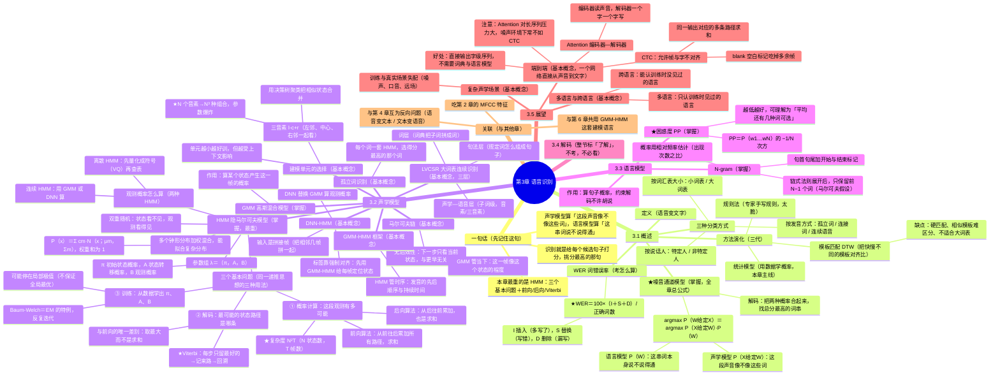
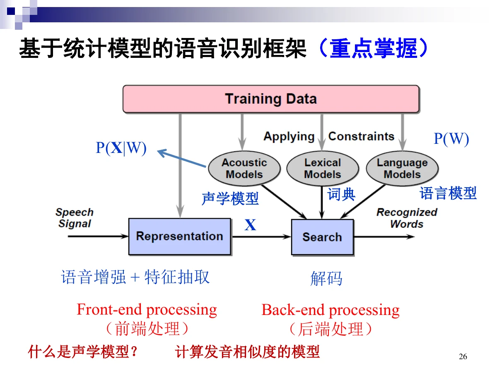
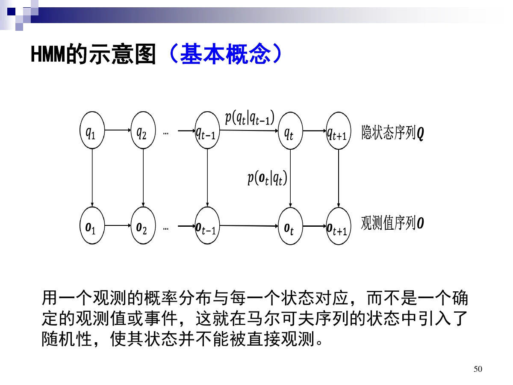
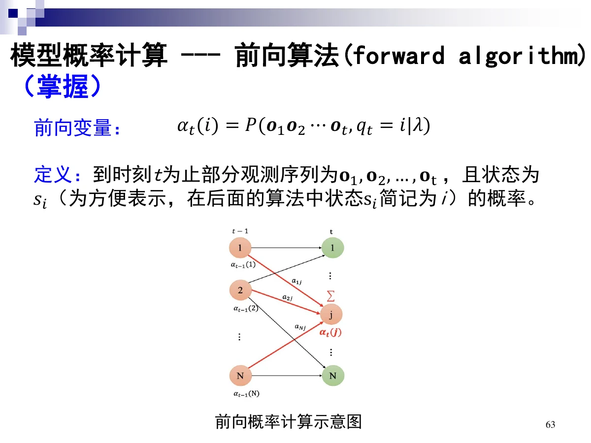
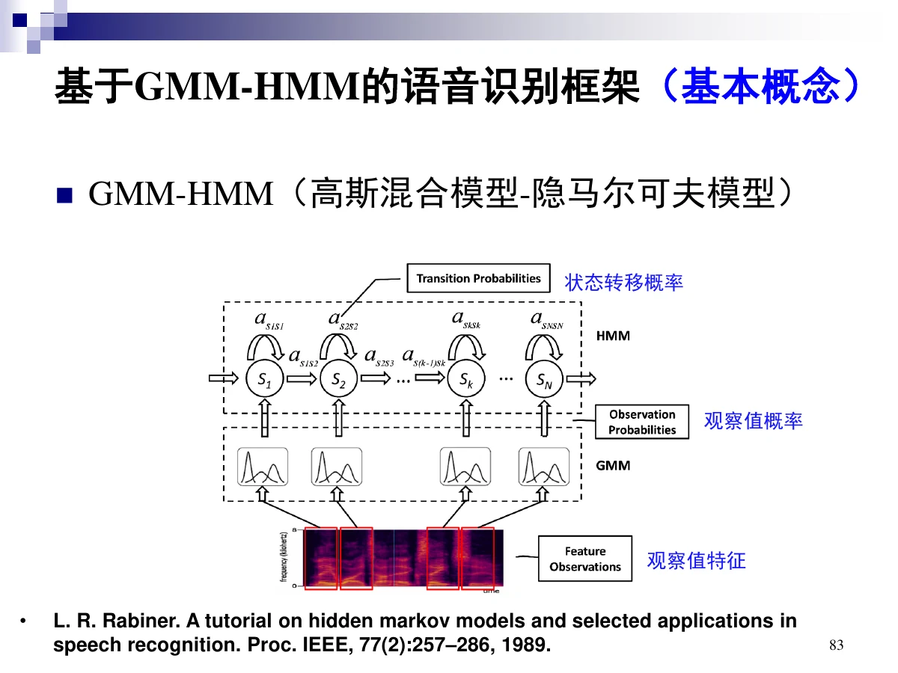
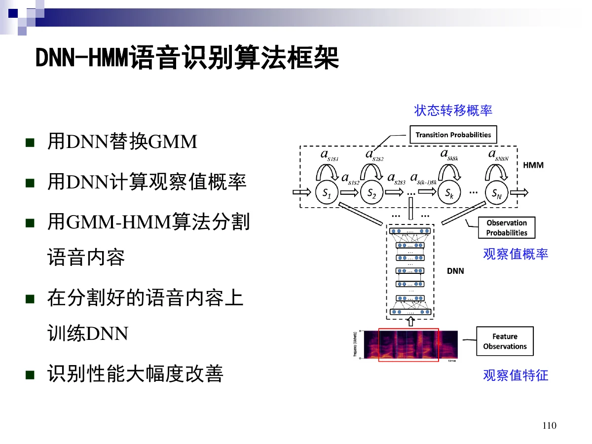

# 3 语音识别

一句话：识别就是求 $\arg\max_W P(X\mid W)P(W)$——**声学模型**算“这段声音像不像这个词”，**语言模型**算“这个词串说不说得通”，**解码**把两者合成最优句子。本章考得最重的是 **HMM（Hidden Markov Model，隐马尔可夫模型）的三个基本问题与前向/后向/Viterbi**。

## 0 读这一章之前

- **前置知识**：只要求知道「概率」大概是什么，以及「求和」和「取最大」的区别。
- 整章可以压缩成一句话：**给每个候选句子打个分，挑分最高的**。声学模型算「像不像」，语言模型算「通不通」。
- 三个新词：**HMM**（看不见的状态推动看得见的声音）、**声学模型**、**语言模型**。
- 公式集中在 HMM 三件套：前向、后向、Viterbi。它们只是同一个递推思想的不同用法（求和 vs 取最大）。

## 总览（思维导图）

## 考点权重

| 模块            | 真正需要掌握                                            |    优先级 |
| ------------- | ------------------------------------------------- | -----: |
| 3.1.1 基本概念    | ASR 定义、三种分类维度、WER（Word Error Rate，词错误率）计算         |      高 |
| 3.1.2 方法回顾    | DTW 思路与缺点、统计模型框架、噪音通道模型（掌握）                       |      高 |
| 3.2.1 HMM     | 参数组、三个基本问题、前向/后向为什么是求和与 $N^2T$、Viterbi 为什么是取最大＋回溯 | **最高** |
| 3.2.2 GMM-HMM | 为什么用 GMM、LVCSR 三层、建模单元原则、三音素、孤立词                  | **很高** |
| 3.2.3 DNN-HMM | 用 DNN 替换 GMM、输入/输出/训练要点                           | **很高** |
| 3.3 语言模型      | N-gram 近似、概率估计、困惑度                                | **很高** |
| 3.4 解码        | 标注「了解」，不考                                         |     不考 |
| 3.5 展望其余      | 复杂声学场景、多语言/跨语言（基本概念）                              |      中 |
| 3.5.1 端到端     | CTC 与 Attention 的差别、端到端的优缺点                       |      高 |

已按 PPT 标记剔除（标注「了解」）：3.1.3 典型应用、HMM 例子（天气/掷骰子/概率计算）、直接计算法、Baum-Welch 推导续页、VQ 与单高斯模型、连接词识别、LVCSR 框架续页、决策树细节、子词成词与训练、**3.4 语音识别解码算法整节（Viterbi beam 搜索、WFST/HCLG）**、N-gram 平滑技术、长距离依赖、3.3.3 神经语言模型、3.5.2 主要挑战、3.5.3 基于大模型的语音识别、基于 CTC 的算法细节页。注意：3.4 在 2026 课件整节标「了解」，现有笔记的 3.4 正文随之删除。

# 3.1 语音识别概述

## 3.1.1 基本概念

**定义**：自动语音识别（ASR）是机器把人类语音信号转变为相应文本的技术，是语音信息处理最核心的方法。识别结果可作最终输出（转写），也可作为自然语言处理（对话、翻译）的输入。

### 分类

| 维度    | 取值                                                   |
| ----- | ---------------------------------------------------- |
| 发音方式  | 孤立词、连接词、连续语音                                         |
| 词汇表大小 | 小（10~100 词）、中（100~1000 词）、大（1000 词以上）                |
| 说话人   | 特定说话人（speaker-dependent）、非特定说话人（speaker-independent） |

### 评价指标 WER 单词错误率
> **人话**：认错的字分三种：多写（插入）、写错（替换）、漏写（删除），再除以正确字数。

把识别结果与正确文本对齐，数出**插入（I）、替换（S）、删除（D）**三类错误的个数：

$$
\text{WER}=\frac{100\times(\#\text{Insertions}+\#\text{Substitutions}+\#\text{Deletions})}{\text{Total Words in Correct Transcript}}
$$

即**三类错误之和 ÷ 正确文本的总词数 × 100%**。WER 可以超过 100%（插入太多时）。

**课件上的对齐示例**（REF 是正确文本，HYP 是识别结果，逐词对齐后数错误）：

| | 词序列 |
| --- | --- |
| REF | portable \* PHONE UPSTAIRS last night so（共 6 个词） |
| HYP | portable FORM OF STORES last night so |
| 判定 | — **S** **I** **S** — — — |

数一遍：**替换 2 个**（FORM 顶替 PHONE、STORES 顶替 UPSTAIRS）、**插入 1 个**（OF）、**删除 0 个**，于是

$$
\text{WER}=\frac{100\times(1+2+0)}{6}=50\%
$$

即这段识别结果相当于每 100 个词错 50 个。课件同页留了两个思考题：**WER 这个指标有什么缺点？有没有更合适的评价指标？**

## 3.1.2 方法回顾

### 基于规则的识别

> **人话**：让专家把规则写全——写不全，也改不动。

靠语音学、音韵学、语法、语用等规则。缺点：**规则难以表达**，也**难以知道如何提升性能**。

### 基于模板匹配：DTW

> **人话**：同一句话两个人说得快慢不同，先拉伸对齐，再逐点比较。

思路：把输入模板与参考模板逐一比较，找最相似的；但两个人说话快慢不同，直接比没意义，所以要先把两个矢量序列**对齐**。**DTW（动态时间弯折/归正）** 用动态规划把全局问题化成许多局部最优决策：

1. 建立从 $(1,1)$ 到 $(I,J)$ 的路径，每条路径代表一种对齐情况，其累计距离称为该路径的**代价**；
2. 递推求每格的最小累计代价；
3. **代价最小的路径就是所求的对准路径**，再用路径长度归正。

DTW 的缺点：

- 很难区分非常类似的模板（硬匹配）；
- 输入与模板的声学条件不同时性能急剧下降（缺少多样性）；
- 没有充分利用语音信号的时序动态信息；
- 不利于大词汇表连续语音识别（LVCSR，Large Vocabulary Continuous Speech Recognition）。

→ 因此转向**基于统计模型的识别**。

### 基于统计模型的框架（重点）

> **人话**：声学模型管「这段声音像不像这个词」，语言模型管「这个说法通不通」。

框架由三块组成：**声学模型** $P(X\mid W)$ 负责「这段声音像不像这个词串」，**词典**规定每个词由哪些音素按什么顺序拼成，**语言模型** $P(W)$ 负责「这个说法通不通」。

前端做语音增强与特征抽取，后端做解码。

### 噪音通道模型（掌握）

> **人话**：把识别想成：听到的是原文被通道弄脏后的版本，反过来推原文。

源句子经过“噪音通道”变成带噪句子，解码就是反过来求最可能的句子：**在所有候选词串 $W$ 里，挑「让这段声音最可能出现、并且本身也最像人话」的那一个**。写成式子是 $\hat W=\arg\max_W P(X\mid W)P(W)$——原本还要除以 $P(X)$，但它对每个候选都一样，比较时可以约掉。

这个式子就是识别部分的总纲：$P(X\mid W)$ 是**声学模型**，$P(W)$ 是**语言模型**，两者的乘积由解码器去搜最大值。

# 3.2 声学模型

## 3.2.1 隐马尔可夫模型（掌握）

### 马尔可夫链（基本概念）

> **人话**：下一步只看现在，不看历史。

离散状态的一阶马尔可夫过程：系统在时刻 $t$ 的状态只与 $t-1$ 时刻的状态有关。

### HMM 的定义与参数

> **人话**：状态看不见，只能看到它每一步吐出来的观测。

HMM 用**双重随机过程**描述：一个 Markov 链描述状态转移（**不可见**），另一个随机过程描述状态与观察值之间的统计对应关系（**可见**）。因为状态不可见，故称“隐”。

模型参数 $\lambda=(\pi,A,B)$：

| 参数         | 含义                                                                |
| ------------ | ------------------------------------------------------------------- |
| $\pi$        | 初始状态概率分布                                                    |
| $A=[a_{ij}]$ | 状态转移概率矩阵                                                    |
| $B=[b_j(k)]$ | 观测值概率矩阵：在 $t$ 时刻、隐状态为 $s_j$ 时观察值为 $v_k$ 的概率 |

每个状态还包含概率分布参数（GMM（Gaussian Mixture Model，高斯混合模型）或 DNN（Deep Neural Network，深度神经网络）的参数）、到其他状态的转移概率、持续时间统计。

### 三个基本问题（掌握）

> **人话**：三件事：这段话有多大可能（打分）、最可能的状态串是什么（解码）、参数怎么学（训练）。

| 问题   | 内容                                                      | 解法               |
| ------ | --------------------------------------------------------- | ------------------ |
| 问题 1 | 模型概率计算：给定 $\lambda$ 与 $O$，求 $P(O\mid\lambda)$ | 前向算法、后向算法 |
| 问题 2 | 模型解码：求最佳状态序列 $Q^*$                            | Viterbi 算法       |
| 问题 3 | 模型参数估计：使 $P(O\mid\lambda)$ 最大                   | Baum-Welch 算法    |

### 前向算法（掌握）

> **人话**：从左往右逐帧走，把「所有能走到这里的路径」的概率加起来。

**前向变量**：$\alpha_t(i)=P(\boldsymbol o_1\boldsymbol o_2\cdots\boldsymbol o_t,\ q_t=i\mid\lambda)$，即到 $t$ 时刻观测为 $o_1\dots o_t$ 且状态为 $s_i$ 的概率。

算法三步：

1. **初始化**：第 1 帧只能是「初始状态概率 × 该状态吐出第 1 帧观测的概率」。
2. **递推**：把上一帧**所有状态**到当前状态的路径概率**求和**，再乘上当前状态吐出这一帧观测的概率。这里的「求和」是前向算法的关键——它把指数级的路径枚举压成线性递推，这正是复杂度只有 $N^2T$ 的原因。
3. **终止**：最后一帧所有状态的 $\alpha_T(i)$ 加起来，就是整段观测的似然 $P(\boldsymbol O\mid\lambda)$。

计算量 $O(N^2T)$：$N=5$、$T=100$ 时只需 2500 次乘法。

### 后向算法（掌握）

> **人话**：从右往左算：站在这一刻，后面剩下的观测还有多少可能。

**后向变量**：$\beta_t(i)=P(\boldsymbol o_{t+1}\cdots\boldsymbol o_T\mid q_t=i,\lambda)$，即从 $t+1$ 到 $T$ 的观测且 $t$ 时刻状态为 $i$ 的概率。

算法：最后一帧之后没有观测了，所以令 $\beta_T(i)=1$；然后从后往前递推——把「下一步可能去的每个状态」的后向概率，乘上转移概率和它吐出那一帧观测的概率，再求和。起点处把初始分布、第 1 帧观测与 $\beta_1$ 合起来，同样能算出 $P(\boldsymbol O\mid\lambda)$。计算量同为 $N^2T$ 数量级。

前向与后向的对照：

**前向 $\alpha_t(i)$ 管前边（1→t），后向 $\beta_t(i)$ 管后边（t+1→T）**；两者相乘，就得到「时刻 $t$ 站在状态 $i$ 上」的整条路径概率——Baum-Welch 重估参数用的正是这个量。

### 模型解码与 Viterbi（掌握）

> **人话**：同样逐帧推进，但每步只留最好的那条路，最后回溯出来。

**解码问题**：确定最佳状态序列 $Q^*=q_1^*q_2^*\cdots q_T^*$，使 $P(\boldsymbol O,Q^*\mid\lambda)$ 最大。注意它与问题 1 的区别：问题 1 要的是**所有路径之和**，解码要的是**一条最好的路径**。

为此定义 $\delta_t(i)$：沿某条路径在时刻 $t$ 走到状态 $i$、并产生前 $t$ 帧观测的**最大概率**。

Viterbi 四步：

1. **初始化**：第 1 帧各状态的最大概率＝初始状态概率 × 该状态吐出第 1 帧观测的概率；来路记为空。
2. **递推**：对当前每个状态，看上一帧**哪个状态过来得分最高**——取最大而不是求和，并把这个「最好的来路」记进回溯指针。
3. **终止**：最后一帧得分最高的那个状态，就是终点。
4. **回溯**：顺着记下的来路一路退回第 1 帧，反过来读就是整条最优状态序列。

注意区别：前向是**求和**（所有路径），Viterbi 是**取最大**（一条最优路径）。

### Baum-Welch 算法（基本概念）

> **人话**：先猜一组参数，算完期望再更新，反复迭代到不再变好。

模型参数估计没有解析解，思路是：**选取初始模型 → 计算更新参数 → 逐步改进**。Baum-Welch 是**期望最大化（EM，Expectation-Maximization）算法的特例**，用于观测序列与隐状态序列都未知时的参数估计；它**未必得到全局最大值**，可能收敛到局部极值。

## 3.2.2 基于 GMM-HMM 的语音识别技术（掌握、基本概念）

### HMM 的观测值概率分布

| 类型                   | 观测概率                                 |
| ---------------------- | ---------------------------------------- |
| 离散分布 HMM           | 矢量量化（VQ）                           |
| 连续分布 HMM（CD-HMM） | 高斯混合模型（GMM）或深度神经网络（DNN） |

### 高斯混合模型（掌握）

> **人话**：一个歪七扭八的分布，用好几坨高斯「揉」出来。

用 $M$ 个高斯分布加权拟合复杂分布，$c_m$ 是第 $m$ 个子模型的先验概率（混合权重），$\sum_m c_m=1$：

每个高斯就是一个「钟形」：均值向量 $\boldsymbol\mu_m$ 决定中心在哪，协方差矩阵 $\boldsymbol\Sigma_m$ 决定它朝哪个方向摊得开、摊多宽；离中心越远，密度值越小。密度函数的具体写法不用记，记住**「一个高斯描述一团、多个高斯加权相加描述一团歪七扭八的分布」**即可。

放进 HMM 的状态 $i$：

状态 $i$ 的观测概率 $b_i(\boldsymbol o_t)$，就是「状态 $i$ 下各高斯在当前这一帧上的取值」按权重加起来。也就是说：**HMM 的每个状态不只有转移概率，还自带一套「会发出什么样特征」的概率分布**，这套分布由 GMM 提供。

### GMM-HMM 的整体框架

> **人话**：GMM 负责「这一帧像哪个音」，HMM 负责「这些音按什么顺序出现」。

观察值特征 → **GMM** 算出观察值概率 $b_i(\boldsymbol o_t)$ → **HMM** 结合状态转移概率做序列建模。

### 孤立词识别（基本概念）

> **人话**：每个词训练一个模型，谁打分高就认成谁。

对每个词条 $v$ 训练一个 HMM $\lambda_v$：把观测序列依次喂给每个词的模型，算它在这段语音上的似然，**谁的似然最大就认成谁**。

### LVCSR 的三层框架（基本概念）

> **人话**：底层认音、中层拼词、上层组句。

| 层          | 职责                                                                                 |
| ----------- | ------------------------------------------------------------------------------------ |
| 声学—语音层 | 底层，接受输入语音，以**子词（subword）**为单位输出，每个子词对应一套 HMM 结构和参数 |
| 词层        | 规定词汇表中每个词由哪些音素/音子串接而成（词典）                                    |
| 句法层      | 规定词按照什么规则组合成句子（语言模型）                                             |

连续语音识别的固有难点：词数太多语料不够、发音相近易误识、句中词数不定、**词边界难确定**、协同发音导致发音变化。

### 建模单元的选择（基本概念）

> **人话**：单元越小越容易训，但越容易被左右邻居带跑调。

以词为单位建模不合理（冗余存储与计算大），所以用**比词小的子词**：音节、半音节、音素等。

| 单元越小 | 后果                                                         |
| -------- | ------------------------------------------------------------ |
| 好处     | 单元数量少，训练工作量小                                     |
| 代价     | 对上下文更敏感、易受相邻音影响而变异，类型设计与样本采集更难 |

### 三音素 HMM（基本概念）

> **人话**：把左右邻居写进名字里（$l$-$c$+$r$），专门对付连读变音。

单音素建模没考虑**协同发音**（语流中音段会互相影响）。解决办法是用三音素，记作 **$l\text{-}c\text{+}r$**（$c$ 为中心单元，$l$、$r$ 为左右上下文）。

$N$ 个音素需要 $N^3$ 个三音素，参数量随 $N$ 急剧增大，所以实际用**决策树聚类**来共享参数，这一过程依赖单音素建模后的**对齐**。

从单音素到三音素的流程：**单音素 + EM 训练 → 把高斯分布复制到三音素 → 建决策树并对高斯聚类 → 复制并混合训练**。

## 3.2.3 DNN-HMM（基本概念）

> **人话**：把「算这一帧属于哪个状态的概率」这一步，从 GMM 换成神经网络。

**做法：用 DNN 替换 GMM，由 DNN 计算观察值概率。**

DNN 是输入层与输出层之间有多层隐层（超过一层）的神经网络；经典做法先用深度信念网络（DBN，Deep Belief Network）预训练，再用反向传播（BP，Backpropagation）微调。

每一层只做两步：先**线性加权求和**（上一层输出乘权重、加偏置），再过**非线性激活函数**；层层叠起来，就得到对输入的复杂非线性变换。

分类任务常用**最小交叉熵（CE，Cross Entropy）**准则：

让正确类别的输出概率尽量接近 1、其余类别尽量接近 0——即最小化「正确答案的负对数概率」。

用 softmax 得到后验概率 $h_i^{L+1}=P(i\mid\boldsymbol o_t)$。

| 要素   | 内容                                                      |
| ---- | ------------------------------------------------------- |
| 输入   | 多为滤波器组（FBK）特征；DNN 会**拼接相邻多帧**（如 7 帧），比 GMM 的单帧输入利用更多上下文 |
| 输出   | 维度等于 HMM 状态数，每一维对应一个绑定的三音素状态                            |
| 训练标注 | 先用已训练好的 GMM-HMM 做**强制对齐（Viterbi）**，给每帧打上状态标签            |
| 流程   | 用 DNN 计算观察值概率 → 用 GMM-HMM 分割语音 → 在分割好的数据上训练 DNN         |

DNN 相对 GMM 的优势：不需要对特征分布做假设；输入可拼接连续帧以利用上下文；可用随机优化高效训练；**鉴别式模型**比生成式 GMM 更适合发音模式分类。

# 3.3 语言模型

## 3.3.1 基本概念

> **人话**：语言模型就是给一句话打「像不像人话」的分。

语言模型：用来**计算一个句子概率**的模型。作用是对句子施加约束，减少声学模型不合理造成的误识。例：“我要回福建省福州市”易被误识成“我要回胡建省湖州市”。

| 分类               | 内容                   |
| ------------------ | ---------------------- |
| 基于文法的语言模型 | 总结语法规则与语音规则 |
| 基于统计的语言模型 | N-gram、神经语言模型   |

**困惑度（perplexity）**：衡量模型拟合测试数据的程度，用模型分配给测试集的概率取倒数并对句长归一化：

$$
PP(W)=P(w_1w_2\cdots w_N)^{-1/N}
$$

含义：预测下一个词时的**加权平均分支因子**，**越低越好**。示例（WSJ，Wall Street Journal，华尔街日报语料）：Unigram 962、Bigram 170、Trigram 109。

## 3.3.2 N-gram 语言模型（掌握）

> **人话**：只往前看 $N-1$ 个词来猜下一个词，省掉全部历史。

**链式法则**：

一个句子的概率可以拆成一串条件概率的连乘：第 1 个词的概率 × 已知第 1 个词时第 2 个词的概率 × … × 已知前面全部词时第 $k$ 个词的概率。

**N-gram 近似**：假设词 $w_k$ 只与前 $N-1$ 个词有关（$N-1$ 阶马尔可夫模型）：

即把「已知全部历史」截断成「已知最近 $N-1$ 个词」。

| 类型    | 用几个词作条件 | 概率形式                              |
| ------- | -------------- | ------------------------------------- |
| Unigram | 0 个           | $P(\text{phone})$                     |
| Bigram  | 1 个           | $P(\text{phone}\mid\text{cell})$      |
| Trigram | 2 个           | $P(\text{phone}\mid\text{your cell})$ |

上下文越长参数越多（指数增长），N-gram 把历史**截断**到 $N-1$ 个词。

**概率估计**用相对频率：

数一数「前 $N-1$ 个词这个组合出现了多少次」和「这 $N$ 个词连在一起出现了多少次」，两者相除就是条件概率——**数数再相除**，没有别的技巧。

为使概率模型一致，句子两端要加唯一开始符 `<s>` 与结束符 `</s>`，并当作附加词处理。

# 3.5 语音识别技术的展望

## 3.5.1 端到端语音识别（基本概念）

### CTC

> **人话**：允许「好几帧对应不到一个字」，用 blank 把多出来的帧吃掉。

**CTC（Connectionist Temporal Classification，连接时序分类）** 是基于神经网络的时序信号分类。

为什么需要它：传统声学模型训练要求**每一帧都有标签（三音素）**，必须先用 GMM-HMM（Gaussian Mixture Model - Hidden Markov Model，高斯混合模型—隐马尔可夫模型）做强制对齐，而对齐质量严重依赖 GMM-HMM 的可靠性；训练与对齐都要反复迭代，非常耗时，分阶段训练也不合理。

CTC 通过引入 **blank** 符号解决“帧与标签不对齐”：输出是一串 spike（尖峰），例如 `--a-bb → ab`；某个输出序列的概率等于“填了 blank 之后所有可能的路径”的概率之和。

### Attention（编码器—解码器）

> **人话**：解码时每一步自己去输入里挑相关的位置看。

编码器把输入序列映射为定长向量，解码器再解码成标签；Attention 让解码器在每一步**动态关注**输入的相关部分。

| 对比     | CTC                | Attention                                      |
| -------- | ------------------ | ---------------------------------------------- |
| 对齐假设 | 需要每帧独立的假设 | 不需要每帧独立假设                             |
| 训练     | 可端到端训练       | 可端到端训练                                   |
| 弱点     | —                  | 长序列给编码器巨大压力；噪声环境下通常不如 CTC |

端到端的优点：直接把声学特征映射到更大的单元（词、字）序列，而不是音素序列；字级输出便于下游 NLP（Natural Language Processing，自然语言处理）处理。混合式需要声学模型 + 词典 + 语言模型，端到端两者都不需要。

### 复杂声学场景下的语音识别（基本概念）

> **人话**：训练时的房间和考试时的房间不一样，模型就露怯了。

训练声学模型的声学场景与真实复杂声学场景差异过大时，性能大大降低；现实中声学场景千变万化，训练集不能完全覆盖（例如噪声、混响在训练时可穷举可模拟，现实中无法穷举，导致训练集与测试集不匹配）。

### 多语言和跨语言语音识别（基本概念）

> **人话**：多语言认「学过的」，跨语言能认「没学过的」。

| 类型 | 能力 |
| ---- | ---- |
| 多语言语音识别 | 只能识别训练集中出现过的语言 |
| 跨语言语音识别 | 能识别从未见过的语言 |

例：英语、德语训练的模型，能同时识别英、德是多语言；还能识别法语是跨语言。每语言单训一个系统成本太高，所以需要这两类技术。

