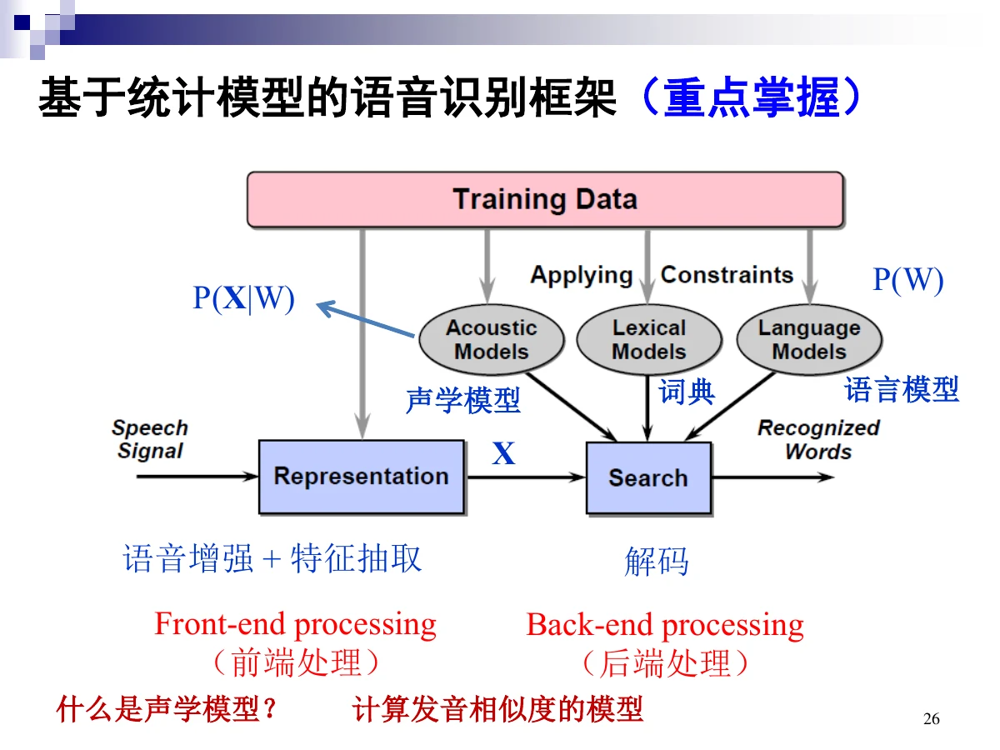
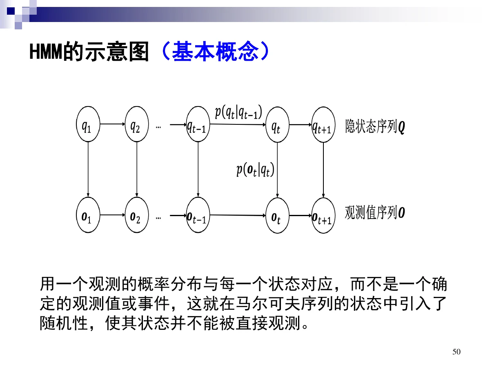
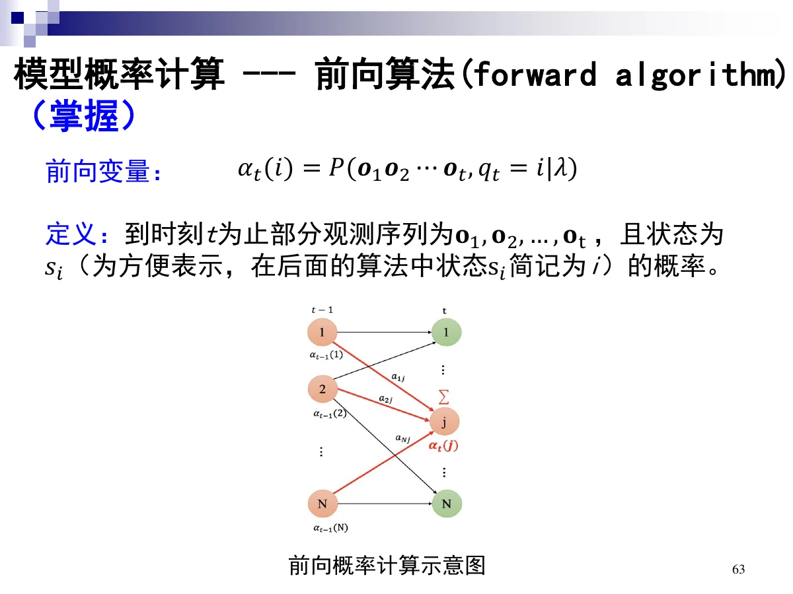
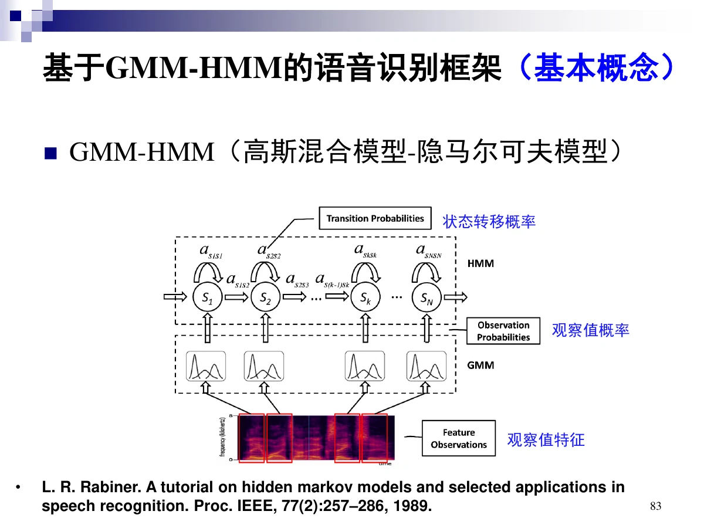
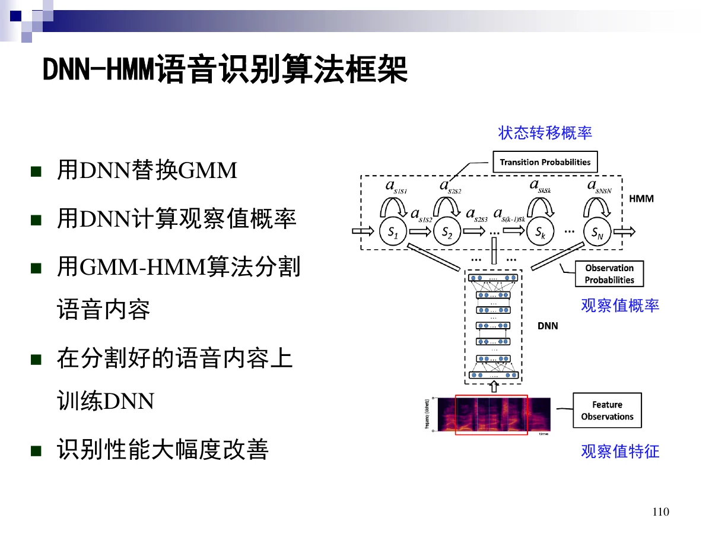

# 3 语音识别

一句话：识别就是求 $\arg\max_W P(X\mid W)P(W)$——**声学模型**算“这段声音像不像这个词”，**语言模型**算“这个词串说不说得通”，**解码**把两者合成最优句子。本章考得最重的是 **HMM 的三个基本问题与前向/后向/Viterbi**。

## 0 读这一章之前

- **前置知识**：只要求知道「概率」大概是什么，以及「求和」和「取最大」的区别。
- 整章可以压缩成一句话：**给每个候选句子打个分，挑分最高的**。声学模型算「像不像」，语言模型算「通不通」。
- 三个新词：**HMM**（看不见的状态推动看得见的声音）、**声学模型**、**语言模型**。
- 公式集中在 HMM 三件套：前向、后向、Viterbi。它们只是同一个递推思想的不同用法（求和 vs 取最大）。

## 总览（思维导图）

$$
\text{第 3 章 语音识别}
\begin{cases}
3.1\ \text{概述}:\ \text{定义、分类、WER}\\
3.2\ \text{声学模型}
\begin{cases}
\text{模板匹配}:\ \text{DTW}\\
\text{HMM}:\ \text{三问题 + 前向/后向/Viterbi/ Baum-Welch}\\
\text{GMM-HMM}:\ \text{GMM 观测概率} + \text{LVCSR 三层}\\
\text{DNN-HMM}:\ \text{用 DNN 替换 GMM}
\end{cases}\\[4pt]
3.3\ \text{语言模型}:\ \text{N-gram、困惑度}\\
3.4\ \text{解码}:\ \text{孤立词}\ \arg\max_v p(\boldsymbol O\mid\lambda_v)\\
3.5\ \text{展望}:\ \text{CTC 与 Attention}
\end{cases}
$$

## 考点权重

| 模块           | 真正需要掌握                                               |   优先级 |
| -------------- | ---------------------------------------------------------- | -------: |
| 3.1.1 基本概念 | ASR 定义、三种分类维度、WER 计算                           |       高 |
| 3.1.2 方法回顾 | DTW 思路与缺点、统计模型框架、噪音通道模型（掌握）         |       高 |
| 3.2.1 HMM      | 参数组、三个基本问题、前向/后向递推与 $N^2T$、Viterbi 四步 | **最高** |
| 3.2.2 GMM-HMM  | 为什么用 GMM、LVCSR 三层、建模单元原则、三音素、孤立词     | **很高** |
| 3.2.3 DNN-HMM  | 用 DNN 替换 GMM、输入/输出/训练要点                        | **很高** |
| 3.3 语言模型   | N-gram 近似、概率估计、困惑度                              | **很高** |
| 3.4 解码       | 孤立词解码式                                               |       高 |
| 3.5.1 端到端   | CTC 与 Attention 的差别、端到端的优缺点                    |       高 |

已剔除：3.1.3 典型应用、马尔可夫链例子、直接计算法、VQ、决策树细节、平滑技术、长距离依赖、神经语言模型、3.5.2/3.5.3 挑战与大模型，以及各处标注「了解」的推导。

# 3.1 语音识别概述

## 3.1.1 基本概念

**定义**：自动语音识别（ASR）是机器把人类语音信号转变为相应文本的技术，是语音信息处理最核心的方法。识别结果可作最终输出（转写），也可作为自然语言处理（对话、翻译）的输入。

### 三种分类维度

| 维度       | 取值                                                                 |
| ---------- | -------------------------------------------------------------------- |
| 发音方式   | 孤立词、连接词、连续语音                                             |
| 词汇表大小 | 小（10~100 词）、中（100~1000 词）、大（1000 词以上）                |
| 说话人     | 特定说话人（speaker-dependent）、非特定说话人（speaker-independent） |

### 评价指标 WER

> **人话**：认错的字分三种：多写（插入）、写错（替换）、漏写（删除），再除以正确字数。

$$
\text{WER}=\frac{100\times(\#\text{Insertions}+\#\text{Substitutions}+\#\text{Deletions})}{\text{Total Words in Correct Transcript}}
$$

三类错误：**插入（I）、替换（S）、删除（D）**。

## 3.1.2 方法回顾

### 基于规则的识别

> **人话**：让专家把规则写全——写不全，也改不动。

靠语音学、音韵学、语法、语用等规则。缺点：**规则难以表达**，也**难以知道如何提升性能**。

### 基于模板匹配：DTW

> **人话**：同一句话两个人说得快慢不同，先拉伸对齐，再逐点比较。

思路：把输入模板与参考模板逐一比较，找最相似的；但两个人说话快慢不同，直接比没意义，所以要先把两个矢量序列**对齐**。**DTW（动态时间弯折/归正）** 用动态规划把全局问题化成许多局部最优决策：

1. 建立从 $(1,1)$ 到 $(I,J)$ 的路径，每条路径代表一种对齐情况，其累计距离称为该路径的**代价**；
2. 递推求每格的最小累计代价；
3. **代价最小的路径就是所求的对准路径**，再用路径长度归正。

DTW 的缺点：

- 很难区分非常类似的模板（硬匹配）；
- 输入与模板的声学条件不同时性能急剧下降（缺少多样性）；
- 没有充分利用语音信号的时序动态信息；
- 不利于大词汇表连续语音识别（LVCSR）。

→ 因此转向**基于统计模型的识别**。

### 基于统计模型的框架（重点）

> **人话**：声学模型管「这段声音像不像这个词」，语言模型管「这个说法通不通」。

$$
P(X\mid W)\ \text{声学模型}\quad+\quad\text{词典}\quad+\quad P(W)\ \text{语言模型}
$$

前端做语音增强与特征抽取，后端做解码。

### 噪音通道模型（掌握）

> **人话**：把识别想成：听到的是原文被通道弄脏后的版本，反过来推原文。

源句子经过“噪音通道”变成带噪句子，解码即求最可能的句子：

$$
\hat W=\arg\max_W P(W\mid X)=\arg\max_W \frac{P(X\mid W)P(W)}{P(X)}
$$

因为 $P(X)$ 与 $W$ 无关，可去掉分母：

$$
\hat W=\arg\max_W \underbrace{P(X\mid W)}_{\text{声学模型}}\underbrace{P(W)}_{\text{语言模型}}
$$

# 3.2 声学模型

## 3.2.1 隐马尔可夫模型（掌握）

### 马尔可夫链（基本概念）

> **人话**：下一步只看现在，不看历史。

离散状态的一阶马尔可夫过程：系统在时刻 $t$ 的状态只与 $t-1$ 时刻的状态有关。

### HMM 的定义与参数

> **人话**：状态看不见，只能看到它每一步吐出来的观测。

HMM 用**双重随机过程**描述：一个 Markov 链描述状态转移（**不可见**），另一个随机过程描述状态与观察值之间的统计对应关系（**可见**）。因为状态不可见，故称“隐”。

模型参数 $\lambda=(\pi,A,B)$：

| 参数         | 含义                                                                |
| ------------ | ------------------------------------------------------------------- |
| $\pi$        | 初始状态概率分布                                                    |
| $A=[a_{ij}]$ | 状态转移概率矩阵                                                    |
| $B=[b_j(k)]$ | 观测值概率矩阵：在 $t$ 时刻、隐状态为 $s_j$ 时观察值为 $v_k$ 的概率 |

每个状态还包含概率分布参数（GMM 或 DNN 的参数）、到其他状态的转移概率、持续时间统计。

### 三个基本问题（掌握）

> **人话**：三件事：这段话有多大可能（打分）、最可能的状态串是什么（解码）、参数怎么学（训练）。

| 问题   | 内容                                                      | 解法               |
| ------ | --------------------------------------------------------- | ------------------ |
| 问题 1 | 模型概率计算：给定 $\lambda$ 与 $O$，求 $P(O\mid\lambda)$ | 前向算法、后向算法 |
| 问题 2 | 模型解码：求最佳状态序列 $Q^*$                            | Viterbi 算法       |
| 问题 3 | 模型参数估计：使 $P(O\mid\lambda)$ 最大                   | Baum-Welch 算法    |

### 前向算法（掌握）

> **人话**：从左往右逐帧走，把「所有能走到这里的路径」的概率加起来。

**前向变量**：$\alpha_t(i)=P(\boldsymbol o_1\boldsymbol o_2\cdots\boldsymbol o_t,\ q_t=i\mid\lambda)$，即到 $t$ 时刻观测为 $o_1\dots o_t$ 且状态为 $s_i$ 的概率。

性质：

$$
\alpha_1(i)=\pi_i b_i(\boldsymbol o_1),\qquad
\alpha_t(j)=\Big[\sum_{i=1}^{N}\alpha_{t-1}(i)a_{ij}\Big]b_j(\boldsymbol o_t),\qquad
P(\boldsymbol O\mid\lambda)=\sum_{i=1}^{N}\alpha_T(i)
$$

算法三步：

1. **初始化**：$1\le i\le N$，$\alpha_1(i)=\pi_ib_i(\boldsymbol o_1)$；
2. **递推**：$2\le t\le T$，$1\le j\le N$，$\alpha_t(j)=\big[\sum_i\alpha_{t-1}(i)a_{ij}\big]b_j(\boldsymbol o_t)$；
3. **终止**：$P(\boldsymbol O\mid\lambda)=\sum_{i=1}^N\alpha_T(i)$。

计算量 $O(N^2T)$：$N=5$、$T=100$ 时只需 2500 次乘法。

### 后向算法（掌握）

> **人话**：从右往左算：站在这一刻，后面剩下的观测还有多少可能。

**后向变量**：$\beta_t(i)=P(\boldsymbol o_{t+1}\cdots\boldsymbol o_T\mid q_t=i,\lambda)$，即从 $t+1$ 到 $T$ 的观测且 $t$ 时刻状态为 $i$ 的概率。

$$
\beta_T(i)=1,\qquad
\beta_t(i)=\sum_{j=1}^{N}\beta_{t+1}(j)a_{ij}b_j(\boldsymbol o_{t+1}),\qquad
P(\boldsymbol O\mid\lambda)=\sum_{i=1}^{N}\pi_ib_i(\boldsymbol o_1)\beta_1(i)
$$

算法：初始化 $\beta_T(i)=1$；对 $t=T-1,T-2,\dots,1$ 递推；最后用终止式求 $P(\boldsymbol O\mid\lambda)$。计算量同为 $N^2T$ 数量级。

前向与后向的对照：

$$
\alpha_t(i)\ \text{管前边（}1\to t\text{）},\qquad \beta_t(i)\ \text{管后边（}t+1\to T\text{）}
$$

### 模型解码与 Viterbi（掌握）

> **人话**：同样逐帧推进，但每步只留最好的那条路，最后回溯出来。

**解码问题**：确定最佳状态序列 $Q^*=q_1^*q_2^*\cdots q_T^*$，使 $P(\boldsymbol O,Q^*\mid\lambda)$ 最大：

$$
Q^*=\arg\max_Q P(\boldsymbol O,Q\mid\lambda)
$$

定义

$$
\delta_t(i)=\max_{q_1,\dots,q_{t-1}}P(q_1\cdots q_{t-1},q_t=i,\boldsymbol o_1\cdots\boldsymbol o_t\mid\lambda)
$$

即时刻 $t$ 沿某条路径到达状态 $i$ 并产生前 $t$ 个观测的**最大概率**。

Viterbi 四步：

1. **初始化**：$\delta_1(i)=\pi_ib_i(\boldsymbol o_1)$，$\varphi_1(i)=0$；
2. **递推**：对 $2\le t\le T$，
   $\delta_t(j)=\max_{1\le i\le N}\big[\delta_{t-1}(i)a_{ij}\big]b_j(\boldsymbol o_t)$，
   $\varphi_t(j)=\arg\max_{1\le i\le N}\big[\delta_{t-1}(i)a_{ij}\big]$；
3. **终止**：$P^*=\max_{1\le i\le N}\delta_T(i)$，$q_T^*=\arg\max_{1\le i\le N}\delta_T(i)$；
4. **回溯**：$q_t^*=\varphi_{t+1}(q_{t+1}^*)$，$t=T-1,\dots,1$。

注意区别：前向是**求和**（所有路径），Viterbi 是**取最大**（一条最优路径）。

### Baum-Welch 算法（基本概念）

> **人话**：先猜一组参数，算完期望再更新，反复迭代到不再变好。

模型参数估计没有解析解，思路是：**选取初始模型 → 计算更新参数 → 逐步改进**。Baum-Welch 是**期望最大化（EM）算法的特例**，用于观测序列与隐状态序列都未知时的参数估计；它**未必得到全局最大值**，可能收敛到局部极值。

## 3.2.2 基于 GMM-HMM 的语音识别技术（掌握、基本概念）

### HMM 的观测值概率分布

| 类型                   | 观测概率                                 |
| ---------------------- | ---------------------------------------- |
| 离散分布 HMM           | 矢量量化（VQ）                           |
| 连续分布 HMM（CD-HMM） | 高斯混合模型（GMM）或深度神经网络（DNN） |

### 高斯混合模型（掌握）

> **人话**：一个歪七扭八的分布，用好几坨高斯「揉」出来。

用 $M$ 个高斯分布加权拟合复杂分布，$c_m$ 是第 $m$ 个子模型的先验概率（混合权重），$\sum_m c_m=1$：

$$
P(\boldsymbol x\mid\theta)=\sum_{m=1}^{M}c_m\mathcal N(\boldsymbol x;\boldsymbol\mu_m,\boldsymbol\Sigma_m)
$$

$$
\mathcal N(\boldsymbol x;\boldsymbol\mu_m,\boldsymbol\Sigma_m)=
\frac{1}{(2\pi)^{D/2}\lvert\boldsymbol\Sigma_m\rvert^{1/2}}
\exp\!\Big[-\frac{1}{2}(\boldsymbol x-\boldsymbol\mu_m)^{\mathsf T}\boldsymbol\Sigma_m^{-1}(\boldsymbol x-\boldsymbol\mu_m)\Big]
$$

放进 HMM 的状态 $i$：

$$
b_i(\boldsymbol o_t)=\sum_{m=1}^{M}c_{i,m}\,
\mathcal N(\boldsymbol o_t;\boldsymbol\mu_{i,m},\boldsymbol\Sigma_{i,m})
$$

其中 $c_{i,m}$ 是状态 $i$ 下第 $m$ 个高斯子模型的权重，$\mu_{i,m}$ 与 $\Sigma_{i,m}$ 是其均值向量与协方差矩阵。

### GMM-HMM 的整体框架

> **人话**：GMM 负责「这一帧像哪个音」，HMM 负责「这些音按什么顺序出现」。

观察值特征 → **GMM** 算出观察值概率 $b_i(\boldsymbol o_t)$ → **HMM** 结合状态转移概率做序列建模。

### 孤立词识别（基本概念）

> **人话**：每个词训练一个模型，谁打分高就认成谁。

对每个词条 $v$ 训练一个 HMM $\lambda_v$，识别时算各模型的似然并取最大：

$$
\hat v=\arg\max_v p(\boldsymbol O\mid\lambda_v)
$$

### LVCSR 的三层框架（基本概念）

> **人话**：底层认音、中层拼词、上层组句。

| 层          | 职责                                                                                 |
| ----------- | ------------------------------------------------------------------------------------ |
| 声学—语音层 | 底层，接受输入语音，以**子词（subword）**为单位输出，每个子词对应一套 HMM 结构和参数 |
| 词层        | 规定词汇表中每个词由哪些音素/音子串接而成（词典）                                    |
| 句法层      | 规定词按照什么规则组合成句子（语言模型）                                             |

连续语音识别的固有难点：词数太多语料不够、发音相近易误识、句中词数不定、**词边界难确定**、协同发音导致发音变化。

### 建模单元的选择（基本概念）

> **人话**：单元越小越容易训，但越容易被左右邻居带跑调。

以词为单位建模不合理（冗余存储与计算大），所以用**比词小的子词**：音节、半音节、音素等。

| 单元越小 | 后果                                                         |
| -------- | ------------------------------------------------------------ |
| 好处     | 单元数量少，训练工作量小                                     |
| 代价     | 对上下文更敏感、易受相邻音影响而变异，类型设计与样本采集更难 |

### 三音素 HMM（基本概念）

> **人话**：把左右邻居写进名字里（$l$-$c$+$r$），专门对付连读变音。

单音素建模没考虑**协同发音**（语流中音段会互相影响）。解决办法是用三音素，记作 **$l\text{-}c\text{+}r$**（$c$ 为中心单元，$l$、$r$ 为左右上下文）。

$N$ 个音素需要 $N^3$ 个三音素，参数量随 $N$ 急剧增大，所以实际用**决策树聚类**来共享参数，这一过程依赖单音素建模后的**对齐**。

从单音素到三音素的流程：**单音素 + EM 训练 → 把高斯分布复制到三音素 → 建决策树并对高斯聚类 → 复制并混合训练**。

## 3.2.3 DNN-HMM（基本概念）

> **人话**：把「算这一帧属于哪个状态的概率」这一步，从 GMM 换成神经网络。

**做法：用 DNN 替换 GMM，由 DNN 计算观察值概率。**

DNN 是输入层与输出层之间有多层隐层（超过一层）的神经网络；经典做法先用深度信念网络（DBN）预训练，再用反向传播（BP）微调。

$$
\boldsymbol a^l=\boldsymbol W^l\boldsymbol h^{l-1}+\boldsymbol b^l,\qquad
\boldsymbol h^l=f(\boldsymbol a^l)
$$

分类任务常用**最小交叉熵（CE）**准则：

$$
J_{CE}=-\sum_{i=1}^{C}y_i\log h_i^{L+1}
$$

用 softmax 得到后验概率 $h_i^{L+1}=P(i\mid\boldsymbol o_t)$。

| 要素     | 内容                                                                                        |
| -------- | ------------------------------------------------------------------------------------------- |
| 输入     | 多为滤波器组（FBK）特征；DNN 会**拼接相邻多帧**（如 7 帧），比 GMM 的单帧输入利用更多上下文 |
| 输出     | 维度等于 HMM 状态数，每一维对应一个绑定的三音素状态                                         |
| 训练标注 | 先用已训练好的 GMM-HMM 做**强制对齐（Viterbi）**，给每帧打上状态标签                        |
| 流程     | 用 DNN 计算观察值概率 → 用 GMM-HMM 分割语音 → 在分割好的数据上训练 DNN                      |

DNN 相对 GMM 的优势：不需要对特征分布做假设；输入可拼接连续帧以利用上下文；可用随机优化高效训练；**鉴别式模型**比生成式 GMM 更适合发音模式分类。

# 3.3 语言模型

## 3.3.1 基本概念

> **人话**：语言模型就是给一句话打「像不像人话」的分。

语言模型：用来**计算一个句子概率**的模型。作用是对句子施加约束，减少声学模型不合理造成的误识。例：“我要回福建省福州市”易被误识成“我要回胡建省湖州市”。

| 分类               | 内容                   |
| ------------------ | ---------------------- |
| 基于文法的语言模型 | 总结语法规则与语音规则 |
| 基于统计的语言模型 | N-gram、神经语言模型   |

**困惑度（perplexity）**：衡量模型拟合测试数据的程度，用模型分配给测试集的概率取倒数并对句长归一化：

$$
PP(W)=P(w_1w_2\cdots w_N)^{-1/N}
$$

含义：预测下一个词时的**加权平均分支因子**，**越低越好**。示例（WSJ 语料）：Unigram 962、Bigram 170、Trigram 109。

## 3.3.2 N-gram 语言模型（掌握）

> **人话**：只往前看 $N-1$ 个词来猜下一个词，省掉全部历史。

**链式法则**：

$$
P(w_1^n)=P(w_1)P(w_2\mid w_1)\cdots P(w_n\mid w_1^{n-1})=\prod_{k=1}^{n}P(w_k\mid w_1^{k-1})
$$

**N-gram 近似**：假设词 $w_k$ 只与前 $N-1$ 个词有关（$N-1$ 阶马尔可夫模型）：

$$
P(w_1^n)=\prod_{k=1}^{n}P(w_k\mid w_{k-N+1}^{k-1})
$$

| 类型    | 概率形式                              |
| ------- | ------------------------------------- |
| Unigram | $P(\text{phone})$                     |
| Bigram  | $P(\text{phone}\mid\text{cell})$      |
| Trigram | $P(\text{phone}\mid\text{your cell})$ |

上下文越长参数越多（指数增长），N-gram 把历史**截断**到 $N-1$ 个词。

**概率估计**用相对频率：

$$
P(w_n\mid w_{n-1})=\frac{C(w_{n-1}w_n)}{C(w_{n-1})},\qquad
P(w_n\mid w_{n-N+1}^{n-1})=\frac{C(w_{n-N+1}^{n})}{C(w_{n-N+1}^{n-1})}
$$

为使概率模型一致，句子两端要加唯一开始符 `<s>` 与结束符 `</s>`，并当作附加词处理。

# 3.4 解码

> **人话**：在所有「怎么分词、边界在哪」的组合里，搜出一条总分最高的。

孤立词识别的解码：输入语音 → 特征提取（MFCC 等）→ 矢量序列 $O$ → 各词条 HMM 算 $p(O\mid\lambda_v)$ → 取最大：

$$
\hat v=\arg\max_v p(\boldsymbol O\mid\lambda_v)
$$

一般形式要同时搜单词序列与边界，并把声学与语言得分加权、对插入加惩罚：

$$
\hat W=\arg\max_{\{w_1^N\}\{t_1^N\}}\sum_{n=1}^{N}\Big[\log P_{\text{acoust}}\big(\boldsymbol x_{t_{n-1}+1}^{t_n}\mid w_n\big)+\lambda\log P_{\text{lang}}(w_n\mid w_{n-1})+\delta\Big]
$$

$\lambda$ 是语言模型权重，$\delta$ 是插入惩罚。

# 3.5 语音识别技术的展望

## 3.5.1 端到端语音识别（基本概念）

### CTC

> **人话**：允许「好几帧对应不到一个字」，用 blank 把多出来的帧吃掉。

**CTC（Connectionist Temporal Classification）** 是基于神经网络的时序信号分类。

为什么需要它：传统声学模型训练要求**每一帧都有标签（三音素）**，必须先用 GMM-HMM 做强制对齐，而对齐质量严重依赖 GMM-HMM 的可靠性；训练与对齐都要反复迭代，非常耗时，分阶段训练也不合理。

CTC 通过引入 **blank** 符号解决“帧与标签不对齐”：输出是一串 spike（尖峰），例如 `--a-bb → ab`；某个输出序列的概率等于“填了 blank 之后所有可能的路径”的概率之和。

### Attention（编码器—解码器）

> **人话**：解码时每一步自己去输入里挑相关的位置看。

编码器把输入序列映射为定长向量，解码器再解码成标签；Attention 让解码器在每一步**动态关注**输入的相关部分。

| 对比     | CTC                | Attention                                      |
| -------- | ------------------ | ---------------------------------------------- |
| 对齐假设 | 需要每帧独立的假设 | 不需要每帧独立假设                             |
| 训练     | 可端到端训练       | 可端到端训练                                   |
| 弱点     | —                  | 长序列给编码器巨大压力；噪声环境下通常不如 CTC |

端到端的优点：直接把声学特征映射到更大的单元（词、字）序列，而不是音素序列；字级输出便于下游 NLP 处理。混合式需要声学模型 + 词典 + 语言模型，端到端两者都不需要。

# 3.6 本章小结

- 识别目标：$\arg\max_W P(X\mid W)P(W)$。
- HMM 三问题：概率计算（前向/后向，求和，$N^2T$）、解码（Viterbi，取最大）、参数估计（Baum-Welch，EM 特例）。
- 前向从 $t=1$ 往后推，后向从 $t=T$ 往前推；Viterbi 多一个 $\varphi$ 用于回溯。
- GMM 负责帧级观测概率，HMM 负责时序；LVCSR 分声学层、词层、句法层。
- 三音素解决协同发音，$N^3$ 太多所以用决策树聚类。
- N-gram 用前 $N-1$ 个词近似，困惑度越低越好。

# 3.7 考前速查表

| 题目出现                                            | 立刻想到                                |
| --------------------------------------------------- | --------------------------------------- |
| 机器把语音变成文本                                  | ASR 定义                                |
| 插入 / 替换 / 删除                                  | WER 的三类错误                          |
| 两个不等长序列先对齐再比                            | DTW（动态规划，代价最小的路径）         |
| 硬匹配、缺少多样性、不利于 LVCSR                    | DTW 的缺点                              |
| 源句子经噪音通道变带噪句子                          | 噪音通道模型；去掉 $P(X)$ 后得声学×语言 |
| 双重随机过程                                        | HMM（状态隐、观测显）                   |
| $\pi,A,B$                                           | HMM 的三个参数组                        |
| 概率计算 / 解码 / 参数估计                          | HMM 三个基本问题                        |
| $\alpha_t(j)=[\sum_i\alpha_{t-1}(i)a_{ij}]b_j(o_t)$ | 前向递推（求和）                        |
| $\beta_t(i)=\sum_j\beta_{t+1}(j)a_{ij}b_j(o_{t+1})$ | 后向递推                                |
| $N^2T$、$N=5,T=100$ 约 2500 次                      | 前向/后向的计算量                       |
| $\delta_t(j)=\max_i[\delta_{t-1}(i)a_{ij}]b_j(o_t)$ | Viterbi 递推（取最大）                  |
| $\varphi$、回溯                                     | Viterbi 的路径记录                      |
| EM 的特例、可能落局部极值                           | Baum-Welch                              |
| $\sum_m c_m\mathcal N(x;\mu_m,\Sigma_m)$            | GMM 的观测概率                          |
| 声学—语音层 / 词层 / 句法层                         | LVCSR 三层框架                          |
| 单元越小越好训练、但越易受上下文影响                | 建模单元选择原则                        |
| $l\text{-}c\text{+}r$、$N^3$、决策树                | 三音素建模                              |
| DNN 替换 GMM、强制对齐打标签                        | DNN-HMM                                 |
| $\prod P(w_k\mid w_{k-N+1}^{k-1})$                  | N-gram 近似                             |
| $PP(W)=P(w_1\cdots w_N)^{-1/N}$                     | 困惑度（越低越好）                      |
| $\hat v=\arg\max_v p(O\mid\lambda_v)$               | 孤立词解码                              |
| blank、spike、路径概率求和                          | CTC                                     |
| 编码器—解码器、长序列压力                           | Attention                               |
