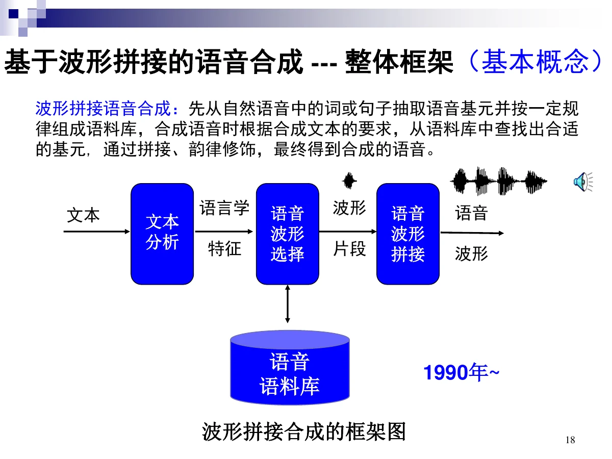
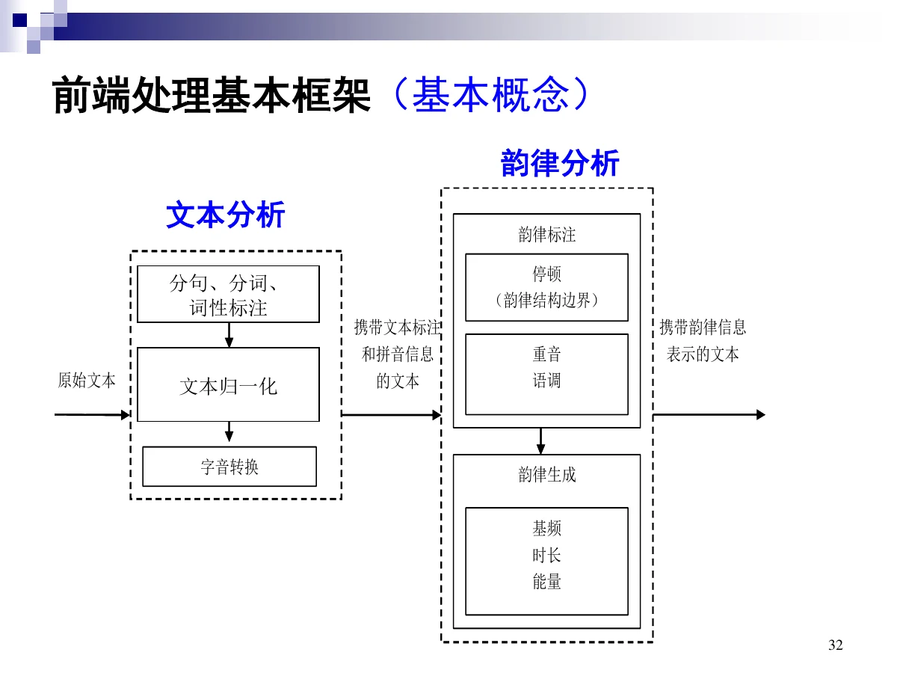
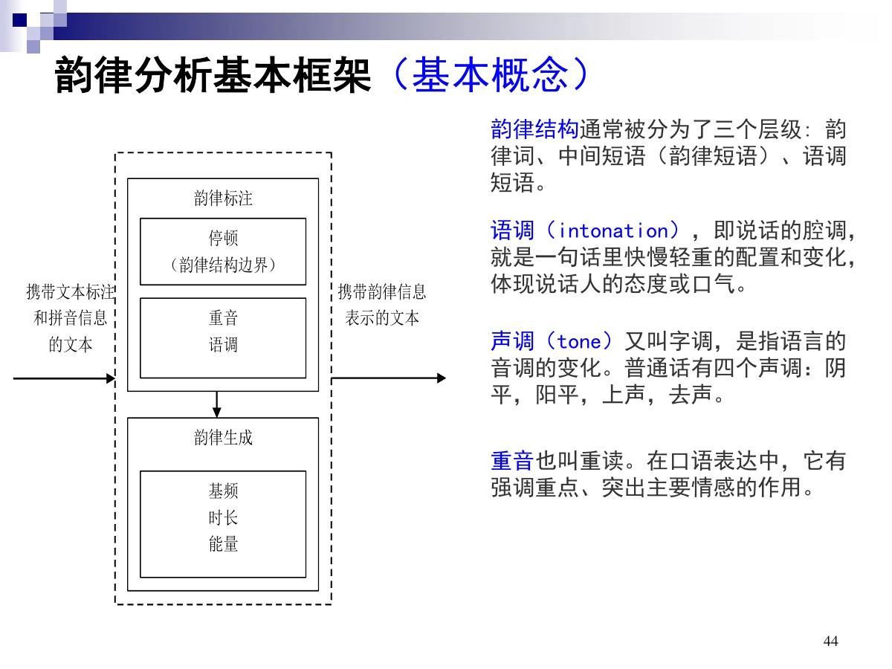
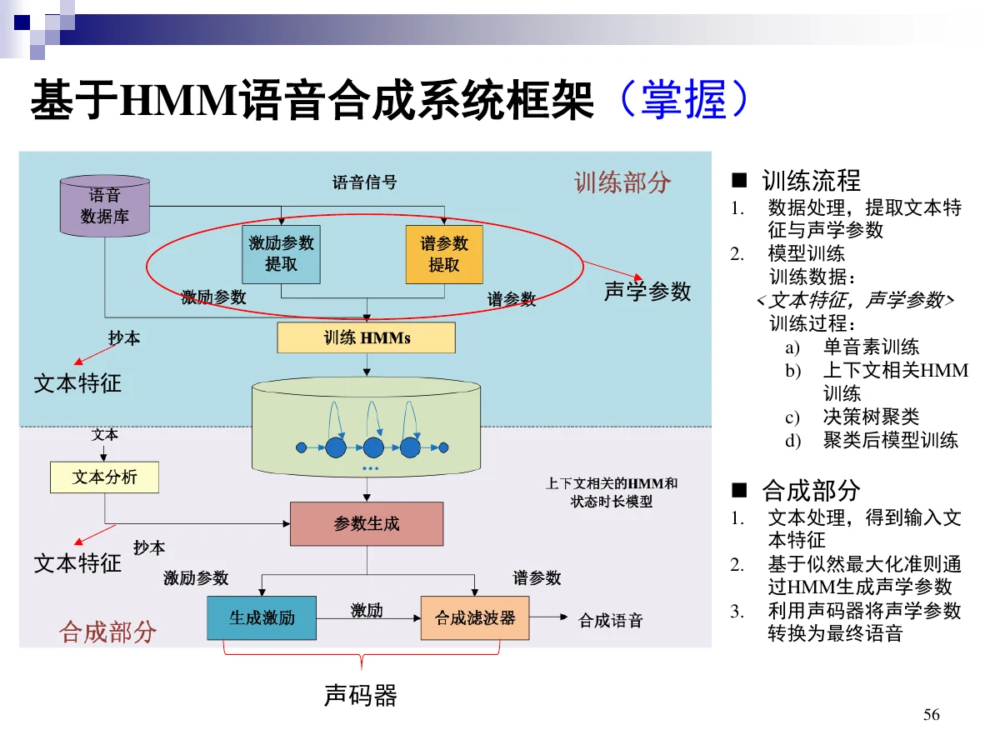
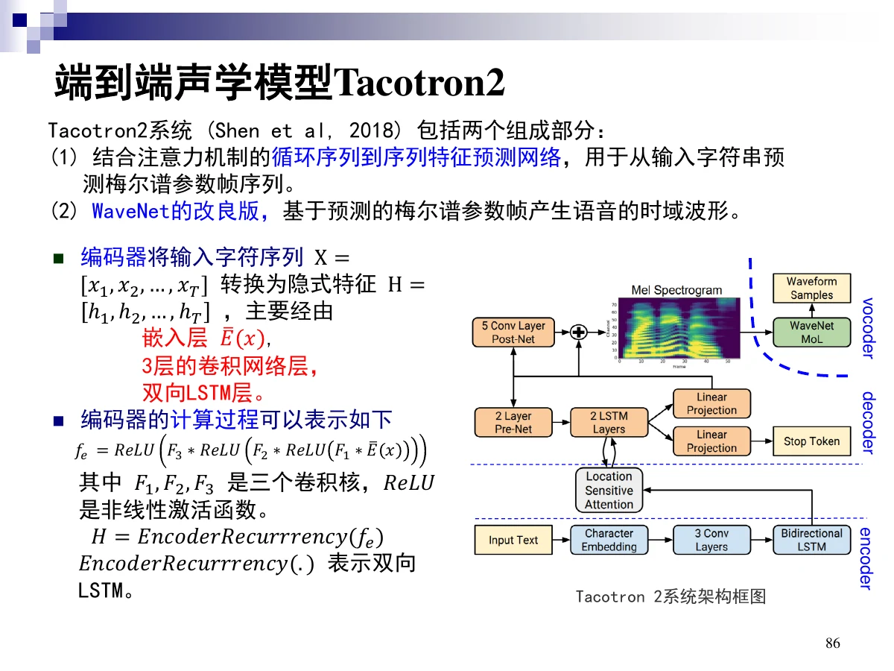

# 4 语音合成

一句话：语音合成（TTS）是**由文本生成语音**，本质是把语言信息重新调制到声学信号上。工程上分**前端（文本 → 语言学特征）** 与 **后端（语言学特征 → 声学参数 → 波形）**，本章重点是 **HMM 统计参数合成**，并了解 **DNN 合成与端到端**的主流做法。

## 总览（思维导图）

$$
\text{第 4 章 语音合成}
\begin{cases}
4.1\ \text{概述}:\ \text{定义、目标、MOS/CMOS/ABX/MCD}\\
4.2\ \text{原理}
\begin{cases}
4.2.1\ \text{整体框架（重点掌握）}:\ \text{前端}+\text{后端}\\
4.2.2\ \text{文本分析}:\ \text{分词、归一化、字音转换}\\
4.2.3\ \text{韵律分析}:\ \text{三级结构、}F_0\text{/时长/能量}
\end{cases}\\[4pt]
4.3\ \text{主流技术}
\begin{cases}
4.3.1\ \text{HMM 合成}:\ \text{训练与解码、系统框架、过平滑}\\
4.3.2\ \text{神经网络合成}:\ \text{DNN 输入输出}\\
4.3.3\ \text{声码器}
\end{cases}\\[4pt]
4.4\ \text{展望}:\ \text{端到端（Tacotron2、FastSpeech、VITS）、VALL-E}
\end{cases}
$$

## 考点权重

| 模块               | 真正需要掌握                                          |   优先级 |
| ------------------ | ----------------------------------------------------- | -------: |
| 4.1.1 基本概念     | 定义、可懂度/自然度、MOS 五级、CMOS、ABX、MCD         | **很高** |
| 4.1.2 方法回顾     | 波形拼接的框架与问题、统计参数合成的优点              |       高 |
| 4.2.1 整体框架     | 前端/后端分工（重点掌握）                             | **最高** |
| 4.2.2 文本分析     | 前端框架、分词与词性、文本归一化、字音转换            | **很高** |
| 4.2.3 韵律分析     | 三级韵律结构、语调/声调/重音、$F_0$/时长/能量的生成   | **很高** |
| 4.3.1 HMM 合成     | 为什么用 HMM、识别 vs 合成、系统框架、过平滑          | **最高** |
| 4.3.2 神经网络合成 | DNN 合成的输入/输出、时长模型与参数生成模型的输入     |       高 |
| 4.4 展望           | 端到端两类模型、Tacotron2/FastSpeech/VITS/VALL-E 要点 |     中高 |

已剔除：4.1.3 典型应用、合成发展历史与机械/参数合成细节、韵律结构标注（中文）、边界预测、语调分解、上下文特征、方差下限估计、语音合成的参数生成、声码器细节，均为标注「了解」的内容。

# 4.1 语音合成概述

## 4.1.1 基本概念

**定义**：语音合成（Speech Synthesis）是通过机械的、电子的方法产生人造语音的技术；TTS 指自动把文本转换为声音。

**两个目标**：

| 目标   | 含义                 |
| ------ | -------------------- |
| 可懂度 | 听者能听懂           |
| 自然度 | 听起来像不像真人说的 |

广义的语音合成还包括语音转换（说话人转换、语音到歌唱转换、情感转换、口音转换）、歌唱合成、可视语音合成。

### 主观评价

**MOS（Mean Opinion Score，1~5 或 0~100）**，CCITT 推荐的主观评价方法：

| MOS | 等级 | 语音质量                                   |
| --- | ---- | ------------------------------------------ |
| 5   | 优   | 流畅自然，无瑕疵                           |
| 4   | 良   | 失真不明显，不注意听感觉不到               |
| 3   | 一般 | 明显失真，但自然度和清晰度尚可忍受，不疲劳 |
| 2   | 差   | 严重失真、不自然，听起来有疲劳感           |
| 1   | 劣   | 语音质量极差，听觉无法忍受                 |

**CMOS（Comparative MOS）**：相对评分，范围 $[-3,3]$，间隔为 1；3 表示远优于、$-3$ 远差于、0 表示无差别。

**ABX Test**：AB 两组音频对比，选 A、选 B，或认为两组无差别（X）。

做主观测听要注意：足够的测听人数、测听设备、是否培训测听人员、每个 session 的时长、以及统计有效性检验。

### 客观评价

和真实音频（ground truth）之间的距离度量：

| 指标             | 含义           |
| ---------------- | -------------- |
| MCD              | 梅尔倒谱失真   |
| RMSE of $F_0$    | 基频均方根误差 |
| RMSE of Duration | 时长均方根误差 |

## 4.1.2 方法回顾

### 波形拼接

先从自然语音中抽取词或句的语音基元，按规律组成语料库；合成时按文本查找合适基元，经**拼接、韵律修饰**得到语音。流程：文本分析 → 语言学特征 → 语音波形选择 → 波形片段拼接 → 波形。

问题（也是统计参数合成要解决的）：

1. 需要**大规模精心设计**的语音数据库；
2. 数据库里没有类似音素样例时合成质量差；
3. **不易控制韵律**；
4. 可扩展性差、不易维护。

### 统计参数语音合成（SPSS）

对输入语音做**参数化表征**，用统计模型对声学参数建模，再由模型构建合成系统。

优点：无需大规模精心设计的语料库、合成质量稳定、**可以控制韵律**、可扩展性好易维护。分**基于 HMM** 与**基于 DNN** 两条路。

# 4.2 语音合成的原理

## 4.2.1 整体框架（重点掌握）

语音是“通过语言调制、由人类发声器官产生的声学信号”，所以合成就是**把语言信息调制到声学信号上**。

| 环节             | 内容                                                 |
| ---------------- | ---------------------------------------------------- |
| 语言处理（前端） | 句词切分、文本归一化、字音转换、**韵律预测**         |
| 声音处理（后端） | **韵律参数预测** + 声音波形生成（声学模型 + 声码器） |

统计参数合成的主流程：

- **前端处理**：从原始文本提取可被声学模型识别的**语言学特征**，即音标与韵律信息的符号化表征；
- **后端处理**：把语言学特征转换成**声学特征**，再转换成语音波形。

有的研究把“文本分析 + 韵律预测”合并称为**语言分析**。

## 4.2.2 文本分析

| 步骤           | 作用                                                               |
| -------------- | ------------------------------------------------------------------ |
| 分词与词性标注 | 标注词语边界与词性                                                 |
| 文本归一化     | 把非标准词转换为发音明确的口语词（如“前方 120M”→“前方一百二十米”） |
| 字音转换       | 给出字符对应的发音，并处理协同发音、**多音字消歧**、儿化音、变调   |

## 4.2.3 韵律分析

### 三级韵律结构（基本概念）

**韵律词 → 中间短语（韵律短语）→ 语调短语**。

三个易混概念：

| 概念 | 含义                                                             |
| ---- | ---------------------------------------------------------------- |
| 语调 | 说话的腔调，一句话里快慢轻重的配置与变化，体现态度或口气         |
| 声调 | 又叫字调，语言的音调变化；普通话有阴平、阳平、上声、去声四个声调 |
| 重音 | 也叫重读，在口语中起强调重点、突出主要情感的作用                 |

### 韵律的特征（基本概念）

- 从信号角度：韵律是**超音段**的声音物理属性（音高、音长、强度）；
- 从语用角度：韵律编码语音意图——信息焦点、对话连贯性、言语行为类型、说话人态度与情感；
- 韵律是**句法与发音的接口**，受语气类型、词汇语义与句法关联、节奏、篇章连贯性影响；
- 在**感知**中反映节奏、强调、语速；在**生成**中通过**音高 $F_0$、持续时间、能量**的变化实现。

### 基频、时长、能量的生成（基本概念）

语调调型隐含于**基频模型**：句子的基频曲线由当前音节的拼音、声调与上下文，从语料库的基频统计模型得到，语调可视为语料库中语调的平均。时长与能量同样是重要的韵律信息。

生成方法两类：**基于规则**、**基于数据**（传统统计模型、深度神经网络等）。

# 4.3 语音合成的主流技术

## 4.3.1 基于 HMM 的语音合成

### 为什么用 HMM

语音产生本身是**双重随机过程**：气流经由的过程无法观测，发出的语音可观测。HMM 同样是双重随机过程：隐马尔可夫链输出的状态序列不可观测，随机过程输出的观察序列可观测。

### 识别与合成是反向问题（掌握）

| 环节 | 语音识别                                                   | 语音合成                                                       |
| ---- | ---------------------------------------------------------- | -------------------------------------------------------------- |
| 训练 | $\hat\Lambda=\arg\max_\Lambda P(L\mid O,\Lambda)$          | $\hat\Lambda=\arg\max_\Lambda P(O\mid L,\Lambda)$              |
| 解码 | $\hat L=\arg\max_L P(O=o\mid L,\Lambda)$（识别、生成文本） | $\hat O=\arg\max_O P(O\mid L=l,\Lambda)$（合成、生成声学参数） |

$O$ 是声学特征，$L$ 是文本（语言学）特征，$\Lambda$ 是 HMM 参数。

**两者训练算法相同：Baum-Welch（EM 的快速实现）；解码算法相同：基于动态规划的 Viterbi。**

### 系统框架（掌握）

**训练流程**

1. 数据处理，提取**文本特征**与**声学参数**；
2. 模型训练，训练数据是 <文本特征, 声学参数> 对，过程为：**单音素训练 → 上下文相关 HMM → 决策树聚类 → 聚类后模型训练**。

**合成流程**

1. 文本处理，得到输入文本特征；
2. 基于**似然最大化准则**，用 HMM 生成声学参数；
3. 用**声码器**把声学参数转换为最终语音。

### 过平滑问题

HMM 合成的语音**平淡、音质不好**，原因是**过平滑**：HMM 假设各状态之间独立，状态参数分布是统计平均的结果；决策树作为浅层线性模型无法建模复杂映射关系，对输入特征与数据空间的线性分割会降低泛化能力。

## 4.3.2 基于神经网络的语音合成

**基于 DNN 的合成（基本概念）**：把增强后的上下文特征与音节时长等参数作为输入，前向传播后直接预测语音的**声学参数**（语谱参数、激励参数），取代 HMM 的生成过程。

两类模型的输入输出（考试常问）：

| 模型         | 输入                                         | 输出                      |
| ------------ | -------------------------------------------- | ------------------------- |
| 时长模型     | 音素级特征（音素 one-hot + 上下文信息）      | 该音素的时长 + 各状态时长 |
| 参数生成模型 | **帧级**输入（按音素时长展开，再加状态信息） | 该帧的语音特征            |

一句话：**一句话有多少音素，就对应多少条时长模型的输入；有多少帧，就对应多少条参数生成模型的输入。**

## 4.3.3 声码器

声码器基于**源—滤波器模型**：把声学参数（谱参数、基频、非周期成分等）还原成激励与声道滤波，再合成波形。合成音质在很大程度上取决于声码器。

# 4.4 语音合成的技术展望

## 端到端语音合成（基本概念）

**端到端（E2E）TTS** 直接读文本作为输入，不使用中间表示，直接输出语音波形；优化目标是**整个系统**而不是各子系统，从而减少人工假设与多阶段建模造成的性能损失。

| 类型             | 做法                                                                                 |
| ---------------- | ------------------------------------------------------------------------------------ |
| 前端的端到端模型 | 把韵律预测、持续时长、语音特征模型统合到一个模型，直接由上下文无关的符号预测语音特征 |
| 后端的端到端模型 | 读取语音特征直接产生波形，又称**神经声码器**                                         |

**Tacotron 2（2018）**：把前端的端到端模型（Tacotron）与后端的端到端模型（WaveNet 改良版）结合；由带注意力机制的循环序列到序列网络预测梅尔谱帧序列，再由声码器生成时域波形。

**FastSpeech（2019）**：自回归模型（如 Tacotron2）有生成速度慢、鲁棒性差（跳词、重复）、可控性差三个问题；FastSpeech 用**非自回归**方式并利用文本与语音的**单调对齐**来加速梅尔谱生成。

**VITS（2021）**：实现声学模型与声码器**统一建模**，避免两段式框架中共用梅尔谱中间表征引入的误差；包含先验编码器、后验编码器（用线性谱）与 Flow 标准化流。

## VALL-E（基本概念）

把语音合成看作**条件语言模型**任务而不是连续信号回归：用离散编码表示语音，给定文本序列与 3 秒语音提示，即可合成未见说话人的高相似度语音。第一个码本用自回归（AR）预测，其余码本用非自回归（NAR）预测。

# 4.5 本章小结

- 合成 = 把语言信息调制到声学信号上；目标可懂度 + 自然度。
- 主观 MOS/CMOS/ABX，客观 MCD 等距离度量。
- 前端做文本分析与韵律预测，后端做声学模型与声码器；前后端分工是重点。
- 韵律三级：韵律词、韵律短语、语调短语；由 $F_0$、时长、能量实现。
- HMM 合成与识别反向，训练 Baum-Welch、解码 Viterbi；缺陷是过平滑。
- 端到端分前端/后端两类，最终走向声学模型与声码器统一建模。

# 4.6 考前速查表

| 题目出现                                      | 立刻想到                                          |
| --------------------------------------------- | ------------------------------------------------- |
| 由文本生成语音                                | TTS / 语音合成                                    |
| 可懂度 + 自然度                               | 合成的两个目标                                    |
| MOS 五级、CMOS $[-3,3]$、ABX                  | 主观评价                                          |
| MCD、$F_0$ RMSE、时长 RMSE                    | 客观评价                                          |
| 需要大规模语料库、不易控韵律                  | 波形拼接的缺点                                    |
| 无需大规模语料、质量稳定、可控韵律            | 统计参数合成的优点                                |
| 前端 / 后端                                   | 文本 → 语言学特征 / 特征 → 波形（重点）           |
| 分词、归一化、字音转换                        | 文本分析三件事，字音转换含多音字消歧              |
| 韵律词 → 韵律短语 → 语调短语                  | 三级韵律结构                                      |
| 语调 / 声调 / 重音                            | 腔调 / 字调（四声） / 重读                        |
| $F_0$、时长、能量                             | 韵律在生成端的实现手段                            |
| 双重随机过程                                  | 为什么用 HMM 做合成                               |
| 识别与合成反向、训练 Baum-Welch、解码 Viterbi | 两者关系                                          |
| 单音素 → 上下文相关 → 决策树聚类 → 聚类后训练 | HMM 合成的训练流程                                |
| 似然最大化准则生成声学参数                    | HMM 合成的合成步骤                                |
| 声音平淡、统计平均                            | 过平滑                                            |
| 音素级输入 → 时长；帧级输入 → 声学参数        | DNN 合成的两个模型                                |
| 前端 E2E / 后端 E2E（神经声码器）             | 端到端的两类模型                                  |
| Tacotron2 / FastSpeech / VITS / VALL-E        | 端到端代表作：注意/非自回归/统一建模/条件语言模型 |
