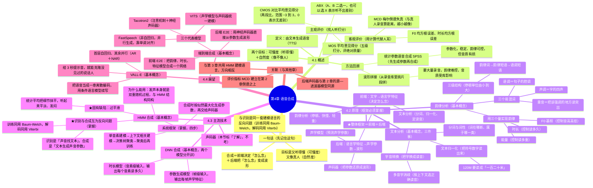

# 4 语音合成

一句话：语音合成（TTS，Text-to-Speech，文本转语音）是**由文本生成语音**，本质是把语言信息重新调制到声学信号上。工程上分**前端（文本 → 语言学特征）** 与 **后端（语言学特征 → 声学参数 → 波形）**，本章重点是 **HMM（Hidden Markov Model，隐马尔可夫模型）统计参数合成**，并了解 **DNN（Deep Neural Network，深度神经网络）合成与端到端**的主流做法。

## 0 读这一章之前

- **前置知识**：无，本章可以从零看。
- 整章一句话：**文字 → 怎么念 → 声音**。前半段叫前端，后半段叫后端。
- 三个新词：**前端**（文本分析 + 韵律）、**后端**（声学模型 + 声码器）、**声码器**（参数变波形）。
- 评价部分只要记住：主观靠人打分（MOS，Mean Opinion Score，平均意见得分；CMOS，Comparative Mean Opinion Score，对比平均意见得分；ABX，ABX Test，ABX 测试），客观靠和真人录音算距离（MCD，Mel-Cepstral Distortion，梅尔倒谱失真）。

## 总览（思维导图）

## 考点权重

| 模块 | 真正要掌握的内容 | 优先级 |
| --- | --- | ---: |
| 4.1.1 基本概念 | 定义与两大目标、广义合成、MOS/CMOS/ABX、MCD 等客观指标及其局限 | **很高** |
| 4.1.2 方法回顾 | 波形拼接的框架与四个问题、统计参数合成的优点 | 高 |
| 4.2.1 整体框架 | 前端/后端分工（**重点掌握**）、与识别流程的异同 | **最高** |
| 4.2.2 文本分析 | 分词与词性、文本归一化、字音转换 | **很高** |
| 4.2.3 韵律分析 | 三级韵律结构、语调/声调/重音、$F_0$ 时长能量 | **很高** |
| 4.3.1 HMM 合成 | 为什么是 HMM、与识别互为反向、系统框架与训练四步、过平滑 | **最高** |
| 4.3.2 DNN 合成 / 4.4 展望 | DNN 合成的输入输出、端到端与 Tacotron2、VALL-E | 中高 |

---

## 4.1 语音合成概述

### 4.1.1 基本概念

#### 言语链与技术演化

- **言语链**：生成、感知、认知回路与言语交互理解回路在同一**知识语境和语言语境**下工作。说话人把意图编码为语音并传给听话人，听话人再解码、再现说话人的意图。
- **人机语音交互分工**：自动语音识别（Automatic Speech Recognition，**ASR**）对应语言信息感知，TTS 对应语音生成，说话人识别（Speaker Recognition）对应非语言信息感知，自然语言处理（Natural Language Processing，**NLP**）支撑言语认知与交互。

| 时期 | 代表技术及变化 |
| --- | --- |
| **20 世纪 90 年代** | **波形拼接**是主流，从录音库挑选片段再拼接 |
| **本世纪初至 2013 年前** | 从波形拼接逐步转向**统计参数合成**，HMM 是经典声学模型 |
| **2013 年前后** | **深度学习**取得成功，DNN 逐步替代 HMM |
| **2016 年前后** | **端到端模型**受到越来越多关注 |
| **2023 年前后** | **语音合成大模型**成为研究热点 |

**本章重点**是基于 HMM 与深度学习的**统计参数合成算法**。

**定义**：

- **语音合成（Speech Synthesis）**：通过机械的、电子的方法产生人造语音的技术；
- **TTS（Text-to-Speech）**：自动将文本转换为声音。

**两大目标**

| 目标 | 含义 | 怎么评 |
| --- | --- | --- |
| **可懂度（Intelligibility）** | 语音中有意义的语言单元（词、句）内容能被识别/理解的程度 | 人工测听或 ASR 系统测评 |
| **自然度（Naturalness）** | 合成语音与人类语音听起来的接近程度 | 尚无唯一客观指标，多靠主观测评 |

> [!question]- PPT 第 8 页 · 除了可懂度与自然度，还有哪些目标？
> **参考答案**
>
> 还有 **说话人相似度/音色逼真度**（是不是像目标说话人）、**表现力与情感**（能否表达情绪、语气、风格）、**韵律正确性**（停顿、重音、语调是否自然）、**可控性**（能否指定语速、音高、风格、口音）、**鲁棒性**（对多音字、数字、专名、中英混读的处理是否正确）、以及工程侧的**实时率与资源占用**。工业上还看**稳定性**（长句不崩、不重复、不漏字）。

**广义的语音合成**还包括：**语音转换**（说话人转换、语音到歌唱转换、情感转换、口音转换）、**歌唱合成**（文本/歌词到歌唱）、**可视语音合成**（如虚拟歌姬的口型动画）。

- **语音转换（Voice Transformation / Voice Conversion）**：输入已有语音，改变说话人、情感或口音，也可以做**语音到歌唱转换（Speech to Singing）**。
- **歌唱合成（Singing Synthesis）**：从文本或歌词生成歌声，即**文本/歌词到歌唱（Text / Lyric to Singing）**。PPT 的日本虚拟歌姬示例使用 **Yamaha 的 VOCALOID 2 语音合成引擎**，其歌声生成属于歌唱合成。
- **可视语音合成（Visual Speech Synthesis）**：生成与语音对应的可视发音表现，例如口型动画。虚拟歌手可以同时结合歌唱合成与可视语音合成，两者不是同一个任务。

**TTS 流程与人的朗读过程对比**：TTS 涵盖了人朗读的主要要素，但**没有考虑两个最重要的要素——上下文理解和意图表达（speech skill）**。

#### 主观评价指标

| 指标 | 类型 | 说明 |
| --- | --- | --- |
| **MOS（Mean Opinion Score）** | 绝对值 | CCITT 推荐的主观评价方法，1~5 分（或 0~100） |
| **CMOS（Comparative MOS）** | 相对值 | 每次听两段同文本音频，用 $[-3,3]$ 打分（间隔 1）：3 远优于、$-3$ 远差于、0 无差别 |
| **ABX Test** | 相对值 | AB 两组音频对比，选 A、选 B，或认为无差别（X） |

MOS 五级：**5 优**（流畅自然无瑕疵）、**4 良**（失真不明显，不注意听感觉不到）、**3 一般**（明显失真但可忍受，无疲劳感）、**2 差**（严重失真、不自然，有疲劳感）、**1 劣**（极差，无法忍受）。

做主观测听要注意：**足够的合理的测听人员与人数**、**测听设备**（不同设备主观感受不同）、**是否培训测听人员**、**每个 session 的时长安排**、以及**统计有效性检验（significant test）**。

> [!question]- PPT 第 11 页 · 测听安排：是否做测听人员培训？
> **参考答案**
>
> 应先统一说明**评价维度、评分标准与操作方法**，必要时安排练习，避免不同人把「音质」「自然度」或「说话人相似度」混作同一个指标。培训不能暗示哪种系统更好，以免引入偏见。
>
> - **人员与人数**：选择适合任务的听者，并保证足够人数，不能只凭少数人的偏好下结论。
> - **设备条件**：尽量统一耳机、音量与测听环境，设备不同会改变主观感觉。
> - **单次测听时长（session）**：合理安排时长与休息，避免疲劳影响后半段评分。
> - **显著性检验（Significance Test）**：判断分数差异是否超过随机波动，不能只看平均分大小。

> [!question]- PPT 第 12 页 · MOS 指标的不足点？
> **参考答案**
>
> 1. **主观性强、可重复性差**——不同听者、不同设备、不同环境结果差异大，需要足够人数和统计检验
> 2. **粒度粗**——五级制对当前高自然度系统的区分度不够（地板效应/天花板效应），常出现大量 4.5 分难以区分
> 3. **成本高、周期长**，难以用于大规模自动评测与训练中的快速迭代
> 4. **只给整体印象**，无法定位是音质、韵律还是发音出错
> 5. 与**可懂度不总一致**（听起来自然不等于听得清）。
>
> 因此实际中常与 CMOS/ABX 等相对指标及 MCD 等客观指标配合使用。

#### 客观评价指标

与真实音频（Ground Truth）之间的距离度量，常用：

1. **梅尔倒谱失真 MCD（Mel-Cepstral Distortion）**；
2. **$F_0$ 均方根误差（RMSE of $F_0$）**；
3. **时长均方根误差（RMSE of Duration）**。

> [!question]- PPT 第 13 页 · 语音识别与语音合成客观指标的异同点？语音合成客观指标的不足点？
> **参考答案**
>
> **相同点**：都以「参考（真人）结果」为标尺算距离/错误率，都可自动化、可重复、可大批量；识别用 WER/CER，合成用 MCD、$F_0$/时长 RMSE。
>
> **不同点**：识别的指标衡量**符号序列**对不对（离散、与文本对齐后计数）；合成的指标衡量**连续声学参数**像不像（频谱包络、基频、时长的距离），不需要对齐到词。
>
> **不足点**：
>
> 1. **与主观听感相关性有限**——MCD 小不代表听起来自然（相位、细节纹理、韵律自然度都没被衡量）。
> 2. **覆盖面窄**——$F_0$、时长 RMSE 只覆盖韵律的两个维度，不能反映音质与表现力。
> 3. **对录音条件敏感**——说话人、信道不同会显著影响数值，跨系统比较需谨慎。
>
> 所以论文里通常是「客观指标 + MOS 主观测听」一起报。

### 4.1.2 方法回顾

#### 波形拼接（基本概念）

> [!tip] 人话
> 从真人录音里剪出片段，再拼起来。

**做法**：从自然语音中抽取词或句的**语音基元**，按规律组成**语料库**；合成时根据文本从语料库查找合适基元，经**拼接、韵律修饰**得到语音。流程：文本 → 文本分析 → 语言学特征 → 语音波形选择 → 波形片段拼接 → 语音波形。

**单元挑选与拼接的分工**：

1. **建库**：先从自然语音中抽取基元，保存其波形及对应信息。
2. **挑选**：文本分析给出语言学特征，按待合成文本的要求，从语料库查找**合适的波形片段**。
3. **拼接**：把挑出的片段连接起来，并进行**韵律修饰**，得到最终波形。挑选负责「用哪一段」，拼接负责「怎样接起来」。

**四个问题**：

1. 需要**大规模精心设计**的语音数据库
2. 数据库里没有类似音素样例时合成质量差
3. **不易控制韵律**
4. 可扩展性差、不易维护。

> [!question]- PPT 第 16 页 · 如何解决波形拼接合成的问题？
> **参考答案**
>
> 改用**统计参数语音合成（SPSS）**——不再存储和拼接波形片段，而是对语音做**参数化表征**（谱参数、基频、时长等），用统计模型学「文本特征 → 声学参数」的映射，合成时由模型生成参数再用声码器还原波形。这样既不需要大规模精设计语料库，又能**控制韵律**、便于扩展维护、质量稳定。

#### 统计参数语音合成（基本概念）

**SPSS**：对输入的语音做**参数化表征**，基于**统计模型**对声学参数建模，再以训练得到的模型构建合成系统。**优点**：无需大规模精心设计的语音数据库、合成质量稳定、**可以控制韵律**、可扩展性好易维护。分**基于 HMM** 与**基于 DNN** 两条路。

---

## 4.2 语音合成的原理

### 4.2.1 整体框架（掌握）

> [!tip] 人话
> 前端把字变成「怎么念」，后端把「怎么念」变成声音。

语音是「通过语言调制、由人类发声器官产生的声学信号」，所以**语音合成的原理就是把语言信息调制到声学信号上**。语言处理包括句词切分、文本归一化等；声音处理包括韵律参数预测与波形生成。

| 环节 | 内容 |
| --- | --- |
| **前端处理（Front-end）** | 从原始文本提取可被声学模型识别的**语言学特征**（音标与韵律信息的符号化表征）：文本分析 + 韵律分析 |
| **后端处理（Back-end）** | 把语言学特征转换成**声学特征**，再转换成语音波形（声学模型 + 声码器） |

标准流程（符号即 PPT 框架图）：文本 $W$ → 文本分析 → 语言学特征 $L$ → 韵律分析 → 声学模型 $\Lambda$ → 声学特征 $O$ → 声码器 $\Gamma$ → 语音波形 $X$。

有的研究把「文本分析 + 韵律预测」合并称为**语言分析**。

> [!question]- PPT 第 23 页 · 语音合成与语音识别主要流程的异同点有哪些？
> **参考答案**
>
> **共同点**：
>
> - 都走「前端 + 后端」两段式
> - 都用 MFCC/谱类声学参数
> - 核心模型都是 HMM（训练用 Baum-Welch、解码用 Viterbi）
> - 都依赖文本与语音的对齐信息
>
> **不同点**：
>
> 1. **方向相反**——识别是「语音（声学特征 $O$）→ 文本（语言学特征 $L$）」，合成是「文本 $L$ → 声学特征 $O$ → 波形」。
> 2. **后端不同**——识别后端是**解码器 + 词典 + 语言模型**，合成后端是**声学模型 + 声码器**。
> 3. **前端不同**——识别的输入要先做语音增强，合成的输入要先做文本分析与韵律预测。
> 4. **评价指标不同**——识别看 WER，合成看 MOS/MCD。

### 4.2.2 文本分析（基本概念）

> [!tip] 人话
> 先断词，再把数字符号念出来，最后定多音字。

| 步骤 | 作用 |
| --- | --- |
| **分词与词性标注** | 标注词语边界与词性。分词是把连续的汉字序列按规范重组成词序列；词性可用来预测韵律边界、做多音字消歧。例：「南京市长江大桥」可切为「南京市 / 长江大桥」或「南京市长 / 江大桥」——切错就影响自然度 |
| **文本归一化** | 把**非标准词转换为发音明确的口语单词**。例：前方 120M → 前方一百二十米；拨打 120 → 拨打幺二零。方法：基于规则 / 规则与深度学习结合 |
| **字音转换（标音）** | 给出每个字的发音，并进一步处理协同发音、**多音字消歧**、儿化音、变调。例：古都{dū}、都{dōu}有；理解{lǐ jiě}。方法：基于字典 / HMM / 神经网络 |

前端整体链路：原始文本 → 文本规范化 → 分词与词性标注 → 字音转换 → 韵律标注 → 韵律生成。

#### 文本处理的细节与例子

- **分词（Word Segmentation）**：词边界不仅决定如何查词，还影响**词性、韵律边界和发音**。「南京市 / 长江大桥」与「南京市长 / 江大桥」的语义不同，读法也会不同。
- **词性标注（Part-of-Speech Tagging）**：给分词结果中的每个词标明名词、动词、形容词等类别，为**韵律边界预测与多音字消歧**提供依据。
- **文本归一化（Text Normalization）**：要处理**简略词、日期、公式、号码**等非标准词。相同数字会因语义而有不同读法，例如距离中的「120」读数值，电话号码中的「120」逐位读。不处理可能造成**语法错误或语义不完整**。
- **字音转换（Grapheme-to-Phoneme Conversion）**：不只逐字查字典，还要结合上下文处理**协同发音、多音字、儿化音与变调**。
- **多音字消歧**：「古都」的「都」读 **dū**，「都有」的「都」读 **dōu**，要根据词义和上下文选读音。
- **变调（Tone Sandhi）**：正文「理解」所列 **lǐ jiě** 是本调标注。实际连读时两个三声相连，前一个三声通常变为二声，所以 PPT 标为 **lí jiě（li2 jie3）**，说明标音还需反映语流中的声调变化。
- **协同发音（Coarticulation）**：相邻音素的发音动作彼此影响，因此当前音素的声学实现不能只看它自身。
- **儿化音标注**：要识别是否发生儿化，并给出相应读音，而不是把所有「儿」都机械地作为独立音节朗读。

### 4.2.3 韵律分析（基本概念）

> [!tip] 人话
> 韵律说白了就是「快慢轻重」。

**四个易混概念**

| 概念 | 含义 |
| --- | --- |
| **韵律结构** | 三个层级：**韵律词 → 中间短语（韵律短语）→ 语调短语** |
| **语调（intonation）** | 说话的腔调，一句话里快慢轻重的配置与变化，体现说话人的态度或口气 |
| **声调（tone）** | 又叫字调，语言的音调变化；普通话有阴平、阳平、上声、去声四个声调 |
| **重音** | 也叫重读，在口语中起强调重点、突出主要情感的作用 |

**韵律的特征**

- 从**信号**角度：韵律是**超音段**的物理属性（音高、音长、强度）；
- 从**语用**角度：韵律编码语音意图——信息焦点、对话连贯性、言语行为类型、说话人态度与情感；
- 韵律是**句法与发音的接口**，受语气类型、词汇语义与句法关联、节奏、篇章连贯性影响；
- 在**感知**中反映节奏、强调、语速；在**生成**中通过**音高 $F_0$、持续时间、能量**的变化实现。

**基频、时长、能量的生成**：语调调型隐含于**基频模型**——句子基频曲线由当前音节的拼音、声调与上下文，从语料库的基频统计模型得到，语调可视为语料库中语调的平均；时长与能量同样是重要韵律信息。生成方法两类：**基于规则**、**基于数据**（传统统计模型、深度神经网络等）。

**韵律标注与韵律生成的区别**：

- **韵律标注（Prosodic Annotation）**：在已有文本标注和拼音信息上，标出**停顿及韵律结构边界、重音、语调**，得到携带韵律信息的文本。
- **韵律生成（Prosody Generation）**：把上述符号层面的要求落实为**基频、时长、能量**的变化。
- **语气与情感**：同一句文字可能表达陈述、疑问或不同态度与情绪。它们会影响信息焦点、重音、节奏与语调，因此**读音正确不等于意图表达正确**。

---

## 4.3 语音合成的主流技术

### 4.3.1 基于 HMM 的语音合成（掌握）

#### 为什么是 HMM

> [!tip] 人话
> 语音本身就是「看不见的状态推动看得见的声音」，HMM 正好是这个结构。

受 HMM 在语音识别领域成功的启发：**HMM 适合为时序信号建模**。语音的产生本身是**双重随机过程**——气流经由的过程无法观测，发出的语音可观测；HMM 同样是双重随机过程——隐马尔可夫链输出的状态序列不可观测，随机过程输出的观察序列可观测。另外 HMM 的三件套（状态集合 $S$、状态转移矩阵 $A$、观察值概率矩阵 $B$）在识别与合成中是同一套。

> [!question]- PPT 第 34—35 页 · 为什么是 HMM？
> **参考答案**
>
> 1. **时序建模能力**：语音随时间展开，HMM 的状态转移描述发音过程的先后关系。
> 2. **隐状态过程**：发音器官内部的气流经由过程不可直接观测，对应隐马尔可夫链产生的**隐藏状态序列**。
> 3. **可观测过程**：每个状态产生可观测的声学特征，对应 HMM 的**观察序列**。隐藏状态转移与条件观察输出构成**双重随机过程**。
> 4. **已有成功经验**：HMM 已成功用于语音识别，因此可以借用同一建模框架，由文本条件生成声学特征。

#### 识别与合成是反向问题（掌握）

> [!tip] 人话
> 识别由声音求文字，合成由文字求声音；训练和解码用的却是同一套算法。

记声学特征为 $O$、语言学特征为 $L$、HMM 参数为 $\Lambda$：

| 环节 | 语音识别 | 语音合成 |
| --- | --- | --- |
| **训练** | 调 $\Lambda$ 使 $P(L\mid O,\Lambda)$ 最大（由声音推出文本的模型） | 调 $\Lambda$ 使 $P(O\mid L,\Lambda)$ 最大（由文本推出声音的模型） |
| **解码/生成** | 给定声音、固定 $\Lambda$，求最可能的文本 $\hat L=\arg\max_L P(O=o\mid L,\Lambda)$ | 给定文本、固定 $\Lambda$，求最可能的声学特征 $\hat O=\arg\max_O P(O\mid L=l,\Lambda)$ |

**两者训练算法相同：Baum-Welch（EM 的快速实现）；解码算法相同：基于动态规划的 Viterbi。** 差的只是「已知哪一边、求哪一边」。

#### 系统框架（掌握）

> [!tip] 人话
> 训练建模型；合成时按文本查模型生成参数，再交给声码器变波形。

**训练流程**

1. **数据处理**：提取文本特征与声学参数，训练数据是 <文本特征, 声学参数> 对；
2. **模型训练**：**单音素训练 → 上下文相关 HMM 训练 → 决策树聚类 → 聚类后模型训练**。

**合成流程**

1. 文本处理，得到输入文本特征；
2. 基于**似然最大化准则**，用 HMM 生成声学参数；
3. 用**声码器**把声学参数转换为最终语音。

#### 文本特征与声学特征

**文本特征**（前端处理后得到）包含：**音素**（发音信息）、**时长**（当前音素发音时长）、**声调**（韵母声调）、**音节**（当前音节在词语/短语/语句中的位置、数目）、**词性/韵律词/韵律短语**信息、以及**上下文信息**（相邻音素的对应特征——包含协同发音、变调、韵律结构等信息，是语言学特征中极其重要的部分）。特定系统还要额外标注：情感合成的整句/短语情感、风格合成的重读与倾向等。

**声学特征**：**谱参数** 与 **基频参数**（以及时长）。

**特征分工**：词性、韵律词与韵律短语主要记录**韵律相关信息**。上下文特征不仅记录当前音素，还记录邻近音素的相应特征，以表达**协同发音、变调和韵律结构**。

| 特定合成任务 | 需要前端额外生成的文本特征 |
| --- | --- |
| **情感合成（Emotional Speech Synthesis）** | **整句的情感**与**句中各短语的情感特征**，不能只给整句一个标签而忽略短语差异 |
| **风格合成（Style-based Speech Synthesis）** | 文本对应的**重读、倾向**等风格特征 |

#### 训练四步为什么这么做

| 步骤 | 为什么 |
| --- | --- |
| **方差下限估计** | 防止过拟合时方差被训练到 0（数值病态） |
| **单音素 HMM 训练** | 对所有单音素 HMM 初始化和训练（Baum-Welch/EM），得到的模型用于扩展、初始化上下文相关模型 |
| **上下文相关 HMM 训练** | 考虑前后音素（记作 **$l$-$c$+$r$**：左-中-右）与**韵律边界**（词/短语/句子）的影响，如 /#-c+a/、/c-a+t/、/a-t+#/ |
| **基于决策树的 HMM 聚类** | 上下文相关模型参数过多、样本太少会产生**过拟合**，用决策树聚类让参数共享，使鲁棒性与数据量平衡 |
| **聚类后 HMM 训练** | 用聚类后的结构与单音素、上下文相关训练相同（Baum-Welch）再训一遍，得到时长、基频、谱参数模型 |

注意：单音素模型「数据充足」，上下文相关模型「数据不足」，聚类复杂模型正是为了「解决过拟合」。

#### Baum-Welch 辅助函数与参数共享

**Baum-Welch 算法**以**期望最大化（Expectation-Maximization，EM）**为理论基础，PPT 第 44 页引入辅助函数 **$Q(\lambda,\lambda')$**。这里把 $\lambda$ 记为当前参数，把 $\lambda'$ 记为候选新参数：

1. **期望步（E-step）**：用当前模型，估计训练语音中各种隐藏状态路径的后验概率。
2. **辅助函数**：以这些后验概率为权重，计算候选参数下「观察序列与隐藏路径的联合对数概率」的期望。它把难以直接优化的隐藏路径问题，转化成可更新参数的目标。
3. **最大化步（M-step）**：选择使辅助函数增大的新参数，再重复估计与更新，使观察数据的似然不下降。

**数据量与模型复杂度必须匹配**：

- **单音素模型**：不同上下文中的同一音素共用模型，参数较少，每个模型可用的样本相对充足。
- **上下文相关模型**：按前后音素及词、短语、句子等韵律边界细分后，模型数量和参数量增多，每种上下文的样本变少，容易**过拟合**。
- **决策树聚类**：利用**上下文属性问题集**组织划分与聚类，让相似上下文共享参数，以缓解样本稀疏，在**鲁棒性与数据量**之间取得平衡。
- **聚类后再训练**：仍使用 Baum-Welch，而不是换一种训练算法，最终得到**时长、基频、谱参数模型**。

#### 过平滑问题

> [!tip] 人话
> 统计平均会把细节抹平，所以听起来平淡、发闷。

HMM 合成的语音**平淡、音质不好**，原因是**过平滑**：

1. HMM 基于建模，假设各状态之间独立，状态参数分布是**统计平均**的结果
2. 决策树作为**浅层线性模型**无法建模复杂映射关系，对输入特征和数据空间的线性分割会降低泛化能力。

### 4.3.2 基于 DNN 的语音合成（基本概念）

> [!tip] 人话
> 让网络直接从文本特征回归出声学参数。

文本先被转换成**输入特征序列** $x_n^t$（第 $t$ 帧的第 $n$ 个输入特征），包括上下文特征与音节持续时间等参数，与传统统计参数相同；经 DNN 前向传播，**输入特征被映射到输出特征** $y_m^t$（第 $t$ 帧的第 $m$ 维特征），输出包括**语谱参数与激励参数**。DNN 用训练数据中抽取的「上下文特征—语音特征」数据对训练，参数可连续更新。

**两类模型的输入输出**（常考）：

| 模型 | 输入 | 输出 |
| --- | --- | --- |
| 时长模型 | **音素级**特征（音素 one-hot + 上下文信息） | 该音素的时长 + 各状态时长 |
| 参数生成模型 | **帧级**输入（按音素时长展开，再加状态信息） | 该帧的语音特征（谱参数等） |

一句话：**一句话有多少音素，就对应多少条时长模型的输入；有多少帧，就对应多少条参数生成模型的输入。**

**参数更新的迭代过程**：

1. **准备配对数据**：从录音及其文本提取上下文特征与对应语音特征。
2. **前向预测**：把输入特征送入 DNN，得到谱参数、激励参数等预测值。
3. **计算误差并更新**：将预测值与真实语音特征比较，通过反向传播更新网络参数。
4. **重复迭代**：反复利用训练数据更新参数，学习更合适的「上下文特征 → 语音特征」映射。**合成时**使用训练好的参数进行前向预测，不需要真实目标语音。

### 4.3.3 声码器（了解）

声码器基于**源—滤波器模型**，把声学参数（谱参数、基频、非周期成分等）还原成激励与声道滤波，再合成波形；**合成音质在很大程度上取决于声码器**。

---

## 4.4 语音合成的技术展望

### 4.4.1 端到端语音合成（基本概念）

> [!tip] 人话
> 文本直接进、波形直接出，不再分那么多阶段。

**端到端（E2E）TTS** 直接读文本作为输入，**不使用任何中间表示**，直接输出语音波形；优化目标是**整个系统**而不是各子系统，从而减少人工假设与多阶段建模造成的性能损失。分两类：

| 类型 | 做法 |
| --- | --- |
| **前端的端到端模型** | 把**韵律预测模型、持续时长模型、语音特征模型**统合到一个模型里，直接由上下文无关的符号预测语音特征 |
| **后端的端到端模型** | 读取语音特征直接产生波形，又称**神经声码器** |

**Tacotron 2（Shen et al., 2018）** 是经典方法：把前端端到端模型（Tacotron）与后端端到端模型（WaveNet 改良版）结合起来——由带注意力机制的序列到序列网络预测梅尔谱帧序列，再由声码器生成时域波形。

### 4.4.2 语音合成前沿任务：VALL-E（基本概念）

> [!tip] 人话
> 把合成当成「接着往下写语音 token」。

VALL-E（Wang et al., 2023）借助预训练模型的**离散编码表示**，把语音合成看作**条件语言模型**任务而不是连续信号回归：给定文本序列与 **3 秒**语音提示，即可合成训练集中未见过的说话人的高相似度语音（60k 小时数据训练，具备一定上下文学习能力）。

实现细节：语音编码器（EnCodec）的码本是**层次化**的；若每个码本都用自回归太慢，于是**第一个码本用自回归（AR）预测，其余码本用非自回归（NAR）预测**。

#### VALL-E 的离散码本与条件生成

- **离散码本（Discrete Codebook）**：EnCodec 把连续波形编码为离散编号序列，模型预测的是这些**语音 token**，不是逐帧回归连续声学参数。生成后由语音编解码器的解码部分还原波形。
- **生成条件**：文本序列规定「说什么」，短语音提示提供目标说话人的声音信息。模型据此生成目标语音的离散编码，体现**上下文学习（In-context Learning）**能力。
- **自回归（Autoregressive，AR）**：第一个码本沿时间逐个预测 token，后一个 token 依赖前面已经生成的 token，用来形成基础语音序列。
- **非自回归（Non-autoregressive，NAR）**：第 2 至第 8 个码本根据文本、语音提示和此前码本的编码补充信息。**每个后续码本内部的时间位置可并行预测**，但码本层级之间仍有条件依赖，不能理解成全部剩余层完全互不依赖。
- **速度取舍**：所有码本都沿时间自回归会很慢，因此采用**首层 AR + 后续层 NAR**，兼顾序列生成能力与效率。

## 附：PPT 作业题（4.1 / 4.2）参考思路

> [!question]- 作业 4.1 · 简述基于传统神经网络的语音合成与端到端的语音合成的主要流程，并对比二者的优缺点。
> **参考答案**
>
> **一、传统（DNN）统计参数合成：两段式**
>
> 1. 前端文本分析 + 韵律分析 → 语言学特征
> 2. DNN 回归出声学参数（谱参数 / 基频 / 时长）
> 3. **声码器**还原波形
>
> **优点**
>
> - 模块清晰、可控性强（能改语速、时长、基频）
> - 数据需求较小，便于插入外部控制
>
> **缺点**
>
> - 两段之间靠**人工设计的中间表征**（梅尔谱 / 参数）传递，存在信息损失
> - 声码器与声学模型分别优化、误差累积，整体不是全局最优
>
> **二、端到端合成**（Tacotron2 / FastSpeech / VITS）：直接由文本预测波形或梅尔谱，再由神经声码器出声，一整套联合训练、优化整体目标
>
> **优点**
>
> - 减少人工假设与阶段间损失，自然度显著更高
> - 流程更简单
>
> **缺点**
>
> - 可解释性和精细可控性较弱
> - 训练数据需求大、推理成本高（自回归模型还慢、易跳词重复）

> [!question]- 作业 4.2 · 相比于端到端语音合成技术，语音合成大模型为什么能取得更好的效果？还存在哪些不足？
> **参考答案**
>
> 更好的原因在于：
>
> 1. **海量数据 + 大模型容量**带来的零样本/少样本泛化（VALL-E 只需 3 秒提示即可克隆音色）
> 2. 把合成重构为**离散 token 上的语言建模**，直接复用大模型的上下文学习能力，韵律与语义更自然
> 3. **统一建模**文本、语音、说话人、情感等多模态条件，可控性通过 prompt 实现。不足：
> 4. 推理慢、成本高（自回归解码）
> 5. **幻觉与不稳定**——可能漏字、重复、乱读，长文本尤甚
> 6. 对训练数据版权与**说话人滥用**的安全风险
> 7. 零样本克隆的**音色相似度与可懂度仍不稳定**（口音、混语种、情感极端时退化）
> 8. 评价体系仍以主观 MOS 为主，缺乏可靠客观指标。

---

## 本章小结

> [!summary] 全章路线
> **目标（可懂 + 自然）→ 评价（MOS/CMOS/ABX + MCD）→ 框架（前端文本/韵律 + 后端声学模型/声码器）→ 主流技术（HMM 合成 = 识别的反向问题；DNN 合成）→ 展望（端到端 Tacotron2、VALL-E）**。

> [!important] 必背一句
> **识别与合成是同一个 HMM 的两套用法——训练都用 Baum-Welch，解码都用 Viterbi，只是已知哪一边、求哪一边不同。**
