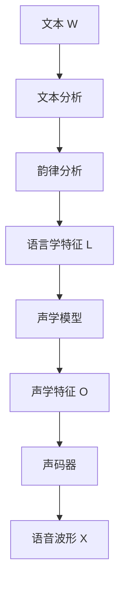

语音合成把文本中的语言信息转换为语音：前端确定发音与韵律，后端生成声学特征与波形。

> [!note] 来源
> 本文依据《4 语音合成-2025（复习）》重组，保留课件 4.1—4.4 的编号。页码均指 PDF 页序，不是页面右下角的编号。例题、自测题和讲解中的假设数据均标为自编，不代表历年考题。

## 导学

| 模块         | 学习要求                             | 达标表现                                                  |
| ------------ | ------------------------------------ | --------------------------------------------------------- |
| 4.1 概述     | 基本概念、了解                       | 区分可懂度与自然度，说明主客观评价的差别                  |
| 4.2 原理     | 整体框架重点掌握；文本与韵律分析了解 | 写出完整流程，解释各模块的输入输出                        |
| 4.3 主流技术 | HMM 重点学习；神经网络与声码器了解   | 说明 HMM 的训练与合成过程，区分时长模型、声学模型、声码器 |
| 4.4 技术展望 | 了解                                 | 说明代表模型解决的问题，区分语音克隆与语音转换            |

学习要求依据课件第 2、4、28、51、83 页；不据此推断考试频率或分值。

## 知识精讲

### 4.1 语音合成概述

#### 4.1.1 基本概念

**语音合成**是用机械或电子方法产生人造语音的技术。**TTS**（Text-to-Speech）特指文本到语音的转换。

两个目标相互关联，但不是同一个标准。

| 目标   | 判断内容                   | 反例                             |
| ------ | -------------------------- | -------------------------------- |
| 可懂度 | 能否正确听出语言内容       | 音色逼真，但把一个词读错         |
| 自然度 | 听起来是否接近人的说话方式 | 每个字都能听清，但停顿、重音生硬 |

**知识剖析**

“能听懂”不等于“像真人”。字音正确只是起点，连读、停顿、重音、语速和语调也会影响朗读效果。因此，合成系统不能只做逐字查音和拼接。

广义研究还包括语音转换、歌唱合成与可视语音合成。语音交互、有声读物、虚拟主播和辅助无障碍服务是典型应用。

来源：课件第 5—9、23—26 页。

**评价指标**

| 指标                 | 类型           | 评价方式                                                      |
| -------------------- | -------------- | ------------------------------------------------------------- |
| MOS                  | 主观、绝对评价 | 对音频质量评分；课件列出 1—5 分和 0—100 分两种量表            |
| CMOS                 | 主观、相对评价 | 相同文本的两段音频比较，按 $-3$ 到 $3$ 评价后者相对前者的质量 |
| ABX（课件称谓）      | 主观、相对评价 | 按本课件的表述选择 A 更好、B 更好或无差别                     |
| MCD                  | 客观评价       | 比较合成语音与参考语音的梅尔倒谱特征                          |
| 基频 RMSE、时长 RMSE | 客观评价       | 分别度量基频与时长的预测误差                                  |

这里的 ABX 名称与选项按课件第 10 页保留，不把该描述推广为所有 ABX 实验的定义。

课件第 12 页采用的 MCD 公式为：

$$
\mathrm{MCD}_K=
\frac{1}{T}\sum_{t=0}^{T-1}
\sqrt{\sum_{k=1}^{K}(c_{t,k}-c'_{t,k})^2}
$$

- $T$：参与比较的帧数。
- $K$：每帧参与比较的倒谱维数。
- $c_{t,k}$ 与 $c'_{t,k}$：参考语音与合成语音在对应帧、对应维的系数。
- 计算顺序：**先求每帧的距离，再对帧取平均**。

> [!warning] 易错点
> MCD 越小，只能说明该指标下的特征距离越小，不能单凭它断言自然度一定更高。比较结果还依赖特征提取与帧对齐方式。不同量表、不同受试条件下的 MOS 也不宜直接横比。

主观评测还要控制测听人员、设备、培训、单次测听时长，并检查统计显著性。

来源：课件第 10—12 页。指标使用限制为补充辨析。

#### 4.1.2 方法回顾

| 方法         | 如何产生语音                           | 主要限制                         |
| ------------ | -------------------------------------- | -------------------------------- |
| 机械合成     | 模拟发声器官及其作用                   | 操作与控制复杂                   |
| 线性预测合成 | 用激励驱动全极点声道模型               | 依赖源—滤波器模型及其参数化假设  |
| 波形拼接     | 从自然语音库选取基元，再拼接和修饰韵律 | 依赖语料覆盖，韵律控制与维护不便 |
| 统计参数合成 | 建模并预测声学参数，再由声码器生成波形 | 参数化与建模可能损失声音细节     |

线性预测合成的表达式：

$$
x(n)=\sum_{i=1}^{p}a_i x(n-i)+G u(n)
$$

其中，$a_i$ 控制声道滤波器；$G u(n)$ 是激励项。激励参数包括增益、清浊音信息和基音频率。

**知识剖析**

波形拼接的基本材料是录好的语音片段；统计参数合成的基本材料是模型预测的参数。后者改善了韵律控制和系统扩展，但不等于不需要训练语料，也不等于一定比拼接更自然。

来源：课件第 14—21 页。

#### 4.1.3 典型应用

应用包括语音交互、特殊人群服务、虚拟主播和有声读物。同一段文本用于不同场景时，合成要求也不同：播报强调信息清楚，有声读物还需要情绪、角色和篇章表达。

来源：课件第 23—26 页；场景要求的比较为补充讲解。

### 4.2 语音合成的原理

#### 4.2.1 整体框架

| 部分           | 输入       | 输出       | 职责                       |
| -------------- | ---------- | ---------- | -------------------------- |
| 前端           | 原始文本   | 语言学特征 | 提供发音、上下文与韵律信息 |
| 后端：声学模型 | 语言学特征 | 声学特征   | 预测声音的参数表示         |
| 后端：声码器   | 声学特征   | 语音波形   | 将参数转换成可播放的声音   |

**知识剖析**

音素、声调、词性、音节位置属于对语言内容的描述；谱参数、基频属于对声音的描述。**语言学特征不是声学特征，声学特征也不是波形。**

来源：课件第 29—32、57—61 页。

#### 4.2.2 文本分析

| 环节       | 作用                                 | 课件例子或关联                               |
| ---------- | ------------------------------------ | -------------------------------------------- |
| 分词       | 确定词语边界                         | “南京市／长江大桥”与“南京市长／江大桥”的差别 |
| 词性标注   | 给词标注语法类别                     | 为多音字消歧和韵律边界预测提供线索           |
| 文本归一化 | 将非标准写法转换为发音明确的口语形式 | “前方 120M”与“拨打 120”的数字读法不同        |
| 字音转换   | 确定发音，处理多音字、变调、儿化     | “古都”的“都”与“都有”的“都”读音不同           |
| 句法分析   | 分析词与词的关系                     | 为后续韵律生成提供结构信息                   |

**分词方法**

- 最大前向匹配：从左到右，优先尝试当前允许的最长词；匹配失败就缩短。
- 统计方法：利用上下文决定标签序列。课件用 CRF 分词，标签为 B、E、M、S，分别表示词首、词尾、词中、单字成词。
- 规则方法便于快速改字典；统计方法更能利用上下文。课件提出结合两者。

> [!example] 典例 1 文本归一化
> **题目**：解释“前方 120M”和“拨打 120”为什么不能采用相同的数字读法。
>
> **审题**：两处数字相同，但一处是距离，一处是电话号码。
>
> **解析**：“前方 120M”读作“前方一百二十米”；“拨打 120”读作“拨打幺二零”。归一化必须结合数字的语义类别，不能把所有数字统一读成数量。
>
> **方法**：先识别类型，再决定读法。
>
> 来源：课件第 37 页原例，问法自编。

**边界辨析**

归一化解决“这段书写形式应当怎么说”；字音转换解决“确定的语言单位应当怎么发音”。前者不是音量归一化，后者也不是声码器的工作。

来源：课件第 33—42 页；边界辨析为补充讲解。

#### 4.2.3 韵律分析

韵律是超音段信息。它通过基频、时长、能量的变化，表现节奏、重音、语速和语气。

| 层级     | 课件标记 | 边界特征                           |
| -------- | -------- | ---------------------------------- |
| 韵律词   | `#1`     | 不停顿，或停顿难以察觉             |
| 韵律短语 | `#2`     | 可以感知停顿，但不一定有明显静音段 |
| 语调短语 | `#3`     | 停顿较长，韵末可作为句末           |

**知识剖析**

“字读对了，但听起来机械”不能直接归因于声码器。停顿位置不当、重音缺失、时长或基频变化不合理，也会降低自然度。韵律边界也不是每处都插入一段静音。

**预测与控制**

- 边界预测可以用规则、决策树、HMM、CRF 或神经网络。
- BLSTM + CRF 利用上下文与输出标签之间的联系预测边界。
- Fujisaki 模型将基频曲线分解为短语成分和声调成分，分别用相应命令控制。
- 基频、时长与能量可以用规则或数据驱动模型生成。

来源：课件第 44—50 页。

### 4.3 语音合成的主流技术

#### 4.3.1 基于 HMM 的语音合成

HMM 适合描述时序信号：状态序列不可直接观测，声学特征序列可以观测。合成时，系统根据语言学条件生成声学参数，再交给声码器。

**训练与生成**

设 $L$ 为语言学特征，$O$ 为声学特征序列，$\Lambda$ 为模型参数。

训练时，已知配对的语言学特征与声学特征，求模型参数：

$$
\hat{\Lambda}=\underset{\Lambda}{\arg\max}\ P(O\mid L,\Lambda)
$$

生成时，模型固定，给定输入文本对应的 $L=l$，求声学特征：

$$
\hat O=\underset{O}{\arg\max}\ P(O\mid L=l,\Lambda)
$$

**读公式的方法**：先看 $\arg\max$ 下标。下标是 $\Lambda$，就在训练模型；下标是 $O$，就在生成声学特征。模型输出 $O$ 后还没有完成波形生成。

来源：课件第 52—56 页。

**训练流程**

1. 提取配对文本的语言学特征和录音的声学参数。
2. 训练单音素 HMM，用作上下文相关模型的初始化。
3. 训练上下文相关 HMM，考虑前后音素与韵律边界。
4. 用决策树聚类，缓解上下文组合过多、样本不足的问题。
5. 对聚类后的模型继续训练。

课件各阶段的 HMM 训练采用 Baum-Welch，理论基础是 EM。方差下限限制估计方差过度接近零；决策树聚类则在上下文细致程度和数据可靠性之间折中。

**上下文特征**

`/l-c+r/` 表示左音素为 `l`、当前音素为 `c`、右音素为 `r`。完整上下文还包括声调、音节位置、词性、韵律词和韵律短语信息。

**局限**

传统 HMM 合成容易过平滑，声音平淡、有机械感。上下文建模过细还会使每类样本不足。不能把“更多上下文”直接等同于“更可靠的模型”。

来源：课件第 57—72 页。

#### 4.3.2 基于神经网络的语音合成

| 模型     | 输入粒度                                 | 输出                     | 作用                 |
| -------- | ---------------------------------------- | ------------------------ | -------------------- |
| 时长模型 | 音素级语言学特征                         | 音素与状态时长           | 确定各音素持续多久   |
| 声学模型 | 按时长展开的帧级特征，以及状态、位置特征 | 谱参数、基频、清浊音信息 | 确定每一帧的声学参数 |

**知识剖析**

音素数与声学帧数通常不同。时长预测连接了这两种粒度：先知道每个音素对应多少帧，才能把音素级特征展开成帧级输入。

类别特征用 one-hot 表示，数值特征保留其数值。DNN 学习语言学特征到声学特征的映射；双向 RNN/LSTM 进一步利用前后文的时序联系。

| 比较项   | 传统 HMM 合成          | 课件中的传统 NN 参数合成                 |
| -------- | ---------------------- | ---------------------------------------- |
| 优势     | 训练快、模型小、合成快 | 参数映射与长依赖建模能力更强             |
| 局限     | 平均化、机械感         | 仍可能只预测均值；时长与声学模型分开建模 |
| 波形生成 | 依赖声码器             | 仍依赖声码器                             |

> [!warning] 适用范围
> 本节比较的是课件中的传统统计参数系统，不代表所有神经网络 TTS 都必须单独训练时长模型，也不代表所有系统都使用传统源—滤波器声码器。

来源：课件第 74—78 页。

#### 4.3.3 声码器

源—滤波器模型把语音生成分成**激励**与**声道滤波**两部分。

| 内容       | 简化描述               | 对应信息             |
| ---------- | ---------------------- | -------------------- |
| 浊音激励   | 准周期脉冲             | 基频反映周期性       |
| 清音激励   | 随机噪声               | 描述无明显周期的激励 |
| 声道滤波   | 声道的谐振作用         | 频谱包络             |
| 非周期成分 | 激励中偏离周期性的部分 | 非周期参数           |

二元激励模型便于建模，但对真实发声过程的简化会限制自然度。**声码器接收声音的参数表示，输出波形；它不是把汉字转成拼音的模块。**

来源：课件第 80—81 页。

### 4.4 语音合成的技术展望

#### 4.4.1 端到端语音合成

| 模型       | 主要机制                                         | 解决的问题或任务                             |
| ---------- | ------------------------------------------------ | -------------------------------------------- |
| Tacotron 2 | 注意力序列到序列网络预测梅尔谱，WaveNet 生成波形 | 学习文本到声学特征，再到波形的映射           |
| FastSpeech | 非自回归预测梅尔谱；时长预测器与长度调节器       | 改善自回归生成慢、对齐不稳、语速难控制的问题 |
| WaveNet    | 自回归波形建模，扩张因果卷积                     | 根据历史采样点及条件信息预测当前采样点       |
| LPCNet     | LPC 预测线性部分，神经网络建模非线性残差         | 利用信号处理知识降低神经波形生成的负担       |
| VITS       | 声学模型与波形解码器统一建模                     | 减少分阶段系统对预测梅尔谱中间接口的依赖     |
| VALL-E     | 对离散语音编码做条件语言建模                     | 利用文本与语音提示生成目标声音               |

**知识剖析**

- “端到端”要结合范围理解。Tacotron 2 仍有梅尔谱和声码器；不能把所有端到端系统都解释为内部没有中间表示。
- FastSpeech 的长度调节器把音素表示扩展到帧级。时长增大时，同一内容通常读得更慢，不是更快。
- VITS 的先验编码器利用文本；训练中的后验编码器利用语音线性谱；Flow 在分布之间作可逆变换。训练时的输入不能直接当作推理时的输入。
- VALL-E 将连续声学回归转为离散编码预测。课件所述方案先以 AR 预测第一个码本，再以 NAR 预测其余码本。

**关键公式**

WaveNet 的条件概率分解为：

$$
P(z\mid y)=\prod_{t=1}^{T}
P(z_t\mid z_1,\ldots,z_{t-1},y)
$$

其中，$z_t$ 是当前波形采样点，$y$ 是外部条件。**因果**表示不读取未来采样点；**扩张**用于扩大感受野。训练中并行计算条件概率，不等于原始自回归推理能同时生成全部采样点。

LPCNet 使用的预测残差为：

$$
\varepsilon(n)=s(n)-\sum_{i=1}^{p}a_i s(n-i)
$$

来源：课件第 84—91 页。训练与推理、端到端范围的区分为补充辨析。

#### 4.4.2 前沿任务

| 任务       | 输入与控制信息               | 保持或改变的内容                       |
| ---------- | ---------------------------- | -------------------------------------- |
| 语音克隆   | 待合成文本与目标人的声音信息 | 让新文本具有目标音色                   |
| 语音转换   | 源说话人的语音与目标声音信息 | 保留源语音的语言内容，改变音色         |
| 多风格合成 | 文本与风格控制信息           | 控制朗读风格；课件例子为 GST           |
| 情感合成   | 文本与情感标注               | 控制合成语音的情绪表达                 |
| 抗噪合成   | 面向噪声环境的合成要求       | 调整发声特征，改善被噪声掩蔽时的可懂度 |

个性化合成的课件框架包括说话人编码器、合成器、声码器。说话人嵌入提供“谁的声音”，文本提供“说什么”，两者作用不同。

课件最后还展示了 FunAudioLLM 和语音交互大模型的案例，用于说明语音理解与生成的结合；演示页面不据此扩展出新的算法推导要求。

来源：课件第 93—99 页。

## 题型方法

### 题型 1 模块定位

**典例 2｜自编**

某系统出现三种问题：

1. “拨打 120”读成“拨打一百二十”。
2. 字音正确，但词语之间的停顿不合理。
3. 输入声码器的声学特征固定后，生成波形仍有明显失真。

分别给出优先检查的模块。

**审题**

判断的依据是错误最早出现在哪一种表示中，不是“听起来不好”这个共同现象。

| 现象                       | 优先检查           | 理由                         |
| -------------------------- | ------------------ | ---------------------------- |
| 数字语义读错               | 文本归一化         | 数量与号码的口语形式不同     |
| 停顿位置不合理             | 韵律分析与边界预测 | 句内组织关系出现问题         |
| 固定声学条件仍生成失真波形 | 声码器             | 此时检查的是特征到波形的转换 |

**方法归纳**：先分语言内容、韵律组织、声学参数、波形生成，再结合中间结果定位。上述判断给出检查顺序，不把某种听感症状与唯一故障强行对应。

依据：课件第 30、37、44—50、80—81 页。

### 题型 2 公式计算

**典例 3｜自编**

采用本章的 MCD 公式，设两帧、每帧二维，参考系数与合成系数如下。数据仅为演算设计。

| 帧 $t$ | 参考系数 | 合成系数 |
| ------ | -------- | -------- |
| 0      | $(0,0)$  | $(3,4)$  |
| 1      | $(1,1)$  | $(1,1)$  |

**审题**：先逐帧求欧氏距离，再除以帧数。维数 $K$ 不是公式外层的分母。

**解析**

$$
\begin{aligned}
d_0&=\sqrt{(0-3)^2+(0-4)^2}=5\\
d_1&=\sqrt{(1-1)^2+(1-1)^2}=0\\
\mathrm{MCD}_2&=\frac{d_0+d_1}{2}=2.5
\end{aligned}
$$

**检验**：两帧距离为 5 与 0，平均结果应落在 0 与 5 之间。它不是将所有平方误差先平均、最后统一开根号的 RMSE。

依据：课件第 12 页。

### 题型 3 机制解释

**典例 4｜自编**

给定三个音素的表示 $h_1,h_2,h_3$，预测时长分别为 2、1、3 帧。写出长度调节后的序列，并解释它的作用。

**审题**：音素序列长度为 3，输出声学序列长度为 6；长度调节器要建立音素到帧的对应。

**解析**

$$
(h_1,h_2,h_3)
\longmapsto
(h_1,h_1,h_2,h_3,h_3,h_3)
$$

音素表示按时长重复后，声学模型获得逐帧的条件输入。如果把各音素时长都放大到原来的两倍，帧数增加到 12；在帧移固定的前提下，语音时长增大，语速变慢。

**方法归纳**：解释一个模块时，依次写输入粒度、变换规则、输出粒度和作用。

依据：课件第 74—75、86 页；时长数值自编。

### 题型 4 比较与选型

**典例 5｜自编**

某系统用自回归注意力模型预测梅尔谱，出现生成慢、重复或跳词，以及语速难直接控制的问题。结合本章说明 FastSpeech 的改进思路，并指出它是否已经完成波形生成。

**解析**

1. 非自回归声学建模并行生成梅尔谱，改善串行生成的速度限制。
2. 时长预测器提供显式时长信息，长度调节器把音素级表示展开成帧级表示。
3. 修改时长可控制语速，也减少推理时对注意力逐步对齐的依赖。
4. 这里输出仍是梅尔谱；完整 TTS 还需要把梅尔谱转换为波形。

**方法归纳**：按“原方法的问题—新模块的机制—输出与剩余步骤”组织答案。不得只列模型名或堆叠“更快、更好”这样的结论。

依据：课件第 85—87 页。

## 自测

### 1 概念判断

“只要每个字都读对，语音合成的可懂度和自然度就都得到了保证。”判断并说明理由。

> [!question]- 答案与解析
> 错。单字读音正确不能保证分词、句内组织和整句意思都正确；自然度还取决于停顿、重音、语速与语调。可懂度与自然度也不能互相替代。
>
> 自编，依据课件第 5、33、44—50 页。

### 2 公式辨析

$\hat\Lambda=\arg\max_{\Lambda}P(O\mid L,\Lambda)$ 与 $\hat O=\arg\max_O P(O\mid L=l,\Lambda)$ 分别求什么？哪一步已经生成了波形？

> [!question]- 答案与解析
> 第一式训练模型参数，第二式生成声学特征。两式都不能单独表示最终波形已经生成；本章传统参数合成系统还需要声码器。
>
> 自编，依据课件第 54—56 页。

### 3 迁移计算

典例 3 中，只把第 0 帧的合成系数改成 $(6,8)$，其余数据不变。新的 MCD 是多少？

> [!question]- 提示
> 先更新第 0 帧的距离，第 1 帧距离仍为 0。

> [!question]- 答案与解析
> 第 0 帧距离为 $\sqrt{6^2+8^2}=10$，所以 MCD 为 $(10+0)/2=5$。变化的数据仅涉及一帧，不能把原平均值直接加上 5。
>
> 自编，依据课件第 12 页。

### 4 综合辨析

判断并改正下列说法：

1. 端到端 TTS 的内部必定没有梅尔谱。
2. 把 FastSpeech 的时长预测值增大，同一文本会读得更快。
3. 把源录音换成另一人的音色，同时保留语言内容，属于语音转换。
4. 把 HMM 换成神经网络，就自动消除了对声码器的依赖。

> [!question]- 答案与解析
>
> 1. 错。Tacotron 2 就使用梅尔谱；端到端必须说明具体范围。
> 2. 错。在帧移固定时，预测时长增大通常使语速变慢。
> 3. 对。判断依据是输入为源语音，语言内容保留，音色发生变化。
> 4. 错。课件中的传统 NN 参数合成仍需要声码器。
>
> 自编，依据课件第 74—78、84—86、93 页。

## 本章小结

- **流程**：语言信息经过前端形成语言学特征，后端再生成声学特征与波形。
- **传统参数合成**：重点区分模型训练、声学参数生成和波形生成。
- **神经网络方法**：关注序列对齐、时长展开、上下文建模和波形生成的分工。
- **评价**：主观听感与客观距离回答的问题不同，不能用单个指标代替全部质量判断。

## 速查表

| 题目出现                   | 立刻检查                                       |
| -------------------------- | ---------------------------------------------- |
| 数字、单位、日期、电话号码 | 文本归一化的语义类别                           |
| 多音字、变调               | 字音转换及上下文                               |
| 停顿、重音、语速、语调     | 韵律结构与基频、时长、能量                     |
| $\arg\max$ 公式            | 求的是模型参数，还是声学特征                   |
| 上下文组合多、每类样本少   | 决策树聚类与估计可靠性                         |
| 音素级与帧级长度不一致     | 时长模型与长度调节                             |
| 声学特征到波形             | 声码器，不是文本前端                           |
| 自回归与非自回归           | 生成是否依赖先前输出，以及讨论的是哪一级序列   |
| 端到端                     | 输入输出范围、是否分阶段训练、是否仍有中间表征 |
| 克隆与转换                 | 新文本合成，还是源语音内容保留                 |

## 来源

- 课件：[4 语音合成-2025（复习）](<raw/slides/4 语音合成-2025（复习）.pdf>)。
- 本文以课件为知识范围，不直接沿用原笔记中的考试权重判断。
- 典例 1 使用课件原例；典例 2—5、自测与数值数据为自编，依据在题后标明。补充辨析与课件内容分开标注。
