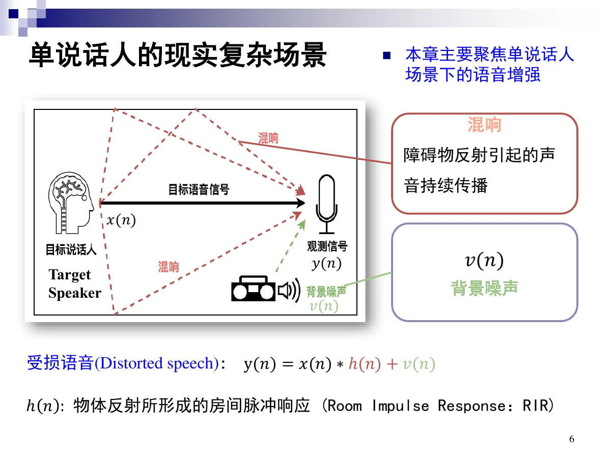
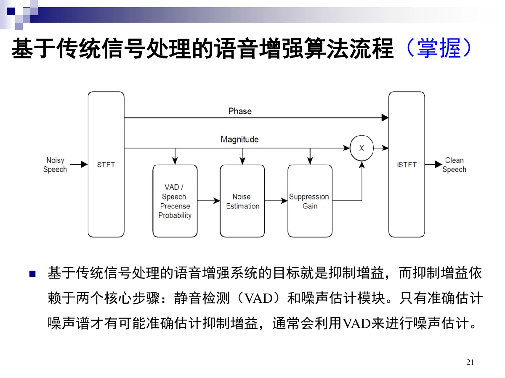
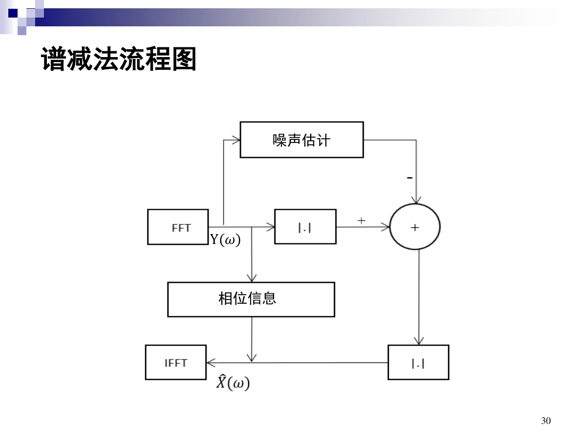
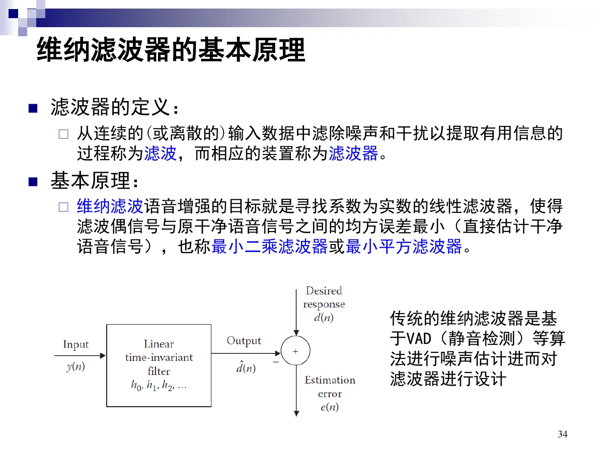
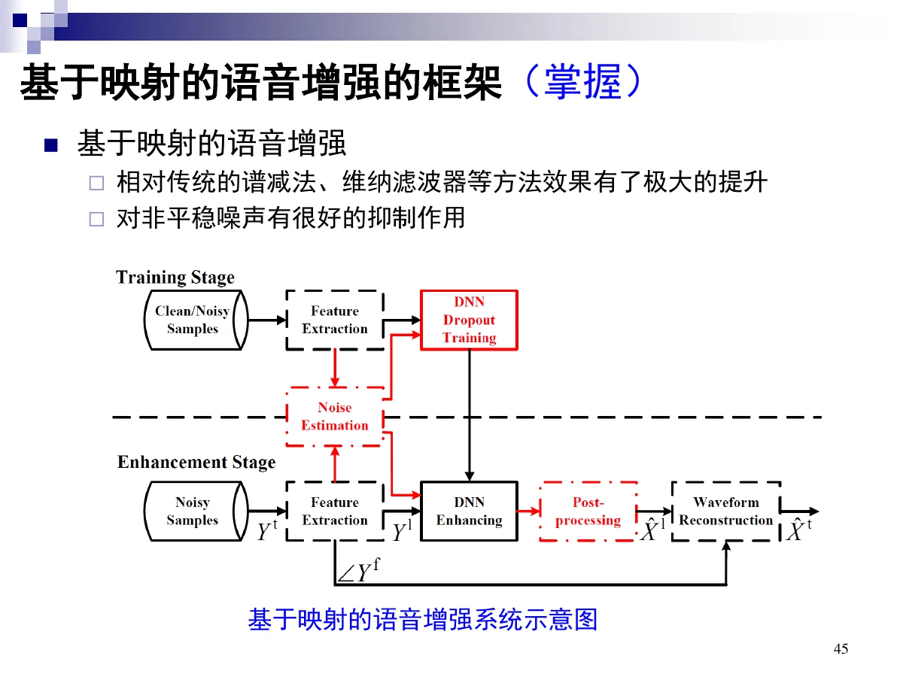
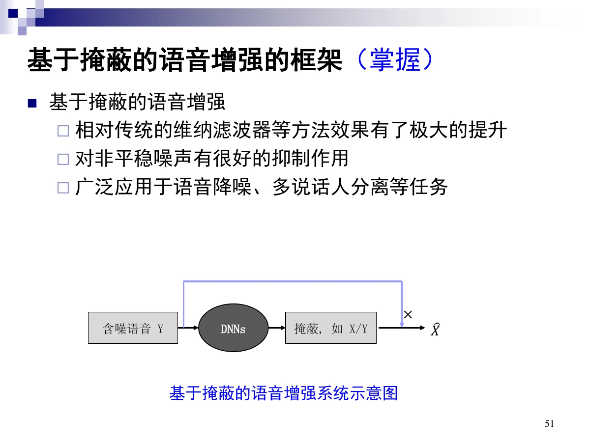
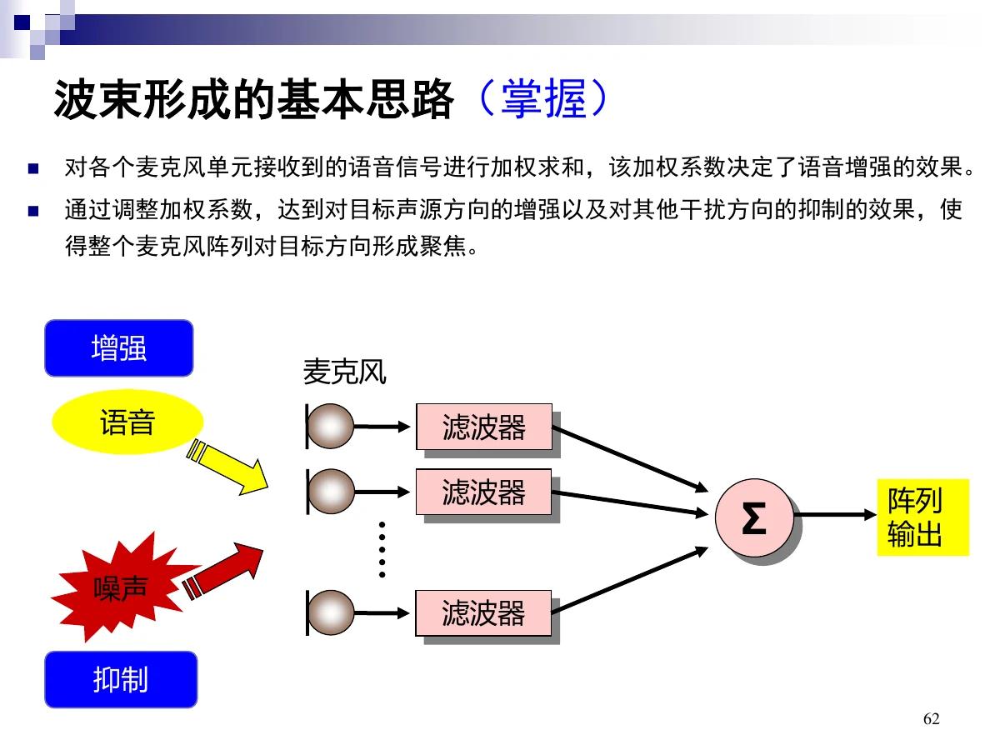

# 5 语音增强

一句话：拿到的是**受损语音** $y(n)=x(n)*h(n)+v(n)$，任务是还原 $x(n)$。传统方法在频域**减去/压低**噪声谱（谱减法、维纳滤波），深度学习方法是让网络**预测干净谱或掩蔽**，多通道则靠**麦克风阵列的到达时间差**做空间滤波。

## 总览（思维导图）

$$
\text{第 5 章}
\begin{cases}
5.1\ \text{概述}:\ \text{三类分离、受损模型、目的与类型}\\
5.2.1\ \text{传统}\begin{cases}\text{流程}:\ \text{VAD}+\text{噪声估计}\to\text{抑制增益}\\
\text{谱减法}:\ \text{功率谱相减}\\
\text{维纳滤波}:\ \text{均方误差最小的增益}\end{cases}\\[4pt]
5.2.2\ \text{深度学习}\begin{cases}\text{频域三步}:\ \text{特征提取}\to\text{特征增强}\to\text{波形重构}\\
\text{映射 vs 掩蔽};\ \text{IBM / IRM}\end{cases}\\[4pt]
5.3.1\ \text{多通道}:\ \text{波束形成（DSB、TDOA）}\\
5.4\ \text{技巧}:\ \text{多目标训练、多任务学习}
\end{cases}
$$

## 考点权重

| 模块               | 真正需要掌握                                     |   优先级 |
| ------------------ | ------------------------------------------------ | -------: |
| 5.1.1 基本概念     | 受损语音模型、三类分离、加性/乘性的相关性区别    | **最高** |
| 5.1.2 方法回顾     | **传统增强算法流程（掌握）**：VAD + 噪声估计     | **很高** |
| 5.2.1 传统单通道   | 谱减法公式与音乐噪声、广义谱减、维纳滤波传输函数 | **最高** |
| 5.2.2 深度学习     | 频域三步、映射/掩蔽的训练与增强步骤、IBM/IRM     | **最高** |
| 5.3.1 固定波束形成 | 波束形成思路、DSB 延迟补偿+加权求和、TDOA/DOA    | **很高** |
| 5.4 技巧           | 多目标训练、多任务学习、耳与脑机制               |     中高 |

已剔除：5.1.2 中的方法历史、语音分离示例、增强前后语谱图、**全部度量指标（PESQ/STOI/SNR/SDR/SIR 均标“了解”）**、5.3.2 自适应波束形成、PSM/cIRM 等标注「了解」的内容。

# 5.1 语音增强概述

## 5.1.1 基本概念

### 三类分离任务

| 任务                             | 内容                                   |
| -------------------------------- | -------------------------------------- |
| 语音去噪（noise reduction）      | 语音与非语音分离（**狭义的语音增强**） |
| 语音去混响（dereverberation）    | 语音与混响分离                         |
| 说话人分离（speaker separation） | 多说话人分离（**狭义的语音分离**）     |

前两类合称**广义的语音增强**。

### 受损语音模型

单说话人场景：

$$
y(n)=x(n)*h(n)+v(n)
$$

- $x(n)$ 干净语音，$h(n)$ 房间脉冲响应（RIR，由障碍物反射形成的持续传播），$v(n)$ 背景噪声。
- **乘性干扰**：混响 $*h$；**加性干扰**：噪声 $+v$。

### 两类干扰的区别

| 干扰     | 叠加方式     | 与干净语音的相关性                               |
| -------- | ------------ | ------------------------------------------------ |
| 背景噪声 | 加性         | **相关性更低**                                   |
| 混响     | 乘性（卷积） | **相关性更高**（还是你自己的声音，只是晚到几遍） |

### 定义与目的

**语音增强**：将受损语音中的背景噪声和混响去除，得到目标干净语音。

目的：

1. 提高语音**可懂度**（intelligibility，又称语言清晰度：听者能听懂传递语音的百分率），使人听起来更清晰；
2. 提高语音识别（ASR、说话人识别等）的性能。

注意：不少增强技术在降噪的同时会引入**失真**，反而损伤可懂度。

### 类型

| 维度   | 取值                                                              |
| ------ | ----------------------------------------------------------------- |
| 通道数 | 单通道、多通道                                                    |
| 方法   | 基于信号处理、基于神经网络                                        |
| 处理域 | 时域、频域                                                        |
| 噪声   | 去噪（加性）、去混响（乘性）、两者兼有                            |
| 目的   | 用于机器感知（ASR、说话人识别）、用于人类感知（助听器、会议系统） |

# 5.2 单通道语音增强

## 5.2.1 基于传统信号处理的方法（基本概念）

### 总体流程（掌握）

传统方法的目标就是**算出一个抑制增益**，而这个增益依赖两个核心步骤：**静音检测（VAD）** 与 **噪声估计**。只有噪声谱估得准，增益才准；通常用 VAD 来更新噪声估计。

标准链路：

1. 分帧、加窗、FFT，得到每帧频谱 $Y(\omega)$；
2. **VAD** 判断该帧是否含语音；
3. 只在静音帧**更新噪声谱** $\hat V(\omega)$；
4. 用 $Y$ 与 $\hat V$ 计算增益（谱减法或维纳滤波）；
5. 把增益乘回幅度谱，**沿用含噪语音的相位**，IFFT 后重叠相加。

问题在于：VAD 一旦把语音帧误判为静音，就会把语音当噪声学进去，之后反把那一段减掉。

### 谱减法

**定义**：用带噪信号的频谱**减去**噪声信号的频谱，得到干净信号频谱的估计。

**噪声估计**：假设语音不存在时可以估计并更新噪声谱；一般假设输入语音的**前 n 帧**是静音，并假设噪声**平稳或缓慢变化**，更新周期之间噪声谱无显著变化。

只考虑加性噪声时：

$$
y(n)=x(n)+v(n)\;\Longrightarrow\;Y(\omega)=X(\omega)+V(\omega)
$$

**思路**：假设语音与噪声**不相关**，

$$
\lvert Y(\omega)\rvert^2=\lvert X(\omega)\rvert^2+\lvert V(\omega)\rvert^2
$$

于是干净语音幅度谱的估计为

$$
\lvert\hat X(\omega)\rvert=\Big(\lvert Y(\omega)\rvert^2-\lvert\hat V(\omega)\rvert^2\Big)^{1/2}
$$

**相位**直接用带噪语音的相位（一定程度上相位不影响语音质量）：

$$
\hat X(\omega)=\lvert\hat X(\omega)\rvert e^{j\theta_y(\omega)}
$$

增强信号由估计频谱的**离散傅里叶逆变换**得到。

### 广义谱减法

直接相减可能得到**负的功率谱**，因此做一般化处理：

$$
\lvert\hat X(\omega)\rvert^{2n}=\max\Big(\lvert Y(\omega)\rvert^{2n}-\alpha\lvert\hat V(\omega)\rvert^{2n},\ \beta\lvert Y(\omega)\rvert^{2n}\Big)
$$

| 符号     | 含义                                           |
| -------- | ---------------------------------------------- |
| $\alpha$ | 噪声超估计因子                                 |
| $\beta$  | 频谱下限系数，防止出现负的频谱                 |
| $n$      | 任意指数参数：$n=1$ 功率谱减，$n=0.5$ 幅度谱减 |

### 谱减法的优缺点

| 优点                                   | 缺点                                                                                                          |
| -------------------------------------- | ------------------------------------------------------------------------------------------------------------- |
| 简单，只需正反傅里叶变换，实时实现容易 | ① 适用信噪比范围窄，低 SNR 时对可懂度损伤大；② 频谱直接相减会产生**“音乐噪声”**（有节奏感、听上去类似音乐声） |

### 维纳滤波

**基本思想**：寻找系数为实数的线性滤波器，使滤波后信号与原干净语音的**均方误差最小**（直接估计干净语音），因此也叫最小二乘/最小平方滤波器。

含噪语音经线性滤波后提高信噪比，传输函数为

$$
H(\omega)=\frac{\hat X(\omega)}{Y(\omega)}=\frac{P_x(\omega)}{P_x(\omega)+P_v(\omega)}
$$

其中 $P_x(\omega)=E[\lvert X(\omega)\rvert^2]$、$P_v(\omega)=E[\lvert V(\omega)\rvert^2]$ 分别是干净语音与噪声的功率谱密度。

**为什么是这个形式**：$P_x$ 远大于 $P_v$ 时 $H\to1$（保留），$P_x$ 远小于 $P_v$ 时 $H\to0$（压制）。传统维纳滤波同样要靠 VAD 之类的算法估噪声功率谱（常用“静”时段的功率谱，或用数帧平滑后减去噪声功率谱得到 $E[\lvert X\rvert^2]$）。

得到 $H(\omega)$ 后，每帧 $\hat X(\omega)=H(\omega)Y(\omega)$，再逆变换回时域（相位取 $Y(\omega)$ 的相位）。

## 5.2.2 基于深度学习的语音增强

### 为什么用深度学习

深度学习有**非线性变换能力**与**强大的回归能力**，擅长处理**非平稳噪声**，增强后的语音更自然、**没有音乐噪声**。

### 频域语音增强的三步（掌握）

| 步骤     | 内容                                               |
| -------- | -------------------------------------------------- |
| 特征提取 | 将时域信号转换为频域特征（STFT 语谱图）            |
| 特征增强 | 用神经网络增强频谱图的**振幅**                     |
| 波形重构 | 用增强后的振幅 + **原始相位** ISTFT 重构回时域波形 |

### 两种目标：映射与掩蔽

| 框架            | 网络输出         | 含义                                              |
| --------------- | ---------------- | ------------------------------------------------- |
| 映射（mapping） | 干净语音频谱 $X$ | 把增强看作多变量回归，非线性回归函数由 DNN 参数化 |
| 掩蔽（mask）    | 掩蔽值，如 $X/Y$ | 受听觉掩蔽与听觉场景分析启发，先估掩蔽再乘回去    |

两者都**比谱减法/维纳滤波效果大幅提升**，且对**非平稳噪声**抑制很好；掩蔽框架广泛用于降噪与多说话人分离。

### 映射框架的步骤（掌握）

**训练**：

1. 用 STFT 提取含噪音频与干净音频的语谱图特征，**含噪为输入、干净为目标**；
2. 用深度学习学习“含噪语谱图 → 干净语谱图”的非线性映射；
3. 保存模型。

**增强**：

1. 用 STFT 提取含噪语音的语谱图；
2. 输入训练好的模型，得到干净音频特征；
3. 干净语谱图 + **原始相位** 做 ISTFT，重构增强语音。

### 掩蔽框架的步骤（掌握）

**训练**：

1. 特征提取：STFT 提取含噪与干净语谱图；
2. **计算掩蔽值**作为标签（从含噪到干净的掩蔽）；
3. 训练模型学习“含噪语谱图 → 掩蔽值”。

**增强**：

1. 特征提取：STFT 提取含噪语谱图；
2. 模型输出掩蔽值；
3. **含噪语谱图 × 掩蔽值** = 干净语谱图估计；
4. 用该估计与原始含噪相位做 ISTFT 重构。

### 两种经典掩蔽目标（基本概念）

**理想二进制掩码 IBM**：

$$
\text{IBM}=\begin{cases}1, & \text{SNR}(t,f)>\text{threshold}\\ 0, & \text{otherwise}\end{cases}
$$

把每个时频单元标为“目标主导”或“干扰主导”，是**二分类**训练，常用**交叉熵**损失。

**理想比率掩码 IRM**：IBM 的软版本

$$
\text{IRM}=\left(\frac{\lvert X(t,f)\rvert^2}{\lvert X(t,f)\rvert^2+\lvert V(t,f)\rvert^2}\right)^{\beta}
$$

$\lvert X(t,f)\rvert^2$ 与 $\lvert V(t,f)\rvert^2$ 分别是时频单元的信号与噪声能量，$\beta$ 可调，一般取 0.5；估计 IRM 常用 **MSE** 损失。IRM 适用于加性噪声，**不适用于混响**（混响是卷积，不是能量叠加）。

# 5.3 多通道语音增强

## 5.3.1 固定波束形成（基本概念）

### 波束形成的基本思路（掌握）

对各个麦克风单元接收到的信号做**加权求和**，**加权系数决定增强效果**；通过调整加权系数，实现对**目标声源方向的增强**、对其他方向的抑制，使阵列对目标方向形成**聚焦**。

按加权系数能否随信号统计特性自我调整，分为**固定**波束形成（设计好后系数不变）与**自适应**波束形成（系数可自我调节）。

固定波束形成的优缺点：计算简单、容易实现；但环境适应性差、对噪声无自适应性。经典算法是**延迟求和波束形成（DSB）**。

### 麦克风信号与 TDOA（掌握）

线性阵列中，声波以入射角 $\theta_s$ 到达相邻间距为 $d$ 的两个麦克风，路程差

$$
\xi=d\sin\theta_s
$$

到达时间差（TDOA）：

$$
\tau_s=\frac{\xi}{c}=\frac{d\sin\theta_s}{c}
$$

于是第二个麦克风的信号是第一个的延迟版本：

$$
x_2(t)=x_1(t-\tau_s)
$$

### TDOA 的计算（掌握）

利用**互相关**与**自相关**的关系：

$$
\phi_{12}(\tau)=E\big[x_1(t)x_2(t+\tau)\big]
=E\big[x_1(t)x_1(t+\tau-\tau_s)\big]=\phi_{11}(\tau-\tau_s)
$$

延迟为零（$\tau-\tau_s=0$）时自相关取最大值，故

$$
\hat\tau_s=\arg\max_\tau\phi_{12}(\tau)
$$

由此得到**到达方向（DOA）**：

$$
\hat\theta_s=\sin^{-1}\!\left(\frac{c\hat\tau_s}{d}\right)
$$

### DSB 的两步（掌握）

1. **延迟补偿**：让每个麦克风的信号在时间上对齐；
2. **加权求和**：得到增强后的单通道输出。

$$
y(t)=\sum_{i=1}^{M}w_ix_{si}(t-D_i),\qquad D_i=D_0-(i-1)\hat\tau_s
$$

等权时 $w_i=1/M$。延迟补偿后 $x_{si}(t-D_i)\approx x_{s1}(t-D_0)$，来自 $\hat\theta_s$ 方向的声音同相相加而被增强，其他方向因不同相而被削弱。

# 5.4 增强技巧

## 多目标训练（掌握）

很难断定“基于映射”和“基于掩蔽”哪个更好，尤其在噪声场景不可见时；两者在不同 SNR 下**互补性很强**。因此可以让同一个网络同时输出干净语音 $X$ 与掩蔽（如 $X/Y$），即**多目标训练**。

## 多任务学习（掌握）

语音的其他任务（如 ASR、说话人识别 ASV）可作为增强任务的**互补信息**，提供语义或说话人信息；反过来，增强后的语音也能提升 ASR/ASV 的性能。

## 复杂听觉场景的耳与脑机制（基本概念）

人依靠耳蜗的机制对声音频谱做最初分析，再通过大脑**自下而上的刺激驱动**与**自上而下的任务驱动**组合，选择特定的听觉物体——这是“鸡尾酒会效应”的生理基础。

# 5.5 本章小结

- 受损语音 = 混响（乘性、相关性高）+ 噪声（加性、相关性低）。
- 传统方法 = 估噪声谱 → 算增益 → 乘回幅度、借用相位。
- 谱减法：$\lvert\hat X\rvert=(\lvert Y\rvert^2-\lvert\hat V\rvert^2)^{1/2}$，会产生音乐噪声；广义谱减用 $\alpha$、$\beta$ 兜底。
- 维纳滤波：$H=P_x/(P_x+P_v)$，最小均方误差意义下最优。
- 深度学习：三步流程；映射直接回归 $X$，掩蔽预测 mask 再相乘；IBM 二分类 + 交叉熵，IRM 软掩蔽 + MSE。
- 多通道：TDOA 由互相关峰值求得，DSB = 延迟补偿 + 加权求和。

# 5.6 考前速查表

| 题目出现                                                                           | 立刻想到                                  |
| ---------------------------------------------------------------------------------- | ----------------------------------------- |
| $y=x*h+v$                                                                          | 受损语音模型；$h$ 是 RIR（乘性）          |
| 与干净语音相关性低 / 高                                                            | 背景噪声 / 混响                           |
| 语音与非语音、语音与混响、多说话人                                                 | 去噪、去混响、说话人分离                  |
| VAD + 噪声估计                                                                     | 传统增强的两个核心步骤                    |
| 前 n 帧当静音、噪声平稳                                                            | 谱减法的噪声估计假设                      |
| $\lvert Y\rvert^2=\lvert X\rvert^2+\lvert V\rvert^2$                               | 语音与噪声不相关的假设                    |
| $(\lvert Y\rvert^2-\lvert\hat V\rvert^2)^{1/2}$                                    | 谱减法幅度估计                            |
| 借用含噪语音的相位                                                                 | 谱减法与维纳滤波都用                      |
| 音乐噪声                                                                           | 频谱直接相减的副作用                      |
| $\max(\lvert Y\rvert^{2n}-\alpha\lvert\hat V\rvert^{2n},\beta\lvert Y\rvert^{2n})$ | 广义谱减法；$\alpha$ 超估计、$\beta$ 下限 |
| $H=P_x/(P_x+P_v)$                                                                  | 维纳滤波传输函数（均方误差最小）          |
| 特征提取 → 特征增强 → 波形重构                                                     | 频域深度增强三步                          |
| 输出干净谱 / 输出掩蔽                                                              | 映射框架 / 掩蔽框架                       |
| 含噪语谱图 × 掩蔽值                                                                | 掩蔽框架的增强步骤                        |
| IBM 0/1、交叉熵；IRM 软掩蔽、MSE、$\beta=0.5$                                      | 两种掩蔽目标                              |
| IRM 不适用于混响                                                                   | 因为混响不是能量相加                      |
| 加权求和、对目标方向聚焦                                                           | 波束形成基本思路                          |
| $\tau_s=d\sin\theta_s/c$                                                           | TDOA 与几何关系                           |
| 互相关峰值处 $\tau=\tau_s$                                                         | TDOA 估计                                 |
| $\theta_s=\sin^{-1}(c\tau_s/d)$                                                    | DOA                                       |
| 延迟补偿 + 加权求和                                                                | DSB 两步                                  |
| 同时输出干净谱与掩蔽                                                               | 多目标训练                                |
