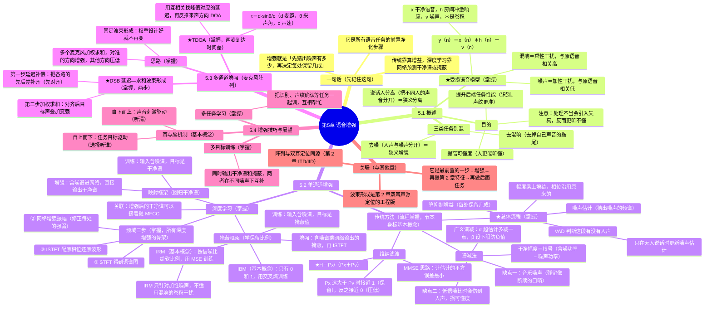

# 5 语音增强

一句话：拿到的是**受损语音** $y(n)=x(n)*h(n)+v(n)$，任务是还原 $x(n)$。传统方法在频域**减去/压低**噪声谱（谱减法、维纳滤波），深度学习方法是让网络**预测干净谱或掩蔽**，多通道则靠**麦克风阵列的到达时间差**做空间滤波。

## 0 读这一章之前

- **前置知识**：知道「语谱图」是横轴时间、纵轴频率的图就够了（见第 2 章）。
- 整章一句话：**在语谱图上把噪声那层「底」去掉**。传统方法算增益，深度学习方法直接预测干净谱。
- 三个新词：**VAD（Voice Activity Detection，语音活动检测）**（判断这段有没有人说话）、**增益**（该保留几成）、**掩蔽**（每个时频点该乘多少）。
- 第 5 章图最多，建议先看图再看公式。

## 总览（思维导图）

## 考点权重

| 模块 | 真正要掌握的内容 | 优先级 |
| --- | --- | ---: |
| 5.1.1 基本概念 | 受损语音模型、三类分离、加性 vs 乘性的相关性、度量指标（SNR/CD） | **最高** |
| 5.1.2 方法回顾 | 传统流程（VAD + 噪声估计）、深度学习流程的两个阶段 | **很高** |
| 5.2.1 传统单通道 | 谱减法思路与音乐噪声、广义谱减三个参数、维纳滤波增益含义、传统方法的局限 | **最高** |
| 5.2.2 深度学习 | 频域三步、映射与掩蔽的完整步骤、IBM/IRM 与各自损失函数 | **最高** |
| 5.3 多通道 | 波束形成思路、固定 vs 自适应、DSB 两步、TDOA/DOA 的计算 | **很高** |
| 5.4 技巧 | 多目标训练、多任务学习、耳与脑机制 | 中高 |

---

## 5.1 语音增强的概述

### 5.1.1 基本概念

#### 现实中的复杂场景

单说话人场景里，观察到的语音被三类东西破坏：**干扰说话人**（多说话人场景）、**背景噪声**、**混响**（障碍物反射引起的声音持续传播）。

> [!question]- PPT 第 4 页 · 为什么需要语音分离？
> **参考答案**
>
> 因为真实录音几乎从不是「一个人、安静房间、对着麦克风」的理想条件：
>
> 1. 多处声源同时存在（鸡尾酒会问题），目标说话人的语音与干扰说话人叠在一起
> 2. 房间反射带来混响，把前一个字拖到后一个字上
> 3. 环境噪声（空调、风扇、街道）持续污染。
>
> 语音分离是**语音信息处理的核心算法之一**，也是所有下游任务（识别、声纹、助听器、会议转写）的**前置净化步骤**——不先分离/增强，后面的模型再好也会被噪声带偏。

#### 语音分离与语音增强

**语音分离（Speech separation）**：把目标语音从背景干扰中分离出来。按干扰类型分三类：

| 任务 | 内容 |
| --- | --- |
| **语音去噪（Noise reduction）** | 语音与非语音分离（**狭义的语音增强**） |
| **语音去混响（Dereverberation）** | 语音与混响分离 |
| **说话人分离（Speaker separation）** | 多说话人分离（**狭义的语音分离**） |

前两类合称**广义的语音增强**，本章（单通道部分）重点即在此。

#### 受损语音模型

$$
y(n)=x(n)*h(n)+v(n)
$$

- $x(n)$：干净语音
- $h(n)$：**房间脉冲响应（RIR, Room Impulse Response）**，指物体反射形成的声音持续传播
- $v(n)$：背景噪声
- **混响以卷积（乘性）形式进入，噪声以相加（加性）形式进入**。

#### 语音增强的定义与目标

**语音增强（Speech enhancement）**：将受损语音中的背景噪声和混响去除，得到目标干净语音。**狭义**＝移除加性噪声，**广义**＝还包含移除混响（乘性噪声）。

**主要目标：提升受损语音的质量与可懂度**。可懂度又称**语言清晰度（speech intelligibility）**，指听者能听懂通过一定传声系统传递的语音信号的百分率。注意：**不少增强技术在降低噪声的同时会引入语音失真，反而损伤可懂度**。

> [!question]- PPT 第 6 页 · 什么是语音增强？
> **参考答案**
>
> **语音增强**是从观测到的受损语音 **$y(n)$** 中恢复目标干净语音 **$x(n)$**，去除**背景噪声与混响**的任务。
>
> - **狭义增强**：去掉加性背景噪声。
> - **广义增强**：还要去除房间反射产生的混响。
> - **评价目标**：同时关注语音质量与可懂度，不能只看噪声是否变小。

**两类干扰的差别**（这是考点）：

| 干扰 | 叠加方式 | 与干净语音的相关性 |
| --- | --- | --- |
| **背景噪声** | 加性 | **相关性更低**（是别人/环境的声音） |
| **混响** | 乘性（卷积） | **相关性更高**（还是自己的声音，只是晚到几遍） |

**混响**：一种室内声学现象——声音发出后在房间界面上发生反射、吸收、扩散、透射、干涉、衍射，形成复杂室内声场，使人产生**混响感**；当室内声场稳定时，声源停止发声后声音因多次反射/散射而继续存在。

**目的**：

1. 提高**可懂度**，让人听起来更清晰
2. 提高**机器感知**的性能（语音识别、说话人识别等）。

> [!question]- PPT 第 9 页 · 能否同时做好人类感知与机器感知？
> **参考答案**
>
> **不总能**——两者常存在权衡：
>
> - **面向人类感知**：人耳对**失真与音乐噪声**敏感，过度抑制会把语音「削」得发闷、损伤可懂度，所以更重视自然度与听感。
> - **面向机器感知**：ASR 更在意**特征判别性**，允许一定失真甚至人工处理（如谱平滑），反而可能提升识别率。
>
> 实践中：以 WER 为主的增强系统会损失部分听感；助听器类系统要在「降噪量」与「语音失真」之间折中。也有研究用**多任务学习**同时优化增强、ASR 与感知相关指标，尽量兼顾。

**语音增强的类型**

| 维度 | 取值 |
| --- | --- |
| 通道数 | 单通道、多通道 |
| 方法 | 基于信号处理、基于神经网络 |
| 处理域 | 时域、频域 |
| 噪声类型 | 去噪（加性）、去混响（乘性）、两者兼有 |
| 目的 | 机器感知（ASR、说话人识别）、人类感知（助听器、会议系统） |

#### 语音增强的度量指标

| 指标 | 含义 |
| --- | --- |
| **信噪比 SNR** | $\mathrm{SNR}=10\log_{10}\dfrac{P_S}{P_N}$，即含噪语音中信号功率与噪声功率之比取对数 |
| **分段信噪比（Segmental SNR）** | 语音是缓慢变化的短时平稳信号，不同时段信噪比不同，因此分帧计算再平均，改善整体 SNRE 的偏差 |
| **倒谱距离 CD** | 计算干净语音与失真语音的倒谱系数（LPCC 或 MFCC）之间的距离：$CD=\dfrac{10}{\log 10}\sqrt{2\sum_{i=1}^{p}\left(C_x(i)-C_y(i)\right)^2}$，$p$ 为维数 |

> [!question]- PPT 第 12 页 · 分段信噪比为什么要分帧计算？
> **参考答案**
>
> - **短时平稳**：语音只在较短时间内近似稳定，不同帧的语音功率与噪声占比会变化。
> - **整体统计的局限**：直接把整段能量相加，强能量语音段对结果的影响更大，可能掩盖弱语音段的低信噪比。
> - **分段计算**：先求各帧的信噪比，再平均，更能反映不同时段的受噪情况。

- **指标全称**：SNR 是 **Signal-to-Noise Ratio（信噪比）**，CD 是 **Cepstral Distance（倒谱距离）**。
- **应用对应目的**：助听器、会议系统重视人类听感与可懂度，自动语音识别和说话人识别系统重视后端机器感知性能。

### 5.1.2 语音增强方法的回顾

**基于传统信号处理的流程（掌握）**
系统的目标是算出**抑制增益**
核心步骤——**静音检测（VAD）** 与**噪声估计**模块。
只有准确估计噪声谱才可能准确估计抑制增益，通常利用 VAD 来更新噪声估计。

- **系统流程**：含噪语音 → 分帧与频谱分析 → **VAD 判断是否有语音** → **无语音段估计或更新噪声谱** → 计算抑制增益 → 对含噪谱加权 → 波形重构。
- **VAD 的作用**：区分有语音和无语音时段，避免把目标语音误当作噪声用于更新噪声估计。

**基于深度学习的方法（基本概念）**
分**训练阶段**（利用大规模数据训练网络参数）与**增强阶段**（用训练好的模型做增强）。
性能佳，但计算量大、容易过拟合。

---

## 5.2 单通道语音增强

### 5.2.1 基于传统信号处理的方法（基本概念）

两类方法的对照：

| 路线 | 特点 | 典型算法 |
| --- | --- | --- |
| 基于信号处理 | **重点是噪声估计**；计算量小、通用性强 | **谱减法**、**维纳滤波** |
| 基于神经网络 | 回归能力强、性能高，但计算量大、泛化能力差 | DNN、LSTM 等 |

#### 谱减法

> [!tip] 人话
> 在语谱图上，把「噪底」减掉。

**定义**：用带噪信号的频谱**减去**噪声信号的频谱，得到干净信号频谱的估计。**噪声估计**：假设语音不存在时可以估计并更新噪声谱；一般假设输入语音的**前 $n$ 帧是静音**，并假设噪声**平稳或缓慢变化**、更新周期之间噪声谱无显著变化。增强信号由估计频谱的**离散傅里叶逆变换**得到。

**时频表示**（只考虑加性噪声）：时域 $y(n)=x(n)+v(n)$，频域 $Y(\omega)=X(\omega)+V(\omega)$。

**思路**：假设语音与噪声**不相关**，则功率谱（power spectrum）可相加 $\lvert Y(\omega)\rvert^2=\lvert X(\omega)\rvert^2+\lvert V(\omega)\rvert^2$；用带噪功率谱减掉估计的噪声功率谱，开方得到干净语音幅度谱（magnitude spectrum）：

$$
\lvert\hat X(\omega)\rvert=\left(\lvert Y(\omega)\rvert^2-\lvert\hat V(\omega)\rvert^2\right)^{1/2}
$$

**相位**直接用带噪语音的相位 $\theta_y(\omega)$（一定程度上相位不会严重影响语音质量）：$\hat X(\omega)=\lvert\hat X(\omega)\rvert e^{j\theta_y(\omega)}$。整个流程就是「带噪频谱 → 噪声估计 → 相减 → 保留原相位 → IFFT」。

**广义谱减法**：直接相减可能得到**负的功率谱**，因此做一般化处理：

$$
\lvert\hat X(\omega)\rvert^{2n}=\max\left(\lvert Y(\omega)\rvert^{2n}-\alpha\lvert\hat V(\omega)\rvert^{2n},\ \beta\lvert Y(\omega)\rvert^{2n}\right)
$$

| 符号 | 含义 |
| --- | --- |
| $\alpha$ | **噪声超估计因子**（宁可多减一点） |
| $\beta$ | **频谱下限系数**，防止出现负的频谱 |
| $n$ | 任意指数参数：$n=1$ 功率谱减，$n=0.5$ 幅度谱减 |

- **$\alpha$ 控制减噪量**：先把估计噪声谱乘上超估计因子再相减，增大它会加强噪声抑制，也可能多削掉语音成分。
- **$\beta$ 控制保留底限**：输出不能低于含噪谱的 **$\beta$ 倍**，而不是简单把负值全部置零。
- **指数决定谱的形式**：**$2n=2$** 对应功率谱，**$2n=1$** 对应幅度谱。

**优缺点**：**优点**是简单，只需正反傅里叶变换，实时实现容易；**缺点**是

1. 适用信噪比范围窄，**低 SNR 时对可懂度损伤较大**（实际应用还要兼顾可懂度与自然度）
2. 频谱直接相减会产生**「音乐噪声」**——有节奏感、听起来类似音乐声。

#### 维纳滤波

> [!tip] 人话
> 按「信噪比有多大」决定保留几成，是均方误差最小的做法。

**滤波/滤波器**：从连续（或离散）输入数据中滤除噪声和干扰以提取有用信息的过程叫滤波，相应装置叫滤波器。

**基本原理**：维纳滤波的目标是找一个**系数为实数的线性滤波器**，使滤波后信号与原干净语音之间的**均方误差最小**（直接估计干净语音），因此也叫**最小二乘滤波器/最小平方滤波器**。传统维纳滤波器基于 VAD 等算法做噪声估计，再据此设计滤波器。

含噪语音经线性滤波提高信噪比，**传输函数**为：

$$
H(\omega)=\frac{\hat X(\omega)}{Y(\omega)}=\frac{P_x(\omega)}{P_x(\omega)+P_v(\omega)},
\qquad P_x(\omega)=E\big[\lvert X(\omega)\rvert^2\big],\ P_v(\omega)=E\big[\lvert V(\omega)\rvert^2\big]
$$

**读法**：$P_x\gg P_v$ 时 $H\to1$（保留），$P_x\ll P_v$ 时 $H\to0$（压制）——即按「信噪比有多大」给一个 0~1 的增益。对平稳噪声，一般假设每帧噪声功率已知（由该帧前面的「静」时段估计）。

**传统方法的总结**：

- 谱减法实现简单、运算量小，但效果一般、易出刺耳的**音乐噪声**；
- 维纳滤波原理较复杂、运算量较大，但性能更好，能**极大消减音乐噪声**；
- 总体而言，传统方法的效果与干净语音**仍有较大差距**。

> [!question]- PPT 第 28 页 · 频谱减法和维纳滤波器的主要问题是什么？为什么？如何进一步提升性能？
> **参考答案**
>主要问题：
> 1. **不擅长处理非线性噪声**（混响这类乘性/卷积噪声），因为它们建立在「加性噪声、频谱相减」的假设上
> 2. **不擅长处理非平稳噪声**（时变噪声），因为噪声谱靠静音段估计并假设缓慢变化
> 3. 会引入**音乐噪声**（谱减）或过度压制导致语音失真（维纳）
> 4. 总体**降噪不干净**、性能不佳。
>
> 原因在于：它们都是**基于统计假设的线性处理**——假设语音与噪声不相关、噪声平稳、相位可忽略；一旦假设被破坏（真实场景几乎总是如此），估计就失准。
>
> 提升方向：改用**数据驱动的深度学习方法**（映射/掩蔽框架，靠非线性回归处理非平稳噪声、不产生音乐噪声），或做**多通道波束形成**利用空间信息，以及**多目标/多任务训练**。

### 5.2.2 基于深度学习的语音增强

#### 为什么用深度学习（基本概念）

深度学习有**非线性变换能力**与**强大的回归能力**，擅长处理**非平稳噪声**，增强后的语音更自然、**没有音乐噪声**。

> [!question]- PPT 第 30 页 · 为什么需要基于深度学习的语音增强？
> **参考答案**
>
> - **传统方法的瓶颈**：依赖噪声估计及平稳、加性等假设，遇到时变噪声或混响时性能受限。
> - **非线性建模能力**：神经网络从数据学习含噪语音与目标之间的复杂关系，不局限于直接相减或简单线性增益。
> - **回归能力**：可以直接估计干净频谱或时频掩蔽，改善非平稳噪声抑制效果与增强语音自然度。

#### 频域语音增强的三步（掌握）

| 步骤 | 内容 |
| --- | --- |
| **特征提取** | 将时域信号转换为频域特征（STFT 语谱图） |
| **特征增强** | 用神经网络增强频谱图的**振幅** |
| **波形重构** | 用增强后的振幅 + **（带噪语音的）相位**做 ISTFT，重构回时域波形 |

#### 两种框架：映射与掩蔽（掌握）

| 框架 | 网络输出 | 含义 |
| --- | --- | --- |
| **映射（mapping）**（Xu et al., 2015） | 干净语音频谱 $X$ | 把增强看作**多变量回归**，非线性回归函数由 DNN 参数化 |
| **掩蔽（mask）**（Wang et al., 2017） | 掩蔽值，如 $X/Y$ | 受**听觉掩蔽现象与听觉场景分析**启发，先估掩蔽再乘回含噪谱 |

两者都比谱减法/维纳滤波**效果大幅提升**，且对**非平稳噪声**抑制很好；掩蔽框架还广泛用于**语音降噪与多说话人分离**。

**映射框架的步骤**

- **训练**：① 用 STFT 提取含噪与干净音频的语谱图特征（**含噪为输入、干净为目标**）；② 用深度学习学习「含噪语谱图 → 干净语谱图」的非线性映射；③ 保存模型。
- **增强**：① STFT 提取含噪语谱图；② 送入模型得到干净语音特征估计；③ 用该估计 + **原始相位**做 ISTFT，重构增强语音。

训练通过**最小化损失函数**进行，学习方法是**误差反向传播（BP）**；回归任务常用**均方误差（MSE）准则**（$\{W,b\}$ 是模型参数，$o$ 是观察向量，$y$ 是相应输出向量）。

- **系统框图的两条支路**：含噪音频经 **短时傅里叶变换（Short-Time Fourier Transform，STFT）** 后分出**幅度支路**与**相位支路**。幅度经网络映射为干净幅度估计，相位绕过网络保留，最后通过 **逆短时傅里叶变换（Inverse Short-Time Fourier Transform，ISTFT）** 合成为增强音频。
- **损失函数的比较对象**：网络输出的干净特征估计与配对的真实干净特征，而不是含噪输入与干净目标直接相减。
- **均方误差（Mean Squared Error，MSE）**：若 **$f_{W,b}(o_i)$** 为第 **$i$** 个样本的预测、**$y_i$** 为其干净目标、**$N$** 为样本数，可写成

$$
L(W,b)=\frac{1}{N}\sum_{i=1}^{N}\left\|f_{W,b}(o_i)-y_i\right\|_2^2.
$$

- **参数更新**：用 **误差反向传播（Backpropagation，BP）** 计算损失对模型参数的梯度，使预测逐步接近干净目标。

> [!question]- PPT 第 36 页 · 语音识别的训练损失函数是什么？
> **参考答案**
>
> - 语音识别是**分类任务**，主流用**交叉熵（Cross-Entropy, CE）**——最小化正确状态/字符的负对数概率
> - HMM 框架下用 **Baum-Welch（EM）** 最大化似然
> - 端到端 CTC 用 **CTC 损失**（对所有对齐路径求和的负对数似然），Attention 模型用**交叉熵**
>
> 而语音增强的映射框架是**回归任务**，用 **MSE** 更自然。

**掩蔽框架的步骤**

- **训练**：① STFT 提取含噪与干净语谱图；② **计算掩蔽值作为标签**（从含噪到干净的掩蔽）；③ 训练模型学习「含噪语谱图 → 掩蔽值」。
- **增强**：① STFT 提取含噪语谱图；② 模型输出掩蔽值；③ **含噪语谱图 × 掩蔽值 = 干净语谱图估计**；④ 用该估计与带噪语音的原始相位做 ISTFT 重构。

- **训练结果**：由掩蔽标签监督模型参数更新，完成训练后**保存模型**，增强阶段直接加载使用。
- **增强阶段的数据**：只需要含噪音频，**不需要真实干净音频**。干净音频用于训练时构造标签，不能当作实际增强时已知的输入。
- **与映射框架的结构差别**：网络输出的是 **$\hat M(t,f)$**，还必须执行 **$\lvert\hat X(t,f)\rvert=\hat M(t,f)\lvert Y(t,f)\rvert$**，再结合原相位重构。

#### 两种经典掩蔽目标（基本概念）

**英文全称**：IBM 是 **Ideal Binary Mask（理想二进制掩码）**，IRM 是 **Ideal Ratio Mask（理想比率掩码）**，时频单元 T-F bin 指 **Time-Frequency bin**。

**理想二进制掩码 IBM**：把每个时频单元（TF bin）标成「目标主导」或「干扰主导」

$$
\mathrm{IBM}(t,f)=\begin{cases}1,&\mathrm{SNR}(t,f)>\text{threshold}\\0,&\text{otherwise}\end{cases}
$$

是**二分类**问题，常用**交叉熵（CE）**损失。

**理想比率掩码 IRM**：IBM 的**软版本**

$$
\mathrm{IRM}(t,f)=\left(\frac{\lvert X(t,f)\rvert^2}{\lvert X(t,f)\rvert^2+\lvert V(t,f)\rvert^2}\right)^{\beta}
$$

$\lvert X(t,f)\rvert^2$、$\lvert V(t,f)\rvert^2$ 分别是时频单元的信号与噪声能量，$\beta$ 可调（一般取 0.5）；信号占优时掩蔽接近 1，噪声占优时接近 0。估计 IRM 常用 **MSE** 损失。**IRM 适用于加性噪声，不适用于混响**（混响是卷积，不是能量叠加）。

> [!question]- 问题（PPT 第 39、40 页）：为什么 IBM 用交叉熵、IRM 用 MSE？为什么 IRM 不适用于混响？
> **参考答案**
>
> **为什么 IBM 用交叉熵**
>
> **IBM 是 0/1 的二分类标签**，网络输出的是「该时频单元属于目标」的概率，衡量两个概率分布差异的标准工具就是**交叉熵**；用 MSE 去拟合 0/1 会得到不合适的梯度与概率解释。
>
> **为什么 IRM 用 MSE**
>
> **IRM 是 [0,1] 上的连续比值**（信号能量占比），属于**回归目标**，所以用 **MSE** 直接最小化预测掩蔽与理想掩蔽的平方差。
>
> **为什么 IRM 不适用于混响**
>
> 它的定义来自「干净能量 + 噪声能量 = 含噪能量」的**加性叠加**假设；混响则是干净语音与房间冲激响应的**卷积**，能量并不按这种可加方式分解，逐时频单元的能量占比无法表达卷积造成的拖尾，所以理想的乘性掩蔽在混响下没有意义（需要专门的去混响目标，如复数谱映射或时域方法）。

---

## 5.3 多通道语音增强

**多通道语音增强**处理用麦克风阵列录制的多通道音频。**优点**：利用了各通道之间与声源位置相关的信息差，因此**抑制方向性噪声的能力更强**。

常见阵列：**均匀线性阵列**（阵列长度 $L$、相邻间距 $d$）与**均匀圆形阵列**（半径 $R$、相邻直线间距 $d$）。**波束形成（Beamforming）** 是主要的阵列处理技术之一，早期用于雷达等定位系统。

### 5.3.1 固定波束形成（基本概念）

**波束形成的基本思路（掌握）**：对各麦克风接收到的信号做**加权求和**，加权系数决定增强效果；通过调整加权系数，**增强目标声源方向、抑制其他方向**，使阵列对目标方向形成**聚焦**。

按加权系数能否随信号统计特性自我调整，分两类：

| 类型 | 特点 |
| --- | --- |
| **固定波束形成（Fixed Beamforming）** | 设计好后加权系数不再改变；**优点**计算简单、容易实现，**缺点**环境适应性差、对噪声无自适应性。经典算法：**延迟求和波束形成 DSB**、滤波求和波束形成 FSB |
| **自适应波束形成（Adaptive Beamforming）** | 加权系数可随统计特性自我调节（了解） |

**麦克风信号与 TDOA（掌握）**：线性阵列中，声波以入射角 $\theta_s$ 到达间距为 $d$ 的两个麦克风，路程差与到达时间差（TDOA）为

$$
\xi=d\sin\theta_s,\qquad \tau_s=\frac{\xi}{c}=\frac{d\sin\theta_s}{c}
$$

于是第二个麦克风的信号是第一个的延迟版本：$x_2(t)=x_1(t-\tau_s)$。其中 $c$ 是声速，$\theta_s$ 是到达方向（DOA）。

**TDOA 怎么算（掌握）**：利用**互相关与自相关**的关系

**术语全称**：TDOA 是 **Time Difference of Arrival（到达时间差）**，DOA 是 **Direction of Arrival（到达方向）**。

$$
\phi_{12}(\tau)=E[x_1(t)x_2(t+\tau)]=E[x_1(t)x_1(t+\tau-\tau_s)]=\phi_{11}(\tau-\tau_s)
$$

延迟为零（$\tau-\tau_s=0$）时自相关取最大，所以 $\hat\tau_s=\arg\max_\tau\phi_{12}(\tau)$——**互相关的峰值位置就是 TDOA**。由此反解出**到达方向（DOA）**：

$$
\hat\theta_s=\sin^{-1}\!\left(\frac{c\hat\tau_s}{d}\right)
$$

> [!question]- PPT 第 48 页 · 如何计算到达时间差（TDOA）？
> **参考答案**
>
> 1. **计算互相关**：对两个麦克风信号尝试不同延迟 **$\tau$**，计算 **$\phi_{12}(\tau)=E[x_1(t)x_2(t+\tau)]$**。
> 2. **代入延迟关系**：由 **$x_2(t)=x_1(t-\tau_s)$**，互相关等于平移后的自相关 **$\phi_{11}(\tau-\tau_s)$**。
> 3. **寻找峰值**：自相关在零延迟处最大，所以互相关最大时 **$\tau=\tau_s$**，该峰值位置就是到达时间差估计。
> 4. **估计方向**：将时间差代入 **$\hat\theta_s=\arcsin(c\hat\tau_s/d)$**，再对这个方向做延迟补偿和加权求和。
>
> **符号含义**：**$\phi_{12}$** 是两路信号的互相关，**$\phi_{11}$** 是第一路信号的自相关，**$E[\cdot]$** 表示统计平均。

**DSB 的两步（掌握）**：

1. **延迟补偿**：让每个麦克风的信号在时间上对齐；
2. **加权求和**：得到增强后的单通道输出。

效果：来自 $\hat\theta_s$ 方向的声音**同相相加**被增强，其他方向因不同相而**互相抵消**。

**固定波束形成的特点**：一旦设计好滤波器，加权系数就不再改变——计算简单、易于实现，但环境适应性差、对噪声没有自适应性。**于是希望找到能自动适应不同环境的波束形成方法（自适应波束形成）。**

---

## 5.4 语音增强的技巧与新进展

### 多目标训练（掌握）

带噪语音 $Y$ 输入同一个网络，**同时输出干净语音 $X$ 与掩蔽（如 $X/Y$）**。理由：很难断定「基于映射」与「基于掩蔽」哪个更好，尤其在噪声场景不可见时；两者在**不同 SNR 水平下互补性很强**。

### 多任务学习（掌握）

把**语音增强**与 **ASR / 说话人确认（ASV）** 等任务放在一起训练：其他任务作为增强任务的**互补信息**，提供丰富的语义或说话人信息；反过来，增强后的语音也能提升 ASR/ASV 的性能。

- **任务分支**：输入特征同时支持**增强任务**与**自动语音识别（Automatic Speech Recognition，ASR）／自动说话人确认（Automatic Speaker Verification，ASV）任务**，利用不同任务的信息共同学习。
- **双向帮助**：识别任务提供语义线索，说话人确认任务提供身份线索，增强任务则为这些后端任务提供更清晰的语音。
- **与多目标训练的区别**：多目标训练联合预测干净谱和掩蔽，仍围绕增强输出。多任务学习联合的是增强、识别、说话人确认等**不同任务**。

### 复杂听觉场景下的耳与脑机制（基本概念）

人的听觉系统能解析复杂听觉场景：依靠**耳蜗**的活动机制对声音频谱做最初分析，再通过大脑**自下而上刺激驱动**与**自上而下任务驱动**的组合来选择特定听觉物体。

- **自下而上刺激驱动**：**被动**接收听觉刺激，通过声源之间的差异进行分离（对应盲源分离方案）；
- **自上而下任务驱动**：**主动**选择性倾听特定声音，聚焦注意特定声源（对应目标说话人提取方案）。

这也正是「鸡尾酒会效应」的生理基础，也是当前说话人分离两条技术路线的灵感来源。多说话人场景下的受损语音模型可写成 $y(n)=\sum_{i=1}^{M}x_i(n)*h_i(n)+v(n)$，$M$ 为说话人数量。

- **各说话人的传播不同**：**$x_i(n)$** 为第 **$i$** 个说话人的干净语音，**$h_i(n)$** 为其到麦克风的房间脉冲响应。每一路先与自己的响应卷积，再与其他说话人的语音及背景噪声 **$v(n)$** 相加。
- **目标与干扰是相对的**：选定一个目标说话人后，其他说话人的语音就成为干扰，此外仍有混响与背景噪声。
- **耳与脑的分工**：耳蜗先做频谱分析，大脑再结合声音本身的差异与当前倾听目标选择特定听觉对象，**两种驱动共同作用**。
- **机器模仿的两条路线**：**盲源分离（Blind Source Separation）**依靠混合声音之间的差异分开各声源，**目标说话人提取（Target Speaker Extraction）**依据指定目标的信息选择性地保留一个说话人。

---
## 本章小结

> [!summary] 全章路线
>
> - **问题（噪声加性、混响乘性）→ 传统（谱减/维纳，靠 VAD + 噪声估计）→ 深度学习（频域三步
> - 映射 vs 掩蔽
> - IBM 交叉熵 / IRM MSE）→ 多通道（波束形成，TDOA 靠互相关）→ 技巧（多目标、多任务）**

> [!important] 一句话收束
> **增强的本质是估一个「该保留几成」的增益或掩蔽，难点全在噪声估计与相位处理。**
