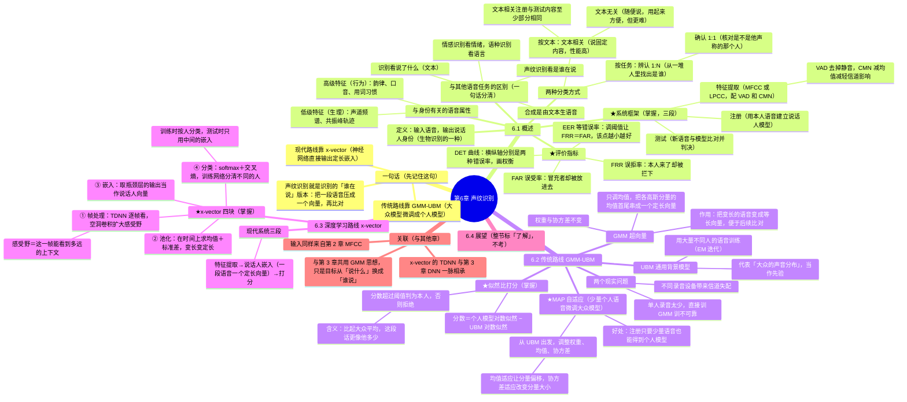

# 6 声纹识别

一句话：声纹识别是**根据声音特性判断说话人身份**。传统路线是 **GMM-UBM（Gaussian Mixture Model - Universal Background Model，高斯混合模型—通用背景模型）+ MAP（Maximum A Posteriori，最大后验概率）自适应 + 似然比打分**，深度学习路线是 **x-vector 说话人嵌入 + 后端打分**。

## 0 读这一章之前

- **前置知识**：知道「概率分布」大概是什么（一堆可能性的分布形状）。
- 整章一句话：**先给每个人建一个声音档案，再拿新语音去比对**。
- 三个新词：**注册**（建档案）、**嵌入**（用一个定长向量代表一个人）、**似然比**（比「大众」更像「他」多少）。
- 传统路线看 GMM-UBM，现代路线看 x-vector，两条线都在回答「怎么把一个人的声音压成一个向量」。

## 总览（思维导图）

## 考点权重

| 模块 | 真正要掌握的内容 | 优先级 |
| --- | --- | ---: |
| 6.1.1 基本概念 | 定义、与其他语音任务的区别、低级/高级属性、文本相关 vs 无关、辨认 vs 确认、FRR/FAR/EER | **最高** |
| 6.1.2 方法回顾 | 系统三部分（特征提取/注册/测试）、GMM 为什么合适、UBM 为什么必要、x-vector 简介 | **很高** |
| 6.2 GMM-UBM | MAP 自适应的三个理由、平均对数似然、似然比判决、GMM 超向量 | **最高** |
| 6.3 深度学习 | x-vector 四个函数块、TDNN 感受野、时间池化、嵌入提取、softmax + 交叉熵 | **最高** |

---

## 6.1 声纹识别概述

### 6.1.1 基本概念

**定义**：**声纹识别（说话人识别）** 是**生物识别**（指纹、掌纹、人脸、虹膜等）的一种，根据说话人的**声音特性**进行身份辨识。输入是**语音**，输出是**说话人身份**。

#### 语音里装着三类信息

| 信息类型 | 内容 | 对应任务 |
| --- | --- | --- |
| **语言信息（linguistic）** | 说了什么内容 | **语音识别**、**语音合成/文语转换 TTS** |
| **副语言信息（prosody）** | 韵律、语气等 | **情感识别** |
| **非语言信息（personal information）** | 说话人身份等 | **声纹识别**（说话人辨认/确认） |

**与其他语音任务的区别**：

- 语音识别输出**文本信息**
- 情感识别输出**情感信息**
- 语种识别输出**语种**
- 语音合成由文本输出语音
- 而**声纹识别输出语音携带的说话人身份信息**

#### 说话人身份相关的语音属性

| 层级 | 与什么相关 | 具体表现 |
| --- | --- | --- |
| **低级属性** | 发声器官的**生理**方面 | 声道频谱、**共振峰轨迹** |
| **高级属性** | 说话方式的**行为**差异 | **韵律**、**口音**、**话语中词的选择** |

#### 两种分类方式

**按输入模式（文本相关 / 无关）**

| 类型 | 特点 |
| --- | --- |
| **文本相关（Text-dependent）** | 注册与测试话语共享（至少部分）相同内容；目的是分析**给定语音语境下**的说话人特征；**性能更高** |
| **文本无关（Text-independent）** | 注册与测试可用任意文本（甚至不同语言）；不使用口语内容的先验信息；**便利性更高** |

**按输出模式（辨认 / 确认）**

| 类型 | 判定什么 | 对比形式 |
| --- | --- | --- |
| **说话人辨认（Speaker Identification）** | 待识别说话人来自注册集中的**哪一个**（与一组标记样本比较，取最匹配者） | **1 : N** |
| **说话人确认（Speaker Verification）** | 待识别语音是否来自注册集中的**某个**说话人（与声称身份的注册样本比较，匹配足够好＝过阈值则接受） | **成对 / 1 : 1** |

**辨认任务可以分解为 N 对说话人的比较，因此确认任务更基础。**

#### 评价指标

> [!tip] 人话
> 该放行的被拦下叫 FRR，该拦的被放行叫 FAR；两者相等处的错误率叫 EER。

| 指标 | 定义 |
| --- | --- |
| **误拒绝率 FRR（False Rejection Rate）** | 被错误拒绝的**有效身份声明**的比例 = 本该匹配成功却判失败的次数 ÷ 总的匹配成功次数 |
| **误接受率 FAR（False Acceptance Rate）** | 错误接受**冒名顶替者**身份声明的比例 = 本该匹配失败却判成功的次数 ÷ 总的匹配失败次数 |
| **等错误率 EER（Equal Error Rate）** | 调整阈值使 **FRR = FAR**，此时的 FAR/FRR 值即 EER，**越小越好** |

阈值变化时两者的权衡曲线叫 **DET 曲线（Detection Error Tradeoff，检测—错误—均衡曲线）**。

### 6.1.2 声纹识别方法的回顾

#### 系统基本框架（掌握）

> [!tip] 人话
> 先给每个人建档案（注册），再把待测语音拿去比对（测试）。

| 部分 | 作用 |
| --- | --- |
| **特征提取** | 把原始语音信号转换为**包含说话人信息为主**的特征向量序列 |
| **注册** | 用注册语音建立说话人模型，供与测试段对照，判断访问者是否与其声明身份相符 |
| **测试** | 从待测语音提取特征，与每个注册说话者的模型比较，按**相似度（似然度）** 做出识别决策 |

#### GMM 与 UBM（基本概念）

**GMM** 用来为目标说话人的声纹特征建模：它用多个高斯概率密度的**加权**来拟合空间分布，可以**平滑地逼近任意形状**的概率密度函数，是一个易于处理、对实际数据表征能力强的参数模型。

$$
P(\mathbf x\mid\theta)=\sum_{m=1}^{M}c_m\,\mathcal N(\mathbf x;\boldsymbol\mu_m,\boldsymbol\Sigma_m)
$$

**为什么需要 UBM（Universal Background Model，通用背景模型）**：

1. 实际场景中**每个说话人的语音数据很少**，训练不出可靠的 GMM
2. 复杂声学环境与信道下，训练与测试语音**存在失配**。

解法：先用 **EM 算法**训练一个**说话人无关**的通用背景模型（UBM），再基于 UBM 通过自适应算法（如 **MAP 最大后验概率**）得到目标说话人模型。

**为什么用 MAP 而不是从头训练**：

1. UBM 作为初始模型，可以**减少注册新说话人所需的语音时长/数量**
2. 说话人相关 GMM 与 UBM **模型复杂度相同**，因此能算出更可靠的对数似然分数
3. 借助**高斯选择**可以算得更快。

#### x-vector（基本概念）

**X-vector 提取器**：

- 用**监督方式**训练的深度神经网络导出**句子级嵌入表示**——TDNN 经过训练以在输出层区分说话人
- **统计池化层**计算均值与标准差
- 段的统计信息被送入另一个隐层产生嵌入
- **数据增广是必要的**

---

## 6.2 传统声纹识别算法（GMM-UBM）

### 特征提取

- **目的**：**保留说话人信息**，**去除噪声和其他干扰信息**。
- **声学特征**：梅尔频率倒谱系数（**MFCC**）、线性预测倒谱系数（**LPCC**）。
- **完整前端**还包括：**语音活动检测（VAD）**（丢弃非语音帧）与**后处理**（如倒谱均值归一化 **CMN**）。

### 基于 GMM 的说话人建模

**注册**：说话人模型由该说话人的注册语音构建。每条注册语音 $X$ 经前端得到特征向量序列 $\{\mathbf x_t\}_{t=1}^{T}$；用 $K$ 个高斯分量的 GMM 描述其分布，参数集合

$$
\theta=\{\boldsymbol\mu_k,\boldsymbol\Sigma_k,w_k\}_{k=1}^{K},\qquad \sum_{k=1}^{K}w_k=1
$$

$w_k$ 是权重（所有分量之和恒为 1），$\mu_k$、$\Sigma_k$ 是均值与协方差。

### 识别：平均对数似然与似然比（掌握）

测试语音与说话人模型的匹配程度，用**平均对数似然**衡量：

$$
\mathcal L(Y\mid\theta)=\frac{1}{T}\sum_{t=1}^{T}\log p(\mathbf x_t\mid\theta)
$$

- **辨认**：选择得分最高的说话人模型；
- **确认**：用**对数似然比**做判决。

**说话人确认可以化为两个假设的检验**：

- $H_0$：测试段 $Y$ 来自假设说话人；
- $H_1$：测试段 $Y$ 不是来自假设说话人。

判决量是「个人模型 vs UBM」的对数似然比：

$$
\Lambda(Y)=\mathcal L(Y\mid\theta_{\text{speaker}})-\mathcal L(Y\mid\theta_{\text{UBM}})\;\underset{H_1}{\overset{H_0}{\gtrless}}\;\eta
$$

$\Lambda$ 超过阈值 $\eta$ 则**接受**，否则**拒绝**。含义是「比起大众平均水平，这段话更像这个人多少」。

### 最大后验（MAP）自适应

以 UBM 为初始模型，**调整全部参数**（权重、均值向量、协方差矩阵）：

1. 计算每一帧到各混合高斯分量的**相似度**；
2. 由相似度算出**零阶与一阶统计量**（各分量的占用数、特征和）；
3. 用这些统计量**调整参数**（例如均值向量 $\mu_k$）。

因为调整量由「有多少帧落在该分量」决定，所以数据少的说话人只会被小幅修正、不会跑偏——这正是「只需很少注册语音」的原因。

### GMM 超向量（GMM supervector）

GMM-UBM 范式的做法：对每个说话人，基于**同一个 UBM** 估计说话人相关的 GMM；并且**只调整均值向量**，权重与协方差矩阵保持与 UBM 相同。于是每个说话人的模型可由「各高斯分量均值」唯一表示——把所有分量的均值向量按固定顺序**首尾相连**，得到一条很长的定长向量，即 **GMM 超向量**，可作为说话人的表征。

---

## 6.3 基于深度学习的声纹识别

### 现代系统三段

**特征提取 → 说话人嵌入 → 打分**。

### x-vector（掌握）

> [!tip] 人话
> 让网络自己学出一条定长向量来代表说话人。

**x-vector 是包含四个函数块的深度神经网络**：

| 函数块 | 内容 |
| --- | --- |
| 1. **帧处理器** | 用多层神经网络提取深度特征（如**延时神经网络 TDNN**）；输入是 MFCC 或对数 mel-filterbank 系数 |
| 2. **池化层** | 把变长的特征向量序列压成**一个固定维向量**；最常用**时间池化**（对每维特征取**均值与标准差**） |
| 3. **嵌入提取** | 若干相互连接的网络层，其中一层设计为**瓶颈层（bottleneck layer）**；**瓶颈层的输出（非线性层之前）就是 x-vector** |
| 4. **说话人分类** | 按说话人标签做分类：输出层每个节点代表一个说话人（共 $C$ 个），用 **softmax** 归一化，用**交叉熵**衡量输出与标签的差异 |

**TDNN 与时间上下文**：TDNN 提取上下文的能力取决于**感受野**宽度（影响网络特定单元的输入空间区域）。想扩大视野可用**空洞卷积**（以一定步长跳过输入值），或**堆叠更多空洞一维卷积层**。

**池化层**：说话人嵌入通过池化形成固定长度表征——时间池化即对每维特征求均值与标准差。

**嵌入提取**：聚合后的特征经若干全连接层处理，把**第一个线性层的输出**作为嵌入表征；它是固定长度向量，捕捉说话人的**长期声纹特征**。

**多类分类与损失**：输出层每个节点代表一个类（说话人），用 **softmax**（归一化指数）激活；**交叉熵损失**衡量网络输出与标签的差异，$1\{y_i=j\}$ 是指示函数（第 $i$ 个样本属于第 $j$ 个说话人取 1，否则 0）。

---

## 本章小结

> [!summary] 全章路线
> **定义与三类信息 → 两种分类（文本相关/无关、辨认 1:N/确认 1:1）→ 指标（FRR、FAR、EER、DET）→ 框架（特征 + 注册 + 测试）→ GMM-UBM（UBM 打底 + MAP 微调 + 似然比打分 + 超向量）→ x-vector（TDNN → 时间池化 → 瓶颈嵌入 → softmax 分类）**。

> [!important] 记住一句话
> **声纹识别 = 用「像本人」减「像大众」的差值做判决；深度学习把这条差值换成了两个嵌入的距离。**
