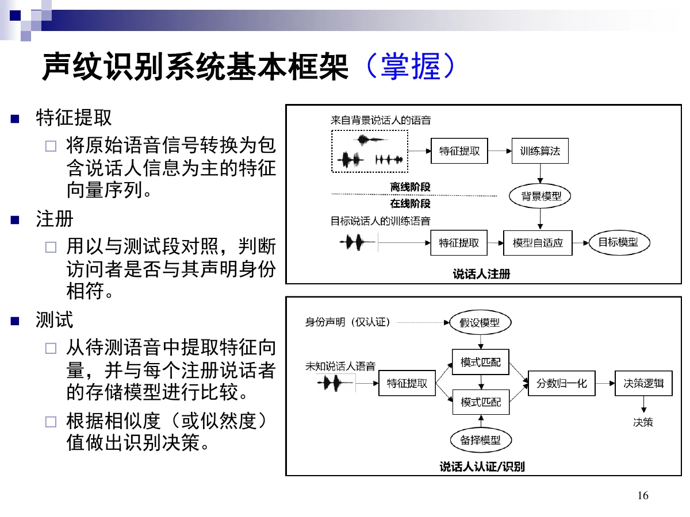
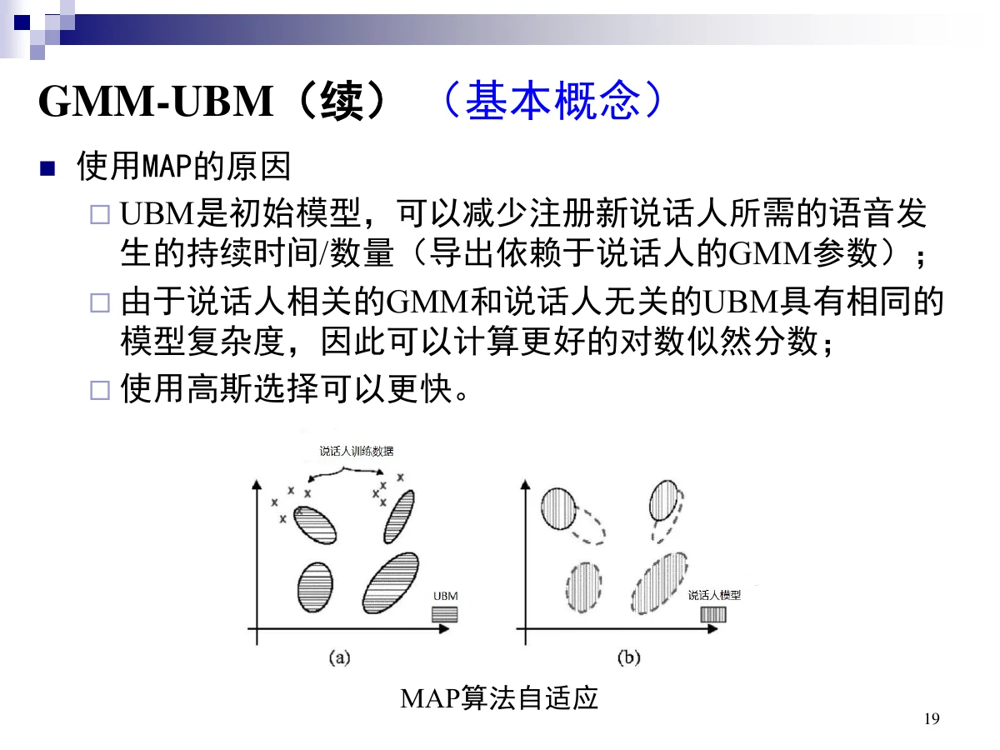
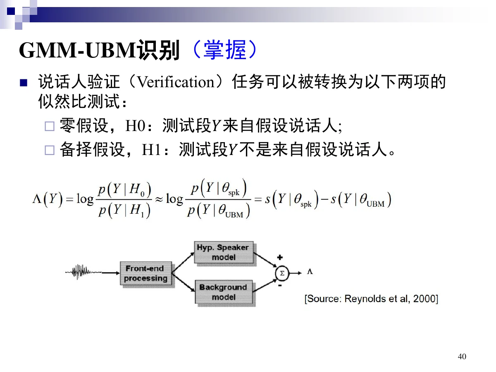
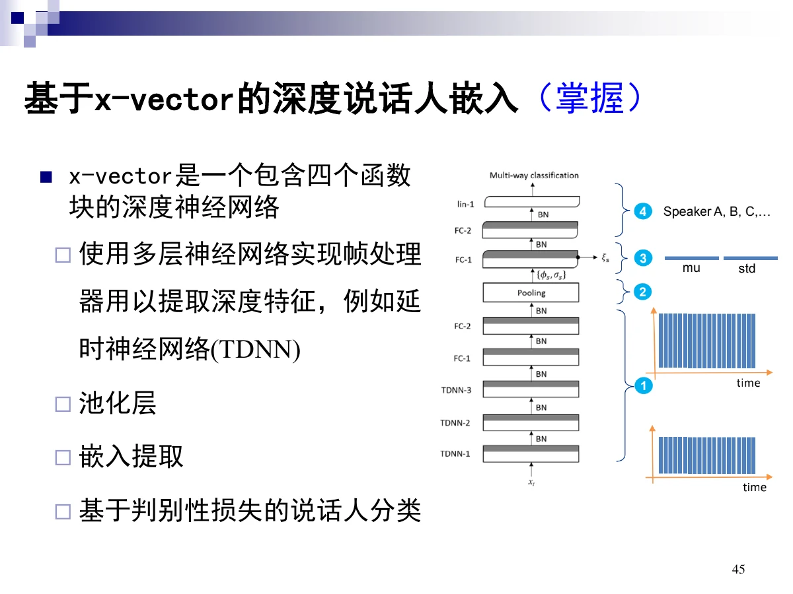
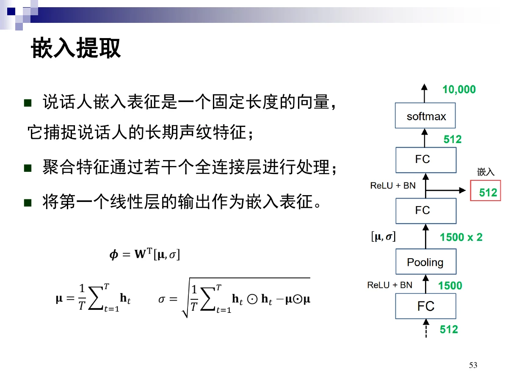

# 6 声纹识别

一句话：声纹识别是**根据声音特性判断说话人身份**。传统路线是 **GMM-UBM + MAP 自适应 + 似然比打分**，深度学习路线是 **x-vector 说话人嵌入 + 后端打分**。

## 0 读这一章之前

- **前置知识**：知道「概率分布」大概是什么（一堆可能性的分布形状）。
- 整章一句话：**先给每个人建一个声音档案，再拿新语音去比对**。
- 三个新词：**注册**（建档案）、**嵌入**（用一个定长向量代表一个人）、**似然比**（比「大众」更像「他」多少）。
- 传统路线看 GMM-UBM，现代路线看 x-vector，两条线都在回答「怎么把一个人的声音压成一个向量」。

## 总览（思维导图）

$$
\text{第 6 章 声纹识别}
\begin{cases}
6.1\ \text{概述}\begin{cases}\text{定义、与其他任务的区别}\\
\text{低级属性 / 高级属性}\\
\text{分类}:\ \text{文本相关/无关}\text{、}\text{辨认 1:N / 确认 1:1}\\
\text{指标}:\ EER=FRR=FAR\\
\text{系统框架}:\ \text{特征提取} \to \text{注册} \to \text{测试}
\end{cases}\\[4pt]
6.2\ \text{传统}:\ \text{GMM-UBM} + \text{MAP} + \text{似然比} + \text{超向量}\\
6.3\ \text{深度}:\ \text{x-vector 四块（帧处理、池化、嵌入、分类）}
\end{cases}
$$

## 考点权重

| 模块           | 真正需要掌握                                                           |   优先级 |
| -------------- | ---------------------------------------------------------------------- | -------: |
| 6.1.1 基本概念 | 定义、与 ASR/情感/语种的区别、辨认 vs 确认、文本相关/无关、EER/FRR/FAR | **最高** |
| 6.1.2 方法回顾 | 系统三部分（特征提取/注册/测试）、GMM-UBM、x-vector 概念               | **很高** |
| 6.2 GMM-UBM    | UBM 的作用与 MAP 自适应、似然比打分、GMM 超向量                        | **最高** |
| 6.3 深度学习   | x-vector 四个函数块、时间池化、嵌入提取、交叉熵分类                    | **最高** |

已剔除：6.1.3 典型应用、技术演化时间线、JFA / i-vector / PLDA、EM 推导、MAP 续页、注意力池化与自注意力池化、改进 softmax、数据增广、6.4 全部展望（含 GE2E），均为标注「了解」的内容。

# 6.1 声纹识别概述

## 6.1.1 基本概念

### 定义

> **人话**：用声音认人：输入一段语音，输出这是谁。

声纹识别（说话人识别）是**生物识别**（指纹、掌纹、人脸、虹膜等）的一种，根据说话人的**声音特性**进行身份辨识。

- 输入：语音
- 输出：说话人身份

### 与其他语音任务的区别

> **人话**：同一段语音，不同任务读的是不同信息：文字、情绪、语种、身份。

| 任务     | 输出                         |
| -------- | ---------------------------- |
| 语音识别 | 语音携带的**文本信息**       |
| 情感识别 | 语音携带的**情感信息**       |
| 语种识别 | 语音所属的**语种**           |
| 语音合成 | 由文本输出语音               |
| 声纹识别 | 语音携带的**说话人身份信息** |

### 说话人身份相关的语音属性

> **人话**：音色来自生理（声带、声道），口音和习惯来自行为。

| 层级     | 与什么相关             | 具体表现                   |
| -------- | ---------------------- | -------------------------- |
| 低级属性 | 发声器官的**生理**方面 | 声道频谱、共振峰轨迹       |
| 高级属性 | 说话方式的**行为**差异 | 韵律、口音、话语中词的选择 |

### 两种分类方式

> **人话**：一个问「说的是什么内容」，一个问「是不是他」；再分「N 选 1」和「二选一」。

**按输入模式（文本相关 / 无关）**

| 类型     | 特点                                                                                 |
| -------- | ------------------------------------------------------------------------------------ |
| 文本相关 | 注册与测试话语共享（至少部分）相同内容；分析给定语音语境下的说话人特征；**性能更高** |
| 文本无关 | 注册与测试可用任意文本（甚至不同语言）；不用口语内容的先验信息；**便利性更高**       |

**按输出模式（辨认 / 确认）**

| 类型                      | 判定什么                                   | 对比形式    |
| ------------------------- | ------------------------------------------ | ----------- |
| 说话人辨认 Identification | 待识别说话人来自注册集中的**哪一个**       | 1:N         |
| 说话人确认 Verification   | 待识别语音是否来自注册集中的**某个**说话人 | 1:1（成对） |

### 评价指标

> **人话**：该放行的被拦下叫 FRR，该拦的被放行叫 FAR；两者相等时的错误率叫 EER。

- **误拒绝率 FRR**：被错误拒绝的有效身份声明的比例（本该匹配成功却判失败）。
- **误接受率 FAR**：错误接受冒名顶替者声明的比例（本该失败却判成功）。
- **等错误率 EER**：调整阈值使 **FAR = FRR**，此时的错误率。EER 越小越好；阈值变化时两者的权衡画成 **DET 曲线**（检测—错误—均衡曲线）。

## 6.1.2 声纹识别方法的回顾

### 系统基本框架（掌握）

> **人话**：先给每个人建档案（注册），再把待测语音拿去比对（测试）。

| 部分     | 作用                                               |
| -------- | -------------------------------------------------- |
| 特征提取 | 把原始语音转换为**以说话人信息为主**的特征向量序列 |
| 注册     | 用注册语音建立说话人模型，供与测试段对照           |
| 测试     | 从待测语音提取特征，与每个注册说话者比较并判决     |

### 技术路线

| 路线           | 代表方法                                    |
| -------------- | ------------------------------------------- |
| 传统（生成式） | GMM-UBM（基本概念）→ 超向量、i-vector、PLDA |
| 深度学习       | x-vector 说话人嵌入（基本概念）             |

# 6.2 传统声纹识别算法（GMM-UBM）

## 特征提取

> **人话**：只保留与「谁」有关的部分，把内容和噪声尽量丢掉。

- 目的：**保留说话人信息**，**去除噪声和其他干扰信息**。
- 声学特征：梅尔频率倒谱系数（MFCC）、线性预测倒谱系数（LPCC）。
- 完整前端还包括：**语音活动检测**（丢弃非语音帧）与**后处理**（如倒谱均值归一化 CMN）。

## 基于 GMM 的说话人建模

> **人话**：用一坨概率分布描述「这个人的声音长什么样」。

**注册**：说话人模型由该说话人的注册语音构建。注册语音 $X$ 经前端得到特征向量序列 $\{\boldsymbol x_t\}_{t=1}^{T}$，用 $K$ 个高斯分量的 GMM 描述其分布，参数集合

$$
\theta=\{\boldsymbol\mu_k,\boldsymbol\Sigma_k,w_k\}_{k=1}^{K},\qquad \sum_{k=1}^{K}w_k=1
$$

其中 $w_k$ 是权重，$\mu_k$、$\Sigma_k$ 是均值与协方差。

**问题**：实际场景中每个说话人的语音很少，训练不出可靠的高斯混合模型。

## GMM-UBM

> **人话**：每个人语音太少，先用大众模型打底，再小幅微调成个人模型。

**UBM（通用背景模型）**：用大量说话人无关的数据，通过 EM 算法训练一个**说话人无关**的 GMM，作为先验。

**MAP 自适应**：以 UBM 为初始模型，用最大后验概率（MAP）自适应得到目标说话人模型，可**大幅减少注册所需语音时长**。适应时权重、均值向量和协方差矩阵都可调整：均值适应使高斯分量**偏移**，协方差适应改变分量的**大小（不确定性）**。

好处：说话人相关的 GMM 与 UBM 模型复杂度相同，便于计算更可靠的对数似然分数。

## 打分：似然比测试（掌握）

> **人话**：比起「大众平均」，这段话更像「他」多少——超过阈值就认。

说话人确认可化为两个假设的检验：

- $H_0$：测试段 $Y$ 来自假设说话人；
- $H_1$：测试段 $Y$ 不是来自假设说话人。

给定测试段与说话人模型 $\theta$ 的（平均）对数似然相似度为

$$
\mathcal L(Y\mid\theta)=\frac{1}{T}\sum_{t=1}^{T}\log p(\boldsymbol x_t\mid\theta)
$$

判决用**对数似然比**（说话人模型 vs UBM）：

$$
\Lambda(Y)=\mathcal L(Y\mid\theta_{\text{speaker}})-\mathcal L(Y\mid\theta_{\text{UBM}})
\;\underset{H_1}{\overset{H_0}{\gtrless}}\;\eta
$$

$\Lambda$ 超过阈值 $\eta$ 则接受，否则拒绝。

## GMM 超向量（GMM supervector）

> **人话**：只调均值，把各分量的均值串成一条很长的向量当身份证。

GMM 由三组参数组成：权重（每个分量有多重要）、均值（分量中心在哪）、协方差（分量的形状）。为简化计算、减少数据需求，**假设说话人与 UBM 的权重和协方差相同，只调整均值向量**；把所有高斯分量的均值向量按固定顺序首尾相连，就得到一条**超长的向量**，称为 **GMM 超向量**——它可作为说话人的定长表征。

# 6.3 基于深度学习的声纹识别

## 现代系统三段

现代声纹识别系统主要基于**说话人嵌入**：**特征提取 → 说话人嵌入 → 打分**。

## x-vector（掌握）

> **人话**：让网络自己学出一条定长向量来代表说话人。

**x-vector 是一个包含四个函数块的深度神经网络**：

| 函数块        | 内容                                                                                    |
| ------------- | --------------------------------------------------------------------------------------- |
| 1. 帧处理器   | 多层神经网络提取深度特征（如延时神经网络 TDNN）；输入是 MFCC 或对数 mel-filterbank 系数 |
| 2. 池化层     | 把变长的特征向量序列压成**一个固定维向量**；最常用**时间池化**（取均值和标准差）        |
| 3. 嵌入提取   | 若干相连网络层，其中一层设计为**瓶颈层**；**瓶颈层（非线性层之前）的输出就是 x-vector** |
| 4. 说话人分类 | 用判别性损失按说话人标签做分类（softmax + 交叉熵）                                      |

### 各块的细节

**TDNN 与时间上下文**：TDNN 提取上下文的能力取决于**感受野**宽度（影响某个单元的输入空间区域）。想扩大视野可以用**空洞卷积**（按步长跳过输入值），或**堆叠更多空洞一维卷积层**。

**池化层**：说话人嵌入通过池化形成固定长度表征，时间池化即对每维特征求均值与标准差。

**嵌入提取**：聚合后的特征经过若干全连接层，把**第一个线性层的输出**作为嵌入表征；该嵌入是固定长度向量，捕捉说话人的**长期声纹特征**。

**分类与损失**：输出层每个节点代表一个说话人，用 **softmax** 归一化，用**交叉熵**衡量输出与标签的差异。

# 6.4 本章小结

- 声纹识别输出身份；与 ASR（文本）、情感识别、语种识别、TTS 的输出都不同。
- 辨认是 1:N 选最大，确认是 1:1 比阈值。
- 文本相关性能高、文本无关更便利。
- EER 是 FAR 与 FRR 相等时的错误率。
- GMM-UBM 解决“每人语音太少”：UBM 做完先验，MAP 只做小幅自适应；打分用对数似然比。
- 超向量 = 只调均值、把各分量均值串成一条长向量。
- x-vector 四块：帧处理 → 池化 → 嵌入（瓶颈层输出）→ 分类（softmax + 交叉熵）。

# 6.5 考前速查表

| 题目出现                                                         | 立刻想到                            |
| ---------------------------------------------------------------- | ----------------------------------- |
| 生物识别、输出说话人身份                                         | 声纹识别定义                        |
| 声道频谱、共振峰轨迹 / 韵律、口音                                | 低级属性（生理）/ 高级属性（行为）  |
| 注册与测试内容相同、性能更高                                     | 文本相关                            |
| 任意文本、便利性更高                                             | 文本无关                            |
| 1:N / 1:1                                                        | 辨认 / 确认                         |
| FAR = FRR 时的错误率                                             | EER（另有 DET 曲线）                |
| FRR / FAR 的分子                                                 | 本该成功被判失败 / 本该失败被判成功 |
| 特征提取 → 注册 → 测试                                           | 系统三部分                          |
| 说话人无关的先验模型、EM 训练                                    | UBM                                 |
| 少量注册语音即可适应                                             | MAP 自适应（调权重/均值/协方差）    |
| $\mathcal L(Y\mid\theta_s)-\mathcal L(Y\mid\theta_{\text{UBM}})$ | 对数似然比打分                      |
| 只调均值、首尾相连成长向量                                       | GMM 超向量                          |
| 帧处理 → 池化 → 嵌入 → 分类                                      | x-vector 四个函数块                 |
| 均值 + 标准差                                                    | 时间池化                            |
| 瓶颈层（非线性层之前）的输出                                     | x-vector 嵌入                       |
| 感受野、空洞卷积                                                 | TDNN 的时间上下文                   |
| softmax + 交叉熵                                                 | 说话人分类训练                      |
