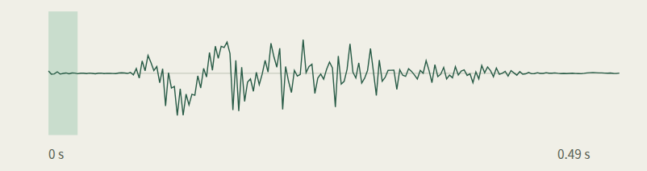
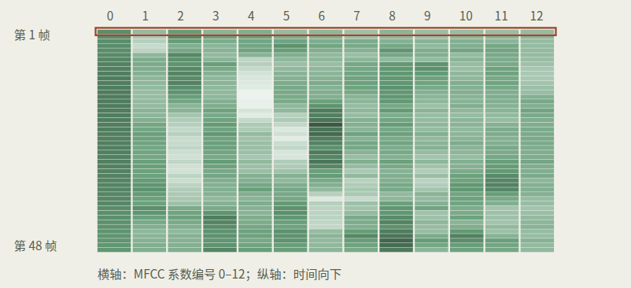
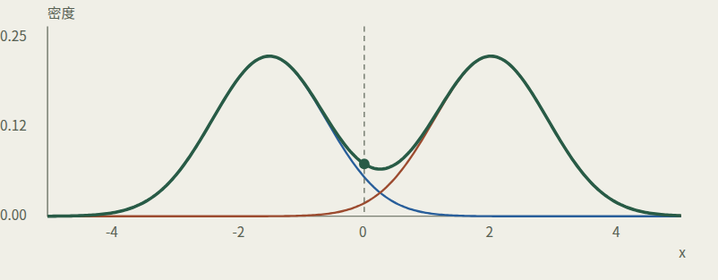
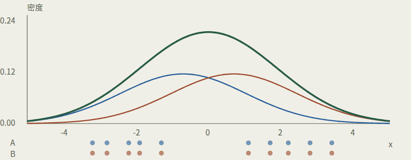
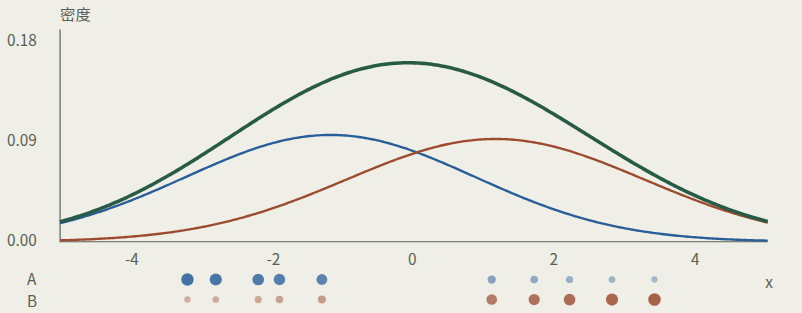

# 实验2-1 GMM语音识别：从零到补全代码

> [!info] 阅读方式
> 这是 Obsidian 原生 Markdown 笔记：公式用 LaTeX，图和录音是本知识库附件。此前 HTML 中的滑块、按钮不能在普通笔记里直接运行，因此这里保留静态图、完整计算过程与自测答案；需要操作时，用系统浏览器打开配套 HTML。

相关课程：[[2 语音信号处理的基础]]、[[3 语音识别]]。

[配套交互 HTML](raw/GMM实验/gmm-visual-guide.html)（在文件管理器 / 系统浏览器中打开；不是把 JavaScript 塞进笔记执行）。

## 怎么读

不用记得之前学过什么。按“声音 → MFCC → 数组 → 高斯 → GMM → 初始化 → EM → 评分 → 填空 → 验收”顺着读；看到公式先读下面的文字，再对照代码。本文给的是讲解与参考填法，没有自动修改实验代码，也没有宣称完成实际训练。

### 全文符号

| 符号                    | 含义                         | 对应代码                 |
| ----------------------- | ---------------------------- | ------------------------ |
| $N$                     | 当前输入的帧数               | `len(feats)`             |
| $D$                     | 每帧特征维数，本实验 13      | `feats.shape[1]`         |
| $K$                     | 一个 GMM 的成分数，本实验 3  | `self.K`                 |
| $\mathbf{x}_n$          | 第 n 帧的特征向量            | `feats[n]`               |
| $\pi_k$                 | 第 k 个成分的混合权重        | `self.pi[k]`             |
| $\boldsymbol{\mu}_k$    | 第 k 个成分的均值向量        | `self.mu[k]`             |
| $\boldsymbol{\Sigma}_k$ | 第 k 个成分的协方差矩阵      | `self.sigma[k]`          |
| $\gamma_{nk}$           | 第 n 帧对第 k 个成分的责任度 | EM 归一化后的 gamma[n,k] |

数学下标通常从 1 写起，Python 下标从 0 开始；例如第 1 帧对应 feats[0]。不要把这两个编号习惯混淆。

## 1. 这次究竟要做什么？

给程序一段只说了一个英语数字的录音，让它判断说的是哪一类。这叫**孤立词识别**，不是听写连续的一整句话，也不是判断说话人是谁。


训练时看“录音 + 正确标签”，学每个类别的特征分布；测试时只给录音打分，标签只用于最后核对。**一个类别一个 GMM，一个 GMM 内有 3 个高斯成分。**不要把“成分”和“类别”混为一谈。

当前代码与数据清单，已直接核对

| 项目        | 实际内容                                                   |
| ----------- | ---------------------------------------------------------- |
| 类别        | Z、O、1–9，共 11 类；Z/O 对应 zero / oh 的两种零读法       |
| 训练 / 测试 | 330 / 110 条录音；每类分别 30 / 10 条                      |
| 特征与模型  | D=13，K=3；每类 1 个模型，共 33 个成分                     |
| 训练轮数    | epochs=3，指每个类别做 3 次 EM，不是 3 个类别              |
| 需要填什么  | log_likelihood 中一处；EM 的 E 步和 M 步各一处             |
| 验收内容    | 补全的代码 + result/gmm.log；按实验说明打包为学号-姓名.zip |

本次说明明确只做第一部分 GMM，不要求实现 HMM 或 Wenet。说明中的 95.5% 是参考准确率，不是这次已经跑出的结果，也不是固定保证。

## 2. 声音为什么能变成数字？

麦克风记录空气振动。计算机每隔一小段时间读取一次振幅，得到一串数，叫**采样**。采样率 8000 Hz 表示每秒 8000 个振幅读数，不是每秒 8000 个单词。

下面不是随机画的示意图：这是训练集 `ACZB_endpt.wav`，标签为 Z，采样率 8000 Hz，共 3920 个采样点，时长 0.49 秒。波形为显示而抽取每 20 个采样点中的一个；特征使用完整音频计算。

![[Courses/语音信息处理/raw/GMM实验/ACZB_endpt.wav]]

### 真实波形与分析窗



绿色窗口覆盖第 1 帧的 0–25 毫秒；窗口每次往前移 10 毫秒。录音最后一帧覆盖 0.470–0.495 秒，超出 0.49 秒的部分补零。逐帧移动请打开配套交互 HTML。

人说话时整体不断变化，但很短的一段内可以近似稳定。因此每 **25 毫秒**取一个窗，每 **10 毫秒**往前挪一次。相邻帧会重叠，不是互不相交地切开。此录音每窗 200 点、每步 80 点，最后不足一窗会补零。

$$
\begin{aligned}
N_{\mathrm{frames}}&=1+\left\lceil\frac{3920-200}{80}\right\rceil\\
&=48
\end{aligned}
$$

这里的 `ceil` 是向上取整。不要混淆采样点和帧：一帧由很多采样点组成，一帧之后会对应一行 MFCC 特征。

## 3. MFCC：把一帧变成 13 个数

直接比较波形很难：时间稍微错开，振幅就可能不同。MFCC（梅尔频率倒谱系数）把每帧的**频谱包络**压缩成一小组数，描述“这小段声音的频率能量如何分布”。它不是 13 个音符、13 个词，也不是 13 个采样点。

1. **预加重：** $y[t]=s[t]-0.97s[t-1]$，减轻高频相对偏弱的影响。
2. **分帧、窗函数：**按前一节切窗。当前库的默认窗是全 1（矩形窗），不是常见教程里默认加的 Hamming 窗。
3. **FFT 与功率谱：**从时间波形转到频率能量；默认 nfft=512。零填充增加频率取样点，不会凭空增加声音信息。
4. **26 个 Mel 滤波器：**频率轴按听觉尺度分组，汇总各频带能量。Mel 尺度在低频分得较细、高频较疏。
5. **取对数：**压缩能量范围，让能量比例更容易表达。
6. **DCT：**将相关的频带信息重新组合，只保留前 13 个系数；默认还有倒谱提升（ceplifter=22）。
7. **帧能量：**默认 appendEnergy=True，将第 0 个系数替换为该帧总能量的自然对数。因此不是原封不动保留 13 个 DCT 值。

```python
# utils.py:4–7，实际调用
(rate, sig) = wav.read(wav_path)
feat = mfcc(sig, rate, numcep=13)
# 此真实样本的结果：feat.shape == (48, 13)
```

### 真实 MFCC 矩阵



横轴是系数编号 0–12，纵轴是帧，时间向下；轮廓框标出第 1 帧。深浅仅表示数值，不表示概率。图中每一行有 13 个数，合计 48 行。

`extract_feat` 只调用 MFCC。虽然导入了 `delta`，实际没有使用一阶或二阶差分，所以这里是 13 维，不是 39 维。`librosa` 列在实验依赖中，但当前特征函数实际使用 `python_speech_features`。

## 4. 先补上读代码需要的基础

把 `feats` 想成一张数表，`shape` 是表的尺寸。如果形状为 `(200,13)`，就是 200 行、13 列：**N=200 帧，D=13 个特征。**

本实验中反复出现的 Python 写法

| 写法                  | 含义                                         |
| --------------------- | -------------------------------------------- |
| `feats[n]`            | 第 n 帧的一整行，形状 (D,)；编号从 0 开始    |
| `feats[n, d]`         | 第 n 帧的第 d 个特征，一个数                 |
| `len(feats)`          | 第一维长度 N；不是所有元素数 N×D             |
| `self` / `self.mu[k]` | 当前模型对象 / 该模型的第 k 个成分均值       |
| `range(K)`            | 依次给出 0 到 K−1，循环遍历成分              |
| `zeros((N,K))`        | 建 N×K 全零表；建立容器不代表已算好概率      |
| `zip(labels, feats)`  | 一一配对“成分编号”和“对应帧”                 |
| `dict[key]`           | 按键查字典，例如 gmms['2'] 找到类别 2 的模型 |

### 用一张小表看清 axis

$$
A=\begin{bmatrix}1&2&3\\4&5&6\end{bmatrix}
$$

- 沿轴 0：跨行，相同列相加，留下每列一个数。
- 沿轴 1：跨列，相同行相加，留下每行一个数。

$$
\begin{aligned}
\operatorname{sum}(A,\mathrm{axis}=0)&=[5,7,9]\\
\operatorname{sum}(A,\mathrm{axis}=1)&=[6,15]
\end{aligned}
$$

例如第一种是 1+4、2+5、3+6；第二种是 1+2+3、4+5+6。输出形状分别为 (3,) 和 (2,)。

`sum(a)` 不指定 axis 时把所有元素相加。`mean` 是平均值；`concatenate(..., axis=0)` 则把多段录音的特征沿帧方向接起来，不会把 13 个特征加在一起。注意：**不是所有带 axis 的操作都会删除维度**；“合并掉”是这里归约操作的默认行为，`keepdims=True` 还可以保留长度为 1 的轴。

> [!question] 小检查：gamma.shape=(100,3)，sum(gamma,axis=1) 有几个数？
>
> - 3 个
> - 100 个
> - 300 个

> [!success]- 展开答案
> 100 个。(100,3) 沿轴 1 求和，合并 3 个成分，留下 100 帧。

## 5. 一个高斯分布在表达什么？

先把 13 维降为 1 维理解。例如每帧只记“一个声音特征 x”。某一类声音的 x 常在某个中心附近，远离中心的情况少，就可以用一条钟形曲线近似。

- **均值 μ：**中心在哪里。
- **方差 σ²：**围绕中心散得多开。标准差 σ 是方差的平方根。
- **概率密度：**曲线在 x 处的高度，记作 N(x;μ,σ²)。连续变量落在区间内的概率是区间下的面积；某一个精确点的概率为 0。

$$
\mathcal{N}(x;\mu,\sigma^2)=\frac{1}{\sqrt{2\pi\sigma^2}}\exp\!\left(-\frac{(x-\mu)^2}{2\sigma^2}\right)
$$

固定方差时，离均值越远，指数项越小，密度越低。方差变小时曲线变窄、峰值变高，但总面积仍为 1。**密度可以大于 1**，因此不要把密度高度理解为百分比。

### 两个加权高斯相加



蓝线是 A 的加权密度，赭线是 B 的加权密度，绿线是两者相加。虚线表示观察点。此图固定 A 的均值为 −1.5、方差为 0.8、权重为 0.5；B 的均值为 2、方差为 0.8、权重为 0.5。这是一维教学模型，不是实际 13 维模型的投影。

在交互版中：移动均值会左右移动曲线；增大方差会使曲线变宽、峰值降低；改变权重会改变两个成分各自贡献的面积。

### 回到 13 维：圆变成椭圆，方差变成协方差矩阵

一帧 `x` 有 13 个数，均值 `mu` 也有 13 个数。协方差矩阵 `sigma` 为 13×13：对角线是每个特征自己的方差；非对角线说明两个特征是否一起涨落。正相关不等于因果关系。

无相关：椭圆不倾斜正相关：沿斜方向延伸

$$
\begin{aligned}
q&=(\mathbf{x}-\boldsymbol{\mu})^{\mathsf T}\boldsymbol{\Sigma}^{-1}(\mathbf{x}-\boldsymbol{\mu})\\
\mathcal{N}(\mathbf{x};\boldsymbol{\mu},\boldsymbol{\Sigma})&=\frac{\exp(-q/2)}{(2\pi)^{D/2}\lvert\boldsymbol{\Sigma}\rvert^{1/2}}
\end{aligned}
$$

`|Σ|`（行列式）调整密度的尺度；`Σ⁻¹`（逆矩阵）调整不同方向的距离。二次型 `(x−μ)ᵀΣ⁻¹(x−μ)` 是马氏距离的平方，不是普通逐项相乘。`.T` 表示转置，`dot` 表示点积或矩阵乘法；一维 NumPy 向量转置后仍是 `(D,)`，但这里连乘仍得到标量。

代码里的 `self.sigma` 是协方差矩阵，不是单个标准差。`np.pi` 是圆周率；下一节的 `self.pi` 才是混合权重。

## 6. 为什么要混合多个高斯？

同一个数字的不同发音阶段、不同说话方式，可能让特征形成多个“团”。一个高斯只围住一个中心，多条高斯加起来就更灵活。**成分不自动等于音素、说话人或某个数字。**算法只按特征分布分组。

$$
\begin{aligned}
p(\mathbf{x}\mid\theta)&=\sum_{k=1}^{K}\pi_k\mathcal{N}(\mathbf{x};\boldsymbol{\mu}_k,\boldsymbol{\Sigma}_k)\\
\pi_k&\geq0,\qquad\sum_{k=1}^{K}\pi_k=1
\end{aligned}
$$

`Σ` 在求和符号里表示“把各项加起来”；`Σk` 表示第 k 个协方差矩阵。看上下文，别把两者混在一起。`θ` 只是所有参数的合称。

一个类别的模型参数，K=3、D=13

| 代码字段     | 形状      | 每个成分存什么         |
| ------------ | --------- | ---------------------- |
| `self.pi`    | (3,)      | 一个权重，表示成分占比 |
| `self.mu`    | (3,13)    | 13 个均值              |
| `self.sigma` | (3,13,13) | 一个完整协方差矩阵     |

配套交互版的滑块已经在算 GMM：先求 A、B 各自密度，乘权重，再相加。在代码中，`gaussian` 只算一个高斯的密度，不包含混合权重。

> [!question] 高斯分布峰值为 1.5，一定是代码错了吗？
>
> - 一定错了，概率不能超过 1
> - 不一定，密度不是区间概率

> [!success]- 展开答案
> 不一定，密度不是区间概率。密度高度可以大于 1；整条密度曲线下的总面积为 1。

## 7. K-means：先猜一套参数

EM 要根据已有模型重新分配样本，但模型一开始还没有参数。因此先用 K-means 硬分组，再从分组里统计参数。

1. `vq.kmeans2(feats, K, minit='points', iter=100)`：从样本中随机选初始中心，反复按距离分组、更新中心。
2. `labels[n]`：第 n 帧被分到哪个成分；硬分配中每帧只属于一组。
3. `mu[k] = mean(cluster, axis=0)`：同一组跨帧平均，留下 13 个特征均值。
4. `sigma[k] = cov(cluster, rowvar=False)`：把列当变量、行当观测，得到 13×13 的协方差。
5. `pi[k] = 该组帧数 / 总帧数`：例如 40、60、100 帧分成三组，权重为 0.2、0.3、0.5。

当前 `__init__` 保存 K 和 D，并调用 `kmeans_initial`。主程序给**每个类别都传入全部训练帧**作初始化；到 `train` 才按类别取帧并分别训练。不要误读成“初始化时就只用了本类别数据”。

K-means 的 `iter=100` 和外层 EM 的 `epochs=3` 是不同循环。随机起点会影响结果。`np.cov` 默认用样本协方差的 N−1 分母；下一节 EM 的最大似然协方差使用有效样本量 Nₖ 分母，二者不要照抄混用。

## 8. EM：交替解决“先分组还是先建模”

已知每个成分参数，就能估计每帧更像哪个成分；已知每帧对各成分的归属程度，又能重新估计参数。EM 就让这两件事交替进行。这里的 EM 是**期望最大化**，不是一个新模型。

### E 步：每帧对各成分有多大责任度？

$$
\begin{aligned}
w_{nk}&=\pi_k\mathcal{N}(\mathbf{x}_n;\boldsymbol{\mu}_k,\boldsymbol{\Sigma}_k)\\
\gamma_{nk}&=\frac{w_{nk}}{\displaystyle\sum_{j=1}^{K}w_{nj}}
\end{aligned}
$$

先算加权密度 `w`，再除以同一帧的总密度，得到责任度 `gamma`。同一行的责任度之和为 1，表示“给定这一帧，各成分有多可能负责生成它”。这叫软分配，一帧可以同时分给多个成分。

例如加权密度为 `[0.02,0.03,0.05]`，行和是 0.10，归一化后责任度为 `[0.2,0.3,0.5]`。前一张表的行和不必为 1；后一张表必须近似为 1。

### M 步：用责任度作为“票的重量”更新参数

$$
\begin{aligned}
N_k&=\sum_{n=1}^{N}\gamma_{nk}\\
\pi_k^{\mathrm{new}}&=\frac{N_k}{N}\\
\boldsymbol{\mu}_k^{\mathrm{new}}&=\frac{1}{N_k}\sum_{n=1}^{N}\gamma_{nk}\mathbf{x}_n\\
\mathbf{d}_{nk}&=\mathbf{x}_n-\boldsymbol{\mu}_k^{\mathrm{new}}\\
\boldsymbol{\Sigma}_k^{\mathrm{new}}&=\frac{1}{N_k}\sum_{n=1}^{N}\gamma_{nk}\mathbf{d}_{nk}\mathbf{d}_{nk}^{\mathsf T}
\end{aligned}
$$

`Nₖ` 是“有效帧数”，可以是小数。比如某帧责任度 0.3，就对该成分贡献 0.3 票。更新协方差要用**刚刚算出的新均值**；但这轮全部 M 步使用同一份 E 步责任度，不能更新一个成分后就重算剩余成分的责任度。

### 把 E 步、M 步拆开看

教学数据为 10 个一维点：

$$
X=[-3.2,-2.8,-2.2,-1.9,-1.3,1.1,1.7,2.2,2.8,3.4]
$$

这不是录音特征。初始两个成分权重都是 0.5，均值分别为 −0.7、0.7，方差都是 3。



**执行 E 步：**固定模型，给每个点分配责任度。例如 x=−3.2 对 A / B 的责任度约为 0.816578 / 0.183422；x=3.4 约为 0.169853 / 0.830147。沿列求和得到有效帧数 5.027679 / 4.972321。

**执行 M 步：**固定刚算好的责任度，更新参数：

| 成分 |   新权重 |    新均值 |   新方差 |
| ---- | -------: | --------: | -------: |
| A    | 0.502768 | −1.179008 | 4.180850 |
| B    | 0.497232 |  1.151911 | 4.415138 |



两个图中样本位置没有改变；改变的是参数和曲线。下方 A / B 两行点的深浅与大小表示本轮 E 步责任度，在 M 步后保留，直到下一次 E 步重算。

平均 log10 密度由 −1.019778 升为 −0.986921。本演示为避免退化使用方差下限 0.01；它不是本实验真实训练结果。需要连续做多轮时，在交互版按“E 步 → M 步”反复操作。

理想条件下，精确 E / M 步不会降低训练集对数似然；EM 可能停在局部最优，不保证全局最优。训练分数上升也不保证测试准确率每轮都上升，分布拟合与分类表现不是同一件事。

> [!question] 归一化后的责任度表，哪一个和应该为 1？
>
> - 每列之和
> - 每行之和
> - 整张表之和

> [!success]- 展开答案
> 每行之和。E 步对每一帧在 K 个成分间分配责任，所以每行和为 1；按列求和得到 Nₖ。

## 9. 怎么给一整段录音打分？

模型固定时，问“这段录音的特征在此模型下有多合理”，这就是似然。当前 GMM 把帧视作独立观测，不建模帧的先后转移关系。因此它能比较整体特征分布，但没有 HMM 那样的时间状态模型。

$$
\begin{aligned}
L(\theta;X)&=\prod_{n=1}^{N}p(\mathbf{x}_n\mid\theta)\\
\log L(\theta;X)&=\sum_{n=1}^{N}\log p(\mathbf{x}_n\mid\theta)\\
\operatorname{score}(X;\theta)&=\frac{1}{N}\sum_{n=1}^{N}\log_{10}p(\mathbf{x}_n\mid\theta)
\end{aligned}
$$

`∏` 是连乘。许多很小的密度相乘会迅速变得极小，因此用对数将乘法变成加法。本代码还除以帧数，返回的是**平均十进对数密度**，不是真正的似然乘积，也不是直接的正确率。

```python
# log_likelihood 中的运算顺序
frame_probs = np.sum(gamma, axis=1)  # (N,K) → (N,)
frame_logs = np.log10(frame_probs)   # (N,) → (N,)
llh = np.mean(frame_logs)           # (N,) → 一个标量
# 注意：这里 gamma 存加权密度，不要先按行归一化！
```

例如两帧的密度是 0.1 和 0.01：取对数得到 −1 和 −2，平均为 **−1.5**。分数越大越匹配，−1.5 大于 −4。对数密度可能为正，不要额外加上“必须负数”的限制。改用自然对数只差一个正常数倍，在同一套候选模型中不改变 argmax。

重要陷阱：如果把 `log_likelihood` 中的 gamma 先归一化，每行和会变成 1，取对数后全为 0，所有模型失去区分能力。EM 和评分中的同名变量，使用阶段不同。

### 一次分类的具体例子

以下是**预设教学分数，不是真实测试输出**。假设一条真实标签为 8 的录音在部分候选模型下得分如下：

| 候选模型 | 平均 log10 密度 |
| -------- | --------------: |
| 5        |           −19.4 |
| 8        |           −19.7 |
| 6        |           −22.0 |

其余模型分数更低。最大分数属于类别 5，所以预测为 5，这条识别错误。模型不会因为真实标签是 8 就自动选 8；真实标签只用于核对。交互版展示完整 11 类分数。

`np.argmax(scores)` 返回最大值的位置，再用该位置取出 `class_items` 中的类别。测试中的选择是最大似然分类；代码没有额外乘类别先验。对同一条录音，各类别评分使用相同 N，因此取平均不改变候选类别排序。

> [!question] 在 log_likelihood 里先把 gamma 按行归一化，会更准确吗？
>
> - 会，归一化总是更好
> - 不会，会把每帧密度和变成 1

> [!success]- 展开答案
> 不会，会把每帧密度和变成 1。评分函数不能先归一化；那样每行和变成 1，所有对数分数都会变成 0。

## 10. 回到代码：每个填空为什么这样写

先自己根据公式写，再展开参考实现。以下只给出需要理解的函数，不改动磁盘里的 `gmm.py`。它们使用框架现有的 `gaussian`，便于一行行对照。

### 填空一：log_likelihood——填入每帧、每成分的加权密度

```python
def log_likelihood(self, feats):
    N = len(feats)
    gamma = np.zeros((N, self.K))
    for n in range(N):
        for k in range(self.K):
            gamma[n, k] = self.pi[k] * self.gaussian(
                feats[n], self.mu[k], self.sigma[k])
    llh = np.mean(np.log10(np.sum(gamma, axis=1)))
    return llh
```

外层遍历帧，内层遍历成分。最后一行已经由框架给出，填空只负责把 gamma 的零替换为真正的加权密度。这里不要归一化。

### 填空二：EM 的 E 步——先加权密度，再按行归一化

```python
N = len(feats)
gamma = np.zeros((N, self.K))
for n in range(N):
    for k in range(self.K):
        gamma[n, k] = self.pi[k] * self.gaussian(
            feats[n], self.mu[k], self.sigma[k])
    gamma[n] /= np.sum(gamma[n])
```

一个完整行填好后再除以其行和。若每填一个格子就归一化，会把不完整的数据拿去当分母，改变算法。这里假设各密度有限且每行和为正；数值问题见下一节。

### 填空三：EM 的 M 步——有效帧数、权重、均值、协方差

```python
Nk = np.sum(gamma, axis=0)           # (K,)
self.pi = Nk / N
for k in range(self.K):
    weights = gamma[:, k]            # (N,)
    self.mu[k] = np.sum(
        weights[:, None] * feats, axis=0) / Nk[k]
    diff = feats - self.mu[k]        # (N,D)，用新均值
    self.sigma[k] = (
        diff.T @ (weights[:, None] * diff)) / Nk[k]
# 框架中已有：return self.log_likelihood(feats)
```

`weights[:,None]` 把 (N,) 变成 (N,1)，这样每行的 D 个特征都乘同一个责任度，称为广播。`@` 是矩阵乘法：(D,N) @ (N,D) → (D,D)。这等价于把每帧偏差的外积按责任度加权求和，而不是只计算对角线。

### 先用一个很小的例子验证 M 步

两帧 x=[0,2]，两帧对成分 A 的责任度为 [0.75,0.25]。于是 Nₐ=1，πₐ=1/2，μₐ=0.5；方差为 0.75×(0−0.5)²+0.25×(2−0.5)²=**0.75**。这个算例足够检查“是否加权”“是否用了新均值”和“分母是否正确”。

```python
# 可在 GMM 环境中独立运行的公式自检，不训练完整数据集
import numpy as np
x = np.array([[0.0], [2.0]])
r = np.array([[0.75, 0.25], [0.25, 0.75]])
nk = r.sum(axis=0)
mu = (r.T @ x) / nk[:, None]
var = np.array([
    (x[:, 0] - mu[k, 0])**2 @ r[:, k] / nk[k]
    for k in range(2)
])
assert np.allclose(r.sum(axis=1), 1)
assert np.allclose(nk / len(x), [0.5, 0.5])
assert np.allclose(mu[:, 0], [0.5, 1.5])
assert np.allclose(var, [0.75, 0.75])
```

这些是公式对应的基础填法，不宣称已经用它们完成真实数据训练。若遇到退化成分或奇异协方差，不能用“忽略异常”代替处理；需先看下一节。

## 11. 公式正确，也要注意数值条件

读懂框架的边界，不把补丁误当数学保证

| 现象 / 写法                   | 实际含义与处理方向                                                                                                                               |
| ----------------------------- | ------------------------------------------------------------------------------------------------------------------------------------------------ |
| 矩阵不可逆 / 行列式非正       | 协方差退化或不正定；先查空簇、样本不足及公式。需要正则时加 `ε·I`（只加对角线），并保持 ε 为小的正数。                                            |
| `where(sigma==0, eps, sigma)` | 原框架逐元素替换零；它不保证矩阵正定。协方差的非对角线为零本来就可以合法。                                                                       |
| Nk=0 或非常小                 | 某成分几乎没有有效样本，M 步会除零或产生不稳定参数；应检查初始化和成分退化，再决定重新初始化等策略。                                             |
| 密度下溢、log(0)、NaN         | 概率空间直接计算在高维可能失去精度。稳健实现可用 Cholesky 计算 log 密度并用 log-sum-exp 求混合对数密度；仅在取 log 前加 eps 不能修复错误协方差。 |
| `nan_to_num` / 概率为零改 eps | 框架有这些处理，但输出有限数不证明模型有效，不能据此忽略上游退化。                                                                               |
| 每次准确率略变                | 初始化带随机性；比较改动应固定随机条件并使用同一训练 / 测试划分，不能用测试标签训练。                                                            |
| 训练分数升、测试分数未升      | 可能是过拟合或模型限制；不要把“EM 单调性”解读成“准确率必升”。                                                                                    |

如果使用协方差正则，常见写法是 `sigma += 1e-6 * np.eye(D)`；1e-6 只是示例量级，要结合特征尺度判断。它是数值稳定措施，不是原始无约束最大似然公式的一部分。不要在没有观察问题时把所有异常强制变成成功。

## 12. 把全部函数接回真实流程

按执行顺序阅读源码

| 位置 / 函数      | 做什么                                                                                                          |
| ---------------- | --------------------------------------------------------------------------------------------------------------- |
| `init_logger`    | 日志同时写控制台和 result/gmm.log；logging 是标准库。                                                           |
| `get_all_feats`  | 读训练 wav.scp，提取全部训练录音的 MFCC，沿 axis=0 拼成总帧表用于初始化。                                       |
| `Dataloader`     | 读 wav.scp 与 text，建立“类别→录音ID列表”和“录音ID→路径”两个字典；内部变量叫 utt2feat，实际存的是路径而非特征。 |
| `GMM.__init__`   | 每类创建一个模型；记录 K、D，用 kmeans_initial 得到 π、μ、Σ。                                                   |
| `kmeans_initial` | 对输入帧硬分组，统计初始权重、均值和协方差。                                                                    |
| `gaussian`       | 算某一帧在某一个高斯下的密度，返回一个数。                                                                      |
| `get_feats`      | 只取指定类别所有录音的特征并拼接，形状为该类的 (N,D)。                                                          |
| `train`          | 逐类取帧，先记录初始分数，再调用 EM 三轮并写日志。                                                              |
| `EM`             | 先 E 再 M，更新本类别的参数，再调用 log_likelihood 返回更新后的分数。                                           |
| `log_likelihood` | 模型不变，只计算输入录音 / 帧集合的平均 log10 密度。                                                            |
| `extract_feat`   | 单条录音 → MFCC，训练和测试都复用；不是训练模型。                                                               |
| `test`           | 对每条测试录音逐类打分，argmax 选类别，与真实标签对比，返回 correct/N。                                         |

### 数据文件不是模型，也不是音频本身

```python
# wav.scp：录音 ID → WAV 路径
ACZB_endpt.wav data/train/isolated_digits_ti_train_endpt/WOMAN/AC/ZB_endpt.wav
# text：录音 ID → 标签
ACZB_endpt.wav Z
```

训练按标签合并帧，所以不同长度录音贡献的帧数不同；更长的录音对该类训练贡献更多帧。合并后不保留录音边界做序列建模，这是当前 GMM 基线的设定。

### 运行与结果检查

```python
# 从实验根目录进入 GMM；使用当前已有隔离环境
cd 02-speech-recognition/GMM
source .venv/bin/activate
python gmm.py
```

相对路径从工作目录解析，因此要在 GMM 目录运行。若换机器，按该目录 README 安装 requirements.txt；实验说明里的 conda 环境名不等于当前机器必须存在同名环境。

```text
# 日志格式示意，数字为教学示例，不是本次运行记录
Class:2 Initial llh:-20.000000
Class:2 Train Epoch[0/3]:-19.500000
Class:2 Train Epoch[1/3]:-19.200000
Class:2 Train Epoch[2/3]:-19.100000
Test[0/110]-True:2
Test[0/110]-Pred:2
ACC:0.955
```

第 0、1、2 轮合计三轮。先检查分数是否有限、参数是否有效，再看真实 / 预测标签以及最终 ACC。日志记录成功或程序退出码为 0，都不能单独证明算法实现正确。

## 13. 怎样判断你真的完成了？

**准确率 ACC = 正确录音数 / 测试录音总数**；本实验是一条录音一个孤立词，因此错误率 = 1−ACC。不要把它直接当作连续语音识别中含替换、插入、删除的通用 WER。

### 从正确条数算准确率和错误率

$$
\begin{aligned}
\mathrm{ACC}&=\frac{N_{\mathrm{correct}}}{N_{\mathrm{test}}}\\
\mathrm{ER}&=1-\mathrm{ACC}
\end{aligned}
$$

本实验有 110 条测试录音。若正确 105 条、错误 5 条：

$$
\begin{aligned}
\mathrm{ACC}&=\frac{105}{110}\approx95.45\%\\
\mathrm{ER}&=\frac{5}{110}\approx4.55\%
\end{aligned}
$$

这只是计算示例。日志按三位小数记录为 ACC:0.955，因此由日志四舍五入值推导的错误率只是近似值。

- 能从 `feats.shape` 说明 N、D，从 `gamma.shape` 说明 N、K。
- 能解释一个类别的 3 个成分与 11 个类别的区别。
- 能独立写出“密度→乘权重→求和→取对数→平均”。
- 能说明为什么 E 步归一化、评分函数却不能归一化。
- 能用责任度加权更新权重、均值、完整协方差。
- 能从最终预测统计正确数和错误数，保留实际运行的日志。
- 提交补全后的代码与 result/gmm.log，按实验说明命名压缩包；教程不是运行日志的替代品。

> [!question] 本实验一共有几个高斯成分？
>
> - 3 个
> - 11 个
> - 33 个

> [!success]- 展开答案
> 33 个。11 个类别，每类一个含 3 个成分的 GMM，总共 33 个高斯成分。

> [!question] x=[0,2]、责任度=[0.75,0.25]，该成分的新方差是多少？
>
> - 0.5
> - 0.75
> - 1

> [!success]- 展开答案
> 0.75。新均值是 0.5；0.75×0.25 + 0.25×2.25 = 0.75。

> [!question] EM 每轮都保证测试准确率提高吗？
>
> - 保证
> - 不保证

> [!success]- 展开答案
> 不保证。EM 优化的是训练数据似然，不保证测试分类准确率每轮提高，也不保证找到全局最优。

已答对 0 / 7 题。可以随时重试。

### 一句话速查：忘了时从这里找回来

**MFCC**：每帧提取 13 维频谱包络相关特征。

**GMM**：多个高斯密度按权重相加，描述一类声音的特征分布。

**K-means**：初始化用硬分配；不是 EM 的软责任度。

**E 步**：模型固定，估计每帧对各成分的责任度。

**M 步**：责任度固定，加权重估模型参数。

**log_likelihood**：不改模型，只算平均 log10 密度，用于训练监测和分类评分。

**识别**：同一录音在 11 个模型中选最高分，不是选最大责任度成分。

## 依据与边界

- 实验范围、填空与提交内容：本机《实验2-1 GMM的实现.docx》。本次只要求 GMM，不含 HMM / Wenet。
- 程序流程：当前实验目录的 gmm.py、utils.py 与 README；数据统计来自实际 train / test 清单。
- 音频和 MFCC 图来自训练录音 ACZB_endpt.wav，48 帧、13 维。EM 图使用明确标记的一维教学数据，不是完整模型训练结果。
- [NumPy：sum 与 axis](https://numpy.org/doc/1.26/reference/generated/numpy.sum.html)
- [python_speech_features：MFCC 参数](https://python-speech-features.readthedocs.io/en/latest/)
- [SciPy：kmeans2](https://docs.scipy.org/doc/scipy/reference/generated/scipy.cluster.vq.kmeans2.html)

笔记目录：Courses/语音信息处理；配套图片、录音和 HTML 在 raw/GMM实验。Obsidian 阅读视图或实时预览可渲染公式，源码模式会显示 LaTeX 文本。
