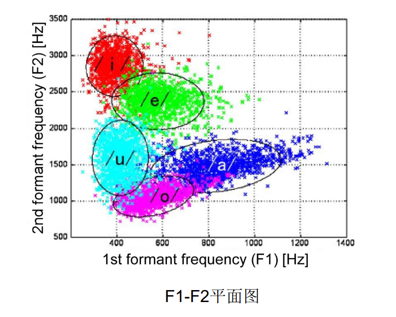
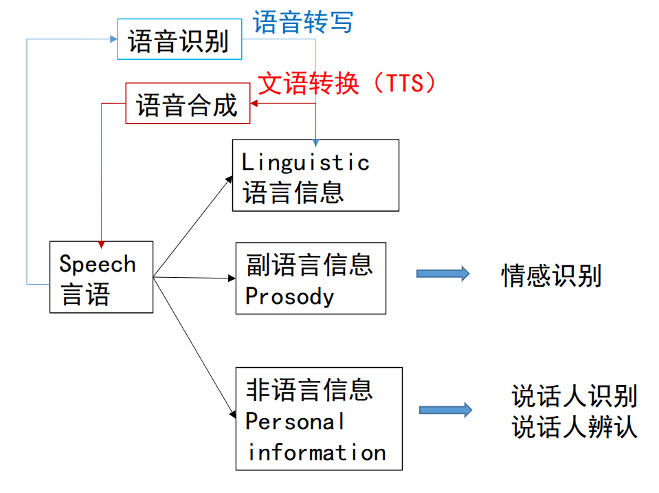

# 第一章 语音产生与感知机理
## 1.1 语音产生的机理
### 1.1.1 有声语言（语音）的形成（基本概念） 
#### 声音与语音
- 声音的定义：声音是振动产生的声波，是通过介质传播并能被人或动物听觉器官所感知的波动现象
- 语音的定义：**语音是声音的一种**，是人在言语交流过程中由发音器官产生和由听觉系统感知的**语言载体**。
- 语音信息处理的研究，长期以来一直是围绕着人的发音（产生）和听觉（感知）机理、以及相关的语言学概念展开的
- 注
	- 当我们考虑有声语言（Spoken language）的“语言信息”时， 用“言语”的称谓
	- 当把它作为物理信号进行处理时，称之为“语音”。 
	- 在不引起混淆的情况下，一般不做严格地区分。
#### 声音的产生、传播与感知
- 产生：振动，它引起介质（如空气等）粒子的简谐（正弦规律）运动，形成波动
	- 谐振频率现象是指一物理系统在特定频率和波长下，比其他频率和波长以更大的振幅做振动的情形。
	- 两端关闭或开放的声管、两端固定的弦的谐振频率 $$f_n=\frac{2nc}{4l}$$
	- 一端关闭另一端开放的声管或一段固定另一端自由的谐振频率$$f_n=\frac{(2n-1)c}{4l}$$
- 传播：空气分子的简谐振动，使周围的空气产生疏密变化，形成疏密相间的纵波，进行传播
- 感知：耳蜗将中耳传来的机械运动转为淋巴液的波动，所含频率在基底膜对应位置引起谐振将其分解并传入大脑进行感知。 语音感知过程会融入其他知识对声音进行综合判断。
### 1.1.2 语音的发音器官及其发音机理（基本概念） 
#### 语音的发音器官

- 发音器官：肺、气管、喉（包括声带）、咽、 鼻、口 。它们共同形成一条形状复杂的管道
- 声带：在喉部的从喉结到杓状软骨之间的韧带褶
- 声门：两个声带之间形成一个开闭自如的声门
- 声道：由咽腔、口腔和鼻腔三个空气腔体组成
#### 语音产生的原理图

人的发声过程
- 声门/声带产生不同频率的声音（准周期气流或白噪声）
- 声道对声源的调制作用

#### 声源（激励源）的产生
- 声源
	- 肺部产生气流，通过喉头时冲击声带，使声带产生振动
	- 能量：呼吸时肺部呼出的气流
- 声带
	- 阀门、振动部件
	- 呼吸时左右两声带打开（声门开）
	- 在说话的时候合拢，肺气流经气管形成冲击“打开-闭合-打开-闭合-…”声门，从而冲击声带产生振动，然后通 过声道响应变成语音
#### 声道调制
- 声道
	- 构成：咽腔、口腔和鼻腔，从声门延伸至口唇的非均匀截面的声管，约17cm（成年男性）
	- 功能
- 调音
#### 浊音、清音与爆破音
#### 语音的基本特性
- 振幅：波振动的大小，一般用dB表示（声压级的标准测量单位）
- 基音周期：声带开启-闭合一次的时间
- 基频：基音周期的倒数，声带振动的基本频率
- 音调
	- 声带振动的频率（即基音）决定了声音频率的高低，频 率快则音调高，否则音调低
	- 人的基音范围：80~500 HZ，儿童和青年女性偏高，成年男性偏低
### 1.1.3 发音运动及其范畴化（基本概念）
#### 发音运动指令的范畴化
- 发音运动指令的范畴化：一个相对独立的语音单元，即使其发音姿势在一定范围内变动，其声学特性应该稳定不变
#### 音素和音位
#### 元音和辅音
#### 元音的共振峰频率
- 共振峰=声道共振产生的波峰 （同时受声源特性的影响）
- 用**单端封闭管**中的驻波解释声道共振 $$f_n=\frac{(2n-1)c}{4l}$$
- 辅音**一般没有**共振峰，半元音（**发音姿势接近元音**的一类特殊辅音）可以被认为有共振峰
#### 元音：F1-F2图
- 在声学上，元音的特征主要取决于共振峰频率(F1和F2)。

#### 音节

## 1.2 语音感知的机理

### 1.2.1 听觉器官的构造及其功能（基本概念）
#### 1. 外耳（Outer Ear）
- **组成结构**：由 **耳廓（Pinna）** 和 **外耳道（External Ear Canal）** 组成。
- **主要功能**：起**集声**和**声波传导通路**的作用。外耳道一端开放，另一端由鼓膜封闭。
- **声学与谐振参数**：
    - **耳廓增益**：耳廓特殊的形状可使频谱峰压点在 **5.5 kHz** 的纯音获得 **10 dB** 的增益。
    - **外耳道谐振**：长约 **2.5 cm**（常温下音速约 350 m/s）。根据一端开放一端封闭的声管谐振公式 ($f_n = \frac{(2n-1)c}{4l}$)，其**初次谐振频率约在 3.5 kHz 附近**，**二次谐振频率可达 10 kHz 前后**。
#### 2. 中耳（Middle Ear）
- **位置与组成**：位于外耳与内耳之间，主要由**鼓膜**、**听骨链（锤骨、砧骨、镫骨）**、**中耳肌**和**咽鼓管**等结构组成。
- **信号转换与放大功能**：
    - **声学-机械转换**：将外耳道传入的空气振动转化为鼓膜及听骨链的**机械振动**。
    - **力学放大与传输**：鼓膜与听骨链组成力学系统，放大振动能量并经由镫骨传递至内耳的**前庭窗（卵圆窗）**。
- **滤波器特性**：听骨链对 **500 ~ 2000 Hz** 的声波产生较大谐振，起到**带通滤波器**的作用。
#### 3. 内耳（Inner Ear）
- **构造与双重功能**：位于耳朵最深处，最主要的结构是**骨迷路**，由**耳蜗（Cochlea）** 和 **前庭系统**构成，兼具**听觉**与**感受位置变化（平衡觉）** 的双重功能。
    - **前庭系统**：平衡觉的末梢器官。
    - **耳蜗（Cochlea）**：呈螺线形（约两周半），负责听觉功能，将机械振动转换为神经电信号。
- **耳蜗腔体结构**：由三个充满淋巴液的空间组成——**前庭阶**、**蜗管（中阶）**和**鼓阶**。
- **毛细胞（Hair Cells）分工与损伤影响**：
    - **内毛细胞**：将耳蜗内液体的声音振动转化为**电学信号**，经听神经传至听觉脑干及听觉皮层。
    - **外毛细胞**：机械放大传入耳蜗的低水平（弱）声音，对强度过大的声音进行**能动抑制**。
    - **损伤后果**：毛细胞损伤会导致听觉灵敏度下降，甚至引发感觉神经性耳聋。
#### 4. 耳蜗的声音分析与频域分解（基底膜）
- **行波传播**：声波引起的液体波动在**基底膜（Basilar Membrane）**上从耳蜗基部（约 35 mm 处）依次向蜗顶移动。
- **听觉滤波器组与频域分析**：
    - 基底膜上不同位置对应不同的固有谐振频率，将复合声音分解为不同频率成分，本质上相当于一组**带通滤波器（听觉滤波器组）**。
    - 在基底膜上，**高频方向的频率分辨率急速下降**。
    - 人的听觉范围（**20 ~ 20000 Hz**）受限于基底膜谐振频率的范围制约。
### 1.2.2 听觉感知机理与听觉特性
#### 响度
#### 音调的主观
#### 语音中语言、副语言和非语言信息的感知

## 1.3 语音产生与感知的相互作用
### 1.3.1 言语链（掌握）
#### 言语链

- 生成感知认知回路和言语交互理解回路在同一知识语境和语言语境下工作
- 言语链反映了说话人的**意图**如何以言语的形式**编码**并传递给听话人，以及如何在听话人的大脑中**解码、再现**说话人意图的全过程
- 
#### 言语链与人机语音交互（重点掌握）

# 第二章 语音信号处理的基础
## 2.1 语音信号的数字化和时频分析 
### 2.1.1 语音信号的数字化
#### 奈奎斯特频率（基本概念）
- **奈奎斯特频率**：离散信号系统采样频率的一半
- **奈奎斯特–香农采样定理**：对于一个给定的采样频率 $𝑓𝑠$，完全重构的频带限制为$𝐵 ≤ 𝑓𝑠/2$ 。也就是说，只要 离散系统的奈奎斯特频率高于被采样信号的最高频率或 带宽，就可以避免混叠现象（车轮明明是向前转的 但因为采样频率太低 拍出来看着像向后转一样）。
- **常用的采样频率：8k Hz, 16k Hz, 44.1k Hz**
- 哪种音频信号的采样频率为44.1k Hz？音乐CD的音频
- 为什么采用44.1k Hz？人的听觉范围: 20-20000 Hz
#### 语音信号预处理-分帧(Framing)（基本概念）
#### 语音信号预处理-加窗(Windowing)（基本概念）
- 目的：为了使时域信号更好地满足离散傅里叶变换的周 期性要求，减少泄漏
- 加窗后的语音信号：$$x'(n)=x(n)w(n)$$
- 常见的窗函数$w(n)$：汉明窗、汉宁窗、矩形窗
### 2.1.2 语音信号的时域分析（基本概念） 
#### 1. 基本概念
**时域分析**是指直接在**时间轴**上观察和分析语音波形信号随时间的变化规律（例如声音振幅的高低波动、波形的周期性变化等）。
好比**听一首完整的曲子**。你能直观感受到声音随时间忽大忽小、节拍强弱，但很难分辨出其中包含了哪几个具体音符组合。
#### 2. 主要分析指标与作用
由于语音信号是非平稳的，时域分析通常以 **20~25 ms 的短时帧**（加窗分帧）为单位进行计算：
- **短时平均能量（Short-Time Energy）**：
    - **概念**：计算某一时间窗内语音信号能量的总和。
    - **作用**：常用于**区分浊音与清音**（浊音能量大、清音能量小）、**语音端点检测**（判定有声段与无声段）、划分声母与韵母以及情感特征分类。
- **短时平均过零率（Short-Time Zero-Crossing Rate, ZCR）**：
    - **概念**：统计单位时间内语音波形穿过零电平（信号采样点符号发生改变）的次数。
    - **作用**：清音的高频成分多，其过零率显著高于浊音（清音平均频率约 4500 Hz，浊音约 1400 Hz）。结合短时能量，常用于精确进行**语音端点检测**和**清浊音判断**。
- **短时自相关函数（Short-Time Autocorrelation）**：
    - **概念**：用于测定信号自身在时域内的相似度与周期性。
    - **作用**：如果信号具有周期性，自相关函数会在周期整数倍处出现极大值峰值，因此主要用于**估计浊音的基频周期（基音周期 $F_0$）**和研究波形的同步性。
### 2.1.3 语音信号的频域分析（基本概念）
#### 1. 基本概念
**频域分析** 是指利用**离散傅里叶变换（DFT / FFT）**，把随时间变化的连续波形拆解为不同频率成分及其对应的振幅/能量分布（即**频谱**）。通过将连续的频谱向量按时间叠加，可以得到反映能量、频率与时间三维关系的**语谱图（Spectrogram）**。
好比**看曲子的五线谱**。它将混合声音拆解开，让你一眼看清当下包含了哪些音高（频率）以及各自的音量（能量）占比。
#### 2. 为什么必须进行频域分析？
- **符合人耳听觉机理**：人耳的生理听觉系统（耳蜗基底膜）本身就是一个天然的带通滤波器组，具有对声音进行频域分解与选择的功能。
- **大幅简化数学计算与建模**：在发音机理中，语音波形是声源与声道的**卷积**（$y(t) = x(t) * h(t)$）；而到了频域，时域中极复杂的卷积计算直接变成了简单的**乘积运算**（$Y(\omega) = X(\omega) \cdot H(\omega)$），非常便于后续分析与解耦。
#### 3. 主要作用与典型应用
- **倒谱分析与声源-声道解耦**：在频域对频谱取对数（$\log|X(k)| = \log|S(k)| + \log|H(k)|$）并做反傅里叶变换，即可在“类频率（Quefrency）”域通过倒滤波器（Lifter）将**声道包络（低阶系统特征）**与**声源细节（高阶基频特征）**彻底分离。
- **声学特征提取**：为**自动语音识别（ASR）**、**语音合成（TTS）** 及**声纹识别**提取关键特征向量（如**梅尔频率倒谱系数 MFCC**、线性预测编码 LPC 等）。
- **语谱图可视化**：通过**宽带语谱图**观察共振峰（$F_1, F_2$）随时间的变化，或通过**窄带语谱图**观察谐波结构与基频周期。
- **语音增强与去噪**：在频域应用**谱减法**或维纳滤波，直接从含噪语音的功率谱中扣除估计的背景噪声谱，恢复干净语音。
## 2.2 语音产生与感知的数学模型
### 2.2.1 语音产生的数学模型（基本概念）
## 2.3 基于语音产生机理的特征分析方法
## 2.4 基于语音感知机理的特征分析方法
