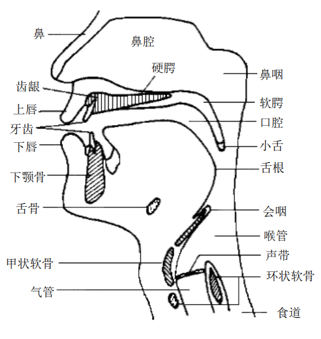
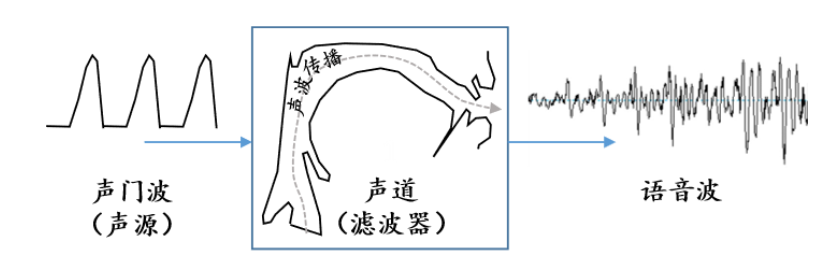
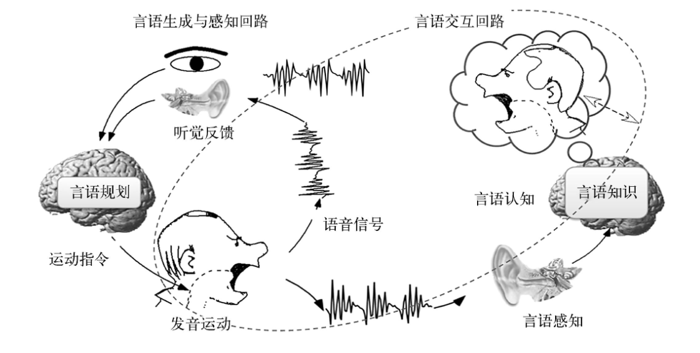
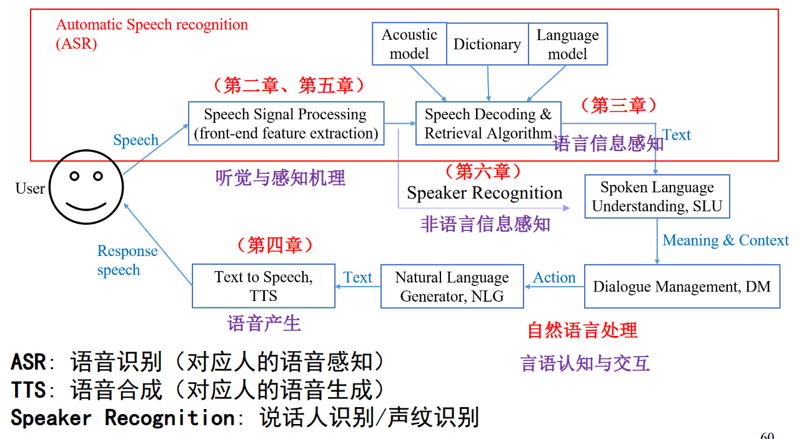

# 第一章 语音产生与感知机理
## 1.1 语音产生的机理
### 1.1.1 有声语言（语音）的形成（基本概念） 
#### 声音与语音
- 声音的定义：声音是振动产生的声波，是通过介质传播并能被人或动物听觉器官所感知的波动现象
- 语音的定义：**语音是声音的一种**，是人在言语交流过程中由发音器官产生和由听觉系统感知的**语言载体**。
- 语音信息处理的研究，长期以来一直是围绕着人的发音（产生）和听觉（感知）机理、以及相关的语言学概念展开的
- 注
	- 当我们考虑有声语言（Spoken language）的“语言信息”时， 用“言语”的称谓
	- 当把它作为物理信号进行处理时，称之为“语音”。 
	- 在不引起混淆的情况下，一般不做严格地区分。
#### 声音的产生、传播与感知
- 产生：振动，它引起介质（如空气等）粒子的简谐（正弦规律）运动，形成波动
	- 谐振频率现象是指一物理系统在特定频率和波长下，比其他频率和波长以更大的振幅做振动的情形。
	- 两端关闭或开放的声管、两端固定的弦的谐振频率 $$f_n=\frac{2nc}{4l}$$
	- 一端关闭另一端开放的声管或一段固定另一端自由的谐振频率$$f_n=\frac{(2n-1)c}{4l}$$
- 传播：空气分子的简谐振动，使周围的空气产生疏密变化，形成疏密相间的纵波，进行传播
- 感知：耳蜗将中耳传来的机械运动转为淋巴液的波动，所含频率在基底膜对应位置引起谐振将其分解并传入大脑进行感知。 语音感知过程会融入其他知识对声音进行综合判断。
### 1.1.2 语音的发音器官及其发音机理（基本概念） 
#### 语音的发音器官

- 发音器官：肺、气管、喉（包括声带）、咽、 鼻、口 。它们共同形成一条形状复杂的管道
- 声带：在喉部的从喉结到杓状软骨之间的韧带褶
- 声门：两个声带之间形成一个开闭自如的声门
- 声道：由咽腔、口腔和鼻腔三个空气腔体组成
#### 语音产生的原理图

人的发声过程
- 声门/声带产生不同频率的声音（准周期气流或白噪声）
- 声道对声源的调制作用

#### 声源（激励源）的产生
- 声源
	- 肺部产生气流，通过喉头时冲击声带，使声带产生振动
	- 能量：呼吸时肺部呼出的气流
- 声带
	- 阀门、振动部件
	- 呼吸时左右两声带打开（声门开）
	- 在说话的时候合拢，肺气流经气管形成冲击“打开-闭合-打开-闭合-…”声门，从而冲击声带产生振动，然后通 过声道响应变成语音
#### 声道调制
- 声道
	- 构成：咽腔、口腔和鼻腔，从声门延伸至口唇的非均匀截面的声管，约17cm（成年男性）
	- 功能
- 调音
#### 浊音、清音与爆破音
#### 语音的基本特性
- 振幅：波振动的大小，一般用dB表示（声压级的标准测量单位）
- 基音周期：声带开启-闭合一次的时间
- 基频：基音周期的倒数，声带振动的基本频率
- 音调
	- 声带振动的频率（即基音）决定了声音频率的高低，频 率快则音调高，否则音调低
	- 人的基音范围：80~500 HZ，儿童和青年女性偏高，成年男性偏低
### 1.1.3 发音运动及其范畴化（基本概念）
#### 发音运动指令的范畴化
- 发音运动指令的范畴化：一个相对独立的语音单元，即使其发音姿势在一定范围内变动，其声学特性应该稳定不变
#### 音素和音位

## 1.2 语音感知的机理
### 1.2.1 听觉器官的构造及其功能（基本概念）
## 1.3 语音产生与感知的相互作用
### 1.3.1 言语链（掌握）
#### 言语链

#### 言语链与人机语音交互（重点掌握）
