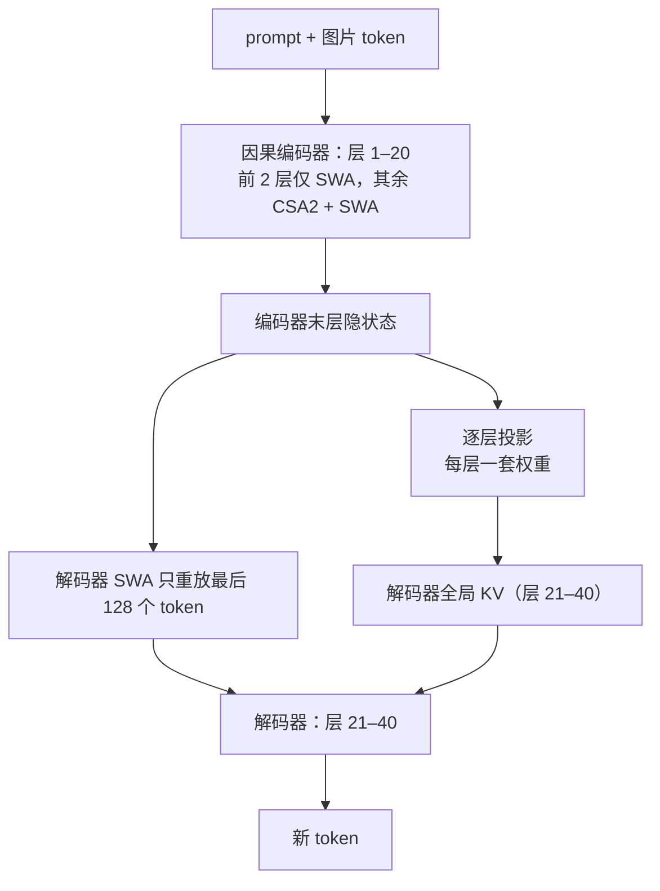

# DeepSeek-V4.1-Flash 的 Causal Encoder-Decoder 架构

> 来源：[DeepSeek V4.1 Flash 发布博客](https://www.deepseek.com/zh/news/deepseek-v4-1-flash/)；[技术报告 DeepSeek_V41_Tech_Report.pdf](https://huggingface.co/deepseek-ai/DeepSeek-V4.1-Flash/blob/main/DeepSeek_V41_Tech_Report.pdf) §2.1–2.2；[模型卡与 config.json](https://huggingface.co/deepseek-ai/DeepSeek-V4.1-Flash)。
>
> 补的是 [[第01章-LLM架构与优化方法|第 1 章]] §1.3.3 的空白：那一节的表格把编码器-解码器写成「现在较少使用」，而 2026 年的 DSV4.1-Flash 又把它请了回来——但理由和 T5 完全不同。

## 它是什么

DSV4.1-Flash 是 552B 主干参数的 MoE 多模态模型（另有 196B Engram 参数），支持 1M 上下文。40 层语言主干被切成 **20 层因果编码器 + 20 层解码器**，两者都在同一条左到右的链上，都是因果的。

- **prefill（读输入）**：每个 token 约激活 8B 参数。
- **decode（写输出）**：每个 token 约激活 16B 参数。

下面两条不是重点，但要知道它们同属一套压缩体系：CSA2 做跨层 KV / 索引复用与 FP4 主 KV（全局 KV 降到 890 字节/token），SWA 窗口 128 token。CED 解决的是**计算**（prefill FLOPs），CSA2 解决的是**存储**（KV 字节数）。

## 关键机制：全局 KV 由编码器末层投影而来

以 $L=40$ 记总层数。写 $H_l$ 为第 $l$ 层隐状态，编码器是 $l \le L/2$，解码器是 $l > L/2$。

对**全局注意力**，解码器第 $l$ 层的 KV 条目 $C_l$ 与压缩权重 $Z_l$ 不来自 $H_l$，而是来自编码器末层 $H_{L/2}$：

$$C_l = H_{L/2} W^{KV}_l, \qquad Z_l = H_{L/2} W^{Z}_l, \qquad l > \tfrac{L}{2}$$

即每层一套自己的投影权重，但输入是同一个 $H_{L/2}$。后果是：解码器那 20 层的全局 KV 缓存只需要 20 次便宜的矩阵乘就能得到，不必真的把每个 prompt token 推过 20 层注意力 + MoE。

对**滑动窗口注意力（SWA）**，CED 没有偷懒：任何一层的局部 K/V 仍然来自它自己的隐状态 $H_l$。报告把这称作「增加局部 KV 生成的计算深度」——也是它和 YoCo 一类「上层直接复用下层 KV」做法的差别所在。

## 代价：SWA 要重放

既然解码器的 SWA 不能靠投影，就必须有人把它算出来。精确做法要重放 $n_{win} \times L/2$ 个 token（$n_{win}=128$）。多轮短 prompt 场景下这并不便宜。

于是有 **SWA Bounded Replay**：只重放最近的 $n_{win}$ 个 token，做一个近似重建。报告称退化可忽略，并引用证据说 SWA 的实际有效感受野远小于理论上的 $n_{win} \times L/2$。这条是工程折中而不是数学等价，生产上「全局缓存命中」不等于零成本。

于是 prefill 复杂度：

$$O(NL) \longrightarrow O\big(N \cdot \tfrac{L}{2} + n_{win} \cdot \tfrac{L}{2}\big) \approx O\big(N \cdot \tfrac{L}{2}\big)$$

报告的说法是「接近砍掉一半 prefill 计算」；同时它自己的图 2 显示，上下文从 4K 拉到 1M（256 倍），单 token decode FLOPs 只涨约 1/4。

## 和 T5 / BART 的编码器-解码器不是一回事

| 维度 | T5 / BART | DSV4.1-Flash CED |
| :--- | :--- | :--- |
| 编码器方向 | 双向 | 因果，只能看更早的位置 |
| 编码器与解码器的连接 | 每个解码器层用交叉注意力去读编码器输出 | 全局 KV 由 $H_{L/2}$ 用逐层权重投影而来；报告没有描述独立的交叉注意力层 |
| 解码器读什么 | 编码器全序列的表示 | 一个共享的全局 KV 缓存 + 自己那几层的局部窗口 |
| 训练目标 | span corruption / denoising | 下一个 token 预测，和仅解码器模型一样 |
| 为什么分成两段 | 输入/输出结构不同（翻译、摘要） | 输入远大于输出：让读与写的计算代价不对称 |

两点值得盯住：

1. **因果编码器不是 BERT 编码器**。它保留了左到右结构，所以 prefix 缓存、流式、自回归生成都不需要改。所谓「编码」在这里的含义是「专门为 prompt 造一份表示」，不是「双向理解」。
2. **这不是把交叉注意力搬回来**，而是把「上层 KV 从哪来」这件事从层内计算改成了一次投影。层维度上的 KV 复用（CSA2 的 Full / Reindex / Reuse 三模式）用的是同一个思想的另一面。

## 放回 §1.3.3 的语境

§1.3.3 的解释是：仅解码器胜出，因为所有参数都参与生成、编码器在纯生成任务上浪费容量。CED 没有推翻这条，它换了一个前提：**在 agent 负载里，prompt（工具定义、仓库地图、截图、终端历史）比答案大一到两个数量级**。此时「花一半的层去读输入、把容量集中在写输出」不是浪费，而是把算力从便宜的那一侧挪到贵的那一侧。

顺带，§1.3.2 说的「交叉注意力在多模态模型里再次出现」在这里也成立，只是方向是视觉→语言：DeepSeek-ViT + 两层 MLP 投影器把图像变 embedding，插进图像 token 位置，和文本一起从预训练第一天就联合训练。

## 值得怀疑的地方

- 8B / 16B 是**激活参数量**，不是延迟，也不证明生成就是读取的两倍贵。真正的证据要看墙钟和吞吐。
- 它要求推理引擎实现 Encoder–Prefill–Decode 分离部署（视觉编码、prompt 处理、生成三条路径各自伸缩）。把旧 DeepSeek 架构改个名字的 OpenAI 兼容服务器跑不起来。
- 权重 475.25 GiB（48 个分片），加上 Engram 稀疏表要放主机内存并靠 RDMA 预取。自部署的门槛在显存与互联，不在公式里。

## 留给你自己想

1. 如果全局 KV 完全来自 $H_{L/2}$，那解码器那 20 层对**全局上下文**还能贡献什么新信息？它对**局部细节**的贡献又来自哪里？这个分工和你预期的「更深的层更会抽象」一致吗？
2. CED 把 prefill 减半、decode 不变。什么样的真实负载会因此受益最大，什么样的负载几乎受益为零？
